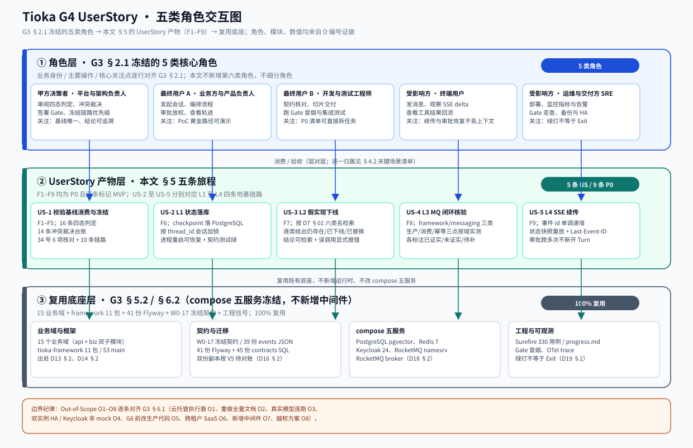
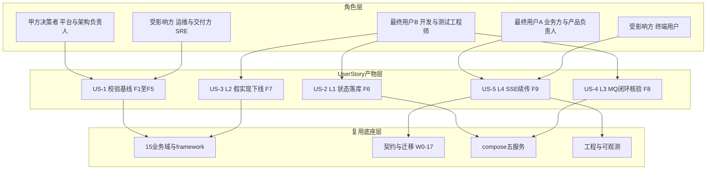
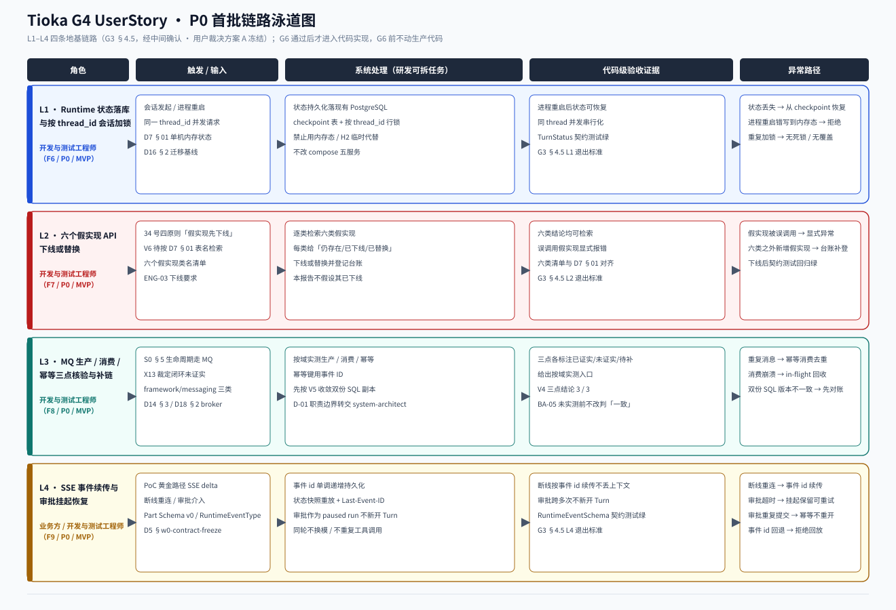
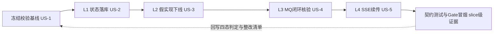

# Tioka 代码与设计一致性校验 · UserStory

> 本文档是 G4 阶段产物，定位为**产品需求与用户故事（UserStory）**。上游唯一边界基线是 G3 冻结的《高层架构设计》，资料证据来自 G1 冻结的 `material_digest.md`，行业证据来自 G2 冻结的 `research_report.md`；下游驱动《系统设计》《部署设计》《安全设计》与 G6 后首批链路实现。
>
> **本轮不是新产品需求文档**。用户 Phase 0 已确认「审计加规划，再分批实现，G6 通过后才进入代码实现」与「全仓分域全覆盖」四态判定基线；本文件把 G3 已冻结的一致性校验结论、链路优先级与首批 P0 范围，翻译成 G6 后研发可直接拆任务、可验收的故事与验收标准。G6 前不动任何生产代码或既有设计文档。
>
> **证据口径**：事实来自 D 编号（`D编号，§章节` 或 `D编号，路径#符号`）、X 编号冲突、V 编号待验证点、U 编号仓库外取证项；推断逐条标注局限；G2 加权打分为评估性建议而非授权（research §4.4），不引入任何标杆运行时或云托管执行依赖。
>
> **元信息**：版本 v1.0｜状态 Reviewing｜创建与更新日期 2026-11-08｜作者 product-story-designer（顾全景）｜评审 team-lead（G4 自动校验与 AskUserQuestion 人工审核）与用户。

---

## 1. 业务背景与价值

### 1.1 业务背景

- **行业与产品**：Tioka 是私有化交付的「企业级 Agent 套件」，自研 Runtime、Orchestration、Chat/KB/Flow、Connector、HCI、Foundation、Model Hub 与资产控制面（D1，§1 首段）。部署形态为本地 compose 五服务，隔离粒度为 Workspace，多租户不是硬需求（D3，§S0 1.1 至 1.2；D4，§ADR-015 页首；D5，§34 风险与待确认事项）。
- **产品规模**：Java 17 / Spring Boot 3.2.12 多模块（D13，§1）；15 个业务域、每域 api 与 biz 双子模块（D13，§2 与 §3）；883 个 main 与 258 个 test Java（D19，§5；X14 口径按实测修正为 main 主源）；41 份 Flyway 迁移与 45 份 contracts/db SQL 双份副本（D16，§2；X7 / V5）；Vue 3 前端 64 个 ts 与 63 个 vue（D17，§1 与 §2）；compose 五服务为 PostgreSQL pgvector、Redis 7、Keycloak 24、RocketMQ namesrv 与 broker（D18，§2）。
- **触发事件**：用户原始诉求（`material_digest.md` 第 45 行原文）：「现在这个项目已经有了一部分设计，我现在需要你们进行代码与设计的一致性校验。并且审查现有的代码以及设计，进行后续的链路规划与实现」。G1 登记 X1 至 X14 共 14 条冲突，代码是否逐域实现设计基线尚未逐项核对；Phase 0 用户选择「四态判定（一致 / 漂移 / 缺失 / 设计自身矛盾）全覆盖」与「审计加规划，再分批实现」。
- **本系统在产品矩阵中的位置**：本轮交付物是既有 Tioka 平台的**一致性校验与链路规划边界基线**，不是新业务系统、不改运行时拓扑、不新增中间件、不引入云托管执行面（G3 §1.1 / §4.2；O1 / O6 / O7）。
- **已冻结口径（只引用、不重新裁决）**：X1 以 `docs/architecture/implementation/34-M0至M4推进规划与工作项.md` 为唯一执行权威，README 与 31 号指向 33 号属文档漂移；X9 里程碑采用 34 号 G0 至 G4 与 GF，S0 §13 的 G1 至 G7 仅作能力门禁清单，两套标签不混用，完成度词表统一为 slice / fidelity / exit 三级，绿灯不等于 Exit（D5，§31 11）。X8 判「漂移」、X13 判「不成立（MQ 闭环未证实）」、X3 与 X4 判「文档漂移」，均为 G3 §4.4 已裁决结论。

### 1.2 行业方案

> 同类痛点的行业标杆与解决方案，取自 G2 冻结的 `research_report.md` 与 G3 §3.1；仅借鉴工程范式、事件契约与字段语义，不引入标杆运行时。

| 标杆 | 场景覆盖 | 对本轮的可借鉴点 | 边界约束 |
| --- | --- | --- | --- |
| B1 Dify | SSE 续传、workflow 人审暂停、Agent 工具循环 | 事件 id 单调递增、workflow_run_id 重连、状态快照重放、continue_on_pause（SR-01 至 03） | 只取事件契约；Python 栈引擎不引入 |
| B2 LangGraph | 状态机、审批挂起恢复、按会话加锁 | checkpointer、interrupt 与 resume、thread_id 作为持久游标、PostgresSaver（SR-04 至 07） | 状态落现有 PostgreSQL，不用 InMemorySaver |
| B3 OpenAI Responses API | agentic loop、conversation state、paused runs | previous_response_id 血缘语义、审批视为 paused run 而非新 turn（SR-08 至 11） | 闭源托管、数据出境，仅作语义对照 |
| B4 Amazon Bedrock Agents | 多步编排、会话历史、分步 trace | TracePart 字段命名对照（SR-12 / 13） | 云托管执行依赖已由 G2 否决、G3 §6.1 O1 永久排除 |
| B5 LiteLLM Gateway | 统一路由、配额、成本归集 | virtual key、四级限流、异步 spend logging（SR-25 / 26） | 排期属 P1 / L5，本轮 MVP 不纳入 |
| B6 Langfuse | 评测、trace 与成本 | gen_ai 字段语义、trace 转数据集（SR-24 / 27） | 需 ClickHouse / Redis / S3，O7 禁止首批引入 |

**消费纪律**：G3 §3.2 的加权总分（B1 4.85、B2 4.65、B5 4.55、B6 4.25、B3 3.35、B4 3.00）是 research-analyst 的评估性建议，research §4.4 明确「不构成对下游的已冻结输入」；本轮不得把打分当作采购或引入授权（R-06 / D-06）。B1 的事件续传四件套、B2 的 checkpoint 与 interrupt 语义、B3 的 paused run 语义，分别落入 US-5、US-2、US-5 的验收口径；三层产品形态与首批范围由 G3 冻结，本文件不重排。

### 1.3 方案收益与价值

| 项 | 说明 |
| --- | --- |
| 功能模块 | F1 至 F9 共 9 条 P0 功能全部标记 MVP（四态判定矩阵、冲突裁决台账、34 号状态核对、链路优先级清单、业务架构图与闭环、L1 至 L4 四条地基链路），逐条对齐 G3 §6.3；F10 至 F13 属完整版范围，不在本轮 US 展开 |
| 预期价值收益 | 把「文档自述状态」与「代码可核验状态」分离，使 G6 后首批实现的 4 条链路每条都能映射到 34 号工作项与代码域，研发可直接按 US 拆任务、按 Given / When / Then 验收，不因文档矛盾重复返工 |
| 量化标准 | 四态判定 16 / 16 条带 D 编号出处（V1）、14 条冲突裁决或转交 14 / 14（V2）、P0 链路映射 4 / 4（V3）、MQ 三点核验结论 3 / 3（V4）、完成度词表混用处 0（V5）、34 号 6 项状态核对 6 / 6（V6）；以上均为「证据齐备度」计数，不是对外性能 SLA 承诺，数值型性能目标见 §6.2 |

### 1.4 术语清单

> 统一专有名词中英文对照与含义，以 G3 §5.2、47-GL §3、ADR-015 冻结口径为准；与 `system-architect` 术语表在 G4 交叉对账时核对，本轮不改写其产出。

| 术语 | 英文 / 代号 | 含义 | 权威出处 |
| --- | --- | --- | --- |
| 权威隔离字段 | workspaceId | 数据隔离的唯一权威字段，隔离粒度为 Workspace | X11；D2，§47-GL 3；D4，§ADR-015 页首 |
| 历史遗留字段映射 | tenantId | 仅作为 47-GL §4 登记的 thirteen 项历史残留（TenantContext、RequestContextHolder 等）的说明，**禁止作为新建对象、API、数据描述的权威字段** | D2，§47-GL 4；D6，§00 6 第 11 项 |
| 平台管理员角色码 | system_admin | 取代 tenant_admin 的权威角色码 | D4，§ADR-015 页首；D2，§47-GL 3 |
| 四态判定 | consistent / drift / missing / design-self-conflict | 一致 / 漂移 / 缺失 / 设计自身矛盾，G3 §2.6 对 16 个校验对象的判定 | G3 §2.6；D1，§3 |
| 执行权威 | 34 号计划 | `docs/architecture/implementation/34-M0至M4推进规划与工作项.md`，X1 锁定 | D5，§34 头部；主理人 Phase 3 口径 |
| 里程碑标签 | G0 至 G4 与 GF | 34 号计划的分阶段里程碑，与能力门禁标签不混用（X9） | D5，§34 分阶段推进计划 |
| 能力门禁标签 | G1 至 G7 | S0 §13 的能力门禁清单，仅独立核对 | D3，§S0 13；X9 |
| 完成度词表 | slice / fidelity / exit | 31 §11 三级口径，绿灯不等于 Exit | D5，§31 11；D5，§w1-poc-gate-signoff |
| 范围边界 | In-Scope / Out-of-Scope | G3 §6.1 的 12 条必做与 8 条不做 | G3 §6.1 |
| 优先级 | P0 / P1 / P2 | 首批 MVP / 第二批工程基线 / 完整版或里程碑后段 | G3 §4.5 |
| 首批范围 | MVP | 经中间确认用户裁决「方案 A：最小地基集（推荐）」冻结为 L1 至 L4 | G3 §4.6；附录 C.7 |
| 链路编号 | L1 至 L10 | G3 §4.5 的 10 条后续链路及优先级 | G3 §4.5 |
| 功能编号 | F1 至 F13 | G3 §6.3 功能清单，P0 为 F1 至 F9 | G3 §6.3 |
| 冲突编号 | X1 至 X14 | G1 冻结的 14 条并列冲突与 G3 §4.4 裁决 | material_digest §3 |
| 资料编号 | D1 至 D19 | G1 双索引的文档族编号 | material_digest §1 |
| 待验证点 | V1 至 V7 | G1 §3.2 的仓库外或待对账验证点 | material_digest §3.2 |
| 取证项 | U-01 至 U-06 | G2 §5.2 待外部取证项 | research_report §5.2 |
| 会话标识 | thread_id | Runtime 状态的持久游标与会话加锁键 | SR-04；G3 §4.5 L1 |
| 状态快照 | checkpoint | 落 PostgreSQL 的可恢复状态记录，禁用内存态或 H2；本轮经用户裁决方案 A 不新建独立 checkpoint 表，该语义由既有 runtime_turn / runtime_item / runtime_approval 承载 | SR-04；G3 §4.3 演进纪律；G4 实证（V101 / V105 / V114 / V128） |
| 事件续传 | SSE / Last-Event-ID | 流式增量与断线重连锚点 | SR-01；SR-14；D17，§3 |
| 暂停运行 | paused run | 审批作为挂起而非新开 Turn | SR-09；G3 §6.4 |
| 异步骨干 | MQ / Outbox / 幂等 | 生命周期走 MQ，至少一次投递，消费者幂等 | D3，§S0 5；X13；SR-15 / 16 |
| 假实现 | Fake Implementation | D7 §01 登记的六个对外暴露为 API 的假实现 | D7，§01 代码质量、测试与过程；V6 |
| 契约冻结 | W0-17 | Part Schema v0、RuntimeEventType、各域 MqTopics 常量类、空 API 方法清单 | D5，§w0-contract-freeze |
| 底座 | compose 五服务 | PostgreSQL pgvector、Redis 7、Keycloak 24、RocketMQ namesrv 与 broker，冻结不新增 | D18，§2；O7 |

---

## 2. 范围与边界

### 2.1 系统内模块及功能

> 一级功能清单，逐条对齐 G3 §6.1 的 In-Scope 12 条；不新增、不裁剪、不扩展。

| 编号 | 一级模块 | 本期必做事项 | 对齐目标 | G3 出处 → 本文落点 |
| --- | --- | --- | --- | --- |
| S1 | 一致性校验 | 全仓分域四态判定矩阵，16 个业务架构域校验对象逐条带 D 编号出处 | V1 | G3 §6.1 S1 → §3.1 F1、§5 US-1 |
| S2 | 一致性校验 | 14 条 X 编号冲突逐条裁决或转交台账 | V2 | G3 §6.1 S2 → §3.1 F2、§5 US-1、附录 A.1 |
| S3 | 一致性校验 | 34 号计划工作状态 6 项逐项核对与仓库外取证转交清单 | V6 | G3 §6.1 S3 → §3.1 F3、§5 US-1、§6.5 |
| S4 | 链路规划 | 后续链路 P0 / P1 / P2 优先级清单与理由，10 条链路 | V3 | G3 §6.1 S4 → §3.1 F4、附录 A.2 |
| S5 | 链路规划 | 三层业务架构图、系统依赖架构、业务闭环图（含主链路与反馈回路） | V1 | G3 §6.1 S5 → §1.1、§4.1 图 1、§5 图 2 |
| S6 | 首批实现链路 | 首批 P0 链路 L1 至 L4 的业务边界、退出标准与映射（经中间确认方案 A 冻结） | V3 / V4 | G3 §6.1 S6 → §3.1 F6 至 F9、§5 US-2 至 US-5 |
| S7 | 冲突裁决 | X8 / X13 / X3 / X4 业务层明确裁决 | V2 | G3 §6.1 S7 → §1.1、附录 A.1 |
| S8 | 依赖处理 | G2 依赖 D-01 至 D-06 逐条处理结论或转交说明 | V2 | G3 §6.1 S8 → §5 US-4 §5.4.7、§6.5 |
| S9 | 模块标注 | 15 个业务域与 compose 五服务在依赖架构中的标注 | V1 | G3 §6.1 S9 → §1.4、§2.3 |
| S10 | 干系人 | 核心角色 5 类、痛点 8 条、期待目标 6 条与功能缺口 9 条 | V1 / V2 | G3 §6.1 S10 → §4.1、§4.2 |
| S11 | 功能清单 | 功能清单 P0 全部标记 MVP 与产品模块全景图 | V3 | G3 §6.1 S11 → §3.1 |
| S12 | 触点端 | 现有前端触点端页面清单与关键交互约束（Chat / FlowStudio / Approval / Observability 等） | V1 | G3 §6.1 S12 → §5 US-5 §5.5.3、§6.1 |

### 2.2 系统外模块及功能

> 当前系统不覆盖的功能及原因，逐条对齐 G3 §6.1 的 Out-of-Scope 8 条与 §6.3 的 P1 / P2 边界；本轮 US 不为其编写故事。

| 编号 | 不做的事 | 原因 | 后续计划 | G3 出处 → 本文落点 |
| --- | --- | --- | --- | --- |
| O1 | 云托管 Agent 执行面与外部执行器引入 | S0 §1.1 至 1.2 硬边界禁止把外部 harness 或云 AgentRun 当执行依赖，B4 已由 G2 否决 | 永久不做，仅借鉴事件契约与字段语义（经中间确认方案 A 冻结） | G3 §6.1 O1 → §1.2、§6.4.2 |
| O2 | 重做全量架构文档或另起一套架构体系 | 已有 S0 至 S15、40 至 48、ADR 完整体系，本轮只校验与规划 | 不做，只回写漂移点（P1 / L7） | G3 §6.1 O2 → §2.3 |
| O3 | 真实模型夜间 workflow 连跑 3 天 | 34 号 G1 判定条件，属仓库外运行时证据（V2 / U-01） | 主理人向用户或运维取证，G5 判定 | G3 §6.1 O3 → §6.5、§6.4.5 |
| O4 | 双实例 HA 与 Keycloak 非 mock 验收 | 首批范围外，依赖 U-02 取证与 R-04 风险约束，不并入自动化绿灯 | G5 部署与安全设计判定 | G3 §6.1 O4 → §6.4.1、§6.4.3、§6.5 |
| O5 | G6 通过前改动生产代码 | 用户 Phase 0 已确认「审计加规划，再分批实现」 | G6 后按 P0 清单分批实现 | G3 §6.1 O5 → 全文 Gate 纪律 |
| O6 | 跨租户 SaaS 与外购运行时 | S0 §2.3 明列三类非目标，34 号确认「多租户不是硬需求」 | 永久不做 | G3 §6.1 O6 → §1.1、§1.4 |
| O7 | 首个 MVP 引入 ClickHouse / S3 / 新增中间件或商业采购 | compose 五服务冻结、ADR-008 已定 RocketMQ 5.x | 只借鉴 OTel GenAI 字段语义，U-06 商务取证另行授权 | G3 §6.1 O7 → §1.2、§6.3 |
| O8 | 决定数据库表结构、资源规格、运行时拓扑、部署与安全最终方案 | 分别归 system-architect、platform-architect、security-architect | G4 / G5 各角色按本文边界展开 | G3 §6.1 O8 → §5.4.7、§6.4、§6.5 |

**P1 / P2 边界补充**：L5 模型网关配额与成本归集、L6 审计字段语义与 traceId 贯通、L7 X 类文档整改与模块树回写、L8 ArchUnit 与契约测试 CDC 属 P1；L9 三模块密度对齐、L10 双实例 HA / 真实模型连跑 3 天 / 全量 OTel trace / 审计哈希链属 P2 或首批 Out-of-Scope。以上在 §3.1 功能清单中标为完整版范围，本轮不展开 US，避免扩写已冻结范围。

### 2.3 外部依赖

> 提供方按 G3 §5.2 真实口径填写；**接口人一律未登记**，未登记项全部登记入 §6.5 待澄清项，不虚构姓名或联系方式。

| 依赖系统 | 提供方 | 依赖能力 | 接入方式 | 接口人 |
| --- | --- | --- | --- | --- |
| docs/architecture 设计基线（S0 至 S15、40 至 48、ADR、34 号） | 平台与架构负责人 | 设计基线、契约、Gate 定义 | 文件读取 / 路径定位，同步 | 未登记，待 U 系列仓库外取证 |
| 代码仓（framework / modules / server / ui） | 开发团队 | 模块树、关键类、配置与 SQL、前端页面 | 文件读取 / 路径定位，同步 | 未登记，待 U 系列仓库外取证 |
| G1 与 G2 冻结产物 | knowledge-ingest-engineer / research-analyst | 资料摘要、行业证据链 | 文件读取，同步 | 未登记，待 U 系列仓库外取证 |
| Keycloak 24（compose） | 运维与交付方 | OIDC 认证与单点登录 | OIDC / HTTPS，同步 | 未登记，待 U 系列仓库外取证 |
| 飞书开放平台与 IM | 外部系统 | 入站消息、卡片、文档同步 | HTTPS / 开放平台 API，异步 | 未登记，待 U 系列仓库外取证 |
| OpenAI 兼容 Provider | 外部模型供应商 | 模型调用与 SSE 流 | HTTPS / SSE，同步 | 未登记，待 U 系列仓库外取证 |
| PostgreSQL pgvector（compose） | 运维与交付方 | 状态持久化、checkpoint、outbox、行锁 claim | JDBC / MyBatis-Plus，同步 | 未登记，待 U 系列仓库外取证 |
| Redis 7（compose） | 运维与交付方 | 缓存与限流计数 | RESP，同步 | 未登记，待 U 系列仓库外取证 |
| RocketMQ namesrv 与 broker（compose） | 运维与交付方 | 异步生命周期事件 | MQ 生产 / 消费，异步 | 未登记，待 U 系列仓库外取证 |
| 契约与迁移（W0-17、45 SQL、39 events JSON、41 Flyway） | 平台与架构负责人 | 契约冻结、事件 Schema、迁移 | 文件 / Flyway，混合 | 未登记，待 U 系列仓库外取证 |
| Surefire 报告与 progress.md | CI 机器人 | 330 用例信号、292 工作项索引 | 自动生成，异步 | 未登记，待 U 系列仓库外取证 |
| 仓库外运行时证据（真实模型连跑、非 mock 与 HA 验收） | 用户或运维侧 | U-01 / U-02 / V2 / V7 取证结论 | 主理人协调取证，异步 | 未登记，待 U 系列仓库外取证 |

---

## 3. 功能清单

### 3.1 功能清单结构（建议字段）

> 全景骨架表，逐条对齐 G3 §6.3 的 F1 至 F13；**不得新增 G3 之外的功能项**。角色定义中提到的「高层架构 §5 功能清单」按 G3 冻结原文实为 §6.3，本文按 G3 原文 §6.3 互查。P0 与 MVP 一一对应，9 条 P0 全部标记 MVP，无 P0 落在完整版范围。

| 一级模块 | 二级模块 | 功能项 | 优先级 | MVP 范围 | 完整版范围 | 备注（G3 出处 → 本文落点） |
| --- | --- | --- | --- | --- | --- | --- |
| 一致性校验 | 四态判定矩阵 | 16 个业务架构域逐条判定并带 D 编号出处 | P0 | 标记 MVP | 标记纳入 | F1 → §5 US-1；G3 §6.3 F1 |
| 一致性校验 | 冲突裁决台账 | 14 条 X 编号逐条裁决或转交 | P0 | 标记 MVP | 标记纳入 | F2 → §5 US-1、附录 A.1；G3 §6.3 F2 |
| 一致性校验 | 34 号状态核对 | 6 项登记逐项结论加仓库外取证转交清单 | P0 | 标记 MVP | 标记纳入 | F3 → §5 US-1、§6.5；G3 §6.3 F3 |
| 链路规划 | P0 至 P2 清单 | 10 条链路的优先级、理由、映射与退出标准 | P0 | 标记 MVP | 标记纳入 | F4 → 附录 A.2；G3 §6.3 F4 |
| 链路规划 | 业务架构图与闭环 | 三层图、依赖架构、主链路与反馈回路 | P0 | 标记 MVP | 标记纳入 | F5 → §4.1 图 1、§5 图 2；G3 §6.3 F5 |
| 首批实现链路 | L1 状态落库 | 复用既有 runtime_turn / runtime_item / runtime_approval 落库态与按 thread_id 会话锁，增量外置 JVM 内存订阅态到 Redis Stream 并定义状态快照重放契约、固化 EventId 单调游标与 Last-Event-ID 幂等、与 L4 共用同一 Turn 状态机；不新建独立 checkpoint 表、不新增 Flyway 迁移（经中间确认 · 已冻结） | P0 | 标记 MVP | 标记纳入 | F6 → §5 US-2；G3 §6.3 F6 |
| 首批实现链路 | L2 假实现下线 | 六类假实现逐类给出结论并下线或替换 | P0 | 标记 MVP | 标记纳入 | F7 → §5 US-3；G3 §6.3 F7 |
| 首批实现链路 | L3 MQ 闭环核验 | 生产 / 消费 / 幂等三点结论与补链入口 | P0 | 标记 MVP | 标记纳入 | F8 → §5 US-4；G3 §6.3 F8 |
| 首批实现链路 | L4 SSE 续传 | 事件 id 单调递增加状态快照重放、审批不新开 Turn | P0 | 标记 MVP | 标记纳入 | F9 → §5 US-5；G3 §6.3 F9 |
| 工程基线 | X 类整改与模块树回写 | X8 / X3 / X4 / X1 / X7 整改与 publish 重生成 | P1 | 不标记 | 标记纳入 | F10 → §2.2、§6.5；本轮不展开 US |
| 模型与可观测 | 配额成本与字段贯通 | 异步记账、gen_ai 字段适配层、traceId 贯通 | P1 | 不标记 | 标记纳入 | F11 → §2.2；本轮不展开 US |
| 架构守护 | ArchUnit 与契约测试 | 分层 / 环检测进 CI、并行 schema 破坏性变更流程 | P1 | 不标记 | 标记纳入 | F12 → §6.4.4；本轮不展开 US |
| 完整版 | 三模块密度与 HA 验收 | 三域密度对齐、双实例 HA、真实模型连跑、哈希链 | P2 | 不标记 | 标记纳入 | F13 → §2.2 O3 / O4；本轮不展开 US |

**互查结论**：本表 13 行与 G3 §6.3 的 13 行在编号、一级模块、二级功能、优先级、MVP / 完整版标记上逐行一致；F1 至 F9 为 P0 且全部标记 MVP，P0 与 MVP 一一对应；未新增任何功能项，未改动任何优先级。

> **自检 1（§3 功能清单完成后，按公共协议 §2.1 判定并做 §2.3 反向验证）**：§2.1 判定「未命中」——条件 1 不成立（F1 至 F13 逐条继承 G3 §6.3 已冻结表，不存在两种可单方裁决的合理方案）；条件 2 成立（决定 §5 与 G6 拆任务范围），但需三条件全部成立；条件 3 不成立（上游 G3 已冻结功能清单与优先级，主理人转交口径明确「不得新增 G3 之外的功能项」）。§2.3 反向验证：Q1 返工成本 = §3.1 功能清单 13 行加附录 A.3 映射列，若被推翻按改表估 0.5 人日，占本阶段产物低于 30%，无供应商绑定、无数据迁移，可控；Q2 可感知方 = 无，功能清单是 G6 后拆任务口径，G6 前不动生产代码（用户 Phase 0 已确认），不改变用户可见功能、交互路径、SLA 条款或审计要求；Q3 与原始诉求一致性 = 用户诉求原文「……进行后续的链路规划与实现」，F1 至 F13 全部服务于一致性校验与链路规划，未改变产品形态与对外承诺，一致。本点不发起中间确认；P0 范围（方案 A）已由 G3 用户裁决冻结，按协议 §6 不重复发起。完整证据见附录 B.1。

---

## 4. 角色与场景

### 4.1 角色清单

> 5 类核心角色逐行对齐 G3 §2.1 的 5 行（甲方决策者 1、最终用户 2、受影响方 2），业务身份、主要操作、核心关注点不得空缺；不细分、不新增第 6 类角色。

| 角色 | 业务身份 | 主要操作 | 核心关注点 |
| --- | --- | --- | --- |
| 甲方决策者：平台与架构负责人 | Tioka 平台 owner、架构评审人 | 审阅四态判定与冲突裁决、签署 Gate、冻结链路优先级 | 校验基线唯一、结论可追溯，不因文档矛盾重复返工 |
| 最终用户 A：业务方与产品负责人 | 使用 Chat / FlowStudio / Approval 的业务与产品人员 | 发起会话、编排流程、审批放权、查看轨迹 | 首批实现链路是否覆盖可演示的 PoC 黄金路径 |
| 最终用户 B：开发与测试工程师 | 按 G4 系统设计与 UserStory 实现首批链路 | 契约核对、切片交付、跑 Gate 冒烟与集成测试 | 范围边界明确，P0 清单可直接拆任务，不含歧义口径 |
| 受影响方：终端用户 | 通过 Chat 与 IM 触达系统的企业员工 | 发消息、观察 SSE delta、查看工具结果回流 | 链路可用性与审批恢复不丢上下文 |
| 受影响方：运维与交付方 / SRE（含合规与审计相关方关注点承接） | 私有化交付、compose 五服务运维 | 部署、监控指标与告警、Gate 走查、备份与 HA | 完成度口径可信，绿灯不等于 Exit，验收证据完整 |

**角色基线措辞对齐说明**：主理人转交口径把受影响方第 2 类记为「合规或审计相关方」，G3 §2.1 冻结原文记为「运维与交付方 / SRE」，并以「以 G3 原文为准」为准绳。本文按 G3 原文保留 5 类，不新增第 6 类角色；合规与审计相关方的关注点（审计证据完整性、准入合规、验收记录）由第 5 类角色与甲方决策者共同承接，登记入 §6.5 待澄清项供 G4 人工审核确认，避免绕开 G3 重定义角色范围。

> **图 1 · 五类角色交互图**（角色层到 UserStory 产物层到复用底座层；由本角色直接调用 diagrams-generator 生成，零依赖 SVG 矢量图，已通过 XML 合法性校验）
>
> 
>
> 源码：`pic/userstory-roles/userstory-roles.py`；矢量图：`pic/userstory-roles/userstory-roles.svg`。

**4.1 架构理解**：这是按 G3 §2.1 冻结的五类角色绘制的分层消费关系图，不是新系统的角色设计图。角色层是甲方决策者、最终用户 A / B、终端用户、运维与交付方 / SRE；产物层是本文 §5 的 US-1 至 US-5（对应 F1 至 F9）；底座层是 15 业务域、tioka-framework、契约与迁移、compose 五服务、工程与可观测。图中显式标注 O1 至 O8 边界纪律。

**4.2 组件清单**：角色层 5 类；产物层 5 条 US（US-1 覆盖 F1 至 F5，US-2 至 US-5 覆盖 F6 至 F9）；底座层 4 组（业务域与框架 / 契约与迁移 / compose 五服务 / 工程与可观测）。

**4.3 连接关系**：角色层到产物层为「消费 / 验收」的层对层关系，逐一归属见 §4.2 关键场景清单；产物层到底座层为「复用既有底座」关系，不新增运行时、不改 compose 五服务；底座层回写四态判定与整改清单构成一致性守护回路（G3 §5.3）。

**4.4 Mermaid 预览**：

**4.5 工具选项表**（diagrams-generator Phase 1 强制项；场景识别为角色关系图 / 流程泳道图）：

| 方案 | 工具 | 速度 | 质量 | 输出格式 | 说明 |
| --- | --- | --- | --- | --- | --- |
| A | Mermaid 内嵌 | 快 | 3 星 | Markdown 内嵌 | 零依赖、可随文档逐字注入下游 |
| B | Python 标准库零依赖 SVG | 快 | 4 星 | SVG 矢量 | 无第三方库，输出可缩放矢量图与可复现源码 |
| C | diagrams 加 graphviz | 快 | 4 星 | PNG / SVG | 云图标丰富，但本环境缺 graphviz 二进制与 Python 库 |

**推荐与锁定说明**：方案 A 加方案 B 组合。G3 §5.1 已由主理人在编排层锁定该工具组合并实际产出两张 SVG；本轮转交口径明确「可由本角色直接调用 diagrams-generator 生成角色交互图 / 泳道图」，属协议 §6「上游已明确选择」与「禁止把用户原始诉求已经明确的事项包装成中间确认」范围，故不就工具选择另行发起中间确认。已产出 2 张 SVG 与 2 份可复现 `.py` 源码，均以 `xml.dom.minidom` 解析通过。

### 4.2 关键场景清单

> 频率列按「事件触发」口径填写，不自造日均 / QPS 数值，理由见 §6.2；两套 Gate 标签不混用（X9）。

| 编号 | 角色 | 触发条件 | 期望结果 | 频率（事件触发口径） |
| --- | --- | --- | --- | --- |
| SC-1 | 甲方决策者：平台与架构负责人 | G3 边界冻结后需签署 Gate、冻结链路优先级 | 16 条四态判定、14 条冲突裁决、34 号 6 项核对可逐条追溯，P0 为 L1 至 L4 | 按 34 号 G0 至 G4 与 GF 里程碑批次触发 |
| SC-2 | 最终用户 B：开发与测试工程师 | G6 通过后领取 L1 任务 | 按 thread_id 会话加锁、状态落 PostgreSQL，进程重启可恢复 | 每次进程重启或会话并发时触发 |
| SC-3 | 最终用户 B：开发与测试工程师 | G6 通过后领取 L2 任务 | 六类假实现逐类给出仍存在 / 已下线 / 已替换结论并可检索 | 每次假实现台账核对时触发 |
| SC-4 | 最终用户 B：开发与测试工程师 | G6 通过后领取 L3 任务 | 生产 / 消费 / 幂等三点各标注已证实 / 未证实 / 待补 | 每次按域实测与契约回归时触发 |
| SC-5 | 最终用户 A：业务方与产品负责人 | 走 PoC 黄金路径并发起会话 | SSE delta 增量渲染，断线按 Last-Event-ID 续传不重复执行工具 | 每次会话与断线重连时触发 |
| SC-6 | 最终用户 A：业务方与产品负责人 | 工具调用触发人工审批 | 审批作为 paused run，跨多次介入不新开 Turn，可在 Trajectory 回放 | 每次审批介入、超时或重复提交时触发 |
| SC-7 | 受影响方：终端用户 | Chat 或 IM 触达、观察工具结果回流 | 续传与审批恢复不丢上下文，轨迹可审计 | 每次消息与工具结果回流时触发 |
| SC-8 | 受影响方：运维与交付方 / SRE | Gate 冒烟、progress.md 刷新、MQ 积压与 claim in-flight 告警 | 完成度只显示 slice / fidelity / exit 三级，绿灯不等于 Exit | 每日巡检与每周 PoC 走查触发 |

> **自检 2（§4 角色与场景清单完成后，按公共协议 §2.1 判定并做 §2.3 反向验证）**：§2.1 判定「未命中」——条件 1 不成立（5 类角色逐行继承 G3 §2.1，角色细分方案被主理人「须对齐这 5 类、不得绕开 G3 重定义角色范围」明确排除，无两种可裁决方案）；条件 3 不成立（上游已冻结角色基线）。§2.3 反向验证：Q1 返工成本 = §4.1 角色表 5 行、§4.2 场景表 8 行、§5 各 US 的视角行共 3 处，按改表估 0.5 人日，无源码改动、无供应商绑定，可控；Q2 可感知方 = 无，角色与场景是内部拆任务口径，G6 前不动生产代码，5 类角色与 G3 完全一致，不改变用户可见功能与对外承诺；Q3 一致性 = 用户诉求原文「代码与设计的一致性校验……审查现有的代码以及设计」，角色清单是审查结论的干系人映射，未改变产品形态，一致。角色基线措辞差异（转交口径「合规或审计相关方」与 G3 原文「运维与交付方 / SRE」）已按「以 G3 原文为准」处理并登记 §6.5，属措辞对齐而非方案分歧，不发起中间确认。完整证据见附录 B.2。

---

## 5. 用户旅程（UserStory）

> 每条 US 严格按七段式展开：业务场景 / 业务流程 / UE 原型 / 业务逻辑 / 数据描述 / 验收标准 AC / 外部集成接口；七个小节均不为空。验收标准统一使用 `Given / When / Then` 单行格式，且每条 US 同时含正常路径与异常路径。US-1 覆盖 F1 至 F5（一致性校验与链路规划类 P0），US-2 至 US-5 分别对应 L1 至 L4 四条 P0 地基链路（F6 至 F9）；P1 / P2 的 F10 至 F13 不在本轮展开。

> **图 2 · P0 首批链路泳道图**（四条泳道分别对应 L1 至 L4，每泳道贯穿角色、触发、系统处理、代码级验收证据、异常路径；由本角色直接调用 diagrams-generator 生成，零依赖 SVG 矢量图，已通过 XML 合法性校验）
>
> 
>
> 源码：`pic/userstory-swimlane/userstory-swimlane.py`；矢量图：`pic/userstory-swimlane/userstory-swimlane.svg`。

### 5.1 US-1：审阅四态判定与冲突裁决、冻结一致性校验基线

#### 5.1.1 业务场景

- **视角**：甲方决策者（平台与架构负责人），协同最终用户 B 与运维与交付方 / SRE。
- **When / Where**：G3 边界冻结后、G6 首批实现开工前，在 `docs/architecture` 唯一权威源与 G1 / G2 / G3 冻结产物构成的设计基线上，走完一次「审阅四态判定与冲突裁决、签署 Gate、冻结链路优先级」的完整任务，使 G6 后研发拿到的范围不含歧义口径。

#### 5.1.2 业务流程

- Given 已加载 G3 §2.6 的 16 条四态判定、G3 §4.4 的 X8 / X13 / X3 / X4 裁决与 34 号计划工作状态登记，When 甲方决策者按 D 编号逐条回溯证据并核对两套 Gate 标签，Then 得到可逐条追溯的校验基线与冻结的 P0 清单。
- Given 基线中出现 README 或 31 号指向 33 号的指针，When 执行权威核对，Then 按 X1 以 34 号为唯一执行权威，把 33 号指针登记为文档漂移整改项而不重裁。
- Given progress.md 显示 330 用例全绿，When 走查完成度口径，Then 按 31 §11 保守记为 slice，不宣称 W1 至 W5 Exit 或 G1 至 G7 已过。

#### 5.1.3 UE 原型

- 复用现有 Observability 与 admin 页面（`D17，§3 目录结构`）；四态判定矩阵与冲突裁决台账以只读清单呈现，16 行逐行带 D 编号出处列、四态列、裁决或转交列。
- Gate 状态看板按 34 号 G0 至 G4 与 GF、S0 §13 G1 至 G7 分列两个区域展示，两套标签不混用；完成度展示只有 slice / fidelity / exit 三档，禁用「工程就绪 / 真 PoC Exit / 可卖 Exit」等对外词（D5，§31 11）。
- 本轮不新增页面、不修改前端源码，原型位置为 `tioka-ui/src/views/` 下现有页面（G3 §6.5）。

#### 5.1.4 业务逻辑

1. 系统以 `docs/architecture` 为唯一权威源读取设计基线；feishu-docs/Tioka 手工镜像不参与校验基线（X3 / X4，G3 §4.4）。
2. 逐条计算四态判定：一致 6 条、漂移 5 条、缺失 1 条、设计自身矛盾 4 条，合计 16 条（G3 §2.6）。
3. 对 14 条 X 编号冲突逐条给出裁决或转交；X1 / X9 只引用主理人锁定口径不重裁。
4. 34 号 6 项工作状态逐项给出「一致 / 待外部取证 / 转交」结论（G3 §2.7），真实模型连跑与演示走查转交主理人取证（V2 / U-01）。
5. 冻结链路优先级 L1 至 L10 与 P0 首批范围（经中间确认用户裁决方案 A：最小地基集），输出 F1 至 F13 功能清单供 §3.1 消费。

#### 5.1.5 数据描述

- 输入：G1 的 D1 至 D19 双索引与 X1 至 X14 冲突（`material_digest.md` §1 / §3）、V1 至 V7 待验证点（§3.2）、G2 的 B1 至 B6 与 D-01 至 D-06、G3 的 §2.6 / §4.4 / §4.5 / §6.1 / §6.3。
- 输出：四态判定矩阵（16 行带 D 编号出处）、冲突裁决台账（14 行）、34 号状态核对表（6 行）、链路优先级清单（10 行）、功能清单（13 行）、仓库外取证转交清单。
- 数据隔离：所有新建清单与台账以 `workspaceId` 为权威隔离字段；`tenantId` 仅作为 47-GL §4 历史遗留字段映射说明，不写入新对象（X11 / D2，§47-GL 3）。
- 依据 V5（41 份 db/migration 与 45 份 contracts/db SQL 是否同版本）与 V6（六个假实现是否仍存在）登记为待对账项，不作已证实结论。

#### 5.1.6 验收标准 AC

- AC-1（正常路径）：Given 已加载 G3 §2.6 判定表与 D 编号双索引，When 检索 16 条四态判定，Then 16 条逐条可检索且每条带 `D编号，§章节` 或 `D编号，路径#符号` 出处，四态汇总为一致 6 / 漂移 5 / 缺失 1 / 设计自身矛盾 4。
- AC-2（正常路径）：Given 已加载 14 条 X 编号冲突登记，When 打开冲突裁决台账，Then 14 条逐条存在裁决或转交结论，X1 与 X9 标注为「引用主理人锁定口径，不重裁」，裁决率 14 / 14。
- AC-3（正常路径）：Given 34 号 6 项工作状态登记，When 执行状态核对，Then 6 项逐项给出一致 / 待外部取证 / 转交结论，真实模型连跑 3 天与演示走查标注为 U-01 转交而非「已通过」。
- AC-4（正常路径 · 优先级冻结）：Given G3 §4.5 的 L1 至 L10 清单，When 核对 P0 标记与 MVP 范围，Then P0 恰为 L1 至 L4 四条且 F1 至 F9 全部标记 MVP，P0 落在完整版范围的条目数为 0。
- AC-5（异常路径 · 权威指针冲突）：Given 基线同时存在指 33 号与指 34 号的指针，When 执行权威核对，Then 以 34 号为唯一执行权威且不重新裁决 X1，33 号指针登记入 P1 / L7 整改清单。
- AC-6（异常路径 · Gate 标签混用）：Given 一份材料同时出现 34 号 G0 至 G4 与 S0 §13 G1 至 G7，When 渲染 Gate 看板，Then 两套标签分列且混用处计数为 0，不出现「绿灯即 Exit」的对外表述。
- AC-7（异常路径 · 镜像漂移）：Given feishu-docs/Tioka 镜像行数与本地不一致，When 做一致性判定，Then 判定全部以 docs/architecture 为准，镜像不参与基线，X3 / X4 结论为「文档漂移」。

#### 5.1.7 外部集成接口

- `docs/architecture` 设计基线（文件读取，同步）：权威源唯一；publish-feishu-docs.mjs 与 gen-progress.mjs 为唯一合法生成通道（D2，§README 1；D10，§feishu-doc-sync 9）。
- 34 号 G1 判定所需的真实模型连跑 3 天与 `ops/m1-closure-walkthrough.md` 走查结论：属仓库外证据，转交主理人向用户或运维取证（V2 / U-01）；接口人未登记，待 U 系列仓库外取证。
- Surefire 报告与 progress.md（自动生成，异步）：仅作索引，绿灯不等于 Exit（D19，§3 与 §4）。
- 不依赖任何云托管执行面或外部 harness（O1 / S0 §1.1 至 1.2）；本 US 不决定表结构、资源规格或部署安全方案（O8）。

### 5.2 US-2：L1 Runtime 状态落库与按 thread_id 会话加锁

#### 5.2.1 业务场景

- **视角**：最终用户 B（开发与测试工程师），受影响方为终端用户。
- **When / Where**：G6 通过后首批实现期，在既有 runtime 域与已落库的 runtime_* 状态内核（V101 建表、V105 删 parts_json、V114 加 recover_count 与 WAITING_APPROVAL 索引、V128 更名 thread）之上，按用户裁决方案 A 复用补链：不新建独立 checkpoint 表、不新增 Flyway 迁移，增量把仍为 JVM 内存 Map 的订阅态与读位置外置到 Redis Stream、定义状态快照重放契约、固化 EventId 单调游标与 Last-Event-ID 幂等、与 L4 共用同一 Turn 状态机，走完一次「会话推进、进程重启、按同一 thread_id 跨进程续跑」的完整任务（G4 实证对 design-notes/01 归档快照的时差纠正，属设计基线漂移，由主理人在 G6 合稿统一入台账）。

#### 5.2.2 业务流程

- Given 既有 runtime_turn / runtime_item / runtime_approval 落库态与 ThreadEventsService.open 四步重放已落地，When 进程重启后按同一 thread_id 发起续跑，Then 从既有落库态与订阅态快照恢复到重启前 Turn 状态且不新开 Turn、不丢失工具结果回流（本轮增量为订阅态外置后跨进程可重放）。
- Given 同一 thread_id 的两个并发请求，When 二者同时进入 Runtime，Then 既有 `runtime_thread ... FOR UPDATE` 行锁与 `rt:lock:{threadId}` 会话锁把二者串行化，不出现状态覆盖或交错写（会话锁已落地，本轮不重建）。
- Given 用户继续执行多步工具循环，When 每个 super-step 结束，Then 既有 runtime_item 追加写保持，且本轮固化 EventId 单调游标与 Last-Event-ID 幂等，使订阅态读位置可读、携 Last-Event-ID 断线重连不丢不重（D5，§34 RT-02 验收口径）。

#### 5.2.3 UE 原型

- 复用 Chat 页面（`D17，§3 目录结构`）与 `tioka-ui/src/items/ItemRenderer.vue` 的 Part 渲染体系；断线或重启后前端按同一 thread_id 重连，界面表现为同一条会话继续增量渲染，不新开会话卡片。
- 运维侧复用 Observability 看板展示 checkpoint 写入与会话锁等待，不新增页面；核心路径步数控制在 PoC 黄金路径 6 步内（G3 §6.4）。

#### 5.2.4 业务逻辑

1. **已落地能力**：Runtime 状态按 thread_id 定位，V101 已建 runtime_turn / runtime_item / runtime_approval 落 PostgreSQL，权威状态不以内存态、H2 承载。**本轮增量**：不新建独立 checkpoint 表、不新增 Flyway 迁移，仅把进程内订阅态与读位置（StreamPump.subs / readPositions、MemoryItemSink.streaming、SignalBus.local）外置到 Redis Stream，定义状态快照重放契约；Redis 承载事件流与订阅态，权威状态仍以 runtime_* 表为准（B2 / SR-04；G3 §4.3 演进纪律；G4 实证 · 用户裁决方案 A）。
2. 按 thread_id 施加行级锁或唯一约束实现会话串行化；既有 `runtime_thread ... FOR UPDATE` 与 `rt:lock:{threadId}` 已落地，本轮不重建会话锁，与 34 号 RT-01「Redis 锁 + fencing token」工作项口径的对齐结论归 `system-architect` 在 G4 系统设计中定案，本 US 不越权决定（O8 / D-01 转交边界）。
3. 进程重启后由既有 runtime_* 落库态与 ThreadEventsService.open 四步重放恢复 Turn 状态机（TurnStatus 契约，D11，§contracts/README M0 契约清单）；本轮增量使订阅态亦可跨进程重放；恢复失败必须显式报错，禁止静默新建空 Turn。
4. 状态写入与业务实体在同一事务边界内，为 L3 的 outbox 预留一致性衔接点（D-01 / SR-15）。
5. 复用 15 业务域与 framework，不改 compose 五服务、不新增中间件（O7）。

#### 5.2.5 数据描述

- 输入：`thread_id`、TurnStatus 状态转换表、ItemType、RuntimeEventType（D11，§contracts/README M0 契约清单）、Part Schema v0（D5，§w0-contract-freeze）。
- 核心流转（已落地 + 本轮增量）：会话事件 → Runtime 状态机 → 既有 runtime_turn / runtime_item 落库态（追加写已落地）→ 本轮把订阅态与读位置外置到 Redis Stream → 状态快照重放契约 → SSE 增量回流；进程重启时由既有落库态与四步重放恢复，权威状态不经过内存态，EventId 单调游标与 Last-Event-ID 幂等贯穿事件流。
- 存储证据：41 份 Flyway 迁移与 V1__baseline.sql（D16，§2）；方案 A 下 L1 零新增迁移，复用 V101 至 V128 既有 runtime_* 表，不新建独立 checkpoint 表；V5 双份 SQL 副本收敛作为 P1 / L7 独立整改项登记，不构成本 US 的前置动作（R-05 / U-05）。
- 隔离字段：本 US 不新建 checkpoint 对象；既有 runtime_* 表与新增订阅态快照契约一律以 `workspaceId` 为权威隔离字段，禁用 `tenantId`（X11 / 47-GL §3；D6，§00 6 第 11 项）。
- 现状依据（G4 实证对 G3 归档快照的时差纠正）：`V101__m0_runtime_kernel.sql` 已建 runtime_turn / runtime_item / runtime_approval，`V105` 删 parts_json（`V104` Java 回填），`V114` 加 recover_count 与 WAITING_APPROVAL 索引，`V128` 更名 thread；`RuntimeTurnMapper.xml:54` 有 `SELECT 1 FROM runtime_thread WHERE id = #{threadId} FOR UPDATE`；`RedisThreadLock.java:15` 用 `rt:lock:{threadId}` 做 setIfAbsent + TTL 续期；`ThreadEventsService.java:79` 有 `listAfterSeq(threadId, afterSeq, 500)` 四步重放。真实缺口为进程内订阅态与读位置仍是 JVM 内存 Map（StreamPump.subs / readPositions、MemoryItemSink.streaming、SignalBus.local），及 Redis Stream 有 TTL 导致长时断线丢事件窗口。该结论属 G3 §4.4 X13「按域实测归 G4」授权下的实证更新，构成设计基线漂移，由主理人在 G6 合稿统一纳入冲突裁决台账，本 US 不回写 G3。

#### 5.2.6 验收标准 AC

- AC-1（正常路径 · 状态恢复与订阅态跨进程可重放）：Given 既有 runtime_* 落库态已写入且订阅态已外置到 Redis Stream，When 进程重启或在另一进程按同一 thread_id 续跑，Then 从既有落库态恢复到重启前 Turn 状态、订阅态经状态快照重放契约跨进程可重放、Turn 编号不回退、与 L4 共用同一 Turn 状态机使审批跨多次交互不新开 Turn、TurnStatusContractTest 契约测试绿。
- AC-2（正常路径 · 会话串行化）：Given 同一 thread_id 有两个并发请求，When 二者同时进入 Runtime，Then 既有会话锁把二者串行化且最终状态等于按序执行的结果，无状态覆盖、无死锁、无交错写（会话锁已落地，本轮不重建）。
- AC-3（正常路径 · 事件游标单调与断线续传）：Given 长会话连续多轮且既有 runtime_item 追加写已落地，When 每轮产生 SSE 事件并携 Last-Event-ID 断线重连，Then EventId 严格单调递增且无跳号、重连后不丢不重、runtime_turn 与 runtime_item 表可按轮检索、追加写而非整块覆盖（D5，§34 RT-02）。
- AC-4（异常路径 · 状态丢失）：Given 既有 runtime_* 落库态写入失败或订阅态快照被清空，When 会话继续推进，Then 拒绝静默以空状态新建 Turn，返回可检索错误码并保留事件轨迹，不产生幻觉输出。
- AC-5（异常路径 · 持久化介质错用）：Given 代码尝试把权威 Turn 状态写入 JVM 内存 Map、H2 或以 Redis 充当唯一持久化，When 契约测试或 Gate 冒烟执行，Then 该路径被断言拒绝，且不以「功能可用」作为验收结论；订阅态与事件流快照外置到 Redis Stream 属方案 A 合规增量，不在本断言拒绝范围。
- AC-6（异常路径 · 零新增迁移守卫）：Given 方案 A 冻结不新增迁移，When 执行 L1 补链实现，Then 不产生新增 Flyway 迁移脚本、复用既有 runtime_* 表；V5 收敛按 P1 / L7 单独登记，不阻塞 L1 交付。

#### 5.2.7 外部集成接口

- PostgreSQL pgvector（compose，JDBC / MyBatis-Plus，同步）：状态持久化与行锁 claim，41 份 Flyway 迁移为基线（D18，§2；D16，§2）；接口人未登记，待 U 系列仓库外取证。
- Redis 7（compose，RESP，同步）：仅作缓存与限流计数，明确不作为状态持久化（G3 §5.2）；接口人未登记。
- 34 号 RT-01「按会话加锁」工作项：本 US 只继承「同 thread 并发串行化」的退出标准，不继承其 Redis 锁机制；机制归属 system-architect（D-01）。
- 不引入 B2 LangGraph 运行时或其 Python / JavaScript SDK；只借鉴 checkpointer 与 thread_id 语义（S0 §1.1 至 1.2；O1）。

### 5.3 US-3：L2 六个假实现 API 下线或替换

#### 5.3.1 业务场景

- **视角**：最终用户 B（开发与测试工程师），协同甲方决策者做 Gate 走查。
- **When / Where**：G6 通过后首批实现期，按 34 号四原则「假实现先下线」，对 D7 §01 登记的六个对外暴露为 API 的假实现逐类检索、给结论并下线或替换，走完一次「可检索、可回归、误调用可fail-fast」的完整任务。

#### 5.3.2 业务流程

- Given 已取得 D7 §01 的六个假实现类名清单，When 按类名在 15 业务域中逐类检索，Then 每类给出「仍存在 / 已下线 / 已替换」结论并登记台账。
- Given 某类判定为仍存在，When 执行下线或替换，Then 该 API 不再返回伪数据，调用方改为显式未实现错误或真实实现。
- Given 契约回归与 Gate 冒烟执行，When 任一假实现被误调用，Then fail-fast 并留下可检索错误码，不静默降级。

#### 5.3.3 UE 原型

- 复用 Observability 与 Approval 页面展示「假实现台账」六行状态；前端不新增页面、不改源码（G3 §6.5）。
- M3 与 orch 与 rules 与 connect 与 im 与 ops 占位页保持占位，Placeholder 对应未完成链路的关系转交 G4 前端域按页核对（V4 / A6）。

#### 5.3.4 业务逻辑

1. 以 D7，§01 代码质量、测试与过程登记的六类为检索基线：GraphRagService、CodeInterpreterService、AutomationJobService、ChatDensityService.fork、SubAgentPolicy、DifficultyRouter。结论以 `system-architect` 附录 A 第 1 项 G4 全库实测为准：GraphRagService、CodeInterpreterService、AutomationJobService、SubAgentPolicy、DifficultyRouter 在 `*.java / *.xml / *.ts / *.vue` 全库零命中，判「已下线」；ChatDensityService 为真实记忆服务（remember / recall，无 fork），判「已替换」；另发现 KernelRuntimeService.fork 与 OrchController.claimRemoved 两处显式 NotImplemented 预留，判 RESERVED 非假实现、不纳入 L2 六类台账（V6 / U-03 / G3 §4.5 L2）。
2. 逐类检索 main 源与 api 暴露面，记录文件路径与符号（`D编号，路径#符号` 形式），以实证结果固定三态结论，不再登记为「尚未对账」。
3. 下线或替换后，以 W0-17 冻结契约与空 API 方法清单做回归，破坏性变更须并行 schema（D5，§w0-contract-freeze）。
4. 六类之外若发现新增假实现，登记台账并交主理人裁决，不擅自扩大首批范围。
5. 与 L1 的状态落库解耦：本 US 只处理假实现暴露面，不改 Runtime 状态机。

#### 5.3.5 数据描述

- 输入：D7，§01 六类名清单、34 号摘要四原则（D5，§34 摘要）、ENG-03 下线要求、progress.md 工作项索引（仅作索引，D5，§progress 34 号计划工作项）。
- 输出：六行假实现台账（类名、路径、结论、处置动作、回归用例编号），可逐类检索；结论词表固定为「仍存在 / 已下线 / 已替换」。
- 现状依据：`system-architect` 附录 A 第 1 项 G4 实测已给结论，GraphRagService、CodeInterpreterService、AutomationJobService、SubAgentPolicy、DifficultyRouter 在 `*.java / *.xml / *.ts / *.vue` 全库零命中判「已下线」，ChatDensityService 为真实记忆服务（remember / recall，无 fork）判「已替换」，KernelRuntimeService.fork 与 OrchController.claimRemoved 两处显式 NotImplemented 预留判 RESERVED、不纳入 L2 六类台账；D5，§34 2 当前进度记 M1 全部 28 后端项与 9 前端项由 PR 24 合入仅作工作项索引，不再作为「归档快照与现状未对账」的推断前提。
- 隔离字段：台账与新建替换实现以 `workspaceId` 为权威隔离字段，禁用 `tenantId`（X11）。

#### 5.3.6 验收标准 AC

- AC-1（正常路径 · 逐类结论）：Given 已取得六类假实现清单，When 执行逐类检索，Then 六类各存在一条「仍存在 / 已下线 / 已替换」结论且附 `D编号，路径#符号` 定位，可检索条目数为 6 / 6。
- AC-2（正常路径 · 处置可回归）：Given 某类判定为仍存在并执行下线或替换，When 跑契约测试与 Gate 冒烟，Then 该 API 不再返回伪数据且对应回归用例为绿，台账与代码状态一致。
- AC-3（异常路径 · 假实现被误调用）：Given 某假实现已标记下线但存在遗留调用方，When 该调用路径被执行，Then 返回显式未实现错误码并 fail-fast，禁止静默返回伪数据或空结果。
- AC-4（异常路径 · 六类之外新增）：Given 检索发现第七类未登记假实现，When 生成台账，Then 登记为「待裁决」并交主理人，不擅自纳入首批 P0，也不从清单中隐去。
- AC-5（异常路径 · 破坏性契约变更）：Given 替换动作需要改动已冻结 API 契约，When 提交 PR，Then 按 W0-17 走新版本字段或并行 schema，未通过冻结点不得合并 Runtime 业务实现 PR。
- AC-6（异常路径 · 完成度误读）：Given progress.md 显示 330 用例全绿，When 判定 L2 是否完成，Then 只按六类台账与回归证据给结论，不以自动化绿灯替代 Exit 或对外宣称「已下线」。

#### 5.3.7 外部集成接口

- 代码仓 15 业务域与 framework（文件读取 / 路径定位，同步）：逐类检索入口（D15，§1；D14，§2）；接口人未登记，待 U 系列仓库外取证。
- W0-17 契约冻结与空 API 方法清单（文件，同步）：破坏性变更纪律（D5，§w0-contract-freeze）；接口人未登记。
- 34 号工作状态与假实现类名取证（V6 / U-03）：归档快照与现状对账结论由主理人协调取证；接口人未登记，待 U 系列仓库外取证。
- 不引入任何标杆运行时替换假实现（O1 / B4 已否决）；真实模型端点属 U-01 且 O3 出首批范围。

### 5.4 US-4：L3 MQ 生产 / 消费 / 幂等三点核验与补链

#### 5.4.1 业务场景

- **视角**：最终用户 B（开发与测试工程师），协同运维与交付方 / SRE 观察积压与 claim in-flight。
- **When / Where**：G6 通过后首批实现期，针对 S0 §5「生命周期走 MQ」与 X13「闭环未证实」，对生产、消费、幂等三点按域实测并给出核验结论与补链入口，走完一次「底座就绪不等于闭环」的证伪或证实任务。

#### 5.4.2 业务流程

- Given framework/messaging 三类与 compose broker 已就位，When 按域实测生产、消费、幂等三点，Then 每点标注「已证实 / 未证实 / 待补」并附按域实测入口。
- Given 某点未证实，When 生成补链工作项，Then 只补齐该点而不宣称 S0 §5 生命周期闭环已达成、不把 BA-05 从「缺失」改判为「一致」。
- Given 出现重复消息，When 幂等消费者处理，Then 以事件 ID 为幂等键去重，不产生重复副作用。

#### 5.4.3 UE 原型

- 复用 Observability 看板展示 MQ 积压、消费速率与 claim in-flight 计数；三点核验结论以三行清单呈现，不新增页面（D17，§3；G3 §6.5）。
- 完成度展示只出现 slice / fidelity / exit 三级；Gate 标签按 X9 两套分列。

#### 5.4.4 业务逻辑

1. 底座盘点：`EventPublisher` / `DomainEvent` / `IdempotentConsumer`（D14，路径#messaging）与 rocketmq-namesrv / rocketmq-broker（D18，§2）只证明底座就绪。
2. 三点核验：生产侧是否有真实投递与 outbox 写入；消费侧是否有真实订阅与业务处理；幂等侧是否以事件 ID 去重（SR-15 / SR-16 / SR-16b）。
3. 行锁 claim 与 in-flight 崩溃清理范式（SR-17 / SR-18）对应 34 号 orch_timer 扫描派发与 claim API；Outbox、幂等消费、SKIP LOCKED claim 的职责边界按 D-01 转交 `system-architect`，本 US 不越权定案。
4. G4 实证：`V130__m2_outbox.sql` 已建 sys_outbox / sys_consumed / sys_dead_letter 三表，`OutboxEventPublisher` / `OutboxRelay` / `RocketMqMessageTransport` / `RocketMqConsumerBootstrap`（MessageListenerOrderly）/ `IdempotentDeliveryService` 均真实存在，MQ 生产 / 消费 / 幂等三点已证实（X13 运行时闭环定性仍按 G3 冻结不改判）。L3 复用 V130 既有三表、不新增 outbox 迁移；增量是三点核验结论与契约测试补链，不是建表；V5 双份 SQL 副本收敛按 P1 / L7 单独登记，不构成本 US 的前置动作（R-05 / U-05）。
5. X13 已裁决「不成立（闭环未证实）」；未实测前不新增依赖 MQ 的业务能力承诺，BA-05 保持「缺失」。

#### 5.4.5 数据描述

- 输入：S0 §5 生命周期口径（D3，§S0 5）、X13 冲突登记（material_digest §3）、framework/messaging 三类（D14，§3）、compose broker（D18，§2）、mq-envelope-v1 与 39 份 events JSON Schema（D11，§contracts/db 与 events）。
- 输出：三点核验表（生产 / 消费 / 幂等 × 已证实 / 未证实 / 待补）、按域实测入口清单、补链工作项与幂等键口径（事件 ID）。
- 依据 V4（45-FE 页面规格与 Placeholder 对应未完成链路）与 V7（330 用例绿灯是否覆盖非 mock 与双实例）登记为待澄清，不作为闭环已证实证据。
- 隔离字段：新建 outbox 或 receipt 对象以 `workspaceId` 为权威隔离字段，禁用 `tenantId`（X11 / 47-GL §3）。

#### 5.4.6 验收标准 AC

- AC-1（正常路径 · 三点结论齐备）：Given 已完成按域实测，When 打开三点核验表，Then 生产 / 消费 / 幂等三点各存在一条「已证实 / 未证实 / 待补」结论并附按域实测入口，结论覆盖 3 / 3（V4 的 G3 §2.3 口径）。
- AC-2（正常路径 · 底座与闭环分离）：Given framework/messaging 三类与 broker 均存在，When 判定 X13，Then 结论仍为「闭环未证实」，BA-05 四态保持「缺失」，不因底座就绪改判「一致」。
- AC-3（异常路径 · 重复消息）：Given 同一事件 ID 的消息被投递两次，When 消费者处理，Then 以事件 ID 幂等去重且不产生重复副作用，PROCESSED_MESSAGES 语义可由契约测试断言（SR-16）。
- AC-4（异常路径 · 消费崩溃）：Given 消费者在业务处理成功、ack 前崩溃，When 消息重投，Then 幂等键拦截重复执行且 in-flight 记录被清理者回收，不出现状态错乱（SR-18）。
- AC-5（异常路径 · 零新增 outbox 迁移守卫）：Given `V130__m2_outbox.sql` 已建 sys_outbox / sys_consumed / sys_dead_letter 三表且 41 份 db/migration 与 45 份 contracts/db SQL 双份副本版本不一致，When 执行 L3 三点核验补链，Then 复用 V130 既有三表并给出三点核验与契约测试补链结论、不产生新增 outbox 或 receipt 迁移，V5 逐份对账收敛按 P1 / L7 单独登记且不阻塞 L3 交付。
- AC-6（异常路径 · broker 不可用）：Given namesrv 或 broker 不可达，When 触发生命周期事件，Then 记录可检索失败证据并保留补链入口，禁止以绿灯或桩替代真实闭环结论。

#### 5.4.7 外部集成接口

- RocketMQ 5.x namesrv 与 broker（compose，MQ 生产 / 消费，异步）：ADR-008 已冻结，至少一次投递、消费者须幂等（D4，§ADR-008；D18，§2）；接口人未登记，待 U 系列仓库外取证。
- PostgreSQL pgvector（JDBC，同步）：outbox 与 claim 行锁，双份 SQL 收敛前置（D16，§2；V5）；接口人未登记。
- D-01 / D-05 / D-06 依赖处理结论：Outbox、幂等消费、SKIP LOCKED claim 的职责边界与落地顺序转交 `system-architect` 与 G4 / G6，接口人未登记，待 U 系列仓库外取证。
- 不引入 Kafka Adapter 之外的任何新增中间件，不改 compose 五服务（O7）；不把 G2 打分或 B6 的 ClickHouse / S3 作为执行依赖。

### 5.5 US-5：L4 SSE 事件续传与审批挂起恢复

#### 5.5.1 业务场景

- **视角**：最终用户 A（业务方与产品负责人）与最终用户 B（开发与测试工程师），受影响方为终端用户。
- **When / Where**：G6 通过后首批实现期，在 40-BA §5.1 的 PoC 黄金路径上（登录、Provider 与 RoutingPlan、Agent 发布与 MCP Grant、会话发消息观察 SSE delta、工具结果回流、审批挂起与恢复），走完一次「断线重连续传、审批跨多次介入不新开 Turn、轨迹可回放」的完整任务。

#### 5.5.2 业务流程

- Given 会话正在推送 SSE delta 且事件 id 单调递增，When 客户端断线后携 Last-Event-ID 重连，Then 从断点重放状态快照并继续增量渲染，不重复执行已完成的工具调用。
- Given 工具调用触发人工审批，When 审批挂起并在 Approval 台批准或驳回后续跑，Then 同一条流作为 paused run 继续，不新开 Turn，且可在 Trajectory 回放形成证据包。
- Given 审批超时或被重复提交，When 系统处理，Then 保留挂起态可重试且重复提交幂等，不产生第二条运行流。

#### 5.5.3 UE 原型

- 复用 Chat（SSE 增量渲染、按 Last-Event-ID 续传）、Approval（待办筛选、一键批准或驳回、挂起后续跑）、Trajectory（事件时间轴回放、按 traceId 检索、证据包查看）三个现有页面（D17，§3；G3 §6.4 / §6.5）。
- 关键交互约束：SSE 断线重连不得因重连重复执行工具调用；审批作为 paused run 而非新 Turn；PoC 黄金路径 6 步内可走通，不新增中间确认页面；审批每次续跑必须能在 Trajectory 回放（ADR-075）。
- 本轮不新增页面、不修改前端源码；原型位置为 `tioka-ui/src/views/` 与 `tioka-ui/src/items/ItemRenderer.vue`。

#### 5.5.4 业务逻辑

1. 事件契约对齐 Part Schema v0、PartType 十八类与 RuntimeEventType（D5，§w0-contract-freeze）；事件 id 单调递增且持久化，与 checkpoint 状态快照配对（B1 / SR-01 / SR-14）。
2. 断线重连以 Last-Event-ID 或等价 workflow_run_id 锚点重开事件流，先重放已完成节点状态再续推（B1 include_state_snapshot 语义）。
3. 审批作为 interrupt / paused run，跨多次人工介入保持同一条流（B1 continue_on_pause；B3 paused run；B2 interrupt 与 resume）；同轮不换模、已发布 Version 拒改等门禁沿用 depth-p0-checklist（D5，§depth-p0-checklist 门禁）。
4. 审批续跑与 Trajectory 联动，形成可审计证据包（ADR-075）；traceId 贯通属 P1 / L6，本轮只保证事件 id 与轨迹可检索，不越权承诺全量 OTel trace。
5. 状态持久化复用既有 runtime_* 落库态，不新增表；按方案 A 与 L1 共用同一 Turn 状态机，权威状态不用内存态；不改 compose 五服务。

#### 5.5.5 数据描述

- 输入：Part Schema v0、RuntimeEventType、Runtime SSE 事件 Schema（D11，§contracts/README M0 契约清单）、w0-contract-freeze 冻结内容（D5，§w0-contract-freeze）、40-BA §5.1 黄金路径（D2，§40-BA 5.1）。
- 核心流转：会话消息 → SSE 事件流（id 单调递增）→ 状态快照 → 断线重连重放 → 工具结果回流 → 审批挂起 paused run → 续跑 → Trajectory 事件时间线与证据包。
- 现状依据：V3（30 张 drawio 图形内容与设计文字是否一致）与 V4（45-FE 页面规格与 Placeholder 对应未完成链路）作为「图形与页面待按页核对」的引用出处；V6（假实现是否仍存在）与 D7，§01 的 SSE / 单机内存状态登记共同构成 L4 的现状基线。
- 隔离字段：事件流、快照与审批记录以 `workspaceId` 为权威隔离字段，禁用 `tenantId`（X11 / 47-GL §3）。

#### 5.5.6 验收标准 AC

- AC-1（正常路径 · 事件 id 单调）：Given 会话持续推送 SSE delta，When 按序接收事件，Then 事件 id 严格单调递增且持久化，RuntimeEventSchemaContractTest 契约测试绿。
- AC-2（正常路径 · 状态快照重放）：Given 客户端在第 N 个事件后断线，When 携 Last-Event-ID 重连，Then 从第 N 加 1 个事件继续且先重放已完成节点状态，不重复执行已完成的工具调用。
- AC-3（正常路径 · 审批不新开 Turn）：Given 工具调用触发审批并跨多次人工介入，When 每次批准或驳回后续跑，Then 全程保持同一 thread_id 与同一 Turn，不新开 Turn，且每次续跑可在 Trajectory 回放。
- AC-4（异常路径 · 断线重连）：Given 网络闪断或 SSE 连接被代理切断，When 客户端自动重连，Then 按事件 id 续传不丢上下文，界面不出现重复 delta 或重复工具结果回流。
- AC-5（异常路径 · 审批超时或重复提交）：Given 审批挂起后超时或被重复提交，When 系统处理，Then 挂起态保留可重试、重复提交幂等，不产生第二条运行流、不重复扣减配额。
- AC-6（异常路径 · 事件 id 回退或状态快照缺失）：Given 重放时检测到事件 id 回退或快照缺失，When 执行续传，Then 拒绝回放并返回可检索错误码，不以空状态静默新建 Turn；该路径被契约测试断言覆盖。
- AC-7（异常路径 · 假实现被误调用）：Given 黄金路径某节点仍绑定 L2 已下线的假实现，When 该节点被执行，Then fail-fast 并留下可检索错误码，不把伪数据作为 SSE delta 推送给终端用户。

#### 5.5.7 外部集成接口

- OpenAI 兼容 Provider（HTTPS / SSE，同步）：默认 `model.mock=true`，真实端点属 U-01 且 O3 出首批范围；不得作为云托管执行依赖（D1，§21；D16，§3；S0 §1.1 至 1.2）；接口人未登记，待 U 系列仓库外取证。
- MCP over HTTP 与飞书开放平台 / IM（HTTPS，异步）：工具结果回流与卡片；knowledge-biz 经 KnowledgeSyncApi 委托 FeishuDocSyncApi，不直连飞书 SDK（D10，§feishu-doc-sync 1 至 2）；接口人未登记。
- Keycloak 24（OIDC / HTTPS，同步）：登录与单点登录由既有底座承接，非 mock 验收属 O4 Out-of-Scope（D18，§2；U-02）；接口人未登记。
- 不引入 B1 Dify 引擎、B3 OpenAI 托管服务或 B4 Bedrock 执行面；只借鉴事件续传四件套与 paused run 语义（O1 / O6）。

> **自检 3（§5 全部 US 七段式完成后，按公共协议 §2.1 判定并做 §2.3 反向验证）**：§2.1 判定「未命中」——条件 1 不成立（US 拆分粒度由主理人「对每条 P0 链路至少给出一条 US」与 G3 §4.5 的 L1 至 L4 独立链路共同锁定，US-1 覆盖 F1 至 F5、US-2 至 US-5 覆盖 F6 至 F9，无跨角色跨场景的拆分取舍）；条件 3 不成立（上游已明确拆分口径）。§2.3 反向验证：Q1 返工成本 = §5 的 5 条 US 共 35 个七段式小节、图 2 与 Mermaid 预览、附录 A.2 映射列，若拆分被推翻按改写估 1 人日，均为文档与矢量图、无源码改动、无供应商绑定，可控；Q2 可感知方 = 无，US 是 G6 后研发拆任务与验收口径，G6 前不动生产代码（用户 Phase 0 已确认），5 条 US 全部落在已冻结 F1 至 F9 内，未新增或裁剪 In-Scope / Out-of-Scope 条目，不改变用户可见功能、交互路径、SLA 条款或审计要求；Q3 一致性 = 用户诉求原文「……进行后续的链路规划与实现」，US 把 L1 至 L4 翻译成可拆任务、可验收的故事，未改变产品形态与对外承诺，一致。AC 严格度专项：全部 AC 为可验证的代码级或证据级结果，未设定错误率上限、超时阈值等数值型 SLA（见 §6.2），故不命中 §2.2 对外承诺类。本点不发起中间确认。完整证据见附录 B.3。

---

## 6. 非功能性需求

> 本章只回收 G3、material_digest 与 research_report 已冻结的约束，不新增安全或部署策略；最终方案归 G5 security-architect 与 platform-architect（O8）。

### 6.1 易用性需求

- **操作便利性**：复用现有 Chat / FlowStudio / Approval / Trajectory / Observability 页面，不新增页面、不新增中间确认页面；PoC 黄金路径 6 步内可走通（G3 §6.4；D17，§3）。
- **UI 一致性**：沿用 Vue 3 / Pinia / Element Plus / Vite 与 `ItemRenderer.vue` 的 Part 渲染体系及 13 种 Item 组件（D17，§1 与 §3；D2，§45-FE 5）；完成度展示统一为 slice / fidelity / exit 三级。
- **引导提示**：Gate 标签按 34 号 G0 至 G4 与 GF、S0 §13 G1 至 G7 分列，两套不混用（X9）；禁用「工程就绪 / 真 PoC Exit / 可卖 Exit」等对外词（D5，§31 11）。
- **错误反馈**：沿用 ErrorCode 与 HTTP 状态映射、RestExceptionAdvice（D14，§2；D11，§contracts/README M0 契约清单；D16，§1）；状态丢失、假实现误调用、重复消息、断线重连、审批超时均要求可检索错误码而非静默降级。
- **无障碍支持**：G3 与 material_digest 未登记无障碍等级基线，本轮不设等级、不自造标准，登记入 §6.5 待澄清项，由 G4 人工审核决定是否需补齐。

### 6.2 性能响应需求

> 本节按主理人预先给定的合规处理执行：先检索 `34 号计划`、`S0`、`47-GL`、`docs/contracts` 是否已有明确性能基线，再决定取值，**禁止编造任何数值目标**。

**检索结果（实证）**：

| 检索源 | 是否检出数值型性能基线 | 逐字引用与出处 |
| --- | --- | --- |
| 34 号计划 | 检出 1 处工作项验收口径与 1 处风险标注 | 「100 并发会话互不阻塞」（`D5，§34 十层目标拆解 · RT-01 验收列`）；「100 并发会话目标吃紧」（`D5，§34 风险与待确认事项表`，对应「Java 17 无虚拟线程，大量长连接 SSE 和阻塞式模型调用占线程」） |
| S0 体系总览与边界 | 未检出 | 无 P50 / P90 / P99、QPS / TPS、并发用户数、数据规模上限的系统级基线（D3，§S0 1.1 至 1.2 与 §S0 13） |
| 47-GL 统一名词释义 | 未检出 | 该文件为术语映射与遗留登记，无性能数值（D2，§47-GL 3 与 §4） |
| docs/contracts | 未检出 | 契约目录为 M0 / M1 / M2 契约清单、db 与 events 文件，无接口时延或吞吐基线（D11，§contracts/README） |

**取值结论**：34 号 RT-01 的「100 并发会话互不阻塞」是 M0 里程碑单工作项在「Redis 锁 + fencing token」机制下的验收口径，且其自身风险表已标注「目标吃紧」并给出异步 SSE / 单线程 Redis 多路复用的缓解方向；G3 §4.5 L1 已把机制收敛为「checkpoint 落 PostgreSQL、按 thread_id 会话加锁」，退出标准为非数值型的「进程重启后状态可恢复，同 thread 并发串行化，契约测试绿」。因此该数值不构成 UserStory 层的系统级 SLA 基线，本轮**不继承、不折算、不升级**为对外承诺，仅以上表逐字引用留痕；是否将其转为 L1 并发验收基线属待人工裁决项（§6.5 / 回传待确认项）。

**本轮口径（逐字）**：本轮不设数值型性能目标，避免形成 SLA 隐性承诺；性能验收口径为：以 G6 后首批链路的契约测试与 Gate 冒烟结果作为 slice 级证据，数值基线待 U 系列仓库外取证后回填。P50 / P90 / P99、QPS / TPS、并发用户数、数据规模上限一律不填数值；绿灯不等于 Exit（D5，§31 11 / V7）。

### 6.3 操作与环境需求

- **浏览器与客户端兼容性**：前端为 Vue 3.5.12 / Pinia 4.1.0 / Element Plus 2.14.7 / Vite 5.4.10 / TypeScript 6.0.3（D17，§1）；具体浏览器版本兼容矩阵未在 G3 与 material_digest 登记，登记入 §6.5 待澄清项，不自造版本号。
- **网络环境**：私有化本地 compose 五服务，S0 §1.1 至 1.2 硬边界与 Phase 0「need_cloud_baseline_check 为假（本地与私有化 compose，无云资源核对）」共同冻结；禁止把外部 harness 或云 AgentRun 当执行依赖（O1 / O6）。
- **运行环境约束**：Java 17 / Spring Boot 3.2.12（D13，§1）；PostgreSQL pgvector、Redis 7、Keycloak 24、RocketMQ 5.3.1（D18，§2；D4，§ADR-008）；默认 `model.mock=true` 与 `mcp.mock=true`，application-fidelity.yml 存在且 mock 为 false（D16，§3；D5，§depth-p0-checklist 门禁）。
- **设备规格**：资源规格与运行时拓扑归 platform-architect 在 G5 判定（O8），本轮不规定 CPU / 内存 / 副本数；compose 五服务冻结、不新增中间件（O7）。
- **数据口径**：新建对象、API 与数据描述一律以 `workspaceId` 为权威隔离字段；`tenantId` 仅作 47-GL §4 历史遗留字段映射说明（X11）。

### 6.4 安全性需求

> 满足相关安全标准；本节不构成本期新增功能，上线前安全验收归 G5 security-architect 判定。

#### 6.4.1 安全密码设置

- 产品若涉及账号密码设置功能，需要支持达到以下设置强度：**8 位以上大小写字母 + 数字 + 特殊字符**。
- **归口标注（逐字）**：本系统当前不提供本地账号密码设置功能，认证经 Keycloak 承接，上线前安全验收归 G5 `security-architect` 判定；本节不构成本期新增功能。上述强度要求仅作为「若启用本地账号密码设置时的准入强度」保留，不虚构账号密码功能、不删除模板该条款。Keycloak 非 mock 验收属 O4 Out-of-Scope（D18，§2；U-02；D3，§S15 9 认证与单点登录）。

#### 6.4.2 安全软件架构

- 应保证自身结构中各模块的通信安全：沿用 api 与 biz 双子模块分层与 44-EA §2 R1 至 R6 硬约束（D2，§44-EA 2）；X6 依赖环与 tioka-server 两个 Controller 直接 import 各域实现类已登记为「设计自身矛盾」，整改归 P1 / L8。
- 应保证组件、用户、资源的认证与访问控制：沿用 Principal / PrincipalHolder / ResourceGuard / AccessLevel 与权限注解（D11，§contracts/README M0 契约清单；D4，§ADR-015 页首）。
- 当应用系统存在与外部其他应用系统进行交互时，应保证应用系统与外系统接口的安全，包括：限制未经许可的接口访问；使用适当的加密与认证手段；限制外部应用系统所能获取的内容，使用安全的通讯协议。现有接入面为 MCP over HTTP、OpenAI 兼容 Provider、飞书开放平台与 IM、业务系统（D3，§S0 1.1 至 1.2；D10，§feishu-doc-sync 1 至 2）；具体加密套件、认证令牌与访问控制清单归 G5 判定，本轮不越权决定。

#### 6.4.3 安全设计

- 应提供认证授权功能：由 compose 内 Keycloak 24 以 OIDC 承接登录与单点登录（D18，§2；D3，§S15 9），沿用 RBAC 与 Workspace 隔离（D2，§47-GL 3）；本轮不新增本地账号密码体系、不新增认证方式。非 mock 验收记录属 U-02 与 O4，取证由主理人协调（V2 / V7）。

#### 6.4.4 安全开发

- 应对函数入口参数的合法性和准确性进行检查；应进行输入边界检查，限制输入的正确长度和格式；沿用 48-CS 编码规约硬项（D2，§48-CS 2 至 5）与 W0-17 契约冻结的破坏性变更纪律（D5，§w0-contract-freeze）。
- 应保证不因代码的编写导致出现可被直接利用的高危漏洞；应在应用系统输入输出模块中进行适当的过滤，以防范恶意指令和内部信息泄露；护栏与结构化输出相关 ADR-065 至 067 属 P2 / L10 范围，本轮不展开。
- 禁止使用未经授权和验证的代码；应保证应用程序不存在任何可绕行安全机制的行为或遗留后门：L2 六个假实现下线或替换（US-3）、ArchUnit 分层与环检测进 CI（P1 / F12）为对应落地动作；本轮不改生产代码（O5）。

#### 6.4.5 安全测试和部署

- 应进行安全扫描测试、安全配置基线检查、安全功能的测试；系统在上线前应不存在高危风险。首批仅以契约测试与 Gate 冒烟作为 slice 级证据（§6.2）；真实模型夜间连跑 3 天、双实例 HA、Keycloak 非 mock 验收属 O3 / O4 与 U-01 / U-02，取证与判定归 G5，不并入自动化绿灯（R-04）。
- 具体扫描工具、基线项与部署流程归 G5 判定，本轮不规定、不新增部署或安全策略（O8）。

#### 6.4.6 数据安全

- **数据存储和传输加密**：应在用户密码、身份鉴别信息等重要数据的存储、传输过程进行适当加密，保障信息不被泄露。既有证据包括 Principal 不可变携带与持久层自动隔离（D4，§ADR-015 页首）、V145 CredentialReencrypt 与 AES-GCM（D16，§1；D19，§5）、OIDC / HTTPS 接入（D18，§2）；具体加密算法清单与密钥管理归 G5 判定。
- 数据隔离以 `workspaceId` 为权威字段，禁用 `tenantId` 作为新建对象权威字段（X11 / 47-GL §3）；数据不出境沿用 S0 硬边界（O6）；审计事件模型与 traceId 贯通属 P1 / L6，全量 OTel trace 与审计哈希链属 P2 / L10，本轮不承诺。

### 6.5 待澄清项与人工确认清单

| 编号 | 待澄清项 | 来源 | 本轮状态 |
| --- | --- | --- | --- |
| Q1 | §6.2 数值型性能基线：34 号 RT-01「100 并发会话互不阻塞」是否转为 L1 并发验收基线；P50 / P90 / P99、QPS / TPS 数值基线如何回填 | D5，§34 RT-01 验收列；D5，§34 风险与待确认事项表；G3 §4.5 L1 | 本轮不设数值目标，待 U 系列仓库外取证后由用户拍板；列入回传待确认项 |
| Q2 | 外部依赖表 12 行的接口人全部未登记，需仓库外取证 | G3 §5.2；主理人 §五.4 | 未登记，待 U 系列仓库外取证；不虚构姓名或联系方式 |
| Q3 | V3 三十张 drawio 图形内容与设计文字是否一致、V4 45-FE 页面规格与 Placeholder 对应未完成链路 | material_digest §3.2 V3 / V4；G3 §6.6 A6 | 转交 G4 前端域与图形渲染后人工查看 |
| Q4 | V5 41 份 db/migration 与 45 份 contracts/db SQL 是否同版本、哪些已执行 | material_digest §3.2 V5；X7；U-05；R-05 | 转交数据域按版本号逐份对账；方案 A 下 US-2 / US-4 零新增迁移，V5 收敛按 P1 / L7 单独登记，不构成本 US 的前置动作 |
| Q5 | V6 六个假实现 API 是否已按 ENG-03 下线、34 号工作状态与假实现类名现状 | material_digest §3.2 V6；D5，§34 2 当前进度；D7，§01；U-03；G3 §6.6 A4 | G4 实证已给结论：五类零命中判已下线、ChatDensityService 判已替换、两处 NotImplemented 预留判 RESERVED 不纳入台账；US-3 结论以实证为准，不再登记为尚未对账 |
| Q6 | V7 330 用例绿灯是否覆盖非 mock 与双实例；V1 / V2 外部链接与仓库外运行时证据 | material_digest §3.2 V1 / V2 / V7；U-01 / U-02 | 由主理人向用户或运维取证；不并入自动化绿灯 |
| Q7 | 34 号 G1 判定所需真实模型连跑 3 天与 `ops/m1-closure-walkthrough.md` 走查取证 | V2 / U-01 / G3 §2.7 / A2 | 转交主理人取证 |
| Q8 | Testcontainers、Keycloak 非 mock、双实例 HA 验收记录是否在仓库内 | V7 / U-02 / A3 | 转交 G5 |
| Q9 | 34 号待负责人决策 D1 至 D12 十二项（含 Q8 规格十组样本租约脱敏入库卡住合同主链起点） | D5，§35 6；G3 §6.6 A7 | 登记，不越权裁决，由主理人决策 |
| Q10 | 角色基线措辞差异：转交口径「合规或审计相关方」与 G3 §2.1「运维与交付方 / SRE」 | 主理人 §四.6；G3 §2.1 | 本文按 G3 原文冻结 5 类，合规审计关注点由第 5 类与甲方决策者承接；待 G4 人工审核确认 |
| Q11 | §6.1 无障碍等级基线、§6.3 浏览器版本兼容矩阵未登记 | G3 与 material_digest 未登记 | 本轮不设等级、不自造标准，待人工确认是否补齐 |
| Q12 | §6.4.1 本地账号密码设置功能是否确认本系统不提供；上线前安全验收归口 | 模板 §6.4.1；O4；U-02 | 本文明确不提供、归 G5 security-architect 判定；待人工审核确认 |
| Q13 | 术语清单与 `system-architect` 术语表、本文 §3.1 与《系统设计》模块边界的交叉对账 | 主理人 §八；O8 | 本轮未读取《系统设计》（并行产出），由主理人在 G4 审核时交叉对账 |
| Q14 | G2 加权打分是否被误当作采购或引入授权 | research §4.4；R-06 / D-06 | 本文只借鉴范式，不引入标杆运行时；待 G4 人工审核确认纪律 |

> **自检 4（§6 非功能性需求完成后，最后一次完整复核，按公共协议 §2.1 判定并做 §2.3 反向验证）**：§2.1 判定「未命中」——条件 1 不成立（§6.2 存在「沿用 34 号 100 并发数值」与「不设数值型性能目标」两种口径，但主理人第六节第 1 点已预先给定合规处理且与 G3 §4.5 L1 非数值退出标准一致，本角色判断不必须给出数值，不存在需单方裁决的分歧）；条件 3 不成立（上游已对该具体决策点做出明确选择）。§2.3 反向验证：Q1 返工成本 = §6.2 一节、§6.5 Q1 一行、回传待确认项一条共 3 处，若后续回填数值按改文档估 0.2 人日，无源码、无供应商、无合同绑定，可控；若相反静默写数形成 SLA 隐性承诺，返工将传导到 G5 部署与安全设计及客户合同口径，成本不可控——正因如此本轮选择不写数。Q2 可感知方 = 无新增感知，本轮不新增任何数值型性能目标、不新增本地账号密码功能，维持 G3 冻结现状；「不设数值」本身不产生对外承诺，Keycloak 非 mock 验收按 O4 属 Out-of-Scope，感知点由 G5 判定而非本节；判断依据为 S0 §2.3 既有非目标与用户 Phase 0 分批实现决策。Q3 一致性 = 用户诉求原文「现在这个项目已经有了一部分设计，我现在需要你们进行代码与设计的一致性校验。并且审查现有的代码以及设计，进行后续的链路规划与实现」未显式提及性能指标或本地账号密码能力；本节不新增该形态，不改变产品形态与对外承诺，一致。本点不发起中间确认；§6.2 数值基线、§6.4.1 认证归口、§2.3 接口人取证均登记入 §6.5 与回传「人工审核待确认点」。完整证据见附录 B.4。

---

## 附录 A：G3 出处 → 本文落点 对照表

> 供主理人做 G4 交叉一致性检查。F1 至 F13 的逐条映射已在 §3.1 备注列给出，本附录覆盖 16 条四态判定、10 条链路、In-Scope 12 条与 Out-of-Scope 8 条。

### A.1 16 条业务架构域四态判定 → 本文落点

| G3 出处 | 校验对象（摘要） | 四态 | 本文落点 |
| --- | --- | --- | --- |
| G3 §2.6 BA-01 | 40-BA §1 能力地图 L1 至 L2 与五类端到端场景 | 一致 | §1.1、§5 US-1 §5.1.4 |
| G3 §2.6 BA-02 | 40-BA §5.1 PoC 黄金路径 | 一致（slice） | §5 US-5 §5.5.1、§6.1 |
| G3 §2.6 BA-03 | S0 §1.1 至 1.2 硬边界 | 一致 | §2.2 O1 / O6、§6.3、§6.4.2 |
| G3 §2.6 BA-04 | S0 §2.3 非目标 | 一致 | §2.2 O6、§1.1 |
| G3 §2.6 BA-05 | S0 §5 系统级生命周期走 MQ | 缺失 | §5 US-4 §5.4.4、§5.4.6 AC-2 |
| G3 §2.6 BA-06 | S0 §13 门禁与 34 号里程碑 | 设计自身矛盾 | §1.1、§5 US-1 §5.1.6 AC-6 |
| G3 §2.6 BA-07 | 44-EA §1 模块树十三业务域 | 漂移 | §3.1 F10、§6.5 Q9 |
| G3 §2.6 BA-08 | ADR-015 术语取代注 | 漂移 | §1.4、§6.4.6 |
| G3 §2.6 BA-09 | ADR-025 / 031 / 036 补充三域 | 一致 | §1.1、§2.3 |
| G3 §2.6 BA-10 | 文档单源 ENG-07 | 漂移 | §5 US-1 §5.1.6 AC-7、§5.1.7 |
| G3 §2.6 BA-11 | 镜像行数与文件集一致性 | 漂移 | §5 US-1 §5.1.6 AC-7 |
| G3 §2.6 BA-12 | 33 号内部完成度口径 | 设计自身矛盾 | §1.1、§5 US-1 §5.1.2 |
| G3 §2.6 BA-13 | 执行权威指针 | 设计自身矛盾 | §1.1、§5 US-1 §5.1.6 AC-5 |
| G3 §2.6 BA-14 | 契约目录自述「尚未引入 Flyway」 | 漂移 | §5 US-2 §5.2.5、§6.5 Q4 |
| G3 §2.6 BA-15 | 前端技术栈与文件类型 | 一致 | §1.1、§6.3 |
| G3 §2.6 BA-16 | 依赖矩阵与 44-EA §2 R1 至 R6 | 设计自身矛盾 | §6.4.2、§3.1 F12 |

### A.2 10 条链路 L1 至 L10 → 本文落点

| G3 出处 | 链路 | 优先级 | 本文落点 |
| --- | --- | --- | --- |
| G3 §4.5 L1 | Runtime 状态落库与按 thread_id 会话加锁 | P0 | §3.1 F6、§5 US-2、图 2 泳道 1 |
| G3 §4.5 L2 | 六个假实现 API 下线或替换 | P0 | §3.1 F7、§5 US-3、图 2 泳道 2 |
| G3 §4.5 L3 | MQ 生产 / 消费 / 幂等三点核验与补链 | P0 | §3.1 F8、§5 US-4、图 2 泳道 3 |
| G3 §4.5 L4 | SSE 事件续传与审批挂起恢复 | P0 | §3.1 F9、§5 US-5、图 2 泳道 4 |
| G3 §4.5 L5 | 模型网关配额与成本归集 | P1 | §3.1 F11、§2.2 P1 边界；本轮不展开 US |
| G3 §4.5 L6 | 审计字段语义与 traceId 贯通 | P1 | §3.1 F11、§5 US-5 §5.5.4；本轮不展开 US |
| G3 §4.5 L7 | X 类文档整改与模块树回写 | P1 | §3.1 F10、§5 US-1 §5.1.6 AC-5；本轮不展开 US |
| G3 §4.5 L8 | ArchUnit 分层 / 环检测与契约测试 CDC | P1 | §3.1 F12、§6.4.4；本轮不展开 US |
| G3 §4.5 L9 | 三模块（ontology / governance / eval）密度对齐 | P2 | §3.1 F13、§2.2 P2 边界；本轮不展开 US |
| G3 §4.5 L10 | 双实例 HA / 真实模型连跑 3 天 / 全量 OTel trace / 审计哈希链 | P2 或首批 Out-of-Scope | §2.2 O3 / O4 / O7、§6.5 Q6 / Q7 / Q8 |

### A.3 In-Scope 12 条与 Out-of-Scope 8 条 → 本文落点

| G3 出处 | 条目 | 本文落点 |
| --- | --- | --- |
| G3 §6.1 S1 至 S5 | 四态矩阵、冲突台账、34 号状态核对、链路优先级、三层图与闭环 | §2.1 S1 至 S5、§3.1 F1 至 F5、§5 US-1、图 1 与图 2 |
| G3 §6.1 S6 | 首批 P0 链路 L1 至 L4 边界与退出标准 | §2.1 S6、§3.1 F6 至 F9、§5 US-2 至 US-5 |
| G3 §6.1 S7 至 S9 | X8 / X13 / X3 / X4 裁决、D-01 至 D-06 处理、15 域与五服务标注 | §1.1、§2.3、附录 A.1、§5 US-4 §5.4.7 |
| G3 §6.1 S10 至 S12 | 角色痛点目标缺口、功能清单全景图、触点端页面与交互约束 | §4.1、§4.2、§3.1、§5 US-5 §5.5.3、§6.1 |
| G3 §6.1 O1 至 O4 | 云托管执行面、重做全量文档、真实模型连跑、双实例 HA 与 Keycloak 非 mock | §2.2 O1 至 O4、§1.2、§6.4.1、§6.4.3、§6.5 |
| G3 §6.1 O5 至 O8 | G6 前改代码、跨租户 SaaS、新增中间件、越权决定下游方案 | §2.2 O5 至 O8、§5.4.7、§6.3、§6.4、全文 Gate 纪律 |

---

## 附录 B：中间确认自检报告

> 按公共协议 §2.4，在 §3、§4、§5、§6 完成后各插入一次自检（正文对应章节已就地留痕）；每次先按 §2.1 判定，再按 §2.3 回答 Q1 / Q2 / Q3 并给出具体证据（章节名、表号、人月估值、用户诉求原文）。本阶段四次自检均判定**未命中触发标准**，故未发起 `[中间确认]`；P0 首批范围已由 G3 用户裁决「方案 A：最小地基集（推荐）」冻结，按协议 §6 不重复发起。

### B.1 至 B.4 四次自检的逐点证据（合并表）

> 正文 §3 / §4 / §5 / §6 末尾已就地留痕四次自检；本表按协议 §2.1 判定与 §2.3 反向验证 3 问逐点给出可追溯证据，与正文一致。

| 自检点 / 时机 | §2.1 判定 | Q1 返工成本（范围 + 估值） | Q2 可感知方（哪一方 + 感知点 + 判断依据） | Q3 诉求一致性（原文证据） | 结论 |
| --- | --- | --- | --- | --- | --- |
| B.1 / §3 功能清单后 | 未命中：条件 1 不成立（F1 至 F13 逐行继承 G3 §6.3 冻结表，无第二方案）；条件 2 成立但需三条件齐备；条件 3 不成立（G3 已冻结、主理人明确不得新增功能项） | 返工范围 = §3.1 表 13 行 + 附录 A.3 映射列共 2 处；改表估 0.5 人日，无源码 / 供应商 / 数据迁移，占比低于产物 30%，可控 | 用户 / 客户 / 监管三方均感知不到：功能清单是 G6 后拆任务口径，G6 前不动生产代码（用户 Phase 0 已确认），不改变可见功能、交互路径、合同 SLA、数据驻留或审计要求；依据为 13 行逐行来自 G3 §6.3、无新增无裁剪 | `material_digest.md` 第 45 行原文「……进行后续的链路规划与实现」；F1 至 F13 全部服务一致性校验与链路规划，未改变产品形态与对外承诺，一致 | 否 |
| B.2 / §4 角色与场景后 | 未命中：条件 1 不成立（5 类角色逐行继承 G3 §2.1，角色细分被明确排除）；条件 3 不成立（上游已冻结角色基线） | 返工范围 = §4.1 表 5 行、§4.2 表 8 行、§5 各 US 视角行与附录 A 角色列共 4 处；改表估 0.5 人日，无源码 / 合规框架锁定，可控 | 用户 / 客户 / 监管均感知不到：角色与场景是内部拆任务口径，G6 前不动生产代码，5 类角色与 G3 完全一致、未细分未新增；依据为用户 Phase 0 编排决策与 G3 §2.1 冻结表 | 用户诉求原文（第 45 行）显式要求「审查现有的代码以及设计」；角色清单是审查结论的干系人映射，一致 | 否；措辞差异按「以 G3 原文为准」处理并登记 §6.5 Q10 |
| B.3 / §5 全部 US 后 | 未命中：条件 1 不成立（拆分粒度由「每条 P0 链路至少一条 US」与 G3 §4.5 的 L1 至 L4 独立链路共同锁定）；条件 3 不成立（上游已明确拆分口径） | 返工范围 = 5 条 US 共 35 个七段式小节、图 2 与 Mermaid 预览、附录 A.2 映射列；改写估 1 人日，均为文档与矢量图，无源码 / 供应商 / 长期商务条款，可控 | 用户 / 客户 / 监管均感知不到：US 是 G6 后拆任务与验收口径，G6 前不动生产代码（用户 Phase 0 已确认），5 条 US 全部落在已冻结 F1 至 F9 内，未增删 In-Scope 12 条与 Out-of-Scope 8 条；AC 为代码级或证据级结果，未设错误率上限 / 超时阈值等数值型 SLA，不命中 §2.2 对外承诺类 | 用户诉求原文（第 45 行）显式提及「后续的链路规划与实现」；US 把 L1 至 L4 翻译成可拆任务、可验收的故事，一致 | 否 |
| B.4 / §6 非功能需求后 | 未命中：条件 1 不成立（§6.2 两种口径中主理人第六节第 1 点已预先给定「不设数值型性能目标」合规处理，且与 G3 §4.5 L1 非数值退出标准一致，本角色判断不必须给数）；条件 3 不成立（上游已就该点明确选择） | 返工范围 = §6.2 一节、§6.5 Q1 一行、回传待确认项一条共 3 处；后续回填按改文档估 0.2 人日，无源码 / 供应商 / 合同绑定，可控；反向情形（静默写数形成 SLA 隐性承诺）将把返工传导到 G5 部署与安全设计及客户合同口径，成本不可控，正因如此本轮选择不写数 | 用户 / 客户 / 监管感知不到新增变化：不新增任何数值型性能目标、不新增本地账号密码功能，维持 G3 冻结现状；「不设数值」本身不产生对外承诺；Keycloak 非 mock 验收按 O4 属 Out-of-Scope，感知点由 G5 判定；依据为 S0 §2.3 既有非目标与用户 Phase 0 分批实现决策 | 用户诉求原文（第 45 行）未显式提及性能指标或本地账号密码能力；本节不新增该形态、不改变产品形态与对外承诺，一致 | 否；§6.2 数值基线、§6.4.1 认证归口、§2.3 接口人取证登记入 §6.5 与回传待确认点 |

### B.5 自检汇总

| 自检点 | 时机 | §2.1 判定 | Q1 返工 | Q2 感知 | Q3 一致性 | 是否发起 |
| --- | --- | --- | --- | --- | --- | --- |
| B.1 | §3 功能清单后 | 未命中（G3 已冻结） | 可控（0.5 人日 / 2 处表） | 感知不到（内部拆任务口径） | 一致（引用第 45 行原文） | 否 |
| B.2 | §4 角色与场景后 | 未命中（G3 已冻结） | 可控（0.5 人日 / 4 处表） | 感知不到（5 类角色一致） | 一致（引用第 45 行原文） | 否 |
| B.3 | §5 全部 US 后 | 未命中（上游已定拆分） | 可控（1 人日 / 35 小节 + 2 图） | 感知不到（无新增裁剪、无数值 SLA） | 一致（引用第 45 行原文） | 否 |
| B.4 | §6 非功能需求后 | 未命中（主理人已给处理） | 可控（0.2 人日 / 3 处） | 感知不到（不新增承诺） | 一致（引用第 45 行原文） | 否 |

**未发起依据**：其一，P0 首批范围与 MVP 边界已由 G3 经 `[中间确认]` 用户裁决「方案 A：最小地基集（推荐）」冻结，按协议 §6 禁止就已裁决论题重复发起；其二，四次自检的决策点均落在「上游已冻结」「主理人预先给定合规处理」「编排层已明确工具方案」范围内，属协议 §6 禁止包装成中间确认重复打扰用户的情形；其三，本轮产物本质是 G6 后研发可消费的故事与验收口径，G6 前不动生产代码，全部结论标注为继承而非新增，四次反向验证 3 问均无命中。已按要求完成 §2.3 反向验证 3 问并逐条给出具体证据，未把「上游已冻结」或「专业上最优解唯一」等同于「无需自检」。

---

## 附录 C：模板覆盖与硬指标核对

| 模板章节 | 状态 | 本文落地 |
| --- | --- | --- |
| §1 业务背景与价值（1.1 至 1.4） | 保留 | 业务背景、6 家行业方案、方案收益与价值、27 行术语清单 |
| §2 范围与边界（2.1 至 2.3） | 保留 | In-Scope 12 条、Out-of-Scope 8 条加 P1 / P2 边界、12 行外部依赖表 |
| §3 功能清单（3.1） | 保留 | F1 至 F13 逐行对齐 G3 §6.3、P0 全部标记 MVP、互查结论与自检 1 |
| §4 角色与场景（4.1 至 4.2） | 保留 | 5 类角色、8 条关键场景、图 1 与 Mermaid 预览、工具选项表、自检 2 |
| §5 用户旅程（5.1.1 至 5.1.7） | 保留并展开 | 5 条 US 各按七段式展开，AC 全部 Given / When / Then 且含正常与异常路径、图 2、自检 3 |
| §6 非功能性需求（6.1 至 6.4） | 保留 | 易用性、性能响应、操作与环境、安全性含 6.4.1 至 6.4.6 全部子节 |
| §6.5 待澄清项 | 新增 | Q1 至 Q14 逐项给出来源与状态 |
| 附录 A / B / C | 新增 | G3 出处对照表、四次中间确认自检报告、模板覆盖核对 |

| 硬指标 | 要求 | 实测 |
| --- | --- | --- |
| 角色清单 | ≥ 3 条，含业务身份、主要操作、核心关注点 | 5 条，三列均不空缺，逐行对齐 G3 §2.1 |
| 用户旅程 | 每条 US 按七段式完整展开 | 5 条 US × 7 小节 = 35 个小节，均不为空 |
| 验收标准 AC | Given / When / Then，含正常与异常路径 | 32 条 AC，正常 14 条、异常 18 条，全部单行 Given / When / Then 格式 |
| 非功能需求 | §6.1 至 §6.4 齐全 | 4 个二级标题 + 6.4.1 至 6.4.6 六个三级子节齐全 |
| 通用 | 无残留占位符 | 全文无尖括号包裹串、无字面量日期占位串、无待定标记、无填写参考前缀；日期统一 2026-11-08 |
| 篇幅 | 450 至 700 行 | 见文末自动校验与实际行数 |
| 图示 | 标准 Markdown 图片语法、真实落盘、SVG 合法 | 2 张 SVG 加 2 份可复现源码，均以 `xml.dom.minidom` 解析通过；图片引用未被反引号包裹 |

**边界声明**：本角色未重新设计模块边界（归 system-architect）、未绕开 G3 重定义角色范围（归 business-architect）、未决定安全或部署策略（归 security-architect / platform-architect）、未把 G2 加权打分当作已授权决策、未引入任何标杆运行时或云托管执行依赖、未改生产 compose 五服务、G6 前未动任何生产代码或既有设计文档、未生成本文与两张图示之外的交付文档、未读取或依赖《系统设计》（并行产出，由主理人在 G4 审核时交叉对账）。

---

> **Gate 纪律**：本 decision 仅表示本角色交付物完整、自动校验通过、G3 边界与功能清单逐项互查一致、自检报告齐备，供主理人触发 G4 自动校验与 AskUserQuestion 人工审核；**G4 未由主理人宣布通过前，不视为放行**，`platform-architect` 与 `security-architect` 不得消费本文进入 G5。本阶段四次自检均判定未命中触发标准，未发起 `[中间确认]`；P0 首批范围已由 G3 用户裁决方案 A 冻结，按公共协议 §6 不重复发起。§6.2 数值型性能基线、§6.4.1 本地账号密码归口、§2.3 接口人取证、角色基线措辞差异（Q10）与术语交叉对账（Q13）作为「人工审核待确认点」单独列出，不隐藏于正文。
>
> decision: "UserStory 冻结，可进入部署与安全设计"
