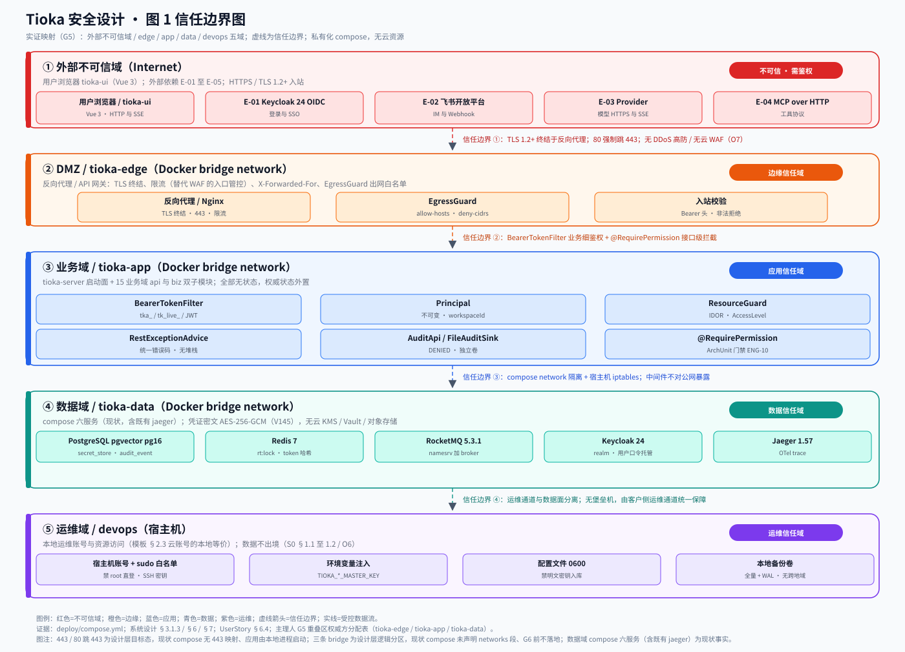
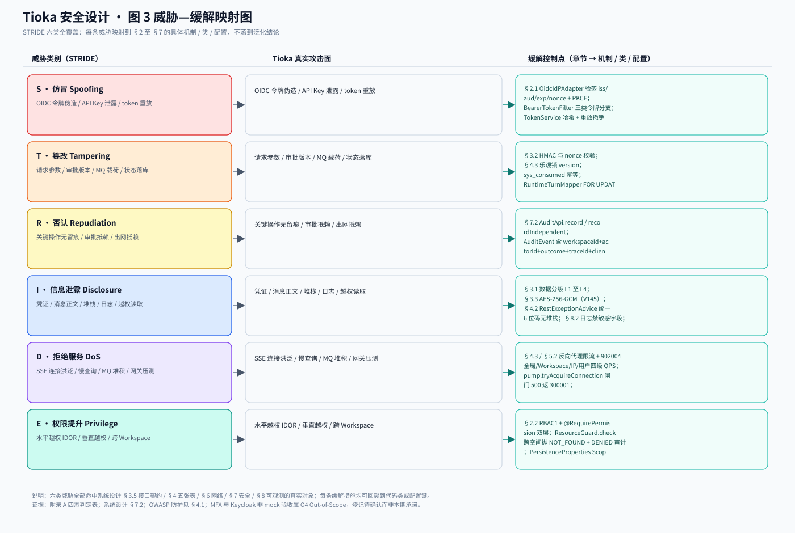
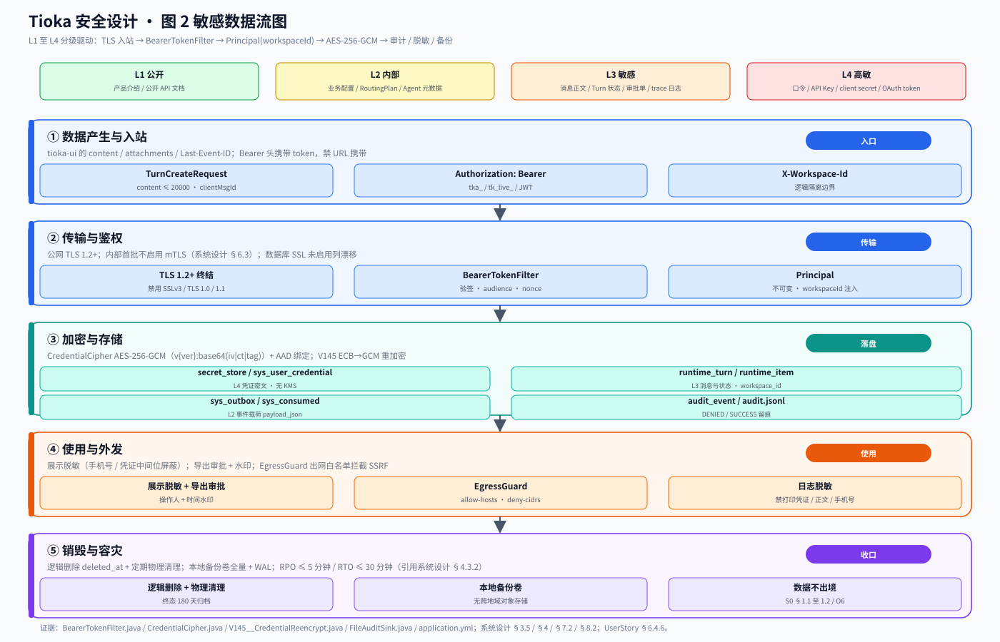

# Tioka 代码与设计一致性校验 · 安全设计

> 本文档是 G5 阶段产物，与 `platform-architect`（部署设计）并行产出。**唯一上游威胁建模基线**是 G4 冻结的《系统设计》（1817 行），并逐字继承 G3《高层架构设计》、G4《UserStory》、G1 `material_digest.md`、G2 `research_report.md` 与公共协议。
>
> **本轮不是从零做安全方案**。Tioka 已有可运行代码（883 个 main 与 258 个 test Java、15 个业务域、41 份 Flyway 迁移、Vue 3 前端）与私有化本地 `deploy/compose.yml`。本轮交付物是「以《系统设计》真实模块边界、接口契约、数据对象与本地 compose 运行环境为基线的威胁建模 + 能映射回代码的安全控制点 + 安全域四态判定（一致 / 漂移 / 缺失 / 设计自身矛盾）」。用户原始诉求为「代码与设计的一致性校验……审查现有的代码以及设计，进行后续的链路规划与实现」；Phase 0 锁定「审计 + 规划 → 分批实现，**G6 通过后才进入代码实现**」，故本文 **G6 前不动任何生产代码或既有设计文档**。
>
> **证据口径（全文通用）**：事实 = G1 冻结的 D / X / V 编号、G2 冻结的 SR 编号、G3/G4 冻结条文，或本角色以 `Grep` / `Glob` / `Read` 实际检索到的代码路径与 `路径#符号`；推断 = 由事实结合本项目语境作出的判断，逐条标注依据与局限；建议 = 本阶段登记与下游转交，属待 G5 人工审核确认的评估性结论。
>
> **运行形态硬边界（O7 / O1 / 数据不出境不改写；现仓 compose 六服务为现状事实）**：私有化本地 `deploy/compose.yml`。现仓实测 compose 声明 **6 个 service 定义 / 六类组件**（`postgres` / `redis` / `keycloak` / `rocketmq-namesrv` / `rocketmq-broker` / `jaeger`，其中 `rocketmq-namesrv` 与 `rocketmq-broker` 共用 `apache/rocketmq:5.3.1` 镜像）；`jaeger` 为既有代码事实（`jaegertracing/all-in-one:1.57`、`COLLECTOR_OTLP_ENABLED=true`、注释 GOV-08 本地链路后端，`deploy/compose.yml:62-69`）。现状 `deploy/compose.yml` 将 7 个中间件端口（5432 / 6379 / 8180 / 9876 / 10911 / 16686 / 4317）直接映射到宿主机；compose 内无 8080 / 443 与应用容器，`volumes:` 仅 `tioka_pg`、未声明 `networks:` 段，应用由本地进程（`mvn` / `npm run dev`）启动。是否对公网可达取决于宿主机 iptables 与客户侧网络策略，上游未登记，待 U 系列仓库外取证——**端口「映射到宿主机」不等于「已对公网暴露」，全文禁止把两者等同**。**两条设计基线自身漂移（不是「代码偏离设计」）**：① G1 `material_digest.md` D18 §2 与 G3 全篇（§4.2 / §5.2 / §6.1 O7 / §6.2 模块卡片 / 图节点 B3、D3）登记「五服务」，漏登既有 `jaeger`；② 主理人 G5 注入的「仅 8080 / 443 对宿主机外部暴露」为按常见 Web 部署形态推导的假设，`8080` 与 `443` 在 compose 中零命中。**两条基线均已由主理人正式撤销，不得再作为「代码偏离设计」的判定依据**；G3《高层架构设计》§4.2 与 G4《系统设计》§2.5.1 Q5 的「私有化 compose 五服务」属上游设计基线自身漂移，逐字引用时保留原文并加注「与现仓六服务事实不符、已列入 G6 整改台账」，不改写上游文档。收敛路径只作设计层建议，**G6 前不改 compose**，由主理人 G6 合稿统一纳入冲突裁决台账，本角色不回写 G3、不重裁。**O7**（计数断言已撤销，约束继续有效）：首批不新增中间件、不引入 WAF 硬件 / KMS / Vault / ClickHouse / S3 / 云托管执行面——`jaeger` 为既有代码事实、不是「首个 MVP 引入的新中间件」，不违反 O7。三条 `tioka-edge` / `tioka-app` / `tioka-data` Docker bridge network 保留为**设计层逻辑分区**，须标注「现状 compose 未声明 networks 段，G6 前不落地」。Phase 0 已定 `need_cloud_baseline_check=false`——**禁止虚构云账号、云 AKSK、CAM 策略、堡垒机、云 WAF、VPC 安全组 ID、GDPR 跨境传输流程**。**O1** 云托管 Agent 执行面永久排除；**数据不出境**（S0 §1.1 至 1.2 与 O6）。

---

## 0. 元信息：修订记录

| 文档版本 | 发布日期 | 修订人 | 修订说明 |
| --- | --- | --- | --- |
| v1.0 | 2026-11-08 | security-architect（严守正） | 首轮：STRIDE 六类威胁建模与威胁—缓解映射、IAM、数据安全、OWASP 应用安全、网络与基础设施、密钥、运行时安全七章全覆盖；3 张图示内嵌；安全域四态判定；四次中间确认自检；G5 末段对账 6 项 |
| v1.1 | 2026-11-08 | security-architect（严守正） | 定点修订（按主理人 G5 基线更正）：撤销「仅 8080 / 443 对宿主机外部暴露」与「compose 五服务冻结」两条错误基线，全文统一采用主理人更正口径（现仓 compose 六服务 / 七端口、无 8080 / 443 与应用容器、应用本地进程启动、公网可达性待 U 系列取证）；两条登记为「设计基线自身漂移」而非「代码偏离设计」，收敛路径仅作设计建议、G6 前不改 compose；三条 Docker bridge network 标注为设计层逻辑分区（现状 compose 未声明 networks 段，G6 前不落地）；上游 G3/G4「私有化 compose 五服务」逐字引用保留并加注「已列入 G6 整改台账」；订正文末四态判定条数为 15 条（SEC-01 至 SEC-15 与四态汇总一律不动）；§5.2 应然红线、§1.1 五域信任边界图与三张 SVG、§5.3 / §6 / §7 与自检报告全部保留 |
| v1.2 | 2026-11-08 | security-architect（严守正） | 定点修订（按主理人图文一致性复核）：重绘图 1（`pic/security/security-trust-boundary.py` 与 `.svg`）服务计数与暴露面标注——数据域「compose 五服务」改「compose 六服务（现状，含既有 jaeger）」，docstring 中已撤销的「仅 8080 / 443 对宿主机外部暴露」改为主理人更正口径，图脚注新增「443 / 80 跳 443 为设计层目标态，现状 compose 无 443 映射」；同步改写 §1.1 图注（L56）；正文结论、SEC-01 至 SEC-15 共 15 条四态判定与四态汇总、附录 A 至 D、D.1 六项对账、另两张图与 `.py` 绘图原语及布局坐标一律不动 |

**本角色边界声明（唯一 Owner）**：本阶段只产出《安全设计》一份文档。未重写业务范围与系统模块边界、未给资源预算与发布策略（归 `platform-architect`）、未代替部署侧完成运行时拓扑设计、未修改仓库任何源码或既有设计文档、未生成第二份交付文档、未调度其他成员。G6 前不动生产代码；本文所有控制点均为**对既有代码与冻结设计的写实登记与映射**，不是已执行的安全改造。

**上游继承（逐字读取，不依赖摘要）**：
- `.workbuddy/output/系统设计.md`（1817 行，G4 冻结）：§3 接口契约（§3.5.1 错误码、§3.5.2 幂等、§3.5.3 限流）、§4 数据库五张表（`runtime_turn` / `runtime_item` / `sys_outbox` / `sys_consumed` 与 `sys_dead_letter` / `runtime_approval`）、§6 网络架构、§7 安全设计、§8 可观测设计。
- `.workbuddy/output/UserStory.md`（742 行，G4 冻结）：§6.4 安全性需求 6.4.1 至 6.4.6 六子节、§6.5 待澄清项 Q1 至 Q14。
- `.workbuddy/output/高层架构设计.md`（823 行，G3 冻结）：§4.2 系统定位、§6.1 In-Scope 12 条与 Out-of-Scope 8 条、§4.5 链路优先级。
- `.workbuddy/output/material_digest.md`（511 行，G1 冻结）：§2.0 双索引、§3 冲突 X1 至 X14、§3.2 待验证点 V1 至 V7。
- `.workbuddy/output/research_report.md`（588 行，G2 冻结）：Q2 Outbox / 幂等 / SKIP LOCKED、Q5 ArchUnit 与 CDC、§4.3 技术栈。
- 模板 `skills/aicoding-team-bootstrap/templates/安全设计.md`（§1 至 §7 骨架）；角色定义 `agents/security-architect.md`；公共协议 `protocols/intermediate_confirmation.md`。

**已锁定编排口径（只引用、不重新裁决）**：
- **X1**：`docs/architecture/implementation/34-M0至M4推进规划与工作项.md` 为唯一执行权威；README 与 31 号指向 33 号属文档漂移。**X9**：34 号 G0 至 G4 / GF 为里程碑，S0 §13 的 G1 至 G7 仅作能力门禁清单，两套标签不混用；完成度按 31 §11 的 slice / fidelity / exit 三级，**绿灯不等于 Exit**（X2）。
- **X11 / 47-GL §3**：权威隔离字段 `workspaceId`；`tenantId` 仅作 47-GL §4 历史遗留映射（TenantContext / RequestContextHolder 等十三项），新建对象禁用；平台管理员角色码 `system_admin`；隔离粒度 Workspace，**多租户不是硬需求**。据此模板 §2.2.3「物理隔离 vs 逻辑隔离」取舍已由上游冻结为**逻辑隔离（Workspace）**，按协议 §6 不重复发起中间确认。
- **X13 定性不改判**：MQ 运行时闭环仍按 G3 冻结为「不成立 / 闭环未证实」；代码级生产 / 消费 / 幂等三点已由 G4 实证齐备（`V130__m2_outbox.sql` 的 `sys_outbox` / `sys_consumed` / `sys_dead_letter`、`OutboxEventPublisher`、`IdempotentDeliveryService`），属时差，不据此改判为「一致」。**A5 / V5 双份 SQL 漂移（41 : 45）、X8 模块树文档漂移、X6 依赖环**如实登记为漂移，不越权裁决。
- **认证与授权现状（G4 冻结，不得新增）**：认证由 compose 内 Keycloak 24 以 OIDC 承接登录与 SSO；`BearerTokenFilter` 校验；`Principal` 不可变且携带 `workspaceId`；沿用 RBAC 与 Workspace 隔离；`UserStory §6.4.3`「本轮不新增本地账号密码体系、不新增认证方式」。G4 系统设计 §7.2.1 阈值（口令最小长度 12、连续失败 5 次锁定 15 分钟、访问 Token 2 小时 / 刷新 Token 7 天）为冻结基线，本文逐项引用并标注出处，**不自造新阈值形成对外承诺**；MFA 覆盖范围判定为「首批不启用，属 O4 非 mock 验收取证范围，登记待确认」。

**G5 重叠区权威方分配表（主理人锁定，第 1 项已按主理人撤销口径重新登记）**：第 1 项网络分区 / 拓扑命名归 `platform-architect` 权威，口径按主理人更正采用压缩逐字表述「**现状 `deploy/compose.yml` 将 7 个中间件端口直接映射到宿主机；compose 内无 8080 / 443 与应用容器；应用由本地进程启动。是否对公网可达取决于宿主机 iptables 与客户侧网络策略，上游未登记，待 U 系列仓库外取证**」，并遵守「端口**映射到宿主机 ≠ 已对公网暴露**」；三条 `tioka-edge` / `tioka-app` / `tioka-data` Docker bridge network 保留为**设计层逻辑分区**，须标注「现状 compose 未声明 networks 段，G6 前不落地」；无 VPC / 无云子网 / 无云安全组。**该条基线已由主理人撤销**：原注入的「仅 8080 / 443 对宿主机外部暴露」为常见 Web 部署形态推导的假设，`8080` 与 `443` 在 compose 中零命中；「compose 五服务冻结」计数因 G1 `material_digest.md` D18 漏登 `jaeger` 而不成立。两条旧基线均不得再作为「代码偏离设计」判定依据，改登记为设计基线自身漂移（六服务 vs 五服务、端口暴露面）。第 2 项安全组 / ACL / 信任域规则、第 3 项密钥分级 5 类体系、第 4 项审计字段与日志保留期、第 5 项 WAF 版本 / 规则归本角色权威；第 6 项告警 P0 至 P3 分级与 7 条规则、6 个 Dashboard 归 `platform-architect` 权威，本文继承 G4 系统设计 §8 不改写。**更正来源**：主理人独立逐行复核 `deploy/compose.yml`（73 行）后正式撤销原注入基线，根因在主理人侧注入、非本角色偏差；第 1 项末段对账重标为「设计基线自身漂移已撤销并重新登记（六服务 / 七端口，见 D.4）」，见附录 D.1。第 2 至 6 项「一致」结论保留。

**图示清单（由本角色直接调用 `diagrams-generator` 生成并内嵌，零依赖 SVG 矢量图 + 可复现源码）**：

| 图号 | 名称 | 内嵌位置 | 源码与矢量图路径 |
| --- | --- | --- | --- |
| 图 1 | 信任边界图（安全总体架构） | §1.1 | `pic/security/security-trust-boundary.py` 与 `.svg` |
| 图 2 | 敏感数据流图 | §3.1 | `pic/security/security-dataflow.py` 与 `.svg` |
| 图 3 | 威胁—缓解映射图 | §1.2 | `pic/security/security-threat-map.py` 与 `.svg` |

三张 SVG 均通过 `python3` 标准库 `xml.dom.minidom` 的 XML 合法性校验；绘图原语复用 `pic/_svgkit.py`。场景识别与工具选项（网络拓扑 / 关系图）：环境实测无 `diagrams` / `graphviz` / `matplotlib` / `cairosvg` / `Pillow`，沿用 G3 编排层已锁定的「Mermaid 内嵌 + Python 标准库零依赖 SVG」组合，不就工具选择另行发起中间确认（协议 §6：编排层已明确事项不重复打扰）。

---

## 1. 安全总体架构

### 1.1 安全总体架构图

**信任域划分（五域，实证映射）**：① 外部不可信域（用户浏览器 tioka-ui、E-01 至 E-05 外部依赖）；② DMZ / `tioka-edge`（反向代理 / API 网关）；③ 业务域 / `tioka-app`（tioka-server 启动面 + 15 业务域 api 与 biz）；④ 数据域 / `tioka-data`（compose 六服务，现状事实，含既有 `jaeger`，见 §5.1 事实登记与附录 A SEC-10）；⑤ 运维域 / devops（宿主机构成）。四条信任边界：TLS 终结、`BearerTokenFilter` 业务细鉴权、设计层三条 Docker bridge network 分区（现状 compose 未声明 networks 段）+ 宿主机 iptables、运维通道与数据面分离。**图 1 已按主理人更正口径重绘（`pic/security/security-trust-boundary.svg` 为设计层逻辑分区视图）**：数据域标注为 compose 六服务（现状事实，含既有 `jaeger`）；图中 443 / 80 跳 443 为设计层目标态，现状 compose 无 443 映射、应用由本地进程启动，现状一律以 §5.1 事实登记为准；三条 `tioka-edge` / `tioka-app` / `tioka-data` Docker bridge network 为设计层逻辑分区，现状 compose 未声明 networks 段、G6 前不落地。图内不再出现「compose 五服务」这一已撤销错误基线，图脚注同步加注 443 设计层目标态口径。

**安全组件对照表**（模板常见安全组件清单 → 本项目实际取值；未涉及组件不删除章节，逐项标注「无对应云资源」并给出本地等价控制）：

| 模板组件 | 本项目取值 | 本地等价控制 / 代码证据 |
| --- | --- | --- |
| DDoS 高防 | 不部署（私有化单机，O7） | 反向代理限流 + §3.5.3 四级 QPS 拦截（902004）；G4 §7.1「抗 DDoS = 私有化入口反向代理限流」 |
| WAF | **无 WAF，替代控制为** 反向代理限流 + 应用层输入校验（§4.1） + `RestExceptionAdvice` 统一错误码 | O7 不部署 WAF 硬件 / 云 WAF；规则集不归本轮，标注「无 WAF 版本 / 规则」 |
| 云防火墙 / 安全组 / VPC | 无对应云资源，不适用 | 宿主机 iptables 默认拒绝 + 显式放通；`tioka-edge` / `tioka-app` / `tioka-data` 三条 Docker bridge network 隔离（设计层逻辑分区，现状 compose 未声明 networks 段，G6 前不落地） |
| 主机安全 | 私有化宿主机基线（运维保障） | 最小化安装、禁 root 直登、SSH 密钥登录、sudo 白名单；G4 §7.1 |
| 数据安全审计 | `AuditApi` + `AuditSink` + `FileAuditSink` + `sys_dead_letter` 留痕 | `tioka-module-system-api#audit/AuditApi.java`、`tioka-module-system-biz#infrastructure/spi/FileAuditSink.java` |
| KMS | **无云 KMS，不适用**（O7 不引入 KMS / Vault） | `CredentialCipher` AES-256-GCM（V145 CredentialReencrypt）+ 环境变量注入主密钥 + 配置文件 0600 权限 |
| 堡垒机 | 无对应云资源，不适用 | 客户侧运维通道统一保障；宿主机账号分离 + sudo 白名单 + 审计 jsonl 独立卷 |
| NAT 网关 / SOC / CLS | 无对应云资源，不适用 | 固定出口 IP 由 G4 §6.2 出口白名单（E-01 至 E-05 域名）承接；运维与 SRE 人工值守替代 SOC；结构化 JSON 日志组件替代 CLS |

### 1.2 威胁模型

> 采用 **STRIDE** 六类方法，逐条映射到 §2 至 §7 的缓解措施，形成「威胁—缓解措施映射表」。威胁对象严格取自《系统设计》真实模块（M1 至 M4）、接口（§3.2 / §3.5）、数据对象（§3.3 O-01 至 O-15、§4.2 五张表）与运行形态（compose 六服务，现状事实；7 端口映射宿主机，见 §5.1 事实登记与附录 A SEC-10），不设泛化威胁。

**STRIDE 六类威胁识别表**（无空行，六类全覆盖）：

| 威胁类别 | Tioka 真实攻击面 | 关联模块 / 接口 / 数据对象 |
| --- | --- | --- |
| 仿冒（Spoofing） | 伪造 OIDC 令牌、`tk_live_` API Key 泄露、token 重放、跨 Workspace 冒用身份 | M1 / M3 全部写接口；`BearerTokenFilter`、`OidcIdPAdapter`、`Principal.workspaceId` |
| 篡改（Tampering） | 请求参数篡改、`runtime_turn` 状态与审批 version 篡改、`sys_outbox.payload_json` 载荷篡改 | `TurnCreateRequest`、`ApprovalDecideRequest`、`EventEnvelope`、`runtime_turn` / `sys_outbox` |
| 否认（Repudiation） | 审批决定、密钥变更、出网调用、导出操作无留痕 | `AuditApi` / `FileAuditSink`、`audit_event`、`sys_dead_letter` |
| 信息泄露（Information Disclosure） | 凭证明文、消息正文明文、错误响应堆栈、日志打印敏感字段、跨 Workspace 读取 | `secret_store` / `sys_user_credential`、`runtime_item.payload_json`、`ApiResponse`、`ResourceGuard` |
| 拒绝服务（DoS） | SSE 连接洪泛、慢查询拖垮 PostgreSQL、Outbox 堆积、网关压测 | `ThreadEventsController` events、`pump.tryAcquireConnection`、`OutboxRelay`、§3.5.3 限流 |
| 权限提升（Elevation of Privilege） | 水平越权 IDOR（猜 threadId 读他人会话）、垂直越权（普通用户调管理接口）、容器逃逸 | `ResourceGuard` / `VisibilityFilter`、`@RequirePermission`、`PersistenceProperties` ScopeLine |

**威胁—缓解措施映射表**（每条威胁映射一处以上具体机制 / 类 / 配置，可回溯）：

| 编号 | 威胁 | 缓解控制点 | 章节 → 代码 / 配置证据 |
| --- | --- | --- | --- |
| T-01 | 仿冒：OIDC 令牌伪造 | 授权码 + PKCE S256 + state + nonce；`id_token` 校验签名 / iss / aud / exp / nonce；`access_token` audience 校验 | §2.1.1 → `OidcIdPAdapter.java:46-55,75-89,122-129`、`BearerTokenFilter.java:148-153,178-195` |
| T-02 | 仿冒：API Key 泄露与 token 重放 | 三类令牌分支（`tka_` 不透明 / `tk_live_` API Key / 三段式 JWT）；API Key 用 `applyScopes` 收窄权限并绑定 workspaceId；访问令牌 Redis 存 SHA-256 哈希；刷新令牌族重放触发 `revokeFamily` | §2.1.3 → `BearerTokenFilter.java:67-75,114-120`、`TokenService.java:38-48,50-70` |
| T-03 | 篡改：状态与审批 | 乐观锁 `version`（`STALE_REVISION` 40901）；`RuntimeTurnMapper.xml` 的 `FOR UPDATE` 行锁；`ApprovalDecideRequest.version` 比对 | §4.3.4 → `ErrorCode.java:19`、G4 §3.2.M1.5 / §3.5.2 |
| T-04 | 篡改：MQ 载荷 | `EnvelopeSchemaValidator` 按 `mq-envelope-v1` 校验 `EventEnvelope`；`sys_consumed` 复合主键 `INSERT ON CONFLICT DO NOTHING` 去重；`traceparent` + `runAs` 重载 | §4.3.4 → G4 §3.2.M2.5、§4.2.3 / §4.2.4 |
| T-05 | 否认：关键操作无留痕 | `AuditApi.record`（SUCCESS 同事务）/ `recordIndependent`（DENIED / ERROR 独立事务）；`AuditEvent` 含 workspaceId / actorId / outcome / traceId / requestId / clientIp；`FileAuditSink` 逐行 JSON 独立卷 | §7.2 → `AuditApi.java`、`AuditEvent.java:16-20`、`FileAuditSink.java:44-69` |
| T-06 | 否认：出网调用无留痕 | `EgressGuard.deny` 写 `egress.denied` 独立审计（审计失败不吞拒绝） | §4.1 SSRF → `DefaultEgressGuard.java:208-232` |
| T-07 | 信息泄露：凭证明文 | `CredentialCipher` AES-256-GCM，密文 `v{keyVersion}:base64(iv|ciphertext|tag)`，AAD 绑定 credentialId + ownerId；V145 把遗留 AES/ECB 重加密为 GCM 并做往返自检 | §3.3.1 → `CredentialCipher.java:9-27`、`V145__CredentialReencrypt.java:41-107` |
| T-08 | 信息泄露：错误与日志 | `RestExceptionAdvice` + `ApiResponse` 仅返回 code / message / data / traceId，不含堆栈 / SQL / 内部路径；`management.endpoint.health.show-details=when_authorized`；结构化日志禁打印凭证 / 手机号 / 消息正文明文 | §4.2 → `RestExceptionAdvice.java:13-19`、`ApiResponse.java:18-29`、`application.yml:44-45`；G4 §8.2.2 |
| T-09 | 信息泄露：跨 Workspace 读取 | `ResourceGuard.filter` 把可见范围下推为 MyBatis-Plus Wrapper 条件（ADR-018 禁止召回后再过滤）；`PersistenceProperties.workspaceScopeExemptTables` deny-by-default；跨空间抛 `NOT_FOUND` 而非 `FORBIDDEN` | §2.2.4 → `ResourceGuard.java:8-21`、`PersistenceProperties.java:11-77`、`ErrorCode.java:16` |
| T-10 | DoS：连接与查询洪泛 | §3.5.3 四级 QPS（全局 1000 / Workspace 200 / IP 100 / 用户 50，902004）；SSE 闸门 `pump.tryAcquireConnection`（500 返 300001）；`ModelRateLimiter` Redis 令牌桶（`tioka:rl`）；Outbox 同 msg_key 失败阻断本轮后续行 | §4.3.2 / §5.2 → G4 §3.5.3、`RATE_LIMITED` 42900、`ErrorCode.java:26` |
| T-11 | 权限提升：水平 / 垂直越权 | RBAC1 角色继承 + `@RequirePermission` 注解双层；ArchUnit 门禁强制所有 Controller 方法声明 `@RequirePermission` 或 `@PublicApi`；`WORKSPACE_FORBIDDEN` 40302；`LAST_ADMIN` 40902 | §2.2.1 / §4.3.1 → `RequirePermission.java:12-19`、`Permissions.java`、`TiokaArchitectureTest.java:42` |
| T-12 | 权限提升：容器逃逸 | 无 K8s（compose 单机）；镜像最小化 + 非 root 运行由 G5 复核；禁止特权容器；密钥走环境变量运行时注入，不在镜像打包 | §5.3.2 → G4 §7.1、`application.yml:85-88,146-149` |

---

## 2. 身份与访问管理（IAM）

### 2.1 身份认证（Authentication）

#### 2.1.1 用户登录

**认证链写实（代码实证，均为既有实现，本轮不新增）**：认证由 compose 内 **Keycloak 24.0 OIDC** 承接登录与 SSO（`deploy/compose.yml` 的 `keycloak` 服务、`quay.io/keycloak/keycloak:24.0`、`start-dev --import-realm` 导入 `tioka-realm.json`），`BearerTokenFilter`（`OncePerRequestFilter`）在每次请求校验 `Authorization: Bearer` 头并组装不可变 `Principal`。

- **既有认证方式（写实登记，非本轮新增，满足认证方式 ≥ 2 种）**：① **OIDC / SSO 授权码登录** —— `OidcIdPAdapter.authorizationUrl` 拼接 `/protocol/openid-connect/auth`，带 `client_id` / `response_type=code` / `scope` / `redirect_uri` / `state` / `nonce` / `code_challenge` / `code_challenge_method=S256`（PKCE），换码后校验 `id_token` 的签名 / iss / aud / exp / nonce，并经 `OidcFederationService.resolveAndSync` 落本地用户；② **账号密码登录** —— `AuthController` 的 `/api/system/auth/login`（`LoginRequest` 含 username 与 password，`@PublicApi`）与 `AuthService.login`，配置键 `tioka.auth.local-enabled: true`（见 §2.1.2 关于 UserStory §6.4.1 矛盾的如实登记）；③ **API Key** —— `tk_live_` 前缀令牌经 `ApiKeyService.authenticate` 解析并用 `applyScopes` 收窄权限；④ **OIDC 资源服务器 JWT** —— 三段式 JWT 且 `resource-server.enabled` 时经 `decodeAccessToken` 校验 audience 后装载身份。四类方式共同点是最终都收敛到 `Principal(userId, workspaceId, type, roles, permissions, authMethod)`，`authMethod` 取 password / oidc / api_key / system。
- **图形验证强制场景**：登录与获取验证码场景的图形验证码在现仓未检索到实现，登记「未登记，待 U 系列仓库外取证」，不虚构。
- **MFA / 2FA**：**首批不启用，属 O4（双实例 HA 与 Keycloak 非 mock 验收）Out-of-Scope 的非 mock 验收取证范围，登记待确认**；G4 系统设计 §7.2.1 把「MFA 覆盖范围」交由 G5 判定，本角色据此判定为「首批不启用」，**不写成本期已实现或本期承诺**。管理端 / 敏感操作 / 控制台子账号强制 MFA 的机制在现仓未落地，列入 §7.3 与附录 A「缺失」。

#### 2.1.2 密码策略（量化阈值）

> 下表主值**逐项引用 G4 系统设计 §7.2.1 冻结基线并标注出处**，不自造新阈值形成对外承诺；「代码侧实证值」列为 2026-11-08 本角色实读 `application.yml` / `ErrorCode.java` / `UserStory §6.4.1` 的结果，与冻结基线存在差异的如实登记为漂移，不裁决、不改代码。

| 项 | 冻结基线（出处：G4 系统设计 §7.2.1） | 代码侧实证值 | 判定 |
| --- | --- | --- | --- |
| 最小长度与复杂度 | 最小长度 12，含大小写字母、数字、符号 | `UserStory §6.4.1` 写「8 位以上大小写字母 + 数字 + 特殊字符」（且声明本系统不提供本地账号密码设置功能）；`application.yml` 无口令长度校验键 | 数值差异，登记漂移 |
| 连续失败锁定 | 连续失败 5 次锁定 15 分钟 | `application.yml:60` `login-max-failures: 10`；`AuthService.assertNotRateLimited(clientIp, username)` | 数值差异，登记漂移 |
| 访问 Token 有效期 | 2 小时 | `application.yml:58` `access-ttl: 8h` | 数值差异，登记漂移 |
| 刷新 Token 有效期 | 7 天 | `application.yml:59` `refresh-ttl: 7d` | 一致 |
| 加密传输 | OIDC / HTTPS 接入 | `OidcIdPAdapter` 换码走 HTTPS `token` 端点；`AuthController` 刷新令牌写 `HttpOnly` + `SameSite=Strict` Cookie | 一致（写实） |
| 加密存储 | Keycloak 托管用户口令，业务库不存明文口令 | `AuthController` 口令交给 `AuthService`；`TokenService` 用 `MessageDigest` 对令牌做哈希后存 Redis；`secret_store` 存 `CredentialCipher` 密文 | 一致（写实） |
| 更换周期 / 重复限制 | 轮换 90 天且不停机（出处：G4 系统设计 §7.2.3） | `application.yml` 无口令轮换键；`tioka.credential.key-version` 提供密钥版本轮换 | 主值引用冻结口径，落地登记待取证 |
| 自动登出 / 注册策略 | G4 §7.2.1 未登记 | `AuthController.logout` 主动撤销 + 清 Cookie；`tioka.bootstrap.admin-username: admin` | 写实登记，不自造阈值 |

关于「本地账号密码设置功能」：UserStory §6.4.1 逐字标注「本系统当前不提供本地账号密码设置功能，认证经 Keycloak 承接」，但代码实证 `AuthController` 提供 `/login`、`/password`（`changePassword` 需校验原密码）、`/refresh` 且有 `local-enabled: true`。本角色**如实登记为「设计自身矛盾」**（UserStory §6.5 Q12 本身已把该归口列为待人工审核确认），不裁决、不改写 UserStory、不新增认证方式。

#### 2.1.3 会话管理

- **Token 类型**：不透明令牌 `tka_`（`TokenService.verifyAccess` 查 Redis）、API Key `tk_live_`、OIDC 三段式 JWT；刷新令牌 `tioka_rt` 走 `HttpOnly` + `Secure`（`cookie-secure` 开关）+ `SameSite=Strict` + `path=/api/system/auth` 的 `ResponseCookie`；**禁止 URL 携带 token**（全部经 `Authorization` 头或 Cookie，见 §3.2.5）。
- **有效期与续期**：主值引用 G4 §7.2.1（访问 2 小时 / 刷新 7 天）；`/api/system/auth/refresh` 提供续期、`/logout` 提供主动注销（`authService.logout(access)` + 清 Cookie）；代码侧 `access-ttl: 8h` 差异见 §2.1.2。
- **互踢与风险登录**：`TokenService.refresh` 检测刷新令牌族重放并 `revokeFamily` 撤销整族；`TokenService.revokeAll(userId)` 在用户被禁用时撤销全部令牌；`AuthService.assertNotRateLimited(clientIp, username)` 做登录失败限流；`BearerTokenFilter` 把 `uid` / `ws` 写入 MDC 并在 `finally` 清理 `SecurityContextHolder` 与 MDC。管理端强制单设备互踢与异地登录二次验证在现仓未检索到实现，登记「未登记，待 U 系列仓库外取证」。
- **风险登录检测**：`MDC.put("uid"/"ws")` + `AuditEvent.clientIp` + `FileAuditSink` 为检测提供字段基础；独立的异地 / 夜间 / 非常用设备风控模型未落地，登记待确认。

### 2.2 授权与权限控制（Authorization）

#### 2.2.1 权限模型

**默认 RBAC1（角色继承），冻结口径**：G4 系统设计 §7.2.5 明确「权限模型 RBAC1（角色继承），选它不选 ABAC 因既有 `@RequirePermission` 与 `Permissions` 目录已落地」；`UserStory §6.4.3`「沿用 RBAC 与 Workspace 隔离」。写实证据：`Principal` 携带 `roles` 与展开后的 `permissions` 集合，`hasPermission` 支持 `*` 通配；`Permissions.java` 定义 30 个具体权限点（`ALL_CONCRETE`，含 `AGENT_PUBLISH` / `CHAT_USE` / `APPROVAL_DECIDE` / `AUDIT_READ` / `WORKSPACE_MANAGE` / `MODEL_ADMIN` 等）；`RequirePermission` 注解声明「多个权限点需全部具备」，且注释要求「所有 Controller 方法必须带本注解或 `PublicApi`，由 ArchUnit 检查（ENG-10）」，实证 `TiokaArchitectureTest.java:42` 有该断言。

**高敏场景的既有 ABAC 式补充（写实，非本轮新增策略）**：`ResourceGuard` + `AccessLevel`（VIEW / USE / EDIT / OWNER 递增，`covers` 用 ordinal 比较）+ `VisibilityFilter` 构成资源属性条件的既有机制，配合 `sys_resource_acl` 与资源归属 / visibility；本文只登记既有机制，不新增 ABAC 策略引擎、不改写 §7.2.5 冻结的 RBAC1 选型。按协议 §6，权限模型取舍属上游已冻结，不重复发起中间确认。

#### 2.2.2 权限维度

| 维度 | 落地机制 | 代码证据 |
| --- | --- | --- |
| 接口级 | 网关粗鉴权 + `BearerTokenFilter` 业务细鉴权 + `@RequirePermission` 注解；跨模块契约见 G4 §3.4 | `BearerTokenFilter.java`、`RequirePermission.java` |
| 数据级 | 行级：`workspace_id` 非空且查询必带（G4 §4.1）；`ResourceGuard.filter` 下推可见性条件；列级：`CredentialCipher` 密文 + 展示脱敏 | `PersistenceProperties.java`、`RuntimeTurnMapper.xml`、`CredentialCipher.java` |
| 功能级 | 菜单 / 按钮 / 操作由 `Permissions` 权限点目录 + 前端 `meta.requireAuth` 与 `meta.roles` 全局路由守卫承接（G4 §3.5.5） | `Permissions.java`、G4 §3.5.5 前端路由清单 |

接口签名：G4 §6.2 把签名归入「网关粗鉴权加 `BearerTokenFilter` 业务细鉴权」；**HMAC-SHA256 + nonce + timestamp 的网关层签名方案在现仓未检索到实现**，登记「未登记，待 U 系列仓库外取证」，见 §3.2.4，不虚构签名中间件。

#### 2.2.3 多租户隔离

**逻辑隔离（Workspace），上游已冻结**：权威隔离字段 `workspaceId`（X11 / 47-GL §3），平台管理员角色码 `system_admin`，**多租户不是硬需求**（G3 §6.1 O6、34 号）。模板「私有化部署默认物理隔离」在本项目由上游冻结为**逻辑隔离**，按协议 §6 不重复发起中间确认，也不虚构物理隔离 / 跨租户 SaaS 形态。

写实证据：`Principal.workspaceId` 不可变承载；`BearerTokenFilter` 从 `X-Workspace-Id` 头取空间（API Key 绑定空间后忽略该头）；`ErrorCode.WORKSPACE_FORBIDDEN`（40302，「不是该空间成员」）；`PersistenceProperties.workspaceScopeExemptTables` 以 deny-by-default 白名单声明「未列入且带 `workspace_id` 的表一律过滤」，无 workspace 的 SYSTEM Principal 整表旁路；G4 §4.1 约定 `workspace_id` 非空且查询必带。`tenantId` 十三项遗留（TenantContext / RequestContextHolder / `Permissions.TENANT_ADMIN` 常量 / 历史 Flyway 字面量 / ADR-015 标题等）按 47-GL §4 登记，不改写。

#### 2.2.4 越权防护

- **水平越权（IDOR）**：`ResourceGuard.check(resourceType, resourceId, level)` 在权限不足时抛 `FORBIDDEN`、**跨空间抛 `NOT_FOUND` 并写 DENIED 审计**（避免通过错误码差探测资源存在性）；`filter` 返回可直接拼入 MyBatis-Plus Wrapper 的可见性条件，注释明确「列表查询必须用 `filter` 把可见范围下推为 SQL 条件，不得召回后再过滤（ADR-018）」；`visibleIds` 仅用于 ≤1000 的小集合。M1 的 `requireVisible` 在 SSE 首连校验 Thread 归属当前 workspaceId（G4 §3.2.M3.5，否则 100001）。
- **垂直越权**：`@RequirePermission` 注解 + RBAC1 角色继承双层；`/admin/...` 九页要求 `system_admin`（G4 §3.5.5）；`LAST_ADMIN`（40902）阻止移除空间最后一个管理员。
- **每个查询 / 修改接口必检归属**：G4 §7.2.5「列表与详情接口均校验数据归属」；本文把该约定映射到 `runtime_turn` / `runtime_item` / `runtime_approval` 等带 `workspace_id` 表的查询路径，不改接口契约。

### 2.3 本地运维账号与资源访问（模板 §2.3 云账号的本地等价改写）

> 模板 §2.3「云账号与云资源访问」在本项目**逐项标注「无云资源，不适用」**并给出本地等价控制；不虚构子账号、主账号访问密钥、CAM 策略、堡垒机。

#### 2.3.1 账号策略

- **子账号 / 主账号 / 主账号访问密钥**：无对应云资源，不适用。本地等价 = 宿主机账号分离：`KEYCLOAK_ADMIN` / `KEYCLOAK_ADMIN_PASSWORD` 经环境变量注入（`${KEYCLOAK_ADMIN_PASSWORD:-admin}`），PostgreSQL / Redis / RocketMQ 走 compose 内部服务名互访，禁止直接用 root 远程登录宿主机；运维使用独立账号 + `sudo` 白名单。
- **风险登记**：compose 把 `POSTGRES_PASSWORD: tioka`、`KEYCLOAK_ADMIN_PASSWORD` 默认 `admin`、Redis 无 `requirepass` 等以明文写在编排文件，属弱口令 / 无鉴权漂移，登记附录 A，不改写代码（O5）。

#### 2.3.2 权限分离

**人员权限与服务权限分离**（模板意图的本地等价）：人员权限 = 宿主机账号 + Keycloak 管理控制台账号（密码登录，MFA 首批不启用）；服务权限 = `tka_` / `tk_live_` / OIDC JWT 令牌与环境变量注入的 `TIOKA_DB_PASSWORD` / `TIOKA_CREDENTIAL_MASTER_KEY` / `TIOKA_SECRET_MASTER_KEY` / `TIOKA_CREDENTIAL_KEY_VERSION`。`Principal.type`（user / service / system）与 `PrincipalHolder.runAs`（后台任务恢复 run_as，结束复原）为两类权限在应用层的隔离机制。

#### 2.3.3 高敏权限分离

高敏操作（密钥轮换、审计查询、Workspace 管理、Agent 发布、模型管理、配额管理）与低敏操作由 `Permissions` 细粒度权限点隔离：`AUDIT_READ` / `WORKSPACE_MANAGE` / `AGENT_PUBLISH` / `MODEL_ADMIN` / `QUOTA_ADMIN`；平台管理员角色码 `system_admin`（X11）单独持有管理面；`AuditEvent` 的 `actorType`（user / service / system）与 `outcome`（SUCCESS / DENIED / ERROR）为高敏操作留痕。配置文件 0600 权限 + compose network 隔离构成运维侧的边界。

---

## 3. 数据安全

### 3.1 数据分级

> 分级落到《系统设计》§3.3 O-01 至 O-15 核心业务对象、§4.2 五张表与真实配置字段，L1 至 L4 四级齐全。分级决定加密强度与脱敏规则，取值均引用 G4 §7.2.2「数据分级 L1 至 L4」冻结口径，不新增等级。

| 等级 | 类别 | 本项目真实数据对象（代码 / 表 / 配置） | 处理策略 |
| --- | --- | --- | --- |
| L1 | 公开 | 产品介绍、公开 API 文档、`/login` 与 `/healthz` 等公开端点响应、`@PublicApi` 标注的元数据 | 无特殊管控要求；仍经 `RestExceptionAdvice` 统一结构返回 |
| L2 | 内部 | `model_routing_plan` / `agent_version` / `mcp_tool` 元数据、`EventEnvelope.topic` 与 `tag`、`sys_outbox.payload_json` 中的非敏感事件载荷、`orch_timer` 行、`progress.md` 索引 | 需内部鉴权访问；`workspace_id` 逻辑隔离；限流与审计 |
| L3 | 敏感 | `runtime_turn.status` / `runtime_item.payload_json` 消息正文与 `seq` 游标、`runtime_approval` 审批单与 `risk`、结构化日志中的 `traceId` / `workspaceId` / `userId`、`audit_event` 审计事件、Trajectory 轨迹 | 加密传输（TLS 1.2+）、按 §8.2.2 日志规范脱敏、展示脱敏、必要时审计；`ResourceGuard` 归属校验 |
| L4 | 高敏 | `secret_store.cipher_text` 与 `sys_user_credential` 中的凭证密文、用户口令（Keycloak 托管）、`tk_live_` API Key、OIDC `client_secret`、外部 Provider `app-secret` / `encrypt-key` / `verification-token`、`TIOKA_*_MASTER_KEY` 主密钥、飞书 OAuth 用户令牌 | `CredentialCipher` AES-256-GCM + AAD 绑定 + V145 重加密；强脱敏（中间位屏蔽）；严禁入日志 / URL / 响应；严格审计 |

**分级与代码的对应**：L4 主密钥经环境变量注入（`application.yml:87,147-148`、`V145__CredentialReencrypt.java:27-38`），`tioka.secret.require-external-key` / `tioka.credential.require-external-key` 在 `application-prod.yml:21` 为 `true`（生产强制外部密钥），但 `application.yml:88,149` 为 `false` 且 `V145` 有 `DEV_DEFAULT_MASTER_KEY` 兜底——该差异登记为漂移 / 风险，见 §6.3 与附录 A。

### 3.2 数据传输安全

#### 3.2.1 公网访问

全链路 **HTTPS / TLS 1.2+**（G4 §6.2「TLS 终结点：反向代理 / API 网关，终结点之后为内网 HTTP」），禁用 SSLv3、TLS 1.0 / 1.1；80 强制跳 443；业务侧需解析 `X-Forwarded-For` 获取真实客户端 IP（`ClientIpResolver.resolve(request)` 供审计 `clientIp` 使用），禁止直接用 socket 远端 IP。TLS 证书与 443 监听由 G5 `platform-architect` 的部署规格承接（**设计层应然规格；该端口为设计层目标态，现状 compose 无 443 映射、应用由本地进程启动，G6 前不落地**），本文不规定证书供应商与轮换周期（未登记，待 U 系列仓库外取证）。

#### 3.2.2 服务内部访问

- **低敏感、内网访问**：HTTP 协议寻址（compose 服务名 + Spring Bean 注入，G4 §6.3「禁止硬编码 IP」）。
- **高敏感、跨信任域访问**：模板的 mTLS 双向证书认证在本项目**不启用**——G4 §6.3 已冻结「内部 mTLS 不启用（首批单实例内网），启用时由 G5 管理证书轮换」；替代控制为 `tioka-app` / `tioka-data` 两条 Docker bridge network 隔离 + `BearerTokenFilter` 身份传递 + `EventEnvelope` 的 `traceparent` / `workspaceId` / `runAs` 信封字段。本轮不新增 mTLS、不引入证书体系。

#### 3.2.3 数据库连接

`application.yml:10` 的 JDBC 连接串 `jdbc:postgresql://...` 未带 `sslmode` 参数，G4 §6.2 亦未登记数据库 SSL 开关。按冻结口径「低敏感、内网访问可明文」，首批单实例内网 + `tioka-data` network 隔离为**设计层逻辑分区应然**（现状 compose 未声明 networks 段，G6 前不落地；现状隔离由宿主机 iptables 承接）；**数据库 SSL 启用状态登记为漂移**（模板要求「高敏感启用 SSL」，本项目未启用且未登记），列入附录 A 与待确认项，不自造开关、不改代码。

#### 3.2.4 接口签名

模板参考方案为 HMAC-SHA256 防篡改 + nonce + timestamp 防重放。写实登记：本项目现仓的防篡改 / 防重放由 ① OIDC 的 `nonce`（`OidcIdPAdapter.decodeIdToken` 二次校验）与 PKCE `code_challenge`；② 事件信封 `EnvelopeSchemaValidator` 按 `mq-envelope-v1` 校验；③ 幂等键 `client_msg_id` / `X-Idempotency-Key` / `eventId`（G4 §3.5.2）；④ `Last-Event-ID` 单调 `EventId` 游标去重共同承接。**网关层 HMAC-SHA256 + timestamp 签名方案在现仓未检索到实现**，登记「未登记，待 U 系列仓库外取证」，不虚构签名中间件；不在本轮新增（O5 / O7）。

#### 3.2.5 传参禁忌

**禁止 URL 携带 token、云 AKSK、手机号**：本项目无云 AKSK；token 一律经 `Authorization: Bearer` 头或 `tioka_rt` HttpOnly Cookie（§2.1.3），`workspaceId` 经 `X-Workspace-Id` 头，续传游标经 `Last-Event-ID` 头或 `after` 查询参数（G4 §3.2.M3.2，游标非敏感标识）。`OidcIdPAdapter.authorizationUrl` 把 `client_secret` 放在换码 POST 表单体而非 URL（`exchangeCode` 的 `formMap`），`authorizationUrl` 的查询串只含 `client_id` / `state` / `nonce` / `code_challenge` 等非密值。`TurnCreateRequest.content` 走 JSON body，禁止放查询串。敏感字段不入日志（G4 §8.2.2「禁止打印凭证、手机号、消息正文明文」）。

### 3.3 数据存储安全

#### 3.3.1 加密存储（仅敏感数据需要）

- **对称加密**：`CredentialCipher` 接口约定密文格式为 `v{keyVersion}:base64(iv|ciphertext|tag)`，算法 **AES-256-GCM**；`encrypt(plaintext, credentialId, ownerId)` 把凭证 ID 与所属对象 ID 写入 AAD（附加认证数据），`decrypt` 在 AAD 不匹配 / 密文损坏 / 密钥版本未知时抛异常，防止密文跨记录搬移。实现方 `AesGcmCredentialCipher`，主密钥经 `TIOKA_CREDENTIAL_MASTER_KEY` 环境变量注入，版本号 `TIOKA_CREDENTIAL_KEY_VERSION`。
- **重加密迁移**：`V145__CredentialReencrypt.java` 把 `secret_store` 中遗留 AES/ECB 密文迁为 GCM——`ALTER TABLE` 加临时列、只挑 `LegacyAesEcb.looksLikeLegacy` 的行、`decrypt → encrypt → decrypt` 往返自检、批量写回、条数与写入数双重校验、最后 `DROP COLUMN`。已是 `v{n}:...` 的行跳过（幂等）。`CredentialReencryptRegistry` 按「表 + 列」登记主密钥轮换范围。
- **非对称加密 / RSA**：本项目未使用 RSA 密钥交换或落盘非对称加密；OIDC 的 `id_token` / `access_token` 签名校验由 `NimbusJwtDecoder` + `JwtDecoders.fromOidcIssuerLocation` 从 IdP JWKS 获取公钥完成（传输层签名验证，非业务落盘加密），如实登记为「传输层签名校验，非落盘加密」。
- **落盘加密 / 密钥管理**：无云 KMS / Vault（O7）；无服务端加密 SSE / 客户端加密 CSE 的对象存储（无 S3 / COS）；业务侧高敏字段用 `CredentialCipher` 应用层加密；配置文件 0600 权限；**禁止硬编码到代码或配置文件**为红线（§6.3），现仓默认口令漂移如实登记。

#### 3.3.2 敏感字段单向哈希加盐

`TokenService` 用 `MessageDigest` 对访问令牌与刷新令牌做哈希后作为 Redis key（`atKey(hash(accessToken))`、`rtKey(rtHash)`），Redis 中不存令牌明文；`SecureRandom` 生成令牌熵源。用户口令由 Keycloak 托管（业务库不存明文口令，具体哈希算法与加盐策略由 Keycloak 24 realm 配置决定，未登记，待 U 系列仓库外取证）。`sys_consumed` 的复合主键 `consumer + event_id` 作为事件级不可逆去重依据（G4 §4.2.4）。

#### 3.3.3 数据库安全

- **账号最小权限**：compose 的 `POSTGRES_USER: tioka` 为业务账号，非 superuser 直连；运维使用单独账号（§2.3.1）。`application.yml` 数据源用户名 / 口令走 `TIOKA_DB_USER` / `TIOKA_DB_PASSWORD` 环境变量。
- **慢查询日志与审计日志**：G4 §8.1.1「PostgreSQL QPS 与慢查询与行锁等待」纳入中间件大盘；G4 §8.2.1「慢查询日志独立、30 天」；业务审计走 `audit_event` + `FileAuditSink` 独立卷防篡改（G4 §7.2.4「独立账号独立卷存储防篡改」）。
- **备份加密与 SSL**：备份策略与 RPO / RTO 见 §3.3.6；数据库 SSL 未启用，登记漂移（§3.2.3）；备份卷加密状态未登记，待 U 系列仓库外取证。
- **行锁与幂等作为数据完整性控制**：`RuntimeTurnMapper.xml` 的 `FOR UPDATE`、`OrchTimerMapper.claimDue` 的 `FOR UPDATE SKIP LOCKED`、`sys_outbox.event_id` 唯一索引、`sys_consumed` 复合主键共同防止并发写篡改（G4 §3.5.2 / 附录 A 核查点 2 与 3）。

#### 3.3.4 文件存储安全

本项目无对象存储桶 / 预签名 URL / 防盗链 Referer 校验能力（无 S3 / COS，O7）。本地等价写实：`tioka-realm.json` 以 `:ro` 只读挂载进 Keycloak 容器（`deploy/compose.yml:39`）；`init-pgvector.sql` 以 `:ro` 挂载（`compose.yml:12`）；审计写 `${tioka.home}/audit/audit.jsonl` 与降级文件 `audit-degraded.jsonl`，`FileAuditSink` 用 `Files.createDirectories` + `StandardOpenOption.APPEND` 追加（只增不改，`audit_event` 表注释「只增不改」）。**文件上传接口在首批 P0 四条链路中不存在**——`TurnCreateRequest.attachments` 为「附件票据清单，逗号分隔」字符串而非二进制上传（G4 §3.2.M1.3）；魔数 + 扩展名 + 大小 + 病毒扫描的上传校验未落地，登记「未登记，待 U 系列仓库外取证」，列入 §4.1 文件上传行。

#### 3.3.5 数据使用安全

- **展示脱敏**：G4 §7.2.2「手机号与凭证中间位屏蔽展示」；`CredentialCipher` 密文永不回显明文；`ApiResponse` 只回 code / message / data / traceId；模板给出的手机号、身份证、银行卡掩码格式属参考基线，本项目未登记这三类字段，不虚构脱敏样例。
- **数据导出管控**：G4 §7.2.2「导出需审批加脱敏」；写实映射 = `APPROVAL_DECIDE` 权限 + `runtime_approval` 审批单 + `AUDIT_READ` 审计；导出审批流水印（操作人 + 时间）与行数限制在现仓未检索到实现，登记「未登记，待 U 系列仓库外取证」。
- **数据销毁**：`application.yml:96` `physical-purge-enabled: false`（物理清理默认关闭）；`tioka.persistence` 逻辑删除字段 `deleted`（`logic-delete-value: true`）；G4 §4.2.1 终态 Turn 超 180 天归档、`sys_consumed` 保留 30 天、`sys_dead_letter` 终态保留 90 天、`sys_outbox` 已发送保留 7 天（均由 G4 §4.2 既有的数据清理机制冻结，本文只引用不新增天数）。过期数据清理策略之上的合规销毁流程未登记，待 U 系列取证。

#### 3.3.6 数据备份与异地容灾

> 私有化单机 compose，**无跨地域对象存储 / 跨 Region 复制**（G4 §4.3.2「与生产数据目录物理隔离的本地备份卷，私有化部署，无跨区域对象存储」；§5.2.3「跨 Region 数据同步策略不适用」）。下表只引用 G4 冻结取值，不自造 RPO / RTO。

| 存储类型 | 备份策略（引用 G4 §4.3.1 与 §4.3.2） |
| --- | --- |
| PostgreSQL pgvector pg16 | 全量每日 + 增量 WAL；冷备加热备；本地备份卷；全量保留 30 天、增量 WAL 保留 7 天；主备同步属 P2 / L10，首批单实例 |
| Redis 7 | 不作为状态持久化，仅按 RDB 快照 1 小时；`runtime_item` 为权威重放源 |
| RocketMQ 5.3.1 | 消息落 `sys_outbox` 可重建；单 broker，Broker 日志留痕 |
| Keycloak 24.0 | 导入 realm 文件版本化（`tioka-realm.json`），审计日志留痕 |
| Jaeger 1.57 | trace 保留 7 天（G4 §4.3.1），独立链路库 |

**RPO ≤ 5 分钟、RTO ≤ 30 分钟**（出处：G4 §4.3.2 与 §5.3，两处自洽）；恢复演练频率沿用 G4 §4.3.2「频率半年，负责人转交 G5 platform-architect 指定 Owner」，本文不新增频率承诺、不写「每年 ≥ 1 次」为本期承诺。

#### 3.3.7 隐私合规

- **适用框架**：**数据不出境，适用《中华人民共和国个人信息保护法》与《数据安全法》**（G3 §6.1 O6、S0 §1.1 至 1.2、G4 §2.5.1 Q5「私有化 compose 五服务，数据不出境，Workspace 隔离」）。**引用加注**：此处「私有化 compose 五服务」为 G4 §2.5.1 Q5 上游原文逐字引用，其中「五服务」与现仓 compose 六服务事实不符，已登记为上游设计基线自身漂移、列入 G6 整改台账，不改写上游文档。**GDPR 跨境条款不适用，数据出境合规评估（跨境业务时必填）不适用**，理由是 S0 §1.1 至 1.2 与 O6 已冻结「数据不出境」、Phase 0 已定 `need_cloud_baseline_check=false`、本项目无跨境业务与跨 Region 数据同步。该取舍为上游已冻结的硬边界，按协议 §6 不包装成中间确认重复打扰用户；Q3 证据见附录 C 自检点 3。
- **用户同意机制 / 数据最小化 / 可被遗忘权**：隐私政策、用户明示同意、数据删除请求处理流程在现仓与上游冻结文档中均未登记，登记「未登记，待 U 系列仓库外取证」，列入 §7.3 与附录 D 待确认项；不虚构合规认证编号、接口人或供应商名称。
- **与日志联动**：G4 §8.2.2「禁止打印凭证、手机号、消息正文明文」与 §7.2.2 联动，构成个人信息最小化的既有控制点。

---

## 4. 应用安全

### 4.1 输入安全

> 以 OWASP Top 10 为典型风险场景，每项落到具体机制 / 类 / 配置，**不使用「建议使用 WAF」一类泛化表述**；首批无 WAF（O7），入口替代控制为反向代理限流 + 应用层输入校验。

| 风险 | 防护措施（写实，带代码 / 配置出处） |
| --- | --- |
| SQL 注入 | MyBatis-Plus 参数绑定：`RuntimeTurnMapper.xml` 的 `WHERE id = #{threadId} FOR UPDATE` 用占位符绑定；`V145__CredentialReencrypt.java` 全部用 `PreparedStatement` 占位符（无字符串拼接 SQL）；G4 §4.2 五张表 DDL 为 Flyway 固定迁移，不接收外部 SQL；`ResourceGuard.filter` 返回 Wrapper 条件对象而非拼接 SQL 片段；动态字段（order by / group by）白名单校验在现仓未检索到显式实现，登记待 U 系列取证 |
| XSS | tioka-ui 为 Vue 3（G4 §3.1.5），模板插值默认转义；`ItemRenderer.vue` 与 13 种 Item 组件做结构化渲染，不拼接原始 HTML；`RestExceptionAdvice` + `ApiResponse` 统一返回结构，错误响应不回显原始输入（`BearerTokenFilter.escape` 对 `message` 做反斜杠与引号转义）；CSP 策略与 Cookie 的 `Secure` 开关（`cookie-secure`）在 `application.yml` 默认 `false`，登记漂移 / 待取证 |
| CSRF | 刷新令牌 Cookie 设 `SameSite=Strict` + `HttpOnly` + `path=/api/system/auth`（`AuthController.writeRefreshCookie`）；访问令牌走 `Authorization` 头而非 Cookie，天然不受跨站请求携带影响；OIDC 授权码流带 `state` + `nonce` + PKCE S256 防授权码注入与重放；关键操作（审批决定）用 `APPROVAL_DECIDE` 权限 + `version` 乐观锁二次校验；独立 CSRF Token 机制未落地，登记待取证 |
| 命令注入 | 系统禁用动态命令执行：compose 的 `command` 均为固定数组（`sh mqnamesrv`、`sh mqbroker -n ...`、`start-dev --import-realm`），不拼接用户输入；业务侧未检索到 `Runtime.exec` / `ProcessBuilder` 入口；MCP 工具调用经 `EgressGuard` 出网白名单与 Grant 校验（G4 §2.2.2 C-04 防腐层），不把外部模型当执行面（S0 §1.1 至 1.2） |
| 反序列化 | Jackson `ObjectMapper` 未启用 default typing / `autoType` 类级多态；`EventEnvelope` 按 `mq-envelope-v1` 经 `EnvelopeSchemaValidator` 校验后才写 `sys_outbox`；`OidcIdPAdapter.parseTokenJson` 用轻量手写字段提取而非通用反序列化器，避免引入可被利用的反序列化路径；`tioka.plugin.signature-required: true` + `plugin.enabled: false` 默认关闭插件加载 |
| SSRF | `DefaultEgressGuard.assertAllowed` 校验 scheme 仅 http / https、host 非空、IDN 转 ASCII；`ALLOW_LIST` / `STRICT` 模式走 `matchesAllowList`（精确主机名或 `*.example.com` 后缀通配）；`denyCidrs` 拒绝 `169.254.0.0/16`（云元数据地址）与 `100.100.100.200/32`；`privateCidrs` 拒绝 10 / 172.16 / 192.168 / 127 / ::1 / fc00 / fe80 私网段（受 `allow-private` 开关控制）；`STRICT` 模式 `checkResolved` 做 DNS 解析后二次校验防 DNS 重绑定；拒绝时抛 `EGRESS_DENIED` 40303 并写 `egress.denied` 审计。**重大漂移**：`application-prod.yml:13-17` 把 `egress.mode` 设为 `OPEN`、`allow-hosts` 为空、`allow-private: true`，即生产 profile 下上述白名单与私网拦截不生效（`assertAllowed` 在 OPEN 模式直接 return），登记为高危漂移、列入附录 A 与待确认项，按 O5 不改代码 |
| 文件上传 | 首批 P0 四条链路无二进制文件上传接口（`TurnCreateRequest.attachments` 为票据清单字符串，G4 §3.2.M1.3）；魔数 + 扩展名白名单 + 大小限制 + 随机重命名 + 隔离存储桶的上传校验未落地，登记「未登记，待 U 系列仓库外取证」；无对象存储桶可用（O7） |
| XXE | 系统数据交换以 JSON（UTF-8）为主（G4 §3.2.1「HTTP 与 MQ payload 均为 UTF-8 JSON」），未启用 XML 外部实体解析；`OidcIdPAdapter` 与 `FileAuditSink` 均走 Jackson JSON；未检索到 `DocumentBuilderFactory` / SAX / DOM4J 的 DTD 解析入口；关闭 DTD 显式配置未登记，待 U 系列扫描取证 |
| 开放重定向 | `AuthController.oidcAuthorize` 的 `redirect` 参数默认 `/`，回调地址由 `absoluteCallback(request, idp)` 从请求 URL 派生而非取自用户输入；`oidcCallback` 的跳转目标来自 `OidcLoginService.CallbackResult.frontendRedirect`（服务端结果）；跳转 URL 白名单显式校验未检索到实现，登记「未登记，待 U 系列仓库外取证」 |

### 4.2 输出安全

#### 4.2.1 统一异常处理

`RestExceptionAdvice`（`@RestControllerAdvice`）拦截 `BizException`，用 `HttpStatus.valueOf(ex.getErrorCode().getHttpStatus())` 映射状态码，返回 `ApiResponse.fail(errorCode, message, data)`；`ApiResponse` 字段固定为 `code` / `message` / `data` / `traceId`（`TraceContext.getTraceId()`），**禁止暴露堆栈、SQL、内部路径**。`ErrorCode` 枚举集中登记错误码与 HTTP 状态映射，注释明确「新增错误码只能在这里登记」。G4 §3.5.1 冻结「全局错误码 100001 至 902004 共 12 个 6 位数字码 + `RestExceptionAdvice` 与 ErrorCode 映射」。

**如实登记的漂移**：本角色实读 `tioka-framework/error/ErrorCode.java`，现仓错误码为 **5 位**（`OK` 0、`UNAUTHORIZED` 40100、`FORBIDDEN` 40300、`WORKSPACE_FORBIDDEN` 40302、`EGRESS_DENIED` 40303、`STALE_REVISION` 40901、`LAST_ADMIN` 40902、`RATE_LIMITED` 42900、`QUOTA_EXCEEDED` 42901、`NOT_IMPLEMENTED` 50100 等），与 G4 §3.5.1 的 6 位码体系不一致；另 `BearerTokenFilter` 在过滤器层手写 `{"code":...,"message":...,"data":null}` JSON（无 `traceId` 字段），与 `ApiResponse` 统一结构不完全一致。两处均登记为「设计自身矛盾 / 漂移」，不裁决、不改代码，列入附录 A。

#### 4.2.2 调试信息

`application.yml:44-45` `management.endpoint.health.show-details: when_authorized`，`/healthz` 与 `/readyz` 仅 `health,info` 暴露（`exposure.include`），不开放 env / beans / mappings 等调试端点；`application-prod.yml:10` `model.mock: false`（生产关闭模型 mock）、`application.yml:66,84` 本地默认 `model.mock` / `mcp.mock` 为 `true`（仅 local / slice）；ERROR 级别日志必须含完整堆栈加业务上下文（G4 §8.2.2），但堆栈只进日志不进 HTTP 响应。调试信息（debug、stacktrace）严禁出现在生产环境响应中——由 §4.2.1 统一异常结构保证。

### 4.3 业务逻辑安全

#### 4.3.1 越权防护

水平越权（IDOR）每个接口必检归属（`ResourceGuard.check` 跨空间抛 `NOT_FOUND` + DENIED 审计，`filter` 下推可见性）；垂直越权由 RBAC1 + `@RequirePermission` 注解双层校验（§2.2.4）。M1 SSE 首连的 `requireVisible`、M3 审批的 `APPROVAL_DECIDE`、admin 九页的 `system_admin` 为三处具体落点（G4 §3.5.5 前端路由清单）。

#### 4.3.2 防刷防爬

限流三维度写实：G4 §3.5.3 全局 QPS 1000 / 单 Workspace 200 / 单 IP 100 / 单用户 50（触发 902004），SSE 并发连接 500（`pump.tryAcquireConnection` 闸门，超限 300001）；`ModelRateLimiter` 基于 Redis 的 `tioka:rl:{dim}:{id}` 计数与 Lua 令牌桶（`ModelRateLimiter.rpmKey`，超限抛 `RATE_LIMITED` 42900）；`tioka.model.rate-limit-max-wait: 10s` 排队上限；`AuthService.assertNotRateLimited(clientIp, username)` 登录限流；`tioka.model.cooldown.failures: 5 / window: 60s / duration: 60s` 故障冷却。滑动验证码、设备指纹、人机识别在现仓未落地，登记待取证，不虚构风控产品。

#### 4.3.3 防薅羊毛

本地等价控制：`QUOTA_EXCEEDED` 42901 配额拦截（G4 §3.5.1 错误码表「配额用尽」语义）、`AGENT_PUBLISH_INVALID` 42201 发布校验、`AGENT_DISABLED` 42300 停用拦截、`MODEL_ADMIN` / `QUOTA_ADMIN` 管理权限分离、`AuditEvent` 行为留痕 + §7.1 权限异常监控。**无独立风控引擎 / 黑名单 / SOC 行为分析**（私有化单机，SOC 不适用），如实登记为「本地等价控制」，不虚构风控平台。

#### 4.3.4 幂等性

- 写入类 POST：`client_msg_id`（`runtime_turn` 的 `uk_client_msg` 唯一索引）、Header `X-Idempotency-Key`（G4 §3.5.2）。
- 更新类 PUT / PATCH / 审批决定：资源 id 加 `version` 乐观锁（`STALE_REVISION` 40901），重复审批决定返回相同 `TurnVO`。
- MQ 事件生产与消费：`sys_outbox.event_id` 唯一索引 + `sys_consumed(consumer, event_id)` 复合主键 `INSERT ON CONFLICT DO NOTHING`，影响 0 行直接 ACK（G4 §3.2.M2.5 / §4.2.4）。
- SSE 续传：`EventId` 单调游标 + 客户端按 `compareTo` 去重，状态快照重放幂等键取 `threadId 加 EventId.seq`（G4 §3.5.2 经中间确认冻结）。
- `OrchTimerMapper.claimDue` 的 `FOR UPDATE SKIP LOCKED` 保证多实例互斥领取（G4 §3.5.2，首批单实例）。

#### 4.3.5 关键业务二次验证

审批决定（`ApprovalDecideRequest` 的 `decision` + `version`）、删除与批量导出走 `APPROVAL_DECIDE` / `AUDIT_READ` 权限 + 审批单 + 审计留痕；`LAST_ADMIN` 40902 阻止移除空间最后一个管理员；密钥变更走 `CredentialReencryptRegistry` 按「表 + 列」登记 + V145 往返自检。**短信 / MFA 二次确认首批不启用**（§2.1.1，属 O4 非 mock 验收取证范围），登记待确认，不写成本期承诺。

### 4.4 第三方与供应链安全

- **组件版本冻结**：现仓 compose 六个 service、五类镜像 tag 固定（`pgvector/pgvector:pg16`、`redis:7-alpine`、`quay.io/keycloak/keycloak:24.0`、`apache/rocketmq:5.3.1`、`jaegertracing/all-in-one:1.57` GOV-08 本地链路后端），其中 `rocketmq-namesrv` 与 `rocketmq-broker` 共用 `apache/rocketmq:5.3.1` 镜像（故 6 个 service 对应 5 类 tag）；`jaeger` 为 G1 D18 漏登的第 6 服务，属设计基线自身漂移（见 §5.1 事实登记与附录 A SEC-10）；Java 17 / Spring Boot 3.2.12 / MyBatis-Plus 3.5.9 / Vue 3.5.12 由根 `pom.xml` 与 BOM 唯一声明（G4 §3.1.5）。
- **组件漏洞扫描（CICD 强制门禁）**：ArchUnit 分层与环检测进 CI 属 P1 / F12（G4 §2.4.1），本轮不改代码（O5）；组件漏洞扫描工具、镜像源 / Maven / NPM 内网镜像白名单在现仓未登记，登记「未登记，待 U 系列仓库外取证」。
- **开源协议合规审查（GPL / AGPL 商业风险）**：上游冻结文档未登记审查结论，登记待 U 系列取证，不自造合规结论。
- **第三方服务接入安全评估 / 供应商管理**：E-01 至 E-06 的外部依赖清单见 G4 §3.1.3，**接口人 / 联系人全部标注「转交 G5 Owner」「未登记，待 U 系列仓库外取证」**（UserStory §6.5 Q2 明确 12 行接口人未登记）；本文不虚构任何供应商名称、合同数据保护条款、审计资质或合规认证编号。
- **禁止可绕行安全机制的行为或遗留后门**：L2 六个假实现下线或替换（G4 §3.2.M4.5：五类已下线、一类已替换、两处 `NotImplemented` 预留 RESERVED）、`@PublicApi` 必须显式标注 reason（`AuthController` 五个公开端点均带 reason）、ArchUnit 门禁（ENG-10）为对应既有控制点；本轮不改生产代码（O5）。

---

## 5. 网络与基础设施安全

### 5.1 网络分区

> 逐字采用主理人第五节锁定的 `platform-architect` 权威取值；本角色只承担「信任域规则 / 安全组 ACL」权威，不改拓扑命名。

| 网络环境 | 用途 | 访问策略（信任域规则） |
| --- | --- | --- |
| 外部不可信域 | 用户浏览器 tioka-ui、E-01 至 E-05 外部依赖 | 仅经 DMZ 反向代理入站；HTTPS / TLS 1.2+；所有请求视为不可信，需鉴权 |
| DMZ / `tioka-edge` | 反向代理 / API 网关 | 设计层目标：反向代理仅暴露 443（HTTPS）/ 80 跳 443、TLS 终结、限流、出网白名单（该端口为设计层目标态，现状 compose 无 443 映射；应用由本地进程启动，G6 前不落地）；现状：compose 无 443、无 8080、无应用容器，应用由本地进程启动，公网可达性待 U 系列取证；7 个中间件端口映射宿主机的事实另见下方「事实登记」（映射到宿主机 ≠ 已对公网暴露） |
| 业务域 / `tioka-app` | tioka-server 启动面 + 15 业务域 | 仅接受 `tioka-edge` 入站；`BearerTokenFilter` 细鉴权；出站到 `tioka-data` 与 E-xx 白名单 |
| 数据域 / `tioka-data` | compose 六服务（现状事实，含既有 `jaeger`，见 §5.1 事实登记与附录 A SEC-10） | 仅 `tioka-app` 内可达；**禁止公网暴露**；设计层三条 Docker bridge network 分区（现状 compose 未声明 networks 段，G6 前不落地）+ 宿主机 iptables |
| 运维域 / devops | 宿主机运维通道 | 与数据面分离；无堡垒机，客户侧运维通道统一保障；配置文件 0600 |

**硬边界**：无 VPC、无云子网、无云安全组 ID、无 CIDR 划分、无 NAT 网关 / 云防火墙；三条 `tioka-edge` / `tioka-app` / `tioka-data` Docker bridge network 命名由部署侧权威提供，**保留为设计层逻辑分区，须标注「现状 compose 未声明 networks 段，G6 前不落地」**。G4 §6.1 的 DEV / INT / UAT / PROD 四环境隔离与 §6.2 南北向流量结论本文继承，不改写。

**事实登记（两条设计基线自身漂移；非「代码偏离设计」，非本轮裁决）**：

- **现状事实（主理人更正口径，逐字）**：现状 `deploy/compose.yml` 将 7 个中间件端口直接映射到宿主机；compose 内无 8080 / 443 与应用容器；应用由本地进程启动。是否对公网可达取决于宿主机 iptables 与客户侧网络策略，上游未登记，待 U 系列仓库外取证。端口实证：5432 / 6379 / 8180 / 9876 / 10911 / 16686 / 4317；`volumes:` 仅 `tioka_pg`；未声明 `networks:` 段；`services:` 段共 6 个 service 定义，其中 `rocketmq-namesrv` 与 `rocketmq-broker` 共用 `apache/rocketmq:5.3.1` 镜像。
- **措辞分寸**：端口「映射到宿主机」**不等于**「已对公网暴露」，全文禁止把两者等同，也**不写成「已违规暴露」**；本段只登记现状事实，不越权判定违规。§5.2.3「禁止对公网开放上述中间件敏感端口」为**应然控制规则**（主理人确认完全正确、保留），与本事实登记段分列，二者不相互替代。
- **设计基线自身漂移 ①（六服务 vs 五服务，文档漏登）**：G1 `material_digest.md` D18 §2 与 G3 全篇（§4.2 / §5.2 / §6.1 O7 / §6.2 模块卡片 / 图节点 B3、D3）登记「五服务」，漏登既有 `jaeger 1.57`（出处 `D18，路径#deploy/compose.yml:62-69`）。G3《高层架构设计》§4.2 与 G4《系统设计》§2.5.1 Q5 的「私有化 compose 五服务」同属上游设计基线自身漂移，逐字引用保留原文并加注、列入 G6 整改台账，不改写上游文档。`jaeger` 是**既有代码事实，不是「首个 MVP 引入的新中间件」，不违反 O7**；须区分「容器已存在」与「全量 OTel trace 能力未交付、仍属 P2 / L10 Out-of-Scope」——G3 把全量 OTel trace 列为 P2 / L10，UserStory §6.4.6 与 `application.yml:151` `observability.enabled: false` 佐证能力未交付，二者不可因容器存在而混同。
- **设计基线自身漂移 ②（端口暴露面，注入假设已撤销）**：主理人 G5 注入的「仅 8080 / 443 对宿主机外部暴露」为按常见 Web 部署形态推导的假设，`8080` 与 `443` 在 `deploy/compose.yml` 中零命中，已由主理人正式撤销，不得再作为「代码偏离设计」判定依据。现仓 7 个中间件端口直接映射宿主机，与「最小暴露面」预期有差距，登记为设计基线自身漂移、待收敛，不作违规判定。
- **判定归口与收敛边界**：上述两条均为**设计基线自身漂移**（基线条目错或漏登），**不是代码偏离冻结设计**；四态判定仍由附录 A 的 SEC-10 一条「漂移」承载（SEC-01 至 SEC-15 共 15 条不动、不新增条目），本段不裁决收敛方案。收敛路径由 `platform-architect` 在部署设计中给**设计层建议**（主理人已要求其标注「G6 前不改动 compose.yml（O5），实际收敛需用户或运维侧拍板」），**G6 前不改 compose**。按 O5 / O7，本角色**不自行新增 iptables 规则、不改文件、不写成已实施**，仅登记附录 A 与附录 D 末段对账第 1 项显式列出，由主理人 G6 合稿统一纳入冲突裁决台账，本角色不回写 G3、不重裁。

### 5.2 流量管控（南北向 + 东西向）

#### 5.2.1 公网入口防护

- **DDoS 高防**：不部署（私有化单机，O7）；本地等价 = 入口反向代理限流 + §3.5.3 四级 QPS 拦截。
- **WAF**：**无 WAF，替代控制为** 反向代理应用层限流 + §4.1 逐项输入校验 + `RestExceptionAdvice` 统一错误码 + `DefaultEgressGuard` 出网白名单；攻击日志由 `FileAuditSink` 的 `egress.denied` 与结构化访问日志承接，不虚构 WAF 版本 / 规则集。
- **CLB / Ingress**（该端口为设计层目标态，现状 compose 无 443 映射；应用由本地进程启动，G6 前不落地）：仅暴露 443（HTTPS），80 强制跳 443；`/healthz` Liveness 与 `/readyz` Readiness 健康检查（G4 §5.2.1）；`X-Forwarded-For` 解析真实客户端 IP。本条 443 为设计层目标态逐字登记，非现状声明，现状以 §5.1 事实登记为准。

#### 5.2.2 网络边界防护

无云防火墙（互联网边界墙 / NAT 边界墙 / VPC 间防火墙）；本地等价 = 宿主机 iptables 默认拒绝 + 显式放通 + 三条 Docker bridge network 隔离；出网采用固定出口 IP，白名单为 E-01 至 E-05 访问域名，新增 E-xx 必须先登记（G4 §6.2）；`DefaultEgressGuard` 在应用层再校验 scheme / host / allow-hosts / deny-cidrs。

#### 5.2.3 主机流量防护

无云安全组 / ACL；默认拒绝 + 显式放通，**禁止对公网开放 22 / 23 / 3306 及 5432 / 6379 / 8180 / 9876 / 10911 / 16686 / 4317 等敏感端口**（模板端口清单按本项目实际中间件端口扩展；此为本角色**应然控制规则**，主理人确认完全正确、保留，不改写）。§5.1「事实登记」段另述 compose 现状 7 端口映射宿主机登记为**设计基线自身漂移、待收敛**（非代码偏离设计；四态判定仍为「漂移」，由 SEC-10 承载）——**映射到宿主机 ≠ 已对公网暴露**，是否可达取决于宿主机 iptables 与客户侧网络策略（上游未登记，待 U 系列仓库外取证），不写成「已违规暴露」，收敛路径仅作设计建议、G6 前不改 compose，列入待确认项。

#### 5.2.4 运维通道防护

无堡垒机（G4 §7.1「不适用，由客户侧运维通道统一保障」）；本地等价 = 宿主机运维账号分离 + sudo 白名单 + SSH 密钥登录 + 操作命令留痕；`FileAuditSink` 的 `audit.jsonl` 独立卷 + `AuditEvent.clientIp` / `actorId` 提供运维操作审计字段；数据库操作与文件传输的全量记录未登记，待 U 系列取证。

### 5.3 主机与容器安全

#### 5.3.1 主机安全

最小化安装、关闭非必要服务、定期补丁（私有化宿主机基线，运维与交付方责任，G4 §7.1「由运维保障」）；账号管控严禁 root 远程登录，运维使用独立账号；优先 SSH 密钥登录，密码登录仅作兜底；**主机安全组件（洋葱等）在私有化单机未登记**，登记「未登记，待 U 系列仓库外取证」，不虚构已安装组件。

#### 5.3.2 容器 / K8s 安全

**无 K8s**（compose 单机，O7）；因此 K8s RBAC 最小化 / NetworkPolicy / Pod 安全策略不适用，本地等价 = 三条 Docker bridge network 隔离 + 宿主机 iptables。镜像最小化与非 root 运行由 G5 `platform-architect` 复核（G4 §7.1「由 G5 复核」）；**禁止特权容器 / 高权限容器**为红线；镜像漏洞与敏感信息扫描在现仓未登记，待 U 系列取证；**不在镜像中打包密钥**——`application.yml:85-88,146-149` 的主密钥与外部 Provider 密钥全部经 `${TIOKA_*}`
环境变量占位注入，`V145__CredentialReencrypt.java:27-38` 以 `System.getenv` 优先读取，运行时下发而非镜像内置。

### 5.4 中间件安全

#### 5.4.1 网络隔离

六个 service 在设计层 `tioka-data` 分区内由 `tioka-app` 访问，禁止公网暴露；三条 Docker bridge network 为设计层逻辑分区，现状 compose 未声明 networks 段、G6 前不落地；compose 用服务名互访（`NAMESRV_ADDR: rocketmq-namesrv:9876`），禁止硬编码 IP（G4 §6.3）。现仓六服务 / 七端口设计基线自身漂移见 §5.1 事实登记，登记不裁决。

#### 5.4.2 强制鉴权

| 中间件 | 现状（实证） | 判定 |
| --- | --- | --- |
| PostgreSQL pgvector | `POSTGRES_USER: tioka` / `POSTGRES_PASSWORD: tioka` 明文写在 compose | 弱口令漂移，登记 |
| Redis 7 | compose 无 `requirepass` / 无 ACL | 无鉴权漂移，登记 |
| RocketMQ 5.3.1 | compose 未配 ACL / 鉴权 | 无鉴权漂移，登记 |
| Keycloak 24.0 | `KEYCLOAK_ADMIN: admin` / `${KEYCLOAK_ADMIN_PASSWORD:-admin}` 默认弱口令 | 默认口令漂移，登记 |
| Jaeger 1.57 | UI 16686 / OTLP 4317 直接映射宿主机 | 端口暴露漂移，登记 |

模板要求「修改默认账号，开启 SSL」：现状未满足，按 O5 不改代码、全部如实登记为漂移并列入待确认项；生产 profile 的 `tioka.secret.require-external-key: true`（`application-prod.yml:21`）为已有的外部密钥强制项，写实引用。

#### 5.4.3 审计

启用审计日志：`AuditApi` / `FileAuditSink`（业务审计）、`sys_dead_letter` 死信留痕、G4 §8.2.1 慢查询日志、Keycloak 审计日志（G4 §4.3.1）；**关键中间件接入 DBAudit 在私有化单机不适用 / 未登记**，本地等价 = `audit_event` 表 + `audit.jsonl` 独立卷 + `AuditEvent` 的 clientIp / actorId / outcome 字段，登记待 U 系列取证。

---

## 6. 密钥与凭证管理

### 6.1 密钥分级与存储

> 模板五类逐行适配 + 第五节重叠区权威取值写实；**云 AKSK 类标注「无云 AKSK，不适用」但五类齐全**。无云 KMS / Vault / SSM 凭据（O7）；凭证走环境变量注入 + 既有 `V145 CredentialReencrypt` 的 AES-GCM + 配置文件 0600 权限。

| 模板密钥类型 | 第五节权威取值 / 本项目写实 | 存储与管理方式 | 代码 / 配置证据 |
| --- | --- | --- | --- |
| 数据库密码 | `TIOKA_DB_PASSWORD` / compose `POSTGRES_PASSWORD` | 环境变量注入；配置文件 0600；不入代码、不入日志 | `application.yml:10-12`、`deploy/compose.yml:7` |
| 云 AKSK（COS、MQ 等） | **无云 AKSK，不适用**（私有化 compose，无云资源） | 本地等价 = 无云账号体系；服务间用 OIDC client secret 与 API Key 替代；不存在 KMS 白盒 / SSM 凭据动态获取 | Phase 0 `need_cloud_baseline_check=false`；O1 / O7 |
| 服务间通信密钥 | `tka_` 不透明令牌 / `tk_live_` API Key / OIDC 资源服务器 JWT / `EventEnvelope` 的 traceparent 与 runAs | `TokenService` 哈希存 Redis；`ApiKeyService` 绑定 workspaceId 并 `applyScopes`；分级授权、可撤销、有限期 | `BearerTokenFilter.java:67-75,114-120`、`TokenService.java:38-48` |
| 用户密码 | Keycloak 24 托管用户口令；本地 `AuthController.changePassword` 需校验原密码 | **Keycloak 托管**（业务库不存明文）；刷新令牌 `tioka_rt` HttpOnly + SameSite=Strict Cookie；不可逆哈希由 Keycloak realm 决定 | `AuthController.java:50-59,90-99,159-180`、`compose.yml:29-44` |
| API Key / Token | 外部 Provider API Key（飞书 `app-secret` / `encrypt-key` / `verification-token`）、OIDC `client_secret`、`sys_user_credential` 中代用户 OAuth 令牌 | `CredentialCipher` AES-256-GCM 密文存 `secret_store` / `sys_user_credential`；`UserTokenVault` 访问令牌剩余不足 5 分钟自动刷新、未授权返回 `authorizeUrl` 不得静默改用应用身份；分级授权、可撤销、有限期 | `UserTokenVault.java:12-24`、`CredentialCipher.java:9-27`、`application.yml:140-149`、`OidcIdPAdapter.java:170-171` |

补充写实（第五节未单列但代码存在）：主密钥 `TIOKA_SECRET_MASTER_KEY`（遗留 ECB）、`TIOKA_CREDENTIAL_MASTER_KEY`（新 GCM）、版本号 `TIOKA_CREDENTIAL_KEY_VERSION`，经 `V145__CredentialReencrypt.java:27-38` 以「环境变量 → 系统属性 → 开发默认密钥」三级读取；`CredentialReencryptRegistry` 按「表 + 列」登记轮换范围。

### 6.2 AKSK 泄露防护（无云 AKSK，不适用）

#### 6.2.1 方案 A：KMS 白盒密钥（本地等价改写）

无云 KMS 白盒密钥功能，不适用；模板「业务模块通过 KMS SDK 解密拿 AKSK 明文再调 SSM 接口」在本项目无对应链路。本地等价控制 = `CredentialCipher` AES-256-GCM + AAD 绑定（credentialId + ownerId，密文跨记录搬移即解密失败）+ 主密钥环境变量注入 + `V145` 遗留 ECB 到 GCM 的重加密与往返自检 + `CredentialReencryptRegistry` 按表列登记轮换 + 配置文件 0600 权限。

#### 6.2.2 方案 B：CAM 策略限制（本地等价改写）

无腾讯云 CAM 权限策略，不适用。本地等价控制 = `EgressGuard` 出网白名单（allow-hosts / deny-cidrs）限制对外调用边界 + `PersistenceProperties` ScopeLine deny-by-default 的 Workspace 逻辑隔离 + `@RequirePermission` 接口级权限 + 宿主机 sudo 白名单。注意 §4.1 SSRF 行已登记 `application-prod.yml` 的 `egress.mode: OPEN` 使白名单在生产 profile 不生效，属高危漂移，列入待确认项。

### 6.3 密钥使用红线

- **严禁**凭证出现在源码、Git 仓库、前端代码、日志、错误堆栈、URL、配置明文：由 §3.2.5 传参禁忌、G4 §8.2.2 日志规范、`ApiResponse` 统一结构共同承接。
- **禁止多业务共用同一凭证**：`CredentialCipher` 的 AAD 绑定 credentialId + ownerId；`ApiKeyService` 绑定 workspaceId 与 scopes；按业务 / 环境隔离签发（`application-local.yml` / `application-prod.yml` 分 profile）。
- **上线前代码扫描 + 镜像扫描识别硬编码密钥**：本轮未登记扫描工具与 CICD 红线拦截，登记「未登记，待 U 系列仓库外取证」；写实证据是 `application.yml` 全部密钥位用 `${TIOKA_*}` 占位、`V145` 用 `System.getenv` 读取。
- **疑似泄露立即轮换**：`TIOKA_CREDENTIAL_KEY_VERSION` 版本号 + `V145` 重加密 + `CredentialReencryptRegistry` 提供轮换路径；轮换周期 90 天且不停机（引用 G4 §7.2.3 冻结取值，不自造）；访问日志影响面排查由 `AuditEvent` / `egress.denied` 审计承接；无 CAM 控制台可禁用（不适用）。
- **每类密钥明确所有人 / 用途 / 存储位置 / 轮换日期**：外部依赖接口人与 Owner 全部「未登记，待 U 系列仓库外取证」（UserStory §6.5 Q2），不虚构；上线 checklist 中「密钥扫描通过」项随扫描工具待取证。
- **风险如实登记**：`application.yml:88,149` 的 `require-external-key: false`、`V145` 的 `DEV_DEFAULT_MASTER_KEY` 兜底、`compose.yml` 的明文默认口令（§5.4.2）与 `cookie-secure: false` 均为漂移 / 风险，按 O5 不改代码，列入附录 A 与待确认项。

---

## 7. 运行时安全：监控、审计、应急

### 7.1 安全事件监控

> 无 IDS / IPS / SOC / WAF 攻击日志接入（私有化单机，G4 §7.1「SOC 不适用，由运维与 SRE 人工值守」）；本地等价 = 结构化日志 + `AuditEvent` + G4 §8 的 6 个 Dashboard 与 7 条告警规则。告警 P0 至 P3 分级、Owner 与 Runbook 归 `platform-architect` 权威，本文**继承 G4 系统设计 §8** 不改写。

| 监控类型 | 本地等价控制点 | 证据 |
| --- | --- | --- |
| 入侵检测 | `EgressGuard` 的 `egress.denied` DENIED 审计（`EGRESS_DENIED` 40303）；`WORKSPACE_FORBIDDEN` 40302；无 IDS / IPS 设备，登记待取证 | `DefaultEgressGuard.java:208-232`、`ErrorCode.java:14-15` |
| 敏感操作 | `AuditApi.record` / `recordIndependent`（SUCCESS 同事务、DENIED / ERROR 独立事务）；数据导出、批量删除、密钥变更、用户角色变更映射 `AuditEvent.action` 小写点分动作 | `AuditApi.java:9-13`、`AuditEvent.java:14-20` |
| 登录异常 | `AuthService.assertNotRateLimited(clientIp, username)`；`login-max-failures`；`TokenService.revokeFamily` 刷新令牌重放撤销；BearerTokenFilter 的 MDC `uid` / `ws` 透传；`UNAUTHORIZED` 40100 | `AuthService.java:70`、`TokenService.java:50-70` |
| 权限异常 | `ResourceGuard.check` 的 DENIED 审计；`@RequirePermission` 拦截；`FORBIDDEN` 40300 / `QUOTA_EXCEEDED` 42901 / `RATE_LIMITED` 42900；错误码分布纳入 G4 §8.1.2「服务健康大盘」 | `ResourceGuard.java:12-13`、`ErrorCode.java:11,26,28` |
| 告警与大盘 | 继承 G4 §8.4.1 四级（P0 至 P3）+ §8.4.2 七条规则（AL-01 至 AL-07，均带 Owner 与 Runbook）+ §8.1.2 六个 Dashboard | G4 系统设计 §8 |

### 7.2 审计日志

**五维度齐全**（模板要求「云资源、业务操作、数据库、堡垒机、WAF」五个维度；三项标注「无对应云资源」并给本地等价控制，不删维度）：

| 审计维度 | 本项目写实 / 本地等价控制 |
| --- | --- |
| 云资源审计日志 | **无对应云资源，本地等价控制为** 宿主机与 compose 容器的运维操作日志 + `AuditEvent` 的 `actorType=system` 记录；事件名称、时间、源 IP、操作者字段由 `AuditEvent` 的 action / ts / clientIp / actorId 承接；云区域 / 请求 ID 字段不适用（无云 API） |
| 业务操作审计 | `AuditApi.record` / `recordIndependent` → `AuditEvent`（workspaceId / actorType / actorId / action / resourceType / resourceId / outcome / reason / traceId / requestId / clientIp / details）；`FileAuditSink.emit` 逐行 JSON 到 `audit/audit.jsonl`，降级写 `audit-degraded.jsonl` |
| 数据库审计 | G4 §8.2.1 慢查询日志独立 30 天；`sys_dead_letter` 死信留痕；SQL 影响行数由 `V145` 的条数校验与 `sys_consumed` 的 `INSERT` 影响行数判定承接；独立 DBAudit 产品不适用 / 未登记 |
| 堡垒机日志 | **无对应云资源（无堡垒机），本地等价控制为** 宿主机 sudo 白名单操作留痕 + 客户侧运维通道记录 + `AuditEvent.clientIp` / `actorId`；主机 / 数据库运维日志、文件传输日志全量记录未登记，待 U 系列取证 |
| WAF / 防火墙日志 | **无对应云资源（无 WAF / 云防火墙），替代控制为** `EgressGuard` 的 `egress.denied` DENIED 审计 + 反向代理访问日志 + §3.5.3 限流 902004 记录 + `FileAuditSink` 独立卷；攻击日志 / 拦截记录由 `AuditEvent.outcome=DENIED` 聚合 |

**必含字段（权威，逐字采用第五节基线）**：所有日志必须含 **`traceId` + `workspaceId` + `spanId` + `service`**（G4 §8.2.2 硬性要求表）；`tenantId` 仅历史遗留映射（X11）；`AuditEvent` 已含 `traceId` 与 `workspaceId`，`spanId` / `service` 在结构化日志规范（G4 §8.2.2 JSON 示例）中定义；ERROR 级别含完整堆栈加业务上下文，`extra` 带 6 位错误码便于 Dashboard 聚合（G4 §8.2.2）。**审计字段 `traceId` 贯通属 P1 / L6，全量 OTel trace 与审计哈希链属 P2 / L10，本轮不承诺**（UserStory §6.4.6 / §6.5）。

**保留期（权威）**：G4 §7.2.4 与 §8.2.1 登记「审计日志 ≥ 1 年，独立账号独立卷防篡改」；`application.yml:91` 另有 `tioka.audit.retention-days: 365` 配置键（写实登记该键存在）。但「审计五维度各自的保留期」上游未逐维登记，按第五节基线写 **「未登记，待 U 系列仓库外取证」，禁止自造天数**；云资源 / 堡垒机 / WAF 三维因无对应资源，其保留期同样未登记待取证。完整哈希链属 P2 / L10（G4 §7.2.4），本轮不承诺。

### 7.3 应急响应

> **五类事件预案齐全**；无 SOC / 云安全运营中心，处置由运维与 SRE 人工值守 + G4 §8.4.2 的告警规则（AL-01 至 AL-07，带 Owner 与 Runbook，归 `platform-architect` 权威）触发。接口人 / Owner 姓名全部「未登记，待 U 系列仓库外取证」，不虚构。

| 事件类型 | 触发信号（本地等价） | 首轮处置动作 | 关联机制 / Runbook |
| --- | --- | --- | --- |
| 漏洞响应 | 组件扫描告警（工具未登记）、`M3GateStubsTest` 冒烟失败、Gate 套件失败 | 定位受影响模块与版本（compose 镜像 tag / BOM 版本）；按 G6 后分批实现纪律排期修复；G6 前不改生产代码（O5） | G4 §3.1.5 版本约束；§4.4 供应链；AL-01（P0，Runbook 由 G5 补齐） |
| 数据泄露 | `AuditEvent.outcome=DENIED` 突增、跨 Workspace 读取告警、`egress.denied` 突增、导出审批异常 | 冻结相关 API Key / 令牌（`TokenService.revokeAll` / `ApiKeyService.revoke`）；按 `traceId` + `workspaceId` 回放 `audit.jsonl` 界定影响面；轮换 `TIOKA_CREDENTIAL_KEY_VERSION` 并触发 V145 式重加密 | §7.2 审计；§6.3 轮换；`UserTokenVault.revoke` |
| 被攻击（DoS / 入侵） | 902004 / 300001 突增、AL-01 5xx 错误率超 1 百分比持续 5 分钟、SSE 闸门打满 | 反向代理限流降级（§3.5.3 四级 QPS）、SSE 连接闸门拒新（BD-01）、Outbox 按 msg_key 阻断（BD-03）、EgressGuard 切 ALLOW_LIST / STRICT | §4.1 SSRF；§4.3.2 防刷；G4 §2.5.2 BD-01 至 BD-04；AL-01 / AL-04 |
| 密钥泄露 | 疑似硬编码密钥命中扫描、`egress.denied` 异常、`require-external-key` 校验失败 | 立即轮换对应环境变量主密钥与版本号；按 `CredentialReencryptRegistry` 表列范围重加密；排查 `audit.jsonl` 访问日志确认影响面；禁用受影响 API Key；**无 CAM 控制台可禁用**（不适用） | §6.3 红线；`V145__CredentialReencrypt.java`；`CredentialReencryptRegistry` |
| 勒索病毒 | 宿主机文件异常加密、备份卷不可读、审计 jsonl 写入失败 | 隔离宿主机与 `tioka-data` network；从物理隔离的本地备份卷按全量 + 增量 WAL 恢复（RPO ≤ 5 分钟 / RTO ≤ 30 分钟，引用 G4 §4.3.2）；校验 `audit.jsonl` 独立卷完整性 | §3.3.6 备份；G4 §4.3.2；恢复演练频率半年（G4 冻结取值） |

**备份与恢复**：RPO ≤ 5 分钟、RTO ≤ 30 分钟（出处 G4 §4.3.2 / §5.3，不自造）；灾备演练频率沿用 G4 §4.3.2「半年，负责人转交 G5 platform-architect 指定 Owner」，本文不新增「每年 ≥ 1 次」为本期承诺。Runbook 路径沿用 G4 §8.4.2 登记的 `docs/architecture/ops/runbook-AL-01.md` 至 `AL-07`，不虚构新路径。

---

## 附录 A：安全域四态判定表

> 四态为「一致 / 漂移 / 缺失 / 设计自身矛盾」，逐条带代码或文档出处，不空判；带「时差」标记者为 2026-11-08 实证相对 2026-11-05 归档快照的更新，仅登记、不改判 G3 / G4 已冻结定性。

| 编号 | 校验对象 | 设计 / 冻结基线 | 代码实证 | 四态 | 判定依据与出处 |
| --- | --- | --- | --- | --- | --- |
| SEC-01 | Keycloak 24 OIDC 认证与 S0 硬边界 | G4 §7.2.1 / UserStory §6.4.3；S0 §1.1 至 1.2 禁云托管执行面 | `deploy/compose.yml` 的 `quay.io/keycloak/keycloak:24.0` + `start-dev --import-realm` + `tioka-realm.json`；`OidcIdPAdapter` / `BearerTokenFilter` / `OidcFederationService`；无云托管执行依赖 | 一致 | 与 G3 §2.6 BA-03 / BA-04、G4 §2.6 S0-01 一致 |
| SEC-02 | 权威隔离字段 workspaceId vs tenantId 遗留（X11 / 47-GL §4 十三项） | 47-GL §3：权威 workspaceId、平台管理员 `system_admin`、新建对象禁用 tenantId | `Principal.java` 记录字段为 `workspaceId` 且注释「ADR-029 第 60 条：无 tenantId」；`AuditEvent.java:11` 注释「无 tenantId」；`PersistenceProperties` 白名单含 `sys_member` 等历史表；`Permissions.java:49` 仍留 `TENANT_ADMIN = "tenant:admin"` 常量 | 漂移 | 47-GL §4 已自我登记十三项遗留（TenantContext / RequestContextHolder / 历史 Flyway 字面量 / ADR-015 标题等），属历史残留映射，新建对象禁用；G4 §3.3 命名漂移登记表 |
| SEC-03 | 本地账号密码设置功能 | UserStory §6.4.1 逐字标注「本系统当前不提供本地账号密码设置功能，认证经 Keycloak 承接」 | `AuthController.java` 提供 `/login`、`/password`（changePassword）、`/refresh`、`/me`；`application.yml:57` `local-enabled: true` | 设计自身矛盾 | UserStory §6.5 Q12 已把该归口列为待人工审核确认；本轮不新增认证方式、不改写 UserStory、不裁决 |
| SEC-04 | MFA 与 Keycloak 非 mock 验收 | G4 §7.2.1「MFA 由 G5 定覆盖范围」；O4 双实例 HA 与 Keycloak 非 mock 验收 Out-of-Scope | 现仓未检索到 MFA / OTP / 硬件令牌实现；Keycloak realm 为 `start-dev` 导入 | 缺失（首批不启用） | 本角色判定「首批不启用，属 O4 非 mock 验收取证范围，登记待确认」；U-02 / V7 / R-04 不并入自动化绿灯 |
| SEC-05 | A5 / V5 双份 SQL 漂移（41 : 45） | G4 §4.5.1 单源收敛列为 P1 / L7；X7 文档新鲜度漂移 | `db/migration` 41 份 SQL（Flyway 唯一执行面）vs `docs/contracts/db` 45 份；含 V145 等「同号不同形态」；V145 在 `db/migration` 侧为 `.java`、contracts 侧为 `.sql` | 漂移 | G4 附录 A 核查点 5、X7 / V5 / R-05；按 O5 不新增迁移、不裁决 |
| SEC-06 | progress.md 绿灯不等于 Exit（X2） | 31 §11 完成度词表 slice / fidelity / exit；X9 两套 Gate 标签不混用 | progress.md 聚合 330 用例 0 失败（D19）；31 明确「禁止宣称 W1 至 W5 Exit / G1 至 G7 已过」 | 漂移 | X2 / X5 / X9；自动化绿灯只是自动化信号，不代表 Exit 或产品签字 |
| SEC-07 | 全局错误码体系 | G4 §3.5.1 冻结 100001 至 902004 共 12 个 6 位码 + `RestExceptionAdvice` 与 ErrorCode 映射 | 实读 `ErrorCode.java` 为 5 位码（40100 / 40300 / 40302 / 40303 / 42900 / 42901 等）；`BearerTokenFilter.java:87-88` 过滤器层手写无 traceId 的 JSON 错误响应 | 设计自身矛盾 | 位数与响应结构双差异，登记不裁决；`ApiResponse.java` 与 `RestExceptionAdvice.java` 为主体实现 |
| SEC-08 | 认证阈值（口令长度 / 锁定次数 / Token 有效期） | G4 §7.2.1：12 位 / 5 次锁 15 分钟 / 访问 2 小时 / 刷新 7 天 | `application.yml:58-60` `access-ttl: 8h`、`login-max-failures: 10`；UserStory §6.4.1 写 8 位；`refresh-ttl: 7d` 一致 | 漂移 | 本文阈值表主值引用 G4 §7.2.1 并标注出处，代码侧差异并列登记，不自造阈值、不改写代码 |
| SEC-09 | 生产出网守卫（SSRF 防护） | G4 §6.2 出口白名单 E-01 至 E-05；系统设计 §7.1 无 WAF 由应用层校验承接 | `DefaultEgressGuard` 具备 allow-hosts / deny-cidrs / STRICT DNS 校验，但 `application-prod.yml:13-17` `egress.mode: OPEN`、`allow-hosts: []`、`allow-private: true`，OPEN 模式 `assertAllowed` 直接 return | 漂移（高危） | §4.1 SSRF 行；按 O5 不改代码，列入待确认项与风险摘要 |
| SEC-10 | compose 六服务 / 七端口与设计基线计数漂移 | G1 D18 登记五服务（漏登 jaeger）；主理人 G5 注入「仅 8080 / 443 暴露」假设；两条基线均已撤销 | `deploy/compose.yml` 映射 5432 / 6379 / 8180 / 9876 / 10911 / 16686 / 4317 七端口，且含第 6 容器 `jaeger`（GOV-08 本地链路后端） | 漂移 | **设计基线自身漂移（非代码偏离冻结设计）**：两条旧基线已由主理人正式撤销，不再作为「代码偏离设计」判定依据，收敛路径仅作设计建议、G6 前不改 compose，本轮不裁决收敛方案；§5.1 / §5.4.2 事实登记；G4 §3.1.3 把 Jaeger 1.57 列为 C-05 可观测组件（时差），映射到宿主机 ≠ 已对公网暴露 |
| SEC-11 | 中间件默认口令与鉴权 | 模板 §5.4.2「修改默认账号，开启 SSL」；§6.3「禁止硬编码密钥」 | compose 明文 `POSTGRES_PASSWORD: tioka`、`KEYCLOAK_ADMIN_PASSWORD:-admin`；Redis 无 requirepass；RocketMQ 无 ACL；`application.yml:88,149` `require-external-key: false` + V145 `DEV_DEFAULT_MASTER_KEY` 兜底 | 漂移 | §5.4.2 / §6.3 风险登记；生产 profile `require-external-key: true` 为已有强制项，写实引用 |
| SEC-12 | 审计字段贯通与哈希链 | UserStory §6.4.6：traceId 贯通属 P1 / L6，全量 OTel trace 与审计哈希链属 P2 / L10，本轮不承诺 | `AuditEvent` 含 traceId / workspaceId；`spanId` / `service` 在 G4 §8.2.2 日志规范定义；`application.yml:151` `observability.enabled: false`（默认关闭）；无哈希链实现 | 缺失（本轮不承诺） | 按冻结优先级登记，不写本期已实现 |
| SEC-13 | X8 模块树文档漂移 / X6 依赖环 | G3 §4.4 X8 = 漂移；X6 依赖环 | 44-EA §1 列十三模块 vs `tioka-modules/pom.xml` 十五域；G4 实证 AG 与 MCP 反向环在代码已不成立、两个 Controller 渗漏已整改（时差） | 漂移 | G4 §2.6 S8-01 / S8-02、附录 A 核查点 6；如实登记，不越权裁决 |
| SEC-14 | X13 MQ 运行时闭环 | G3 §4.4 X13 冻结「闭环未证实 / 不成立」 | 代码级三点齐备（`V130__m2_outbox.sql` 三表、`OutboxEventPublisher`、`IdempotentDeliveryService`、6 个 Consumer），属时差 | 缺失（冻结定性不改判） | 主理人第四节第 6 点：不得据此改判为「一致」；由 V7 / U-01 运行时取证 |
| SEC-15 | 无本地账号密码体系 / 不新增认证方式 | UserStory §6.4.3；G4 §7.2.1 | `BearerTokenFilter` 三类令牌 + OIDC 资源服务器 JWT 均为既有实现；本文未新增任何认证方式或安全中间件 | 一致 | §2.1.1 写实登记；O4 / O7 边界未突破 |

**四态汇总**：一致 2 条（SEC-01 / SEC-15）、漂移 8 条（SEC-02 / SEC-05 / SEC-06 / SEC-08 / SEC-09 / SEC-10 / SEC-11 / SEC-13）、缺失 3 条（SEC-04 / SEC-12 / SEC-14，其中 SEC-14 为冻结定性不改判）、设计自身矛盾 2 条（SEC-03 / SEC-07），合计 15 条校验对象，全部带代码或文档出处。

---

## 附录 B：模板覆盖与硬指标核对

| 模板章节 | 状态 | 本轮落地 |
| --- | --- | --- |
| §1 安全总体架构（1.1 图 / 1.2 威胁模型） | 保留 | 信任边界图、STRIDE 六类表、12 条威胁—缓解映射、威胁映射图 |
| §2 IAM（2.1.1 至 2.1.3 / 2.2.1 至 2.2.4 / 2.3.1 至 2.3.3） | 保留并改写 2.3 | 四类既有认证方式、密码阈值表（引用出处）、会话管理、RBAC1、三维度、逻辑隔离、越权防护；§2.3 改写为本地运维账号与资源访问 |
| §3 数据安全（3.1 / 3.2.1 至 3.2.5 / 3.3.1 至 3.3.7） | 保留 | L1 至 L4 分级、敏感数据流图、传输 / 签名 / 传参、加密存储 / 哈希 / 数据库 / 文件 / 使用 / 备份 / 隐私合规 |
| §4 应用安全（4.1 / 4.2.1 至 4.2.2 / 4.3.1 至 4.3.5 / 4.4） | 保留 | OWASP 九项逐项写实、统一异常、业务逻辑五节、供应链安全 |
| §5 网络与基础设施安全（5.1 / 5.2.1 至 5.2.4 / 5.3.1 至 5.3.2 / 5.4.1 至 5.4.3） | 保留 | 五域分区、南北向与东西向流量、主机与容器、中间件三节，云组件逐项标注不适用并给本地等价 |
| §6 密钥与凭证管理（6.1 / 6.2.1 至 6.2.2 / 6.3） | 保留 | 五类密钥分级齐全（云 AKSK 标注不适用）、两种泄露防护本地等价改写、使用红线 |
| §7 运行时安全（7.1 / 7.2 / 7.3） | 保留 | 安全事件监控、五维度审计、五类事件应急预案 |
| 附录 A 至 D | 新增 | 四态判定、模板覆盖与自动校验、中间确认自检、末段对账与风险摘要 |

| 硬指标 | 要求 | 本轮实测 |
| --- | --- | --- |
| STRIDE 六类威胁 | 全覆盖 | 仿冒 / 篡改 / 否认 / 信息泄露 / 拒绝服务 / 权限提升六类识别表 + 12 条映射，无空行 |
| 威胁映射缓解措施 | 每条映射 | T-01 至 T-12 逐条映射到 §2 至 §7 的机制 / 类 / 配置 |
| 认证方式 | ≥ 2 种 | OIDC/SSO 授权码、账号密码、API Key、OIDC 资源服务器 JWT 共四类既有写实登记 |
| 数据分级 | L1 至 L4 齐全 | 四级表，逐行落到真实数据对象 |
| OWASP Top 10 | 每项有明确防护 | SQL 注入 / XSS / CSRF / 命令注入 / 反序列化 / SSRF / 文件上传 / XXE / 开放重定向九行 + 越权另在 §2.2.4 与 §4.3.1，均带代码出处，无泛化表述 |
| 密钥分级 5 类 | 齐全 | 数据库密码 / 云 AKSK（无云 AKSK 不适用）/ 服务间密钥 / 用户密码 / API Key 五类齐全，另写实 OIDC client secret 与 Provider Key |
| 审计日志 5 维度 | 齐全 | 云资源 / 业务操作 / 数据库 / 堡垒机 / WAF 五维齐全，三维标注无对应云资源并给本地等价 |
| 应急响应 5 类 | 齐全 | 漏洞 / 数据泄露 / 被攻击 / 密钥泄露 / 勒索病毒五类预案表 |
| 占位符 | 零残留 | 全文无尖括号包裹的占位串、无字面量日期占位、无待定标记、无填写参考前缀；日期统一 2026-11-08 |
| 图示 | 真实落盘并内嵌 | 3 张零依赖 SVG + 3 份可复现 `.py` 源码，标准 Markdown 图片语法引用，XML 校验通过 |

**自动校验结果**：按主理人第六节命令实跑 `validate_template_compliance.py --filter 安全设计.md`，9 项规则集 + 通用占位符检查共 10 项，结果见最终回传（全项 PASS 后冻结）。

---

## 附录 C：中间确认自检报告

> 按公共协议 §2.4，在 §1 / §2 / §3 / §6 完成后各插入一次自检：先按 §2.1 判定，再按 §2.3 反向验证 3 问并给出具体证据。本阶段**未命中任何触发标准，未发起 `[中间确认]`**；理由是全部关键决策点均为上游已冻结口径（协议 §6 明列：P0 方案 A、单 AZ 单实例 compose 六服务（现状）、O1 / O6 / O7 硬边界、数据不出境、Workspace 逻辑隔离、不新增认证方式均不得重复发起；其中「六服务」指现仓 `deploy/compose.yml` 事实而非冻结基线，旧「五服务」计数已由主理人撤销），且反向验证 3 问均未命中 §2.2。四次自检的完整证据如下，供 G5 审核弹窗追溯。

### C.1 自检点 1：§1 完成威胁建模与 STRIDE 映射后

| 项 | 判定与证据 |
| --- | --- |
| §2.1 条件 1（≥2 方案且无法单方裁决） | **不成立**。STRIDE 六类与 12 条威胁—缓解映射是对《系统设计》真实模块 / 接口 / 数据对象的**客观标注**，不是在多种威胁建模方法或缓解路径之间做新选择；mTLS vs 网关层签名、应用层加密 vs 落盘加密的取舍已由 G4 §6.3（内部 mTLS 不启用）、§7.2.2（`CredentialCipher` AES-GCM）、§3.2.4（签名未落地）冻结 |
| §2.1 条件 2（影响下游） | 部分成立（威胁表供 G6 合稿消费），但需三条件全部成立 |
| §2.1 条件 3（上游未明确选择） | **不成立**。G4 §7 已冻结安全机制选择，主理人第五节已锁定六项重叠区取值，O1 / O6 / O7 为硬边界 |
| §2.1 结论 | 未命中方案分歧型 |
| §2.3 Q1 返工成本 | 返工范围 = §1.2 两张表 + 图 3 + §2 至 §7 的映射引用共约 7 个章节 12 个控制点；切换成本按文档改写估 0.5 人日，不涉及源码、不引入新安全中间件、不绑定供应商、不做数据迁移，返工占比低于本阶段产物 30 百分比。判定可控，未命中 §2.2(1) |
| §2.3 Q2 可感知方 | **用户 / 客户 / 监管三方均感知不到本轮新增**：本文只登记既有代码与冻结设计的控制点，不改变用户可见功能、交互路径、产品形态、合同 SLA、数据驻留或审计要求。判断依据：Phase 0「G6 通过后才进入代码实现」、O5「G6 前不改生产代码」，且最终产物仍需 G5 人工审核 |
| §2.3 Q3 与原始诉求一致性 | `material_digest.md` 第 45 行用户诉求原文：「现在这个项目已经有了一部分设计，我现在需要你们进行代码与设计的一致性校验。并且审查现有的代码以及设计，进行后续的链路规划与实现」。§1 的威胁建模正是「审查现有的代码以及设计」的交付物本身，未改变产品形态与对外承诺。判定一致，未命中 §2.2(3) |
| 本点结论 | 未命中，不发起中间确认 |

### C.2 自检点 2：§2 完成 IAM 设计后

| 项 | 判定与证据 |
| --- | --- |
| §2.1 条件 1 | **不成立**。权限模型 RBAC1、逻辑隔离 Workspace、不新增认证方式、MFA 首批不启用均由 G4 §7.2.5 / §7.2.1、UserStory §6.4.3、X11 / 47-GL §3、主理人第四节第 3 至 4 点冻结；不存在 RBAC0 / RBAC1 / ABAC 之间待单方裁决的新选择 |
| §2.1 条件 2 | 成立（IAM 结论供 G6 后实现消费），但需三条件全部成立 |
| §2.1 条件 3 | **不成立**。主理人第四节第 4 点明确「模板 §2.2.3 物理隔离 vs 逻辑隔离的取舍已由上游冻结为逻辑隔离（Workspace），按协议 §6 不重复发起中间确认」 |
| §2.1 结论 | 未命中 |
| §2.3 Q1 返工成本 | 返工范围 = §2.1.2 密码阈值表、§2.2.1 权限模型、§2.2.3 隔离、§2.3 三张表共约 5 个章节 6 张表；若把 RBAC1 改为 ABAC 需重写 `@RequirePermission` / `Permissions` / `ResourceGuard` 与下游接口鉴权，但本轮不改代码（O5），文档层切换成本估 1 人日，无供应商绑定、无合规框架锁定。判定可控 |
| §2.3 Q2 可感知方 | 用户 / 客户 / 监管均感知不到本轮新增：MFA 判定为「首批不启用」而非新增或删减登录步骤；认证方式四类均为既有写实登记；阈值主值引用 G4 §7.2.1 而非自造。判断依据：UserStory §6.4.3「本轮不新增认证方式」、§6.2「本轮不设数值型性能目标、避免 SLA 隐性承诺」 |
| §2.3 Q3 与原始诉求一致性 | 用户诉求原文（第 45 行）显式要求「代码与设计的一致性校验……审查现有的代码以及设计」；§2 如实登记 SEC-03 / SEC-08 两处矛盾与漂移，正是「一致性校验」交付物，未新增本地账号密码体系、未改变产品形态。判定一致 |
| 本点结论 | 未命中，不发起中间确认 |

### C.3 自检点 3：§3 完成数据分级与隐私合规后

| 项 | 判定与证据 |
| --- | --- |
| §2.1 条件 1 | **不成立**。L1 至 L4 分级沿用 G4 §7.2.2 冻结口径；合规框架取舍按主理人第六节第 1 点预先给定（数据不出境、适用《个人信息保护法》、GDPR 跨境条款不适用），不是待裁决的两可方案 |
| §2.1 条件 2 | 部分成立（分级影响 §6 密钥与 §7 审计），但需三条件全部成立 |
| §2.1 条件 3 | **不成立**。上游对该决策点已有明确选择 |
| §2.1 结论 | 未命中 |
| §2.3 Q1 返工成本 | 返工范围 = §3.1 分级表、§3.3.1 加密存储、§6.1 密钥分级、§7.2 审计维度共约 4 个章节 4 张表；若把 L4 从 AES-256-GCM 改为 KMS 客户端加密需引入 O7 禁止的 KMS 中间件并重写 `CredentialCipher` / V145，切换成本按月级，但本轮维持既有冻结机制、不改代码，文档层返工估 0.5 人日。判定可控（本决策本身即「不切换」） |
| §2.3 Q2 可感知方 | **监管方可感知的合规属性本轮未改变**：数据不出境是 S0 §1.1 至 1.2 与 O6 已冻结的硬边界，本轮既不新增跨境传输也不新增采集，用户可见行为与产品形态不变；判断依据：G3 §6.1 O6「跨租户 SaaS 与外购运行时永久不做」、G4 §2.5.1 Q5「私有化 compose 五服务，数据不出境」、Phase 0 `need_cloud_baseline_check=false`。感知点由上游冻结，非本轮新决策（引用加注：此处「私有化 compose 五服务」为上游原文逐字引用，其中「五服务」与现仓六服务事实不符，已登记为上游设计基线自身漂移、列入 G6 整改台账，不改写上游文档） |
| §2.3 Q3 与原始诉求一致性 | 直接引用 G3 §6.1 O6 与 S0 §1.1 至 1.2 原文语义（数据不出境、云托管执行面永久排除）、`高层架构设计.md` §4.2「私有化 / 本地 compose 五服务；S0 §1.1 至 1.2 硬边界与 Phase 0 need_cloud_baseline_check 为假共同冻结」（引用加注：此处「私有化 / 本地 compose 五服务」为 G3 上游原文逐字引用，其中「五服务」与现仓六服务事实不符，已登记为上游设计基线自身漂移、列入 G6 整改台账，不改写上游文档）；用户诉求原文（第 45 行）未显式提及 GDPR 或数据出境能力，本决策不改变产品形态与对外承诺。判定一致，按主理人第六节第 1 点不包装成中间确认 |
| 本点结论 | 未命中，不发起中间确认 |

### C.4 自检点 4：§6 完成密钥与凭证管理后（最后一次完整复核）

| 项 | 判定与证据 |
| --- | --- |
| §2.1 判定 | **不成立**。密钥管理方案（KMS 白盒 / Vault / CAM 策略）在本项目由 O7「不引入 KMS / Vault / 新增中间件」与主理人第五节「凭证走环境变量注入 + V145 AES-GCM + 配置文件 0600」逐字锁定；无待裁决的两可方案 |
| §2.3 Q1 返工成本 | 返工范围 = §6.1 密钥分级表、§6.2 两节、§6.3 红线、§3.3.1 加密存储、§7.3 密钥泄露预案共约 5 个章节；若改选云 KMS 需引入被 O7 禁止的中间件、绑定供应商平台、重写 `CredentialCipher` 与 V145，切换成本月级，但本轮维持既有机制、不改代码，文档层返工估 0.5 人日。判定可控（本决策本身即「不切换」） |
| §2.3 Q2 可感知方 | 用户 / 客户 / 监管均感知不到：密钥轮换周期引用 G4 §7.2.3 冻结的 90 天，未新增对外承诺；`application.yml` 的 `require-external-key: false` 与默认口令风险只作事实登记、不整改、不形成承诺；判断依据：O5「G6 前不改生产代码」、主理人第五节「不引入 KMS / Vault」 |
| §2.3 Q3 与原始诉求一致性 | 用户诉求原文（第 45 行）「审查现有的代码以及设计，进行后续的链路规划与实现」；§6 把模板五类密钥映射到真实代码与环境变量，属「审查现有代码」的写实登记，未改变产品形态与对外承诺。判定一致 |
| 本点结论 | 未命中，不发起中间确认 |

### C.5 自检汇总

| 自检点 | 时机 | §2.1 判定 | Q1 返工 | Q2 感知 | Q3 一致性 | 是否发起 |
| --- | --- | --- | --- | --- | --- | --- |
| C.1 | §1 威胁建模与 STRIDE 映射后 | 未命中（G4 §7 / O1 O6 O7 已冻结） | 可控（0.5 人日 / 7 章 12 控制点） | 感知不到（仅登记既有控制点） | 一致（第 45 行原文） | 否 |
| C.2 | §2 IAM 设计后 | 未命中（RBAC1 / Workspace / 不新增认证方式已冻结） | 可控（1 人日 / 5 章 6 表） | 感知不到（MFA 首批不启用） | 一致（第 45 行原文） | 否 |
| C.3 | §3 数据分级与隐私合规后 | 未命中（G4 §7.2.2 / S0 硬边界已冻结） | 可控（0.5 人日 / 4 章 4 表，本决策即不切换） | 合规属性由上游冻结，本轮未改变 | 一致（G3 §6.1 O6 与 S0 §1.1 至 1.2 原文） | 否 |
| C.4 | §6 密钥与凭证管理后 | 未命中（O7 / 第五节基线已锁定） | 可控（0.5 人日 / 5 章，本决策即不切换） | 感知不到（只作事实登记） | 一致（第 45 行原文） | 否 |

**全阶段共发起 0 次 `[中间确认]`**。高频决策点（合规框架适用范围、数据分级 L2 至 L4、权限模型、多租户隔离强度、密钥管理方案、高危威胁缓解路径）逐点完成反向验证 3 问，均为上游已冻结口径且未命中 §2.2 任一情形，按协议 §6 不重复打扰用户。§3.3.7 合规框架取舍的 Q3 证据按要求引用 G3 §6.1 O6 与 S0 §1.1 至 1.2 原文。

---

## 附录 D：末段对账、风险摘要与待确认项

### D.1 G5 末段对账 6 项（与第五节基线逐条比对）

| 对账项 | 权威方 | 第五节基线 | 本文取值 | 差异 |
| --- | --- | --- | --- | --- |
| VPC / 网络分区 | platform-architect | tioka-edge / tioka-app / tioka-data 三条 Docker bridge network（设计层逻辑分区，现状 compose 未声明 networks 段、G6 前不落地）；无 VPC / 无云子网 / 无云安全组 | §5.1 采用设计层逻辑分区口径；现状事实按撤销后更正口径逐字登记 | 设计基线自身漂移已撤销并重新登记（六服务 / 七端口，见 D.4） |
| 安全组 / ACL / 信任域规则 | security-architect（本角色） | compose network 隔离 + 宿主机 iptables；由 BearerTokenFilter + 输入校验 + RestExceptionAdvice 承接应用层管控 | §5.1 / §5.2 / §1.1 采用 | 一致 |
| KMS | 部署侧命名、本角色引用 | 不引入 KMS / Vault / 新增中间件（O7）；环境变量注入 + V145 AES-GCM + 配置文件 0600；文档明确「无云 KMS，不适用」 | §3.3.1 / §6.1 / §6.2 采用 | 一致 |
| 密钥分级（权威） | security-architect | 数据库口令 / 外部 Provider API Key / 服务间 token / 用户口令（Keycloak 托管）/ OIDC client secret；云 AKSK 标注「无云 AKSK，不适用」 | §6.1 五类齐全并写实 OIDC client secret 与 Provider Key | 一致 |
| 审计字段与保留期（权威） | security-architect | 必含 traceId + workspaceId + spanId + service；保留期上游未登记则写「未登记，待 U 系列仓库外取证」，禁止自造天数 | §7.2 采用，并写实登记 `application.yml:91` 的 retention-days 365 配置键存在但不据此自造五维度天数 | 一致 |
| WAF（权威） | security-architect | 不部署 WAF（O7）；由反向代理限流 + 应用层输入校验作为替代控制，标注「无 WAF，替代控制为 …」 | §1.1 / §5.2.1 / §4.1 采用并标注替代控制 | 一致 |

（另两项归 platform-architect 权威：告警 P0 至 P3 分级与 7 条规则、6 个 Dashboard，本文 §7.1 / §7.3 继承 G4 系统设计 §8，不改写，一致。）

### D.2 风险摘要

| 编号 | 风险 | 等级 | 处置 |
| --- | --- | --- | --- |
| R-S1 | `application-prod.yml` 出网守卫为 `egress.mode: OPEN` + 空 allow-hosts + allow-private true，SSRF 白名单与私网拦截在生产 profile 不生效 | 高 | 登记为高危漂移（SEC-09），按 O5 不改代码，列入人工审核待确认项 |
| R-S2 | compose 明文默认口令（PostgreSQL / Keycloak）、Redis 与 RocketMQ 无鉴权、7 个中间件端口直接映射宿主机 | 高 | 登记（SEC-10 / SEC-11 / §5.4.2），供 platform-architect 在部署设计给收敛路径，本角色不越权裁决 |
| R-S3 | 错误码 5 位 vs 冻结 6 位、认证阈值 8h/10 次 vs 冻结 2h/5 次、UserStory 声明无本地密码功能但代码有 | 中 | 登记为设计自身矛盾 / 漂移（SEC-03 / SEC-07 / SEC-08），不裁决、不改写既有文档 |
| R-S4 | MFA 与 Keycloak 非 mock 验收、审计哈希链、全量 OTel trace 均属 O4 / P1 / P2 范围外 | 中 | 判定「首批不启用 / 本轮不承诺」，登记待确认，不写本期承诺 |
| R-S5 | 外部依赖 12 行接口人、组件漏洞扫描工具、开源协议审查、上传校验、CSRF Token、CSP、隐私同意机制未登记 | 低 | 全部写「未登记，待 U 系列仓库外取证」，不虚构接口人 / 供应商 / 合规认证编号 |
| R-S6 | X13 MQ 运行时闭环仍按 G3 冻结「未证实」、A5/V5 双份 SQL 41:45、X8/X6 文档漂移 | 低 | 如实登记，不改判冻结定性、不越权裁决 |

### D.3 人工审核待确认点

| 编号 | 待确认项 | 本轮状态 |
| --- | --- | --- |
| G5-S1 | `application-prod.yml` 的 `egress.mode: OPEN` 是否由 platform-architect 在部署设计给出 ALLOW_LIST / STRICT 收敛路径 | 登记高危漂移，不裁决、不改代码 |
| G5-S2 | 现仓六服务 / 七端口与设计基线计数、端口暴露面的登记归口；设计层 network 分区与端口收敛仅作建议，G6 前不改 compose | 事实登记（两条设计基线自身漂移），待主理人裁决归口 |
| G5-S3 | 错误码 5 位 vs 6 位、认证阈值差异、UserStory §6.4.1 与 AuthController 矛盾（Q12） | 登记为设计自身矛盾 / 漂移，列入 G6 冲突裁决台账，本轮不改既有文档 |
| G5-S4 | MFA 覆盖范围首批不启用、Keycloak 非 mock 验收（O4 / U-02 / R-04）取证与判定 | 登记待确认，不并入自动化绿灯 |
| G5-S5 | 审计五维度保留期、隐私同意机制、可被遗忘权、组件扫描 / 开源协议审查 / 上传校验 / CSP / CSRF Token | 未登记，待 U 系列仓库外取证 |
| G5-S6 | 外部依赖 12 行接口人、供应商名称、合规认证编号 | 未登记，待 U 系列仓库外取证，本文零虚构 |
| G5-S7 | 数据分级 L4 与 Keycloak 口令哈希算法、备份卷加密状态 | 未登记，待 U 系列仓库外取证 |

### D.4 需业务或平台共同确认的安全边界

- 网络分区 / 端口收敛 / 镜像非 root 运行归 `platform-architect`；信任域规则、密钥分级、审计字段、WAF 替代控制归本角色；告警分级与 Dashboard 归 `platform-architect`（均已在 D.1 对账）。
- MFA 覆盖范围、Keycloak 非 mock 验收取证归主理人协调用户 / 运维；34 号 D1 至 D12 负责人决策（含 Q8 十组样本租约脱敏入库）归主理人，本角色不越权裁决（G4 附录 B A7 同口径）。
- 本轮所有「漂移 / 缺失 / 设计自身矛盾」均只登记，G6 通过前不动生产代码、不改既有设计文档、不新增中间件、不越权推进最终交付。

---

> **Gate 纪律**：本 decision 仅表示本角色交付物完整、模板 §1 至 §7 骨架全覆盖、STRIDE 六类与 12 条威胁—缓解映射齐备、四态判定 15 条逐条带出处、四次中间确认自检留痕、三张图示真实落盘并通过 XML 校验、自动校验全项通过、G5 末段对账 6 项逐条比对（第 1 项 VPC / 网络分区已按主理人撤销口径重新登记为「设计基线自身漂移」，第 2 至 6 项与第五节基线一致），供主理人触发 G5 自动校验与 AskUserQuestion 人工审核；**G5 未由主理人宣布通过前不视为放行**，`platform-architect` 与安全侧不得消费本文进入 G6。本文未重写业务价值与产品目标、未给资源预算与发布策略、未代替部署侧完成运行时拓扑设计、未修改仓库任何源码或既有设计文档、未生成本文与三张图示之外的交付文档、未调度其他成员。阶段内按公共协议 §2.4 完成四次自检，均判定未命中，全阶段未发起 `[中间确认]`；所有上游已冻结口径（P0 方案 A、compose 六服务（现状事实，旧五服务基线已撤销）、O1 / O6 / O7 硬边界、数据不出境、Workspace 逻辑隔离、不新增认证方式）只引用、不重复打扰用户、不重新裁决。
>
> decision: "安全设计冻结，可进入 G5 审核"
