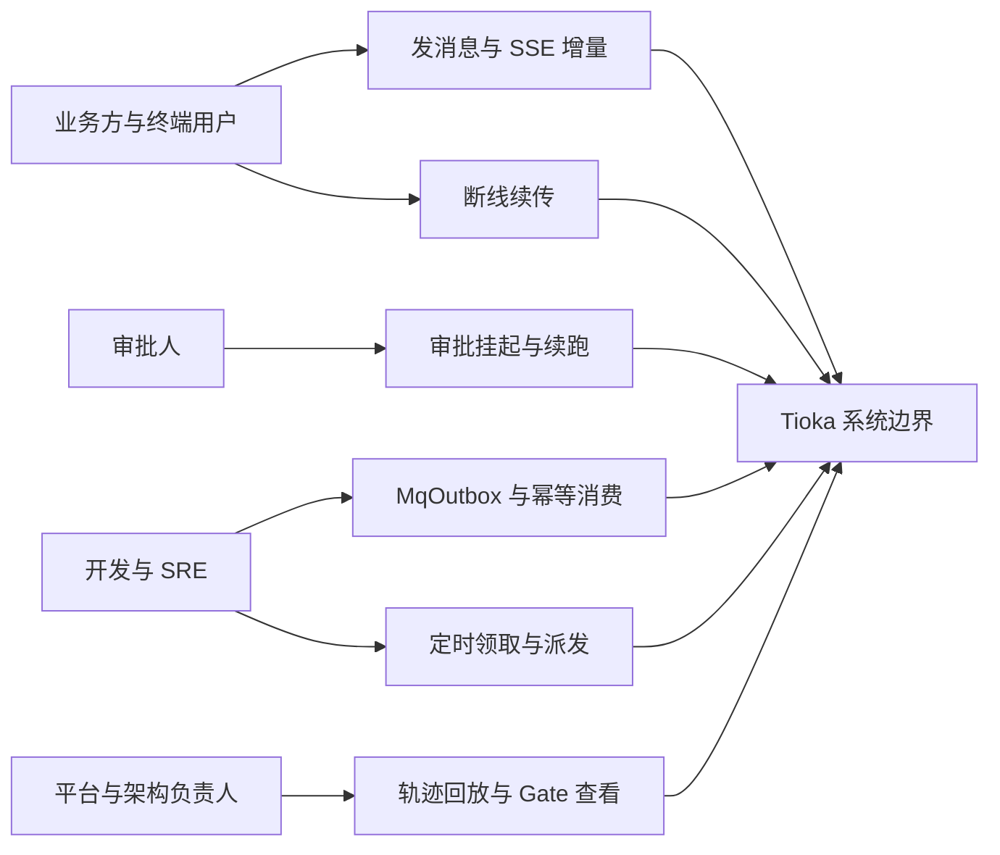
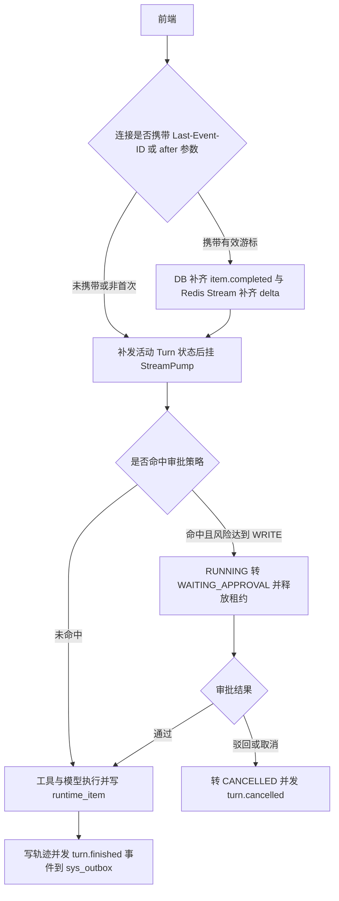
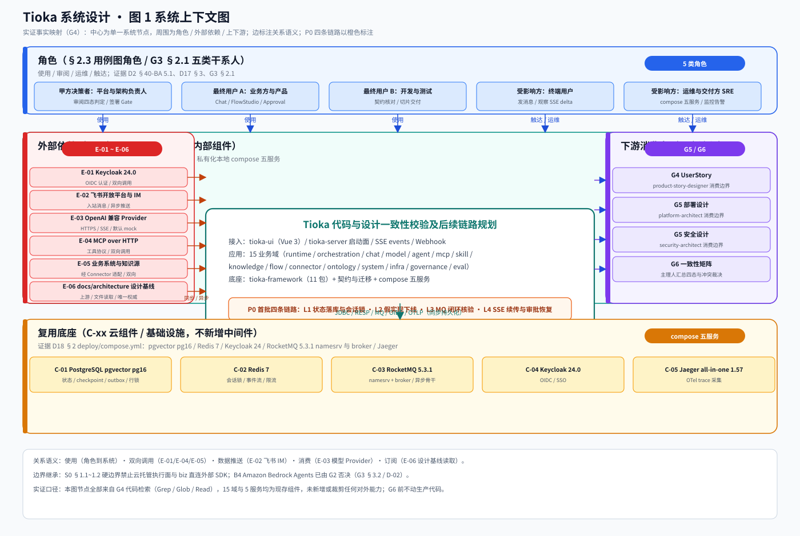
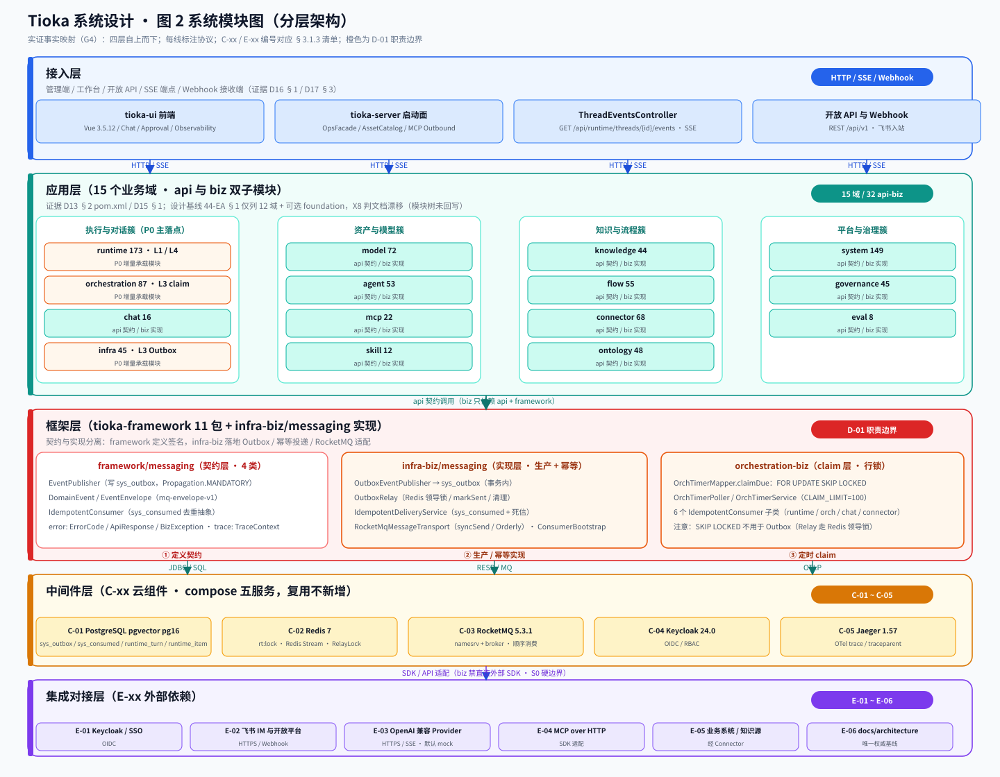
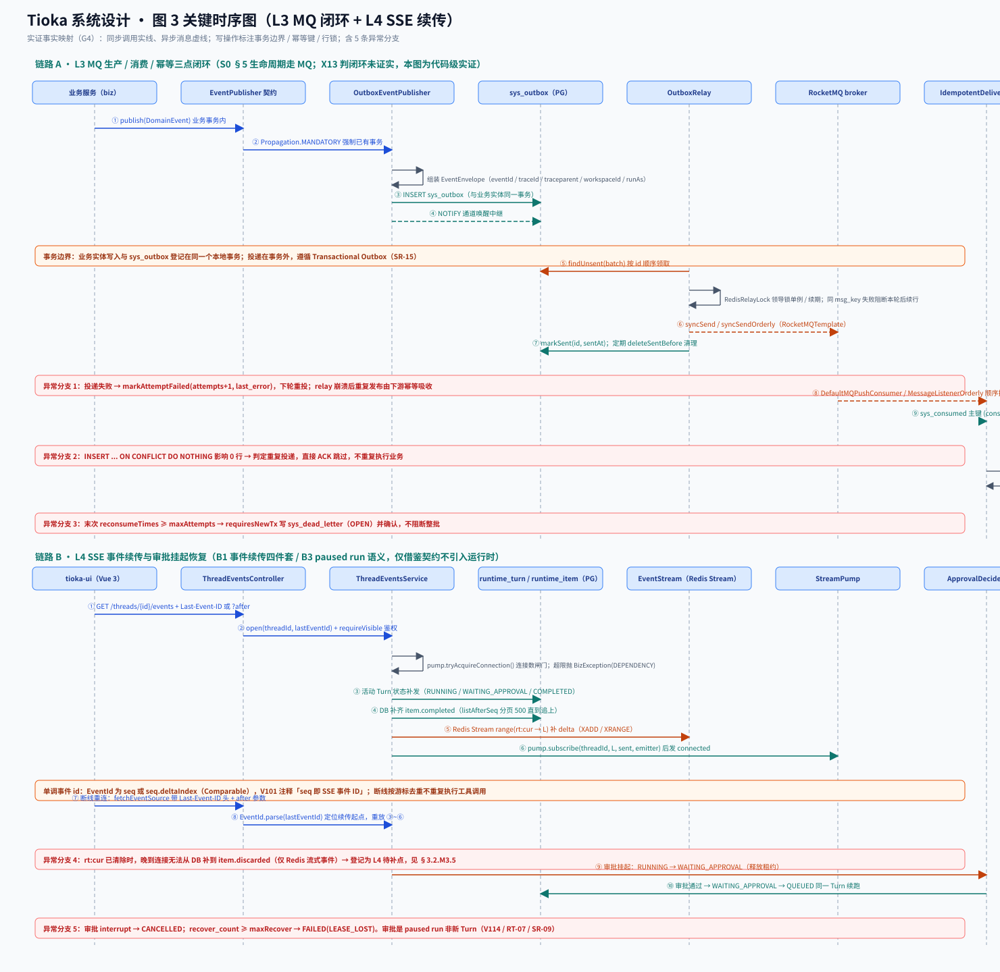
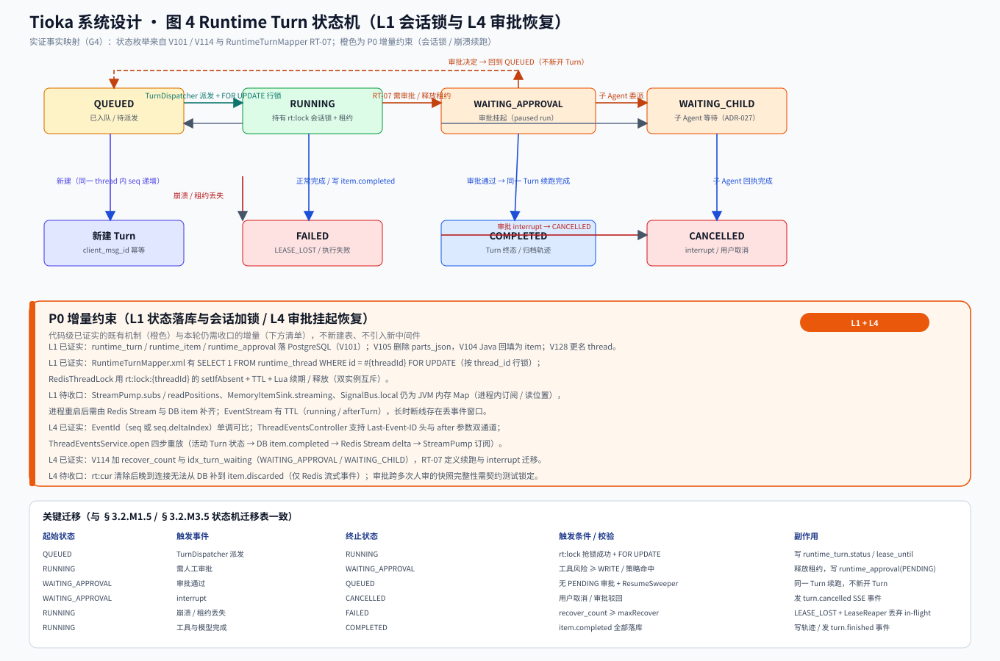

# Tioka 代码与设计一致性校验 · 系统设计

> 本文档是 G4 阶段产物，是 `platform-architect`（G5 部署设计）与 `security-architect`（G5 安全设计）的**系统设计基线**。
>
> **本轮不是从零做系统设计**。Tioka 已有完整设计体系（企业架构 40 至 48、系统详设 S0 至 S15、ADR-008 至 075、施工 M0 至 M4 与 F、34 号执行计划、9 份既有调研、30 张 drawio）与可运行代码（883 个 main 与 258 个 test Java、15 个业务域、41 份 Flyway 迁移、Vue 3 前端、compose 五服务）。本轮交付物是「代码与设计一致性实证校验 + 首批 P0 四条链路的可落地增量设计」。
>
> **证据口径（全文通用）**：事实 = G1 冻结的 `material_digest.md` D / X / V 编号、G2 冻结的 `research_report.md` SR 编号、G3 冻结的《高层架构设计》条文，或本角色 G4 以 `Grep` / `Glob` / `Read` 实际检索到的代码路径与行号；推断 = 由事实结合本项目语境作出的判断，逐条标注依据与局限；建议 = 本阶段裁决与下游转交，属待 G4 人工审核确认的评估性结论。
>
> **时差声明（重要）**：G3 的 X13、BA-05、L1 缺口等判定基于 2026-11-05 归档快照（`design-notes/01`、`33 §1.1`）；本角色在 2026-11-08 对现仓做实证检索，发现多处代码已推进到远超归档快照的状态。本文严格**继承 G3 冻结的业务边界、四态裁决与 P0 范围**，同时如实登记代码实证结论，两者并列、标注时差，不改判 G3 已冻结的四态定性，不扩展新业务域。

---

## 0. 元信息：修订记录

| 文档版本 | 发布日期 | 修订人 | 修订说明 |
| --- | --- | --- | --- |
| v1.0 | 2026-11-08 | system-architect（高见远） | 首轮：S0 至 S15 十六个系统域四态判定、六项实证核查结论表、P0 四条链路（L1 至 L4）的接口契约与模块与数据增量为设计、4 张图示内嵌、模板 §0 至 §8 全覆盖、四次中间确认自检 |

**本角色边界声明（唯一 Owner）**：本阶段只产出《系统设计》一份文档。未重写业务价值与产品目标（归 `business-architect`）、未给出资源预算与发布策略（归 `platform-architect`）、未输出完整安全方案（归 `security-architect`）、未重定义业务边界或扩展新业务域、未修改仓库任何源码或既有设计文档、未生成第二份交付文档、未与 `product-story-designer` 直连通信、未下发或调度其他成员。G6 通过前不动生产代码；本文所有 DDL 与契约均为**设计增量**，不是已执行的迁移。

**上游继承（逐字读取，不依赖摘要）**：
- `.workbuddy/output/高层架构设计.md`（823 行，G3 冻结）：§2.6 十六条四态判定、§4.4 的 X8 / X13 / X3 / X4 裁决、§4.5 的 L1 至 L10 链路优先级、§5.2 系统依赖架构、§6.1 In-Scope 12 条与 Out-of-Scope 8 条、§6.3 功能清单 F1 至 F13，全部继承且不得冲突。
- `.workbuddy/output/material_digest.md`（511 行，G1 冻结）：§2.0 双索引导航、§3 冲突 X1 至 X14、§3.2 待验证点 V1 至 V7。
- `.workbuddy/output/research_report.md`（588 行，G2 冻结）：Q2 的 Outbox / 幂等 / SKIP LOCKED、Q5 的 ArchUnit 与 CDC 工程范式、§4.3 技术栈参考建议。
- 模板 `skills/aicoding-team-bootstrap/templates/系统设计.md`（1500 行，只读参考）：§0 至 §8 章节骨架与硬指标。
- 公共协议 `skills/aicoding-team-bootstrap/protocols/intermediate_confirmation.md`：§2.1 两条触发标准、§2.3 反向验证 3 问、§3.2 五项必填字段。

**已锁定编排口径（只引用、不重新裁决）**：
- **X1**：以 `docs/architecture/implementation/34-M0至M4推进规划与工作项.md` 为执行权威；README 与 31 号「33 为后续推进权威」判为文档漂移。
- **X9**：34 号 G0 至 G4 与 GF 为里程碑口径，S0 §13 G1 至 G7 为能力门禁清单，两套标签不混用；完成度按 31 §11 的 slice / fidelity / exit 三级。
- **用户裁决方案 A（经中间确认，2026-11-08 冻结）**：P0 = L1 至 L4 四条地基链路；P1 = L5 至 L8；P2 = L9 至 L10；维持排除云托管执行面。
- **X8 / X13 裁定**：X8 = 漂移（设计已由 ADR-025 / 031 / 036 补充三域，44-EA §1 与 module-dependencies §1 模块树未回写），15 域为事实基线；X13 = 闭环未证实（不成立）；X3 / X4 = 飞书镜像漂移，镜像不参与校验基线。
- **X11 与 47-GL §3**：权威隔离边界为 Workspace，平台管理员角色码 `system_admin`，新建 DO 与 API 禁用 `tenantId`，新字段一律 `workspaceId`。

**图示清单（由本角色直接调用 `diagrams-generator` 生成并内嵌，零依赖 SVG 矢量图 + 可复现源码）**：

| 图号 | 名称 | 内嵌位置 | 源码与矢量图路径 |
| --- | --- | --- | --- |
| 图 1 | 系统上下文图 | §3.1.1 | `pic/system-context/system-context.py` 与 `.svg` |
| 图 2 | 系统模块图（分层架构） | §3.1.2 | `pic/system-modules/system-modules.py` 与 `.svg` |
| 图 3 | 关键时序图（L3 MQ 闭环 + L4 SSE 续传） | §3.2.1 | `pic/system-sequence/system-sequence.py` 与 `.svg` |
| 图 4 | Runtime Turn 状态机图 | §3.2.M1.5 | `pic/system-statemachine/system-statemachine.py` 与 `.svg` |

四张 SVG 均通过 `python3` 标准库 `xml.dom.minidom` 的 XML 合法性校验；绘图原语复用 `pic/_svgkit.py`。

**中间确认裁决记录（经中间确认）**：本文 §3.5.2、§4.2、§4.5、§2.6 的 S1 行与文末 decision 中涉及「L1 状态落库承载形态」的取值，按公共协议已发起 1 次 `[中间确认]`；用户在 G4 阶段内单题弹窗裁决原文为「方案 A：复用补链（推荐）」，与全文工作基线一致。按公共协议 §5 及阻塞范围 / 期望回答时限字段的既定处理方式，仅将上述各处状态词定点更新为「经中间确认 · 已冻结」，不改动任何表格数值、模块划分、四态判定结论与其余章节，不整体重写，不就已裁决论题重复发起同一 `[中间确认]`。追溯证据：V101 / V105 / V114 / V128 状态落库与更名、`RuntimeTurnMapper.xml` 的 `FOR UPDATE` 行锁、`RedisThreadLock` 会话锁、`ThreadEventsService.open` 四步重放。G3 §2.5 登记「无 checkpoint 表」被本轮代码实证推翻，单列为「设计基线漂移」证据，由主理人在 G6 合稿时统一纳入冲突裁决台账，本角色不回写 G3 冻结产物。

---

## 1. 引言

### 1.1 文档目标

- **一句话定位**：本文档定义 Tioka 既有平台在「代码与设计一致性校验」结论之上，首批 P0 四条链路（L1 状态落库与会话加锁、L2 假实现下线、L3 MQ 三点核验与补链、L4 SSE 续传与审批恢复）落地所需的系统级增量设计。
- **读者对象**：架构师 / 开发 / 运维 / 安全 / 评审委员会，以及 G5 的 `platform-architect` 与 `security-architect`。
- **设计范围**：业务架构（继承 G3）+ 应用架构 + 数据库设计 + 部署架构 + 网络架构 + 安全设计 + 可观测设计；不含资源预算与发布策略，不含完整威胁模型。
- **本轮语义**：① 对 S0 至 S15 系统域做代码与设计一致性**实证校验**（四态判定，逐条带代码路径或 D 编号出处）；② 为 P0 四条链路给出可落地的接口契约、模块设计、数据与可观测增量设计。

### 1.2 关联文档清单

| 输入类型 | 内容要点 | 在本文档中的用途 | 形式 |
| --- | --- | --- | --- |
| 业务边界与 P0 范围 | G3 §2.6 十六条四态判定、§4.4 冲突裁决、§4.5 链路优先级、§6.1 边界、§6.3 功能清单 | 第 2 章业务架构、附录 A 与 E | 外部文档（G3 冻结） |
| 设计基线与代码证据双索引 | `material_digest.md` §2.0 的 D 编号与路径，X1 至 X14，V1 至 V7 | 全章证据出处、附录 B 实证核查 | 外部文档（G1 冻结） |
| 非功能性需求与工程范式 | G2 Q2 的 Outbox / 幂等 / SKIP LOCKED、Q5 的 ArchUnit 与 CDC、§4.3 技术栈 | §3.5 / §4 / §8 | 外部文档（G2 冻结） |
| 系统定位与边界 | S0 §1.1 至 1.2 硬边界、§2.3 非目标、§5 生命周期走 MQ、§13 门禁 | §2.4 / §3.1.3 / §5 | 外部文档（docs/architecture） |
| 外部系统 API 与云组件清单 | Keycloak 24.0 OIDC、飞书开放平台、OpenAI 兼容 Provider、MCP over HTTP；compose 五服务版本 | §3.1.3 集成架构 | 本文档自带（含代码实证） |
| 团队与行业规范 | 44-EA §2 R1 至 R6、47-GL §3 术语取代注、48-CS 编码规约、W0-17 契约冻结 | §3.1.4 / §3.2.1 / §4.1 | 外部文档 + 本文档自带 |
| 代码现状实证 | 本角色 G4 对 `tioka-framework` / `tioka-modules` / `tioka-server` / `tioka-ui` / `deploy` 的检索结果 | 附录 A 四态判定、附录 B 六项核查 | 本文档自带 |
| 自动校验基线 | `validate_template_compliance.py` 系统设计 12 项与通用占位符正则 | 附录 D 模板覆盖核对 | 外部脚本 |

### 1.3 名词与术语表

> 本表是「业务名 ↔ 代码对象 ↔ 数据表」三层映射的唯一索引。权威术语遵循 47-GL §3；`tenantId` 仅作历史遗留登记，不作新设计字段。

| 业务术语 | 业务定义（不超过 30 字） | 应用层核心对象（§3.3 O-xx） | 数据库表名（§4.2） |
| --- | --- | --- | --- |
| 会话 Thread | 一次对话的持久标识与隔离边界 | `RuntimeThreadDO` | `runtime_thread` |
| 轮次 Turn | Thread 内一次执行单元，状态机载体 | `RuntimeTurnDO` | `runtime_turn` |
| 条目 Item | Turn 流式输出的最小持久化单元 | `RuntimeItemDO` | `runtime_item` |
| 单调事件游标 | SSE 事件 id，seq 或 seq.deltaIndex | `EventId` | `runtime_item.seq` |
| 审批挂起 | 同一 Turn 的 paused run，非新 Turn | `RuntimeApprovalDO` | `runtime_approval` |
| 事务发件箱 | 与业务实体同事务登记的待投递事件 | `SysOutboxDO` | `sys_outbox` |
| 幂等消费记录 | 消费组与事件 id 的去重主键 | `SysConsumedDO` | `sys_consumed` |
| 死信 | 末次重试失败后待人工处置的事件 | `SysDeadLetterDO` | `sys_dead_letter` |
| 事件信封 | 跨域 MQ 事件的标准协议 | `EventEnvelope` | `sys_outbox.payload_json` |
| 会话锁 | 按 thread_id 互斥的跨进程租约 | `RedisThreadLock` | Redis 键 `rt:lock` |
| 定时领取 | 多实例互斥领取到期 orch_timer 行 | `OrchTimerMapper` | `orch_timer` |
| 隔离边界 Workspace | 权威数据隔离粒度，取代 Tenant | `Principal.workspaceId` | 各表 `workspace_id` |
| 假实现 | 对外暴露的占位 API，须先下线 | `NotImplemented` | 不落表 |
| 完成度 | slice / fidelity / exit 三级，绿灯不等于 exit | `progress.md` 索引 | 不落表 |

---

## 2. 业务架构

> 本章继承 G3 §5.1 与 §6.2 冻结的业务边界。**业务域分组 5 个**（与 §4 数据库分组一致），其下 15 个系统域为 G3 冻结的事实基线，不拆分、不合并、不新增；分组只是标注，不是重定义边界。

### 2.1 业务架构概览

#### 2.1.1 业务全景图

**业务域清单（5 个分组，与 §4 数据库分组一致）**：

| 业务域 | 核心场景 | 涉及角色 | 与其他业务域的关系 | 数据库分组（§4） |
| --- | --- | --- | --- | --- |
| 执行与对话域 | 会话发消息、SSE delta、审批续跑、编排派发 | 业务方 / 终端用户 / 开发 | 上游 资产与模型域 / 下游 基础能力域 | `runtime_*` 与 `orch_*` 表 |
| 资产与模型域 | Provider 与 RoutingPlan、Agent 发布、MCP Grant、Skill 执行链 | 业务方 / 平台管理员 | 上游 接入层 / 下游 执行与对话域 | `model_*` 与 `agent_*` 表 |
| 知识与流程域 | 知识入库检索、Flow DAG、连接器与本体 | 业务方 / 运维 | 上游 飞书开放平台 / 下游 执行与对话域 | `knowledge_*` 与 `flow_*` 表 |
| 平台与治理域 | 身份与 Workspace、审计、配置版本、评测 | 平台管理员 / 运维 / SRE | 支撑全部业务域 | `auth_*` 与 `audit_*` 表 |
| 基础能力域 | framework 契约、Outbox 与幂等、迁移、compose 五服务 | 开发 / SRE | 被全部业务域依赖，禁止反向 | `sys_*` 表 |

**15 个系统域归属（G3 §5.1 四簇事实基线，逐域不改）**：执行与对话域含 runtime 173、orchestration 87、chat 16；资产与模型域含 model 72、agent 53、mcp 22、skill 12；知识与流程域含 knowledge 44、flow 55、connector 68、ontology 48；平台与治理域含 system 149、infra 45、governance 45、eval 8。括号内为各域 main 源数，出处 D15 §1。三域 ontology / governance / eval 由 ADR-025 / 031 / 036 补充，属 X8 文档漂移，整改列 P1 / L7，不并入首批 P0。

**业务主链路（端到端，G3 §5.3 原文继承）**：登录与身份 → Provider 与 RoutingPlan 配置 → Agent 发布与 MCP Grant → 会话发消息 SSE delta → 工具结果回流 → 审批挂起与恢复 → 轨迹与审计归档 → 反馈回路。

### 2.2 领域关系映射

#### 2.2.1 限界上下文清单

> 域类型严格使用**核心域 / 支撑域 / 通用域**三类。核心域为业务护城河投入最多资源自研；支撑域必要但非差异化，可自研可外采；通用域为通用能力，优先复用或外采。

| 限界上下文 | 对应业务域 | 域类型 | 覆盖的核心业务实体 | 上下文边界 |
| --- | --- | --- | --- | --- |
| Runtime-BC | 执行与对话域 | 核心域 | Thread / Turn / Item / EventId / Approval | 属于：状态机、事件游标、会话锁；不属于：模型路由与工具执行实现 |
| Orchestration-BC | 执行与对话域 | 核心域 | OrchRun / Receipt / OrchTimer | 属于：编排派发、定时领取、回执；不属于：Runtime 内核状态 |
| Chat-BC / Connector-BC | 执行与对话域 / 知识与流程域 | 核心域 / 支撑域 | Conversation / ChatMemory / FeishuBinding | 属于：会话索引与 IM 适配；不属于：外部 SDK 直连 |
| Model-BC / Agent-BC / Mcp-BC / Skill-BC | 资产与模型域 | 核心域 | RoutingPlan / AgentSnapshot / McpServer / Skill | 属于：资产版本与 Grant；不属于：执行面 |
| Knowledge-BC / Flow-BC / Ontology-BC | 知识与流程域 | 支撑域 | Document / FlowRun / OntologyDoc | 属于：知识入库与 DAG；不属于：模型推理 |
| System-BC / Governance-BC / Eval-BC | 平台与治理域 | 支撑域 | Workspace / Principal / AuditEvent / EvalDataset | 属于：身份与审计与评测；不属于：业务执行 |
| Infra-BC | 基础能力域 | 通用域 | SysOutbox / SysConsumed / SysDeadLetter | 属于：Outbox 与幂等投递；不属于：业务语义 |
| Framework-BC | 基础能力域 | 通用域 | EventPublisher / DomainEvent / EventEnvelope / IdempotentConsumer / ErrorCode / TraceContext | 属于：契约签名；不属于：具体实现与持久化 |

注：`Infra-BC` 与 `Framework-BC` 均属通用域，优先复用既有 framework 与 infra-biz；`Runtime-BC` 与 `Orchestration-BC` 属核心域，是 P0 四条链路的主要投入面。

#### 2.2.2 上下文映射（Context Mapping）

> 五种关系模式全部使用，且均为**对既有代码依赖关系的客观标注**，不是在多种协作方案之间做新选择（自检见附录 C 自检点 1）。

| 关系编号 | 上游上下文 | 下游上下文 | 关系模式 | 同步方式 | 选择理由（代码证据） |
| --- | --- | --- | --- | --- | --- |
| C-01 | Runtime-BC | Orchestration-BC | Customer/Supplier | MQ 异步 | OrchTurnWatcher 与 OrchDispatcherConsumer 消费 `RuntimeMqTopics.TOPIC`，上游按下游诉求提供事件 |
| C-02 | 外部 Keycloak / 飞书 / Provider | 各业务 BC | ACL 防腐层 | API 同步 + 适配器 | `OidcIdPAdapter`、`FeishuDocSyncApi`、`BearerTokenFilter` 把外部模型挡在域外，S0 §1.1 至 1.2 要求 biz 禁直连外部 SDK |
| C-03 | Framework-BC | Infra-BC / 全部业务 BC | Shared Kernel | 共享接口与枚举 | `EventPublisher` / `DomainEvent` / `EventEnvelope` / `IdempotentConsumer` / `ErrorCode` 为全仓共享契约，与 W0-17 契约冻结一致 |
| C-04 | OpenAI 兼容 Provider / MCP over HTTP | Model-BC / Mcp-BC | Conformist | HTTPS 同步 | 外部协议不可议价，本域直接遵循对方契约，不反向塑形 |
| C-05 | Infra-BC | 6 个 IdempotentConsumer 子类 | Published Language | 消息事件 + `mq-envelope-v1` | 上游以标准信封对外暴露，多个下游共同消费 |
| C-06 | 各业务 BC | tioka-server 启动面 | Open Host Service | REST 同步 | `OpsFacadeController` 与 `AssetCatalogController` 经各域 api 接口提供标准 API，实证已不再 import 各域实现类 |

关系模式说明：Customer/Supplier 用于上下游强协作且下游能影响上游迭代节奏（Runtime 事件 → 编排）；Conformist 用于顺从强势上游（外部模型与 IM 平台）；ACL 用于在本域和外部域之间建适配层，外部模型变化不影响本域（对接外部强势平台必用）；Shared Kernel 用于多个上下文共享一小块稳定代码或模型，维护成本高，本轮仅 framework 契约层使用；Published Language 用于上游以标准协议对外暴露、多下游消费；Open Host Service 用于上游提供标准 API 接口，经 RPC 或 REST 对外。

#### 2.2.3 跨域协作原则

| 原则编号 | 原则 |
| --- | --- |
| P-01 | 核心域 → 支撑域 / 通用域：禁止反向依赖（44-EA §2 R1：biz 禁止依赖其他 biz；R2：biz 只依赖 api 加 framework 加中间件 starter） |
| P-02 | 核心域之间：禁止直接耦合，必须经事件或 api 解耦（44-EA §2 R4：MQ Topic 与 Tag 只在 api 常量类定义，实证 15 个 `*MqTopics.java` 均在 api 子模块） |
| P-03 | 对接外部不可控系统：必须建 ACL 防腐层，禁止把外部模型贯穿到本域（S0 §1.1 至 1.2 硬边界） |

### 2.3 详细业务架构

#### 2.3.1 用例图

**用例图清单**（角色 — 用例 — 系统边界，覆盖核心业务不低于 80%）：

| 编号 | 用例图标题 | 涉及业务域 | 源文件位置 |
| --- | --- | --- | --- |
| UC-01 | 会话发消息与 SSE 增量渲染 | 执行与对话域 | `tioka-ui/src/views/Chat` 与 `tioka-ui/src/api/stream.ts` |
| UC-02 | 断线按 Last-Event-ID 续传 | 执行与对话域 | `tioka-ui/src/api/stream.ts` 与 `ThreadEventsController` |
| UC-03 | 审批挂起与同一 Turn 续跑 | 执行与对话域 | `tioka-ui/src/api/approval.ts` 与 `ApprovalDecideService` |
| UC-04 | 跨域生命周期事件发布与幂等消费 | 基础能力域 | `infra-biz/messaging` 与 6 个 Consumer 子类 |
| UC-05 | 定时领取与编排派发 | 执行与对话域 | `OrchTimerMapper.xml` 与 `OrchTimerPoller` |
| UC-06 | 运行轨迹回放与 Gate 状态查看 | 平台与治理域 | `tioka-ui/src/views/Observability` 与 `TrajectoryQueryService` |



#### 2.3.2 业务流程图

> 关键流程以角色泳道描述，判定节点带明确分支条件文字，禁用无语义的「是 / 否」。

**关键流程清单**：

| 流程编号 | 流程名 | 起点 | 终点 | 涉及业务域 |
| --- | --- | --- | --- | --- |
| BF-01 | 会话首连与四步状态重放 | 前端发起 events 连接 | SSE 增量持续推送 | 执行与对话域 |
| BF-02 | 断线续传与游标去重 | 连接中断 | 按游标补齐后继续 | 执行与对话域 |
| BF-03 | 审批挂起与同一 Turn 恢复 | 工具命中审批策略 | 续跑或取消 | 执行与对话域 |
| BF-04 | 业务事务内登记 Outbox 并异步投递 | 业务实体写入 | 消费者处理完成或写死信 | 基础能力域 |
| BF-05 | 定时领取到期 orch_timer 行 | 定时器扫描 | 派发并回执 | 执行与对话域 |



### 2.4 业务范围与边界

#### 2.4.1 功能模块清单

> 编号与 G3 §6.3 功能清单 F1 至 F13 一一对应，P0 与 MVP 一一对应，不新增功能、不改优先级。

| 编号 | 一级功能名 | 子功能描述 | 对应业务域 | 实现状态 |
| --- | --- | --- | --- | --- |
| F1 至 F5 | 一致性校验与链路规划 | 四态判定、冲突裁决、34 号状态核对、P0 至 P2 清单、业务架构图与闭环 | 跨域 | 已由 G1 至 G3 完成 |
| F6 | L1 状态落库 | checkpoint 与按 thread_id 会话加锁（经中间确认方案 A 冻结为 P0 / MVP） | 执行与对话域 | 代码级已证实落库与行锁，增量待补（附录 B 核查点 3） |
| F7 | L2 假实现下线 | 六类逐类给出结论并下线或替换（经中间确认方案 A 冻结为 P0 / MVP） | 资产与模型域 | 实证五类已下线，fork 为 M3 占位（附录 B 核查点 1） |
| F8 | L3 MQ 闭环核验 | 生产 / 消费 / 幂等三点结论与补链入口（经中间确认方案 A 冻结为 P0 / MVP） | 基础能力域 | 实证三点代码级齐备（附录 B 核查点 2） |
| F9 | L4 SSE 续传 | 事件 id 单调递增加状态快照重放、审批不新开 Turn（经中间确认方案 A 冻结为 P0 / MVP） | 执行与对话域 | 实证四步重放与双通道续传齐备，两处待补（附录 B 核查点 4） |
| F10 | X 类整改与模块树回写 | X8 / X3 / X4 / X1 / X7 整改与 publish 重生成 | 跨域 | P1，不并入首批 |
| F11 | 配额成本与字段贯通 | 异步记账、gen_ai 字段适配层、traceId 贯通 | 资产与模型域 | P1，不并入首批 |
| F12 | ArchUnit 与契约测试 | 分层与环检测进 CI、并行 schema 破坏性变更流程 | 基础能力域 | P1，不并入首批 |
| F13 | 三模块密度与 HA 验收 | 三域密度对齐、双实例 HA、真实模型连跑、哈希链 | 平台与治理域 | P2，不并入首批 |

`[MOCK]` 标注：`KernelRuntimeService.fork` 抛 `NotImplemented.of("runtime-fork", "M3")`，是 M3 预留占位的显式标注，完整版替换点见 §3.2.M4.5；`OrchController.claimRemoved` 抛 `NotImplemented.of("OrchController.claim", "ORC-03")`，替换点为 ORC-03 完成时删除旧 `OrchApi` 根包。

**In-Scope（本期必做，12 条，继承 G3 §6.1）**：S1 全仓分域四态判定矩阵；S2 十四条冲突裁决或转交台账；S3 34 号计划 6 项核对与仓库外取证转交；S4 链路 P0 至 P2 优先级清单；S5 三层业务架构图、系统依赖架构、业务闭环图；S6 首批 P0 链路 L1 至 L4 的业务边界与退出标准；S7 X8 / X13 / X3 / X4 业务层明确裁决；S8 G2 依赖 D-01 至 D-06 逐条处理结论；S9 15 个业务域与 compose 五服务在依赖架构中的标注；S10 五类角色、八条痛点、六条目标与九条缺口；S11 功能清单与产品模块全景图；S12 现有前端触点端页面清单与关键交互约束。

**Out-of-Scope（本期不做，8 条，继承 G3 §6.1）**：O1 云托管 Agent 执行面与外部执行器引入（S0 硬边界，永久不做）；O2 重做全量架构文档或另起一套架构体系；O3 真实模型夜间 workflow 连跑 3 天（U-01 取证）；O4 双实例 HA 与 Keycloak 非 mock 验收（U-02 取证）；O5 G6 通过前改动生产代码；O6 跨租户 SaaS 与外购运行时；O7 首个 MVP 引入 ClickHouse / S3 / 新增中间件或商业采购；O8 决定数据库表结构、资源规格、运行时拓扑、部署与安全的最终方案（O8 在本阶段由本文给出**系统设计增量**，最终资源与发布策略仍归 G5）。

### 2.5 质量与柔性可用

#### 2.5.1 服务质量目标

| 优先级 | 质量目标 | 业务驱动 | 受影响的关键章节 |
| --- | --- | --- | --- |
| Q1 | 状态可恢复：进程重启后会话状态可恢复，同 thread 并发串行化 | 34 号 M1「安全可用的单内核」与 L1 退出标准 | §3.2.M1 / §4.2 / §5.2 |
| Q2 | 事件不丢不重：单调事件 id 加状态快照重放，断线续传不重复执行工具 | 40-BA §5.1 PoC 黄金路径与 L4 退出标准 | §3.2.M3 / §3.5.2 / §8 |
| Q3 | 异步闭环可信：生产 / 消费 / 幂等三点均可核验，至少一次投递下不重复执行业务 | S0 §5 与 X13 / V4 | §3.2.M2 / §4.2 |
| Q4 | 可维护性：新增设计不改分层与依赖方向，MVP 骨架为完整版子集 | G3 §4.3 演进纪律与 44-EA §2 R1 至 R6 | §3.1.4 / §3.2.1 |
| Q5 | 合规可控：私有化 compose 五服务，数据不出境，Workspace 隔离 | S0 §1.1 至 1.2 与 X11 | §5 / §7 |

**可验证质量场景**（参考 SEI ATAM）：

| 场景编号 | 关联目标 | 触发源 | 触发条件 | 期望响应 | 度量指标 |
| --- | --- | --- | --- | --- | --- |
| QS-01 | Q1 | 进程重启 | 单实例重启后按 thread_id 重连 | 从 runtime_turn 与 runtime_item 恢复活动 Turn | 状态恢复成功率 100%，同 thread 无并发双跑 |
| QS-02 | Q2 | 断线重连 | 携带 Last-Event-ID 值 5.2 重连 | 从游标之后补齐，不重复推送已收事件 | 重复事件数 0，工具重复执行数 0 |
| QS-03 | Q3 | 重复投递 | 同一 eventId 被重投两次 | sys_consumed 命中后直接 ACK | 业务 handle 执行次数 1 |
| QS-04 | Q4 | 新增 P0 链路 | 只改实现密度 | 不改 api 与 biz 依赖方向 | ArchUnit 环检测新增违规 0 |

#### 2.5.2 业务柔性可用策略

**业务功能优先级分层**（§2.4.1 每个一级功能均已标注层级，L0 数量不超过总数 30%）：

| 层级 | 含义 | 故障态下的处置方向 | 用户感知 |
| --- | --- | --- | --- |
| L0 核心业务 | 系统生命线，挂掉等于业务停摆 | 不降级，优先消耗所有资源保障 | 无或极轻微 |
| L1 重要业务 | 不影响主链路但用户高频使用 | 限流加排队加异步化 | 变慢或有排队提示 |
| L2 辅助业务 | 提升体验但非必要 | 关闭或返回兜底数据 | 部分功能不可用并有友好提示 |
| L3 附加业务 | 长尾与统计类 | 直接关闭加异步补偿 | 通常无感 |

功能分层：F6 状态落库 = L0；F8 MQ 闭环 = L0；F9 SSE 续传 = L1；F7 假实现下线 = L1；F1 至 F5 校验与规划 = L2；F10 至 F12 工程基线 = L2；F13 密度与 HA = L3。

**业务降级清单**：

| 编号 | 关联功能 | 触发条件 | 降级动作 | 用户感知 | 决策类型 |
| --- | --- | --- | --- | --- | --- |
| BD-01 | F9 | SSE 连接数达到上限 | 拒绝新连接并返回 300001 | 提示连接较忙并自动稍后重试 | 自动 |
| BD-02 | F9 | Redis Stream 已过 TTL 且游标过旧 | 从 runtime_item 补齐已完成条目，仅丢流式 delta | 少量文字可能不连续，工具结果完整 | 自动 |
| BD-03 | F8 | Outbox 投递连续失败 | 按 msg_key 阻断本轮后续行，下轮重投 | 异步事件稍后到达，会话不中断 | 自动 |
| BD-04 | F8 | 消费者达到最大重试次数 | 写 sys_dead_letter 并确认，转人工处置 | 用户无感，运维收到 P2 告警 | 自动加人工 |

---

### 2.6 S0 至 S15 系统域四态判定汇总（本轮核心）

> 判定对象为**系统详设域 S0 至 S15**，与 G3 §2.6 的业务架构域 BA-01 至 BA-16 是不同校验对象，两者并列、不互相覆盖。四态为「一致 / 漂移 / 缺失 / 设计自身矛盾」。证据列给出代码路径或 D 编号；带「时差」标记者表示本角色 2026-11-08 实证结论比 G3 所引归档快照更新，仅登记、不改判 G3 定性。

| 编号 | 校验对象 | 设计基线 | 代码实证（G4 检索） | 四态 | 判定依据与时差 |
| --- | --- | --- | --- | --- | --- |
| S0-01 | S0 §1.1 至 1.2 硬边界与 §2.3 非目标 | D3 §S0 1.1 至 2.3 | `deploy/compose.yml` 五服务，无云托管执行依赖 | 一致 | 与 G3 BA-03 / BA-04 一致 |
| S0-02 | S0 §5 系统级生命周期走 MQ | D3 §S0 5 | `framework/messaging` 4 类 + `infra-biz/messaging` 14 类 + `RocketMqMessageTransport` + 6 个 Consumer + V130 三表 | 缺失（G3 定性继承） | G3 §4.4 X13 裁定「闭环未证实」；本角色实证代码级三点齐备（附录 B 核查点 2），属**时差**：底座与链路代码已远超 2026-11-05 快照，但按 X13 不把 BA-05 从缺失改判为一致，运行时闭环仍待 V7 / U-01 取证 |
| S0-03 | S0 §13 门禁 G1 至 G7 与 34 号 G0 至 G4 / GF | D3 §S0 13；D5 §34 | `M3GateStubsTest` 五用例；`progress.md` 330 用例索引 | 设计自身矛盾 | X9 已锁定两套标签不混用，不重裁 |
| S1-01 | S1 §5 状态机与 §6 API 契约 | D3 §S1 5 至 7；ADR-016 | `runtime-biz` 173 main；`RuntimeTurnMapper.xml` 有 `FOR UPDATE`；`RedisThreadLock`；V101 / V114 / V128 | 一致（时差） | 状态已落库、按 thread_id 行锁与 Redis 锁均已落地，纠正 G3 §2.5「单机内存状态 / 无 checkpoint 表」的归档快照表述；四态仍按 G3 L1 为 P0 待补链，承载形态「经中间确认 · 已冻结」 |
| S1-02 | S1 SSE 事件续传与审批恢复 | w0-contract-freeze Part Schema v0；ADR-027 | `EventId` / `ThreadEventsController` / `ThreadEventsService.open` / `tioka-ui/src/api/stream.ts` / V114 | 一致（时差） | 四步重放、双通道续传、paused run 均已代码级落地；两处待补点见附录 B 核查点 4 |
| S2-01 | S2 §6 至 7 API 与 MQ、ORC-06 定时领取 | D3 §S2 6 至 7；ADR-020 | `OrchTimerMapper.xml` 的 `FOR UPDATE SKIP LOCKED`；`OrchTimerPoller`；`OrchTimerService` CLAIM_LIMIT=100；`OrchDispatcherConsumer` | 一致 | D-01 的 claim 职责边界已实证，见 §3.5.2 |
| S2-02 | S2 根包 OrchApi 与 claim API 遗留 | 47-GL §4 遗留登记 | `orchestration/api/OrchApi.java` 与 `OrchController.claimRemoved` 抛 NotImplemented | 漂移 | 47-GL §4 已自我登记，列 P1 / L7 回写，不并入 P0 |
| S3-01 | S3 Chat 能力地图与密度 | D3 §S3 2；ADR-022 | `chat-biz/ChatDensityService.java` 为真实记忆服务；`ChatIndexConsumer` | 一致 | 与附录 B 核查点 1 的假实现结论互证 |
| S4-01 | S4 Knowledge 入库检索 | D3 §S4 2；ADR-055 至 057 | `knowledge-biz` 44 main；V119 embedding_dim | 一致 | 密度属 P2 / L9，不在首批 |
| S5-01 | S5 Flow 编排 | D3 §S5 2；ADR-043 | `flow-biz` 55 main；V146 flow_run_rebuild 在 contracts/db 独有 | 漂移 | A5 双副本版本号差异，见附录 B 核查点 5 |
| S6-01 | S6 Connector 与飞书适配 | D3 §S6 2；D10 §feishu-doc-sync | `connector-biz` 68 main；`ImSendPublisher` / `ImSendConsumer`；`FeishuDocSyncApi` | 一致 | 生产消费闭环在 connector 域已实证 |
| S7-01 | S7 HCI 与 Part 渲染 | D3 §S7 2；45-FE §5 | `tioka-ui/src/items/ItemRenderer.vue`；`stream.test.ts` HCI-02 续传用例 | 一致 | 30 张 drawio 与 45-FE 页面规格核对转交 G4 前端域人工查看（A6） |
| S8-01 | S8 §3 模块树与依赖 | D3 §S8 3；44-EA §2 | `tioka-modules/pom.xml` 15 域；`agent-biz/pom.xml` 单向依赖 `mcp-api` | 漂移 | X8 已裁定为文档漂移；实证 AG 与 MCP 反向环在代码中**已不成立**（附录 B 核查点 6） |
| S8-02 | S8 两个 Controller 直接 import 各域实现类 | D7 §01 第 6 项 | `OpsFacadeController` 与 `AssetCatalogController` 仅 import 各域 api 接口与 framework | 一致（时差） | 归档快照登记的渗漏**已整改**，见附录 B 核查点 6 |
| S9-01 | S9 Foundation 七类能力 | D3 §S9 2.1 至 2.7 | `system-biz` 149 main；`BearerTokenFilter` / `OidcIdPAdapter` / `Principal` | 一致 | Workspace 口径已落地 |
| S10-01 | S10 Model Hub 完整能力 | D3 §S10 2；ADR-017 | `model-biz` 72 main；V117 model_gateway；V120 删 session_freeze | 一致 | 配额与成本归集属 P1 / L5 |
| S11 至 S14 | Agent / MCP / Skill / Flow 资产域 | D3 §S11 至 §S14 | 各域 api 与 biz 双子模块；`*MqTopics.java` 15 个均在 api | 一致 | 44-EA §2 R4 已满足 |
| S15-01 | S15 Foundation 基础平台与认证 | D3 §S15 9；ADR-051 至 054 | `system-biz` OIDC 与 RBAC；`deploy/compose.yml` Keycloak 24.0 | 一致 | 非 mock 验收属 U-02 / O4 |

**四态汇总**：一致 11 条（其中 4 条带时差）、漂移 3 条、缺失 1 条（继承 G3 X13 定性）、设计自身矛盾 1 条，合计 16 条校验对象。三条 P1 痛点（校验基线唯一性、完成度口径、MQ 闭环）均有对应判定行。

---

## 3. 应用架构

> 本章是系统设计核心，按模板骨架组织，全部组件名、类名、路径来自 G4 实证检索。

### 3.1 应用架构概览

#### 3.1.1 系统上下文



**系统上下文要素清单**：

| 节点类型 | 节点名 | 与本系统的关系 | 关系语义 |
| --- | --- | --- | --- |
| 角色 | 平台与架构负责人 | 使用 | 审阅四态判定与签署 Gate |
| 角色 | 业务方与产品负责人 | 使用 | Chat / FlowStudio / Approval 工作台操作 |
| 角色 | 开发与测试工程师 | 使用 | 契约核对与切片交付 |
| 角色 | 终端用户 | 使用 | 发消息与观察 SSE delta |
| 角色 | 运维与交付方 SRE | 使用 | compose 五服务运维与告警 |
| 上游平台 | E-06 docs/architecture | 推送 → 本系统 | 文件读取，唯一权威基线 |
| 外部业务系统 | E-01 Keycloak 24.0 | 双向调用 | OIDC 认证与单点登录 |
| 外部业务系统 | E-02 飞书开放平台与 IM | 双向调用 | 入站消息与卡片推送 |
| 第三方平台 | E-03 OpenAI 兼容 Provider | 本系统 → 调用 | HTTPS 与 SSE，默认 model.mock |
| 第三方平台 | E-04 MCP over HTTP | 双向调用 | 工具协议 |
| 下游平台 | G5 部署与安全设计、G6 一致性矩阵 | 本系统 → 推送 | 本文逐字注入 |

**diagrams-generator Phase 1 结构化输出**（场景识别：系统架构图 / 分层架构图）：

- **架构理解**：这是一张按 Tioka 真实组件绘制的分层事实映射图，不是新系统设计图；中心系统画成单一节点不展开内部组件，内部组件归图 2；橙色标注 P0 四条链路落点。
- **组件清单**：接入层为 tioka-ui、tioka-server 启动面、SSE events 端点、Webhook；应用层为 15 业务域按四簇归组；底座层为 tioka-framework、契约与迁移、compose 五服务、工程与可观测。
- **连接关系**：角色到系统为「使用」；外部系统为「双向调用 / 数据推送 / 消费 / 订阅」；系统到底座为 JDBC / RESP / MQ / OIDC / OTLP 同步持久化；系统到下游为逐字注入消费。
- **Mermaid 预览**：见 §2.3.1 与 §2.3.2 内嵌同义图，与 D9 §README 视觉体系一致。
- **工具选项表**：

| 方案 | 工具 | 速度 | 质量 | 输出格式 | 说明 |
| --- | --- | --- | --- | --- | --- |
| A | Mermaid 内嵌 | 快 | 3 星 | Markdown 内嵌 | 零依赖，可随文档逐字注入下游 |
| B | Python 标准库零依赖 SVG | 快 | 4 星 | SVG 矢量 | 无第三方库，输出可缩放矢量图与可复现源码 |
| C | `diagrams` 加 `graphviz` | 快 | 4 星 | PNG 与 SVG | 云图标丰富，但本环境缺 graphviz 二进制与 Python 库 |

- **推荐与锁定**：方案 A 加方案 B 组合。环境实测无 `diagrams` / `graphviz` / `matplotlib` / `cairosvg` / `Pillow`，方案 C 需安装系统级依赖，与「G6 前不动环境、不改仓库」约束不符。主理人已在编排层锁定「系统上下文图、模块图、关键时序图和状态机图由 system-architect 直接调用 diagrams-generator 生成并内嵌」的工具方案与产出目标，且 G3 已就同一工具方案结算，本角色据此直接采用推荐组合，不就工具选择另行发起阶段内中间确认（协议 §6：编排层已明确事项不重复打扰）。

#### 3.1.2 系统模块图



**分层组件清单**（自上而下，每条线标注协议）：

| 层次 | 内容 | 数据来源 |
| --- | --- | --- |
| 接入层 | tioka-ui（Vue 3，HTTP 与 SSE）、tioka-server 启动面、`ThreadEventsController`、开放 API 与 Webhook | §2.3 用例图角色；D16 §1；D17 §3 |
| 应用层 | 15 业务域按四簇归组，每域 api 与 biz 双子模块（api 放接口、DTO、MQ 常量、SPI；biz 放实现） | §2.1；D13 §3；D15 §4 |
| 框架层 | `tioka-framework` 11 包（契约）+ `infra-biz/messaging` 14 类（Outbox、Relay、幂等、RocketMQ 适配）+ `orchestration-biz` claim | §3.4；附录 B 核查点 2 |
| 中间件层 | C-01 PostgreSQL pgvector pg16、C-02 Redis 7、C-03 RocketMQ 5.3.1、C-04 Keycloak 24.0、C-05 Jaeger 1.57 | §3.1.3 云组件清单；D18 §2 |
| 集成对接层 | E-01 至 E-06 的对接桩与 SDK 封装入口 | §3.1.3 外部依赖清单 |

**D-01 职责边界（图中橙色三段，G3 §3.4 转交待办在本节给出明确分工）**：① `framework/messaging` 只定义契约签名（`EventPublisher` 声明写 `sys_outbox` 且 `Propagation.MANDATORY`；`IdempotentConsumer` 声明 `sys_consumed` 去重抽象）；② `infra-biz/messaging` 承担生产与幂等实现（`OutboxEventPublisher`、`OutboxRelay`、`IdempotentDeliveryService`、`RocketMqMessageTransport`、`RocketMqConsumerBootstrap`）；③ `orchestration-biz` 独立承担行锁 claim（`OrchTimerMapper.claimDue` 的 `FOR UPDATE SKIP LOCKED`）。**SKIP LOCKED 不用于 Outbox**：OutboxRelay 用 Redis 领导锁单例（`RedisRelayLock`）而非数据库行锁，两者职责不重叠。详见 §3.5.2 与 §4.2。

#### 3.1.3 集成架构

**外部依赖清单（E-xx）**：

| ID | 外部系统 | 归属团队 / 供应商 | 类别 | 使用方式 | 集成方式 | 协议 / 版本 | 功能定位 | 联系人 |
| --- | --- | --- | --- | --- | --- | --- | --- | --- |
| E-01 | Keycloak 24.0 | 运维与交付方 | 身份认证 | 消费 | OIDC / HTTPS | OAuth 2.0 / OIDC | 登录态校验与 SSO | 转交 G5 Owner |
| E-02 | 飞书开放平台与 IM | 外部厂商 | 通知推送 | 双向 | REST API 加 Webhook | 开放平台 v1 | 入站消息与卡片 | 转交 G5 Owner |
| E-03 | OpenAI 兼容 Provider | 外部模型供应商 | 第三方业务平台 | 消费 | HTTPS 加 SSE | OpenAI 兼容 | 模型调用与流式输出 | 转交 G5 Owner |
| E-04 | MCP over HTTP 工具端 | 外部工具提供方 | 第三方业务平台 | 双向 | HTTP 加 SDK | MCP over HTTP | 工具协议与 Grant | 转交 G5 Owner |
| E-05 | 业务系统与知识数据源 | 业务部门 | 业务协作 | 双向 | REST 经 Connector 适配 | 内部约定 | 数据同步与引用 | 转交 G5 Owner |
| E-06 | docs/architecture 设计基线 | 平台与架构负责人 | 监控审计 | 消费 | 文件读取 | 34 号权威 | 校验基线唯一源 | team-lead |

**云组件 / 基础设施清单（C-xx，含版本号与规格数字）**：

| ID | 组件类别 | 选型 | 部署形态 | 规格量级 | 容量预估 | 提供方 / SLA | 用途 |
| --- | --- | --- | --- | --- | --- | --- | --- |
| C-01 | 关系型数据库 | PostgreSQL pgvector pg16 | 单实例 compose | 2C4G 加 200GB | 41 份迁移 / 峰值 200 QPS | 私有化自建 | 状态、checkpoint、outbox、行锁 claim |
| C-02 | 缓存 | Redis 7-alpine | 单实例 compose | 1C2G | 会话锁与事件流约 2GB | 私有化自建 | `rt:lock`、Redis Stream、RelayLock、限流计数 |
| C-03 | 消息队列 | RocketMQ 5.3.1 | namesrv 加 broker 双容器 | 2 容器 | 单 Topic 多 Tag，峰值 500 TPS | 私有化自建 | 异步生命周期事件 |
| C-04 | 身份认证 | Keycloak 24.0 | 单实例 compose | 1C2G | 导入 tioka-realm.json | 私有化自建 | OIDC 与单点登录 |
| C-05 | 链路追踪 | Jaeger all-in-one 1.57 | 单容器 | 1C2G | 错误请求 100 百分比采样 | 私有化自建 | OTel trace 采集 |

不使用的组件整行删除：本轮不引入 Kafka、Elasticsearch、ClickHouse、S3、K8s、KMS 托管服务。

**组件依赖关系（矩阵）**：

| 业务模块（§3.2） | 依赖的外部系统 | 依赖的云组件 | 故障传导风险 |
| --- | --- | --- | --- |
| M1 Runtime 状态与会话锁 | E-01 | C-01, C-02, C-05 | Redis 不可用 → 会话锁抢锁失败，返回 100002 |
| M2 Outbox 与幂等投递 | E-06（契约读取） | C-01, C-02, C-03 | Broker 不可用 → Relay 重试并阻断同 msg_key 后续行 |
| M3 SSE 续传与审批恢复 | E-01 | C-01, C-02, C-05 | Redis Stream 过期 → 从 runtime_item 补齐，仅丢流式 delta |
| M4 假实现下线与契约收口 | E-06 | C-01 | 契约冻结未通过 → 不得合并 Runtime 业务实现 PR |

#### 3.1.4 工程结构

```
tioka/
├── pom.xml                        # 根 POM，五模块，java.version 17，spring-boot.version 3.2.12
├── tioka-dependencies/            # BOM，版本号唯一声明处（44-EA §2 R5）
├── tioka-framework/               # 11 包 53 main：context / error / id / jackson / json /
│   │                              # label / messaging / persistence / security / tenant / trace
│   └── src/main/java/com/tioka/framework/messaging/
│       ├── EventPublisher.java    # 契约：写 sys_outbox，Propagation.MANDATORY
│       ├── DomainEvent.java
│       ├── EventEnvelope.java     # mq-envelope-v1 对应
│       └── IdempotentConsumer.java
├── tioka-modules/                 # pom.xml 声明 15 个业务子模块
│   ├── tioka-module-runtime/      # api 与 biz 双子模块，L1 与 L4 落点
│   ├── tioka-module-orchestration/# api 与 biz，L3 claim 落点
│   ├── tioka-module-infra/        # api 与 biz，L3 Outbox 与幂等落点
│   ├── tioka-module-chat/         # api 与 biz，ChatIndexConsumer
│   └── （其余 11 域同构，每域 api 与 biz）
├── tioka-server/
│   ├── src/main/java/com/tioka/server/       # 11 main：启动面、两个 Controller、Advice
│   ├── src/main/java/db/migration/           # 4 份 Java 迁移 + 2 份辅助类
│   └── src/main/resources/db/migration/      # 41 份 SQL，Flyway 唯一执行面
├── tioka-ui/
│   └── src/
│       ├── api/                   # http / stream / approval / orch / trajectory / ops
│       ├── chat/                  # threadState.ts，lastEventId 与去重
│       ├── items/                 # ItemRenderer.vue 与 13 种 Item 组件
│       ├── views/                 # Chat / FlowStudio / Approval / Observability / admin
│       ├── router/ 与 stores/     # 路由与 auth / thread 全局状态
│       └── types/                 # 与后端 DTO 对齐
├── docs/contracts/db/             # 45 份 SQL 副本（A5：待收敛，不参与 Flyway 执行）
├── docs/contracts/events/         # 39 份 JSON 事件 Schema
├── deploy/compose.yml             # 五服务定义
└── scripts/                       # 7 份 sh、6 份 mjs、1 份 py
```

依赖方向：业务服务依赖 `tioka-framework` 与各域 api，禁止反向；biz 禁止依赖其他 biz（44-EA §2 R1 至 R2）。

#### 3.1.5 技术选型（版本约束）

> 版本号全部取自仓库真实值（`pom.xml`、`tioka-dependencies/pom.xml`、`tioka-ui/package.json`、`deploy/compose.yml`），出处 D13 / D16 / D17 / D18。

| 技术分类 | 选型 | 版本 | 为什么选 A 不选 B（选型理由） |
| --- | --- | --- | --- |
| 后端语言 | Java | 17 | 选 17 不选 21：根 POM `java.version` 已冻结为 17，34 号风险表明确「不升级 Java 21」且虚拟线程非首批依赖 |
| 后端框架 | Spring Boot | 3.2.12 | 选 3.2.12 不选 3.3.x：根 POM 与 BOM 已冻结，升级将牵动 32 个 api 与 biz 子模块 |
| 持久层 ORM | MyBatis-Plus | 3.5.9 | 选它不选 Spring Data JPA：`OrchTimerMapper.xml` 的 `FOR UPDATE SKIP LOCKED` 与部分索引需原生 SQL 细粒度控制 |
| 关系型存储 | PostgreSQL 加 pgvector | pg16 | 选它不选 MySQL：V130 使用 `BIGSERIAL` / `TIMESTAMPTZ` / 部分索引 / `ON CONFLICT DO NOTHING`，均为 PG 原生语义 |
| 缓存 | Redis | 7 | 选它不选本地 Caffeine：`rt:lock` 会话锁与 `RedisRelayLock` 领导锁都要求跨进程互斥 |
| 消息队列 | RocketMQ | 5.3.1 | 选它不选 Kafka：ADR-008 已冻结 RocketMQ 5.x，compose 已含 namesrv 与 broker，客户可换 Kafka Adapter |
| MQ 客户端 | rocketmq-spring-boot-starter | 2.3.1 | 选它不选原生 `DefaultMQProducer` 直连：`RocketMQTemplate` 已有条件装配与顺序发送封装 |
| API 通信 | REST 加 SSE 加 MQ 混合 | 冻结口径 | 选混合不全量改 gRPC：既有 `@RestController` 与 `fetch-event-source` 契约已冻结，切换成本达月级 |
| 前端框架 | Vue | 3.5.12 | 选 Vue 不选 React：00 总纲第 26 条已更正 ADR-028，实测 `package.json` 为 vue 3.5.12 |
| 前端状态 | Pinia | 4.1.0 | 选 Pinia 不选 Redux：`threadState.ts` 的 `lastEventId` 与 `reconnecting` 已用 Pinia 落地 |
| 前端构建 | Vite | 5.4.10 | 选 Vite 不选 Webpack：`dev` / `build` / `test` 脚本已绑定 vue-tsc 加 vite build |
| 认证方案 | Keycloak OIDC | 24.0 | 选它不选自建登录：compose 已导入 `tioka-realm.json`；非 mock 验收属 U-02 |
| 链路追踪 | OpenTelemetry 加 Jaeger | 1.57 | 选 OTel 不选私有格式：SR-30 标准化避免厂商锁定，`OutboxEventPublisher` 已写 `traceparent` |
| 数据库迁移 | Flyway | 41 份已就位 | 选它不选 `spring.sql.init` 整份 schema：X7 登记 41 份迁移已执行，双副本收敛见 §4.5 |

### 3.2 模块详细设计

#### 3.2.1 模块公共约束（Common）

**通信方式约束**：

| 约束项 | 取值 |
| --- | --- |
| 接口路径风格 | RESTful（资源化 URL，锁定） |
| 协议 | HTTP 加 SSE（同步）加 MQ（异步） |
| 数据格式 | JSON（HTTP 与 MQ payload 均为 UTF-8） |
| 字符编码 | UTF-8 |
| 事务边界 | Outbox 登记与业务实体写入同一本地事务（`Propagation.MANDATORY`） |
| 幂等键来源 | 事件 id（`sys_consumed` 主键 consumer 加 eventId）与 `client_msg_id` |

**通用基础结构**（真实包路径，无泛型写法）：

| 基类 / 结构 | 用途 | 包路径 |
| --- | --- | --- |
| `ApiResponse` | 统一返回结构（code / msg / data / traceId） | `com.tioka.framework.error` |
| `BizException` | 业务异常 | `com.tioka.framework.error` |
| `ErrorCode` | 错误码与 HTTP 状态映射 | `com.tioka.framework.error` |
| `NotImplemented` | 显式占位标注，附替换工作项号 | `com.tioka.framework.error` |
| `EventEnvelope` | 跨域 MQ 事件信封 | `com.tioka.framework.messaging` |
| `Principal` | 不可变身份与 Workspace 隔离 | `com.tioka.framework.security` |
| `TraceContext` | traceId 透传 | `com.tioka.framework.trace` |

**关键时序图（图 3，P0 的 L3 与 L4 两条链路，含 5 条异常分支）**：



#### 3.2.2 模块清单与编号规则

| 编号 | 模块名 | 业务域（§2.1） | 关联 P0 链路 | 关联子领域 |
| --- | --- | --- | --- | --- |
| M1 | Runtime 状态与会话锁模块 | 执行与对话域 | L1 | `runtime-biz/kernel` 与 `runtime-biz/infrastructure` |
| M2 | Outbox 与幂等投递模块 | 基础能力域 | L3 | `infra-biz/messaging` 与 `framework/messaging` |
| M3 | SSE 事件续传与审批恢复模块 | 执行与对话域 | L4 | `runtime-biz/kernel/events` 与 `tioka-ui/src/api` |
| M4 | 假实现下线与契约收口模块 | 资产与模型域 | L2 | `runtime-biz` / `chat-biz` / `orchestration-biz` / `contracts` |

编号规则：M1 至 M4 全局唯一，与 §4 数据库分组、§2.1 业务域一致；每模块按 §3.2.3 五段式独立成节。

#### 3.2.3 单模块设计模板（五段式）

> 本节定义每个模块的五段产出规范，不是任何模块的内容。五段顺序固定：模块概述 → 接口清单 → 关键结构定义 → 模块逻辑时序图 → 关键流程逻辑。各模块直接写真实业务内容，不重复声明本节规范。

##### 3.2.M1 Runtime 状态与会话锁模块

**3.2.M1.1 模块概述**

位置：执行与对话域，覆盖 G3 §4.5 L1 链路；运行时在会话发消息、审批挂起、崩溃续跑三个场景中承载状态。角色：业务方与终端用户、开发与测试。涉及内外部系统：tioka-ui（E-06 契约读取）、C-01 PostgreSQL、C-02 Redis、C-05 Jaeger、framework 的 `Principal` 与 `TraceContext`。实证依据：V101 / V114 / V128 迁移、`RuntimeTurnMapper.xml` 的 `FOR UPDATE`、`RedisThreadLock`、`LeaseReaper`。

**3.2.M1.2 接口清单**

| 子领域 | 方法 | 路径 | 用途 | 请求 DTO | 响应 VO | 幂等 |
| --- | --- | --- | --- | --- | --- | --- |
| 会话 | GET | `/api/v1/runtime/threads/{id}` | 查询 Thread 状态 | 无 | `ThreadDetailVO` | 天然 |
| 轮次 | POST | `/api/v1/runtime/threads/{id}/turns` | 发起一次 Turn | `TurnCreateRequest` | `TurnVO` | 是（client_msg_id） |
| 轮次 | GET | `/api/v1/runtime/threads/{id}/turns/active` | 查询活动 Turn | 无 | `TurnVO` | 天然 |
| 轮次 | PUT | `/api/v1/runtime/threads/{id}/turns/{turnId}/status` | 状态迁移 | `TurnStatusUpdateRequest` | `TurnVO` | 是（turnId 加 version） |
| 审批 | POST | `/api/v1/runtime/approvals/{id}/decide` | 审批决定与续跑 | `ApprovalDecideRequest` | `TurnVO` | 是（approvalId 加 version） |
| 会话 | GET | `/api/v1/runtime/threads/{id}/events` | SSE 事件流（详见 M3） | 无 | SSE | 天然 |

默认超时与重试见 §3.5.4；鉴权要求为已登录加 `CHAT_USE` 权限标签（§7.2）。

**3.2.M1.3 关键结构定义（DTO）**

> 字段按基本信息 / 业务字段 / 状态 / 时间 / 扩展分块；为避免尖括号，集合字段以中文描述字段清单，运行时类型见 §3.3 对象表。

```
TurnCreateRequest
  // ===== 必填基本信息 =====
  threadId       字符串   会话标识，与 workspaceId 绑定校验
  clientMsgId    字符串   客户端幂等号，同一 thread 内唯一
  // ===== 业务字段 =====
  content        字符串   用户消息正文
  // ===== 扩展字段 =====
  attachments    字符串   附件票据清单，逗号分隔，禁止扩展业务核心语义

TurnVO
  // ===== 基本信息 =====
  threadId       字符串
  turnId         字符串
  // ===== 状态字段 =====
  status         字符串   枚举 QUEUED / RUNNING / WAITING_APPROVAL / WAITING_CHILD /
                          COMPLETED / FAILED / CANCELLED
  recoverCount   整数     崩溃续跑次数，V114 已落列
  // ===== 时间字段 =====
  createdAt      字符串   UTC，ISO-8601
  leaseUntil     字符串   租约到期时间，UTC
```

| DTO / VO 名 | 字段名 | 类型 | 必填 | 业务含义 | 约束 / 默认值 |
| --- | --- | --- | --- | --- | --- |
| `TurnCreateRequest` | `threadId` | String | 是 | 会话标识 | 长度不超过 64，须属于当前 workspaceId |
| `TurnCreateRequest` | `clientMsgId` | String | 是 | 幂等号 | 与 `runtime_turn.client_msg_id` 唯一索引对齐 |
| `TurnCreateRequest` | `content` | String | 是 | 消息正文 | 非空，长度不超过 20000 |
| `TurnVO` | `status` | String | 是 | Turn 状态 | 枚举见上，与 `runtime_turn.status` 一致 |
| `TurnVO` | `recoverCount` | Integer | 是 | 崩溃续跑次数 | 默认 0，达到 maxRecover 转 FAILED |

**3.2.M1.4 模块逻辑时序图**

| 编号 | 标题 | 场景类别 | 是否包含异常分支 |
| --- | --- | --- | --- |
| SQ-01 | M1 - 会话锁抢占与 Turn 状态落库 | 核心实体创建 | 是（抢锁失败返回 100002） |
| SQ-02 | M1 - 崩溃续跑与租约回收 | 异常与补偿 | 是（recoverCount 超限转 FAILED） |
| SQ-03 | M1 - 审批挂起与同一 Turn 恢复 | 核心动作触发 | 是（interrupt 转 CANCELLED） |

图 4 状态机与图 3 时序图共同覆盖上述三条；异常分支文字见 §3.2.M1.5 与图 3。

**3.2.M1.5 关键流程逻辑（状态机）**



状态机迁移表（与图 4 内嵌简表一致）：

| 起始状态 | 触发事件 | 终止状态 | 触发条件 / 校验 | 副作用 |
| --- | --- | --- | --- | --- |
| QUEUED | TurnDispatcher 派发 | RUNNING | `rt:lock` 抢锁成功加 `FOR UPDATE` 行锁 | 写 `runtime_turn.status` 与 `lease_until` |
| RUNNING | 需人工审批 | WAITING_APPROVAL | 工具风险达到 WRITE 或策略命中 | 释放租约，写 `runtime_approval` PENDING |
| WAITING_APPROVAL | 审批通过 | QUEUED | 无 PENDING 审批且 ResumeSweeper 扫描 | 同一 Turn 续跑，不新开 Turn |
| WAITING_APPROVAL | interrupt | CANCELLED | 用户取消或审批驳回 | 发 `turn.cancelled` SSE 事件 |
| RUNNING | 崩溃或租约丢失 | FAILED | `recover_count` 达到 `maxRecover` | 标 LEASE_LOST，LeaseReaper 丢弃 in-flight |
| RUNNING | 工具与模型完成 | COMPLETED | `item.completed` 全部落库 | 写轨迹并发 `turn.finished` 事件到 `sys_outbox` |

**承载形态（经中间确认 · 已冻结）**：本模块按推荐项 A 写实——不新建独立 checkpoint 表，以 V101 / V114 / V128 已落地的 `runtime_turn` / `runtime_item` / `runtime_approval` 为权威状态，增量仅做三件事：进程内订阅态外置到 Redis Stream 并定义状态快照重放契约；`EventId` 游标与 `Last-Event-ID` 幂等固化进契约测试；与 M3 共用同一 Turn 状态机。用户裁决方案 A：复用补链已回注，取值冻结，不重复发起同一论题。

##### 3.2.M2 Outbox 与幂等投递模块

**3.2.M2.1 模块概述**

位置：基础能力域，覆盖 G3 §4.5 L3 链路（生产 / 消费 / 幂等三点核验与补链）。角色：开发与测试、运维与 SRE。涉及内外部系统：各业务域 biz（调用 `EventPublisher`）、C-01 PostgreSQL、C-02 Redis、C-03 RocketMQ、framework/messaging 契约层、`orchestration-biz` claim 层。实证依据：`OutboxEventPublisher`（MANDATORY 事务写 `sys_outbox`）、`OutboxRelay`（Redis 领导锁单例按 id 顺序投递）、`IdempotentDeliveryService`（`sys_consumed` 去重加死信）、`RocketMqConsumerBootstrap`（`DefaultMQPushConsumer` 与 `MessageListenerOrderly`）、V130。

**3.2.M2.2 接口清单**

| 子领域 | 方法 | 路径 | 用途 | 请求 DTO | 响应 VO | 幂等 |
| --- | --- | --- | --- | --- | --- | --- |
| 运维 | GET | `/api/v1/ops/outbox/unsent` | 查询未投递行 | 无 | `OutboxPageVO` | 天然 |
| 运维 | POST | `/api/v1/ops/outbox/{id}/replay` | 手动重投 | `ReplayRequest` | `ResultVO` | 是（id 加 version） |
| 运维 | GET | `/api/v1/ops/dead-letters` | 查询死信 | 无 | `DeadLetterPageVO` | 天然 |
| 运维 | POST | `/api/v1/ops/dead-letters/{id}/resolve` | 处置死信 | `DeadLetterResolveRequest` | `ResultVO` | 是（id 加 version） |
| 契约 | 内部 | `EventPublisher.publish(DomainEvent)` | 事务内登记事件 | `DomainEvent` | 无 | 是（eventId） |
| 契约 | 内部 | `IdempotentDeliveryService.deliver(...)` | 幂等投递一次 | `EventEnvelope` | 无 | 是（consumer 加 eventId） |

**3.2.M2.3 关键结构定义（DTO）**

```
DomainEvent
  // ===== 基本信息 =====
  event          字符串   事件名，如 tioka.runtime.turn_finished.v1
  topic          字符串   取自各域 api 的 MqTopics 常量
  subjectKey     字符串   同 key 有序阻断键
  // ===== 业务字段 =====
  payload        字符串   JSON 序列化后的业务载荷
  // ===== 扩展字段 =====
  requestId      字符串   关联请求 id，可空
  subject        字符串   关联主体，可空

OutboxRowVO
  // ===== 基本信息 =====
  id             长整数
  eventId        字符串
  // ===== 状态字段 =====
  attempts       整数     投递尝试次数
  sentAt         字符串   已发送时间，未发送为空
  // ===== 时间字段 =====
  createAt       字符串   UTC
```

| DTO / VO 名 | 字段名 | 类型 | 必填 | 业务含义 | 约束 / 默认值 |
| --- | --- | --- | --- | --- | --- |
| `DomainEvent` | `event` | String | 是 | 事件名 | 与 `mq-envelope-v1` 对齐 |
| `DomainEvent` | `topic` | String | 是 | Topic | 必须来自 api 常量类，biz 禁硬编码 |
| `DomainEvent` | `subjectKey` | String | 否 | 有序阻断键 | 空字符串表示不阻断 |
| `OutboxRowVO` | `attempts` | Integer | 是 | 尝试次数 | 默认 0 |
| `OutboxRowVO` | `sentAt` | String | 否 | 发送时间 | 空表示未发送 |

**3.2.M2.4 模块逻辑时序图**

| 编号 | 标题 | 场景类别 | 是否包含异常分支 |
| --- | --- | --- | --- |
| SQ-04 | M2 - 事务内登记 Outbox 并由 Relay 投递 | 核心动作触发 | 是（投递失败 markAttemptFailed） |
| SQ-05 | M2 - 顺序消费与 sys_consumed 去重 | 核心动作触发 | 是（重复投递直接 ACK） |
| SQ-06 | M2 - 末次失败写死信 | 异常与补偿 | 是（独立事务写 OPEN 死信） |

图 3 上半链路 A 逐步骤展开上述三条；写操作标注事务边界、幂等键传递与领导锁 Key。

**3.2.M2.5 关键流程逻辑（复杂事务）**

```
触发：业务服务在本地事务内调用 EventPublisher.publish

Step 1（同步，事务内，Propagation.MANDATORY）
  ├── 校验：当前必须存在事务，否则抛 201001
  ├── 组装 EventEnvelope：eventId / traceId / traceparent / workspaceId / runAs
  ├── 校验：EnvelopeSchemaValidator 按 mq-envelope-v1 校验
  └── 写入：INSERT sys_outbox 与业务实体同一事务，随后 NOTIFY 唤醒通道

Step 2（异步，事务外，OutboxRelay）
  ├── RedisRelayLock 领导锁单例，未持锁实例空转等待
  ├── findUnsent 按 id 顺序领取一批
  ├── 逐行 transport.send；同 msg_key 失败时本轮跳过后续行
  ├── 成功 markSent；失败 markAttemptFailed 并记录 last_error
  └── 定期 deleteSentBefore 清理已发送行

Step 3（异步，消费）
  ├── DefaultMQPushConsumer 顺序推送，按 reconsumeTimes 调用 deliver
  ├── sys_consumed 用 INSERT ON CONFLICT DO NOTHING 去重
  ├── 影响 0 行 → 判定重复投递，直接 ACK 跳过
  ├── 首次 → W3C traceparent 提取、runAs 重载、requiredTx 内 dispatch
  └── 末次失败 → requiresNewTx 写 sys_dead_letter（OPEN）并确认
```

**三点核验结论（附录 B 核查点 2 展开）**：生产已证实、消费已证实、幂等已证实，均为代码级；但按 G3 §4.4 X13 冻结定性，运行时端到端闭环仍列「未证实」，由 V7 / U-01 取证，不在本阶段改判。

##### 3.2.M3 SSE 事件续传与审批恢复模块

**3.2.M3.1 模块概述**

位置：执行与对话域，覆盖 G3 §4.5 L4 链路。角色：终端用户、审批人、开发与测试。涉及内外部系统：tioka-ui `stream.ts` 与 `approval.ts`、`ThreadEventsController`、`ThreadEventsService`、`EventStream`（Redis Stream）、`StreamPump`、`ApprovalDecideService`、C-01 / C-02 / C-05。实证依据：`EventId`（Comparable 单调游标）、`ThreadEventsController` 的 `Last-Event-ID` 头与 `after` 参数双通道、`ThreadEventsService.open` 四步重放、V114 的 `WAITING_APPROVAL` 索引。

**3.2.M3.2 接口清单**

| 子领域 | 方法 | 路径 | 用途 | 请求 DTO | 响应 VO | 幂等 |
| --- | --- | --- | --- | --- | --- | --- |
| 事件流 | GET | `/api/v1/runtime/threads/{id}/events` | SSE 首连与续传 | `Last-Event-ID` 头或 `after` 参数 | SSE 文本流 | 天然 |
| 事件流 | GET | `/api/v1/runtime/approvals/stream` | 审批台 SSE | 无 | SSE 文本流 | 天然 |
| 审批 | POST | `/api/v1/runtime/approvals/{id}/decide` | 批准或驳回 | `ApprovalDecideRequest` | `TurnVO` | 是（approvalId 加 version） |
| 轨迹 | GET | `/api/v1/runtime/threads/{id}/trajectory` | 按 traceId 回放 | 无 | `TrajectoryVO` | 天然 |

**3.2.M3.3 关键结构定义（DTO）**

```
ResumeRequest
  // ===== 基本信息 =====
  threadId       字符串   会话标识
  // ===== 续传字段 =====
  lastEventId    字符串   seq 或 seq.deltaIndex 形式的单调游标
  // ===== 状态字段 =====
  connectionState 字符串  枚举 open / reconnecting / closed

ApprovalDecideRequest
  // ===== 基本信息 =====
  approvalId     字符串
  // ===== 业务字段 =====
  decision       字符串   枚举 APPROVE / REJECT / INTERRUPT
  version        长整数   乐观锁版本号
  // ===== 时间字段 =====
  decidedAt      字符串   UTC
```

| DTO / VO 名 | 字段名 | 类型 | 必填 | 业务含义 | 约束 / 默认值 |
| --- | --- | --- | --- | --- | --- |
| `ResumeRequest` | `lastEventId` | String | 否 | 续传游标 | 空表示首连；格式 `{seq}` 或 `{seq}.{deltaIndex}` |
| `ResumeRequest` | `connectionState` | String | 是 | 连接状态 | 枚举 open / reconnecting / closed |
| `ApprovalDecideRequest` | `decision` | String | 是 | 审批决定 | 枚举 APPROVE / REJECT / INTERRUPT |
| `ApprovalDecideRequest` | `version` | Long | 是 | 乐观锁 | 与 `runtime_approval.version` 比对 |

**3.2.M3.4 模块逻辑时序图**

| 编号 | 标题 | 场景类别 | 是否包含异常分支 |
| --- | --- | --- | --- |
| SQ-07 | M3 - 首连四步重放 | 核心动作触发 | 是（连接数满返回 300001） |
| SQ-08 | M3 - 断线按游标续传与客户端去重 | 异常与补偿 | 是（游标非法返回 100003） |
| SQ-09 | M3 - 审批挂起与同一 Turn 恢复 | 核心动作触发 | 是（审批过期返回 400001） |

图 3 下半链路 B 逐步骤展开；异常分支 4 与 5 在图内标注。

**3.2.M3.5 关键流程逻辑（复杂事务与跨多步异步）**

```
触发：前端 fetchEventSource 打开 events 连接

Step 1（同步）
  ├── requireVisible 校验 Thread 归属当前 workspaceId，否则 100001
  ├── pump.tryAcquireConnection 连接数闸门，超限 300001
  └── EventId.parse(lastEventId) 定位续传起点

Step 2（同步，重放四步）
  ├── 补发活动 Turn 状态（RUNNING / WAITING_APPROVAL / COMPLETED 等）
  ├── 从 runtime_item 用 listAfterSeq 分页 500 补齐 item.completed
  ├── 从 Redis Stream 的 rt:cur 到 L 补齐流式 delta
  └── pump.subscribe 后发 connected 注释提交响应

Step 3（异步）
  ├── StreamPump 持续推送增量，客户端按 EventId.compareTo 去重
  └── 审批命中：RUNNING 转 WAITING_APPROVAL，释放租约，写 PENDING 审批

Step 4（异步，恢复）
  ├── 审批通过 → 同一 Turn 回 QUEUED 续跑，不新开 Turn
  ├── interrupt → CANCELLED 并发 turn.cancelled
  └── 崩溃续跑 recover_count 超限 → FAILED 且标 LEASE_LOST
```

**待补点（如实登记，不改判 G3 L4 为已完成）**：① `ThreadEventsService` 注释明确「rt:cur 清除后，晚到的连接无法从 DB 补到 item.discarded（仅 Redis 流式事件）」，需补状态快照重放契约；② `EventStream` 有 TTL（running 与 afterTurn 两档），长时断线存在丢事件窗口，需与 L1 承载形态一并收口。

##### 3.2.M4 假实现下线与契约收口模块

**3.2.M4.1 模块概述**

位置：资产与模型域与执行与对话域交界，覆盖 G3 §4.5 L2 链路（34 号四原则「假实现先下线」）。角色：开发与测试、平台与架构负责人。涉及内外部系统：`tioka-modules` 各 biz、E-06 契约冻结（W0-17）、`NotImplemented`。实证依据：附录 B 核查点 1 逐类检索结论。

**3.2.M4.2 接口清单**

| 子领域 | 方法 | 路径 | 用途 | 请求 DTO | 响应 VO | 幂等 |
| --- | --- | --- | --- | --- | --- | --- |
| 契约 | GET | `/api/v1/ops/contract/status` | 查询契约冻结状态 | 无 | `ContractStatusVO` | 天然 |
| 契约 | GET | `/api/v1/ops/placeholders` | 查询显式占位清单 | 无 | `PlaceholderPageVO` | 天然 |
| 运行时 | 内部 | `KernelRuntimeService.fork` | M3 预留 fork 占位 | `ForkRequest` | `ThreadView` | 是（threadId 加 atSeq） |

**3.2.M4.3 关键结构定义（DTO）**

```
PlaceholderVO
  // ===== 基本信息 =====
  className      字符串   占位所在类名
  workItem       字符串   完整版替换工作项号，如 M3 / ORC-03
  // ===== 状态字段 =====
  state          字符串   枚举 DOWN / REPLACED / RESERVED
  // ===== 时间字段 =====
  checkedAt      字符串   UTC，实证检索时间
```

| DTO / VO 名 | 字段名 | 类型 | 必填 | 业务含义 | 约束 / 默认值 |
| --- | --- | --- | --- | --- | --- |
| `PlaceholderVO` | `state` | String | 是 | 处置状态 | 枚举 DOWN / REPLACED / RESERVED |
| `PlaceholderVO` | `workItem` | String | 是 | 替换工作项 | 必须与 34 号工作项 ID 对齐 |

**3.2.M4.4 模块逻辑时序图**

| 编号 | 标题 | 场景类别 | 是否包含异常分支 |
| --- | --- | --- | --- |
| SQ-10 | M4 - 假实现逐类核验与下线登记 | 配置与发布 | 是（未下线则阻断合并） |

时序简述：开发提交 PR → ArchUnit 与占位清单扫描 → 若命中未登记占位则返回 200001 并阻断合并 → 否则登记为 DOWN 或 RESERVED → 契约冻结状态回写。

**3.2.M4.5 关键流程逻辑**

| 假实现类名（design-notes/01 登记） | 实证结论 | 替换路径 |
| --- | --- | --- |
| `GraphRagService` | 已下线（全库零命中） | 无需动作 |
| `CodeInterpreterService` | 已下线（全库零命中） | 无需动作 |
| `AutomationJobService` | 已下线（全库零命中） | 无需动作 |
| `ChatDensityService.fork` | 已替换为真实记忆服务 `ChatDensityService`（remember 与 recall），无 fork 方法 | 无需动作 |
| `SubAgentPolicy` | 已下线（全库零命中） | 无需动作 |
| `DifficultyRouter` | 已下线（全库零命中） | 无需动作 |
| `KernelRuntimeService.fork` | RESERVED：显式抛 `NotImplemented.of("runtime-fork", "M3")` | M3 补齐 fork，列 P1 / L9 |
| `OrchController.claimRemoved` | RESERVED：显式抛 NotImplemented，ORC-03 时删除旧根包 OrchApi | 列 P1 / L7 |

结论：六类登记假实现中五类已下线、一类已替换；另发现两处**显式预留占位**（非假实现对外 API），标注为 RESERVED 并附完整版替换点，符合 34 号「假实现先下线」四原则。

### 3.3 核心业务对象清单

| 编号 | 对象名（代码类名） | 对象类型 | 包路径 | 模块归属 | 被哪些模块复用 | 持久化策略 |
| --- | --- | --- | --- | --- | --- | --- |
| O-01 | `RuntimeTurnDO` | 聚合根 | `com.tioka.runtime.infrastructure.persistence` | runtime-biz | M1 / M3 | 落表 `runtime_turn` |
| O-02 | `RuntimeItemDO` | 实体 | 同上 | runtime-biz | M1 / M3 | 落表 `runtime_item` |
| O-03 | `RuntimeThreadDO` | 聚合根 | 同上 | runtime-biz | M1 / M3 | 落表 `runtime_thread` |
| O-04 | `RuntimeApprovalDO` | 实体 | 同上 | runtime-biz | M1 / M3 | 落表 `runtime_approval` |
| O-05 | `EventId` | 值对象 | `com.tioka.runtime.kernel.events` | runtime-biz | M3 / M1 | 不落表，由 `runtime_item.seq` 承载 |
| O-06 | `EventEnvelope` | 共享 DTO | `com.tioka.framework.messaging` | framework | M2 / 全部 | 序列化进 `sys_outbox.payload_json` |
| O-07 | `DomainEvent` | 共享 DTO | `com.tioka.framework.messaging` | framework | M2 | 不落表，登记为 outbox 行 |
| O-08 | `SysOutboxDO` | 实体 | `com.tioka.infra.messaging.infrastructure.persistence` | infra-biz | M2 | 落表 `sys_outbox` |
| O-09 | `SysConsumedDO` | 实体 | 同上 | infra-biz | M2 | 落表 `sys_consumed` |
| O-10 | `SysDeadLetterDO` | 实体 | 同上 | infra-biz | M2 | 落表 `sys_dead_letter` |
| O-11 | `IdempotentConsumer` | 抽象基类 | `com.tioka.framework.messaging` | framework | M2 与 6 个子类 | 不落表 |
| O-12 | `OrchTimerDO` | 实体 | `com.tioka.orchestration.receipt` | orchestration-biz | M2（claim 边界） | 落表 `orch_timer` |
| O-13 | `RedisThreadLock` | 会话锁 | `com.tioka.runtime.kernel.infrastructure.redis` | runtime-biz | M1 | Redis 键 `rt:lock` |
| O-14 | `OidcIdPAdapter` | 防腐层 ACL | `com.tioka.system.application.oidc` | system-biz | 全部 | 不落表，瞬时转换 |
| O-15 | `ErrorCode` | 共享枚举 | `com.tioka.framework.error` | framework | 全部 | 落为 6 位数字码 |

**命名漂移登记表**（仅登记三者不一致者）：

| 业务实体（§2） | 代码类名（§3.3） | 数据表名（§4.2） | 漂移原因 |
| --- | --- | --- | --- |
| 会话 | `RuntimeThreadDO` | `runtime_thread` | V128 由 `runtime_session` 更名，DO 类名已同步 |
| 隔离边界 | `Principal.workspaceId` / `RequestContextHolder` 遗留 `tenantId` | `workspace_id` | X11 权威术语取代，遗留字段见 47-GL §4，新建对象禁用 |
| 状态 blob | `RuntimeThreadDO.partsJson` 字段仍声明 | V105 已删除 `parts_json` 列 | DO 与 DDL 命名漂移，列 P1 / L7 回写清理 |

### 3.4 跨模块公共能力

| 公共能力 | 简述 | 提供方（SDK / 切面 / Bean） | 被哪些模块复用 | 接入方式 |
| --- | --- | --- | --- | --- |
| 契约签名 | EventPublisher / DomainEvent / EventEnvelope / IdempotentConsumer | `tioka-framework/messaging`（4 类） | M1 / M2 / M3 / M4 | 接口注入，实现由 infra-biz 提供 |
| 登录鉴权 | Token 校验与权限标签 | `BearerTokenFilter` 加 `@RequirePermission` | 全部业务模块 | 过滤器加注解 |
| 错误码与响应 | 统一 ApiResponse 与 ErrorCode | `RestExceptionAdvice` 与 `ErrorCode` | 全部业务模块 | 全局异常切面 |
| trace 透传 | traceId 与 traceparent 透传 | `TraceContext` 与 OTel `W3CTraceContextPropagator` | M2 / 全部 | Header 与 MQ 消息属性 |
| 身份与隔离 | 不可变 Principal 与 runAs | `PrincipalHolder` 与 `SystemPrincipals` | M2 / 全部 | 线程上下文加 runAs 回调 |
| 配置基线 | 阈值与开关 | `KernelProperties` 与 `MessagingProperties` | M1 / M2 / M3 | Spring Bean 注入 |

### 3.5 接口契约

#### 3.5.1 全局错误码体系

**错误码格式**：6 位纯数字，分段规则为「2 位模块号 + 1 位类别 + 3 位序号」。模块号 10 = Runtime、20 = MQ 与 Outbox、30 = SSE、40 = 审批、90 = 全局；类别 0 = 业务语义失败（HTTP 200）、1 = 系统错误（HTTP 5xx）、2 = 客户端错误（HTTP 4xx）。

**错误响应统一结构**：

```json
{
  "code": 100001,
  "msg": "会话不存在或已结束",
  "data": null,
  "traceId": "4bf92f3577b34da6a3ce929d0e0e4736",
  "timestamp": "2026-11-08T10:00:00.000Z"
}
```

**错误码注册表**：

| 错误码 | HTTP 状态 | 所属模块 | 含义 | 重试建议 | 用户文案 |
| --- | --- | --- | --- | --- | --- |
| 100001 | 200 | M1 | 会话不存在或已结束 | 不重试 | 会话不存在或已结束 |
| 100002 | 200 | M1 | 会话锁抢占失败 | 退避后重试 | 正在处理中，请稍候 |
| 100003 | 200 | M3 | 事件游标非法 | 不重试 | 续传位置无效，请刷新页面 |
| 200001 | 200 | M2 | 事件信封校验失败 | 不重试 | 系统繁忙，请稍后重试 |
| 201001 | 500 | M2 | Outbox 投递失败 | 可重试 | 系统繁忙，请稍后重试 |
| 300001 | 200 | M3 | SSE 连接数已满 | 退避后重试 | 连接较忙，正在重试 |
| 400001 | 200 | M3 | 审批单已过期 | 不重试 | 审批已过期，请重新发起 |
| 900001 | 500 | 全局 | 系统内部错误 | 可重试 | 系统繁忙，请稍后再试 |
| 902001 | 400 | 全局 | 参数校验失败 | 不重试 | 参数错误 |
| 902002 | 401 | 全局 | 未登录 | 不重试 | 请重新登录 |
| 902003 | 403 | 全局 | 无权限 | 不重试 | 无权访问 |
| 902004 | 429 | 全局 | 触发限流 | 退避后重试 | 操作太频繁，请稍后再试 |

#### 3.5.2 幂等性约定

| 接口类型 | 是否要求幂等 | 幂等键来源 |
| --- | --- | --- |
| 写入类 POST 创建 | 涉及事件与状态变更的必须幂等 | `client_msg_id`（Turn）或 Header `X-Idempotency-Key` |
| 更新类 PUT 与 PATCH | 必须幂等 | 资源 id 加 version 乐观锁 |
| 删除类 DELETE | 天然幂等 | 无 |
| 查询类 GET | 天然幂等 | 无 |
| MQ 事件生产与消费 | **强制幂等** | 事件 id（`sys_outbox.event_id` 与 `sys_consumed` 主键） |
| 审批决定与状态迁移 | **强制幂等** | approvalId 加 version，重复决定返回相同 TurnVO |
| 续传 SSE | 天然幂等 | `EventId` 单调游标，重复事件由客户端去重 |

**D-01 职责边界（G3 §3.4 转交待办的明确分工）**：

| 能力 | 持有方 | 具体职责 | 代码证据 |
| --- | --- | --- | --- |
| 契约签名 | `framework/messaging` | `EventPublisher` 声明「写 sys_outbox，Propagation.MANDATORY」；`IdempotentConsumer` 声明「先 INSERT sys_consumed ON CONFLICT DO NOTHING，影响 0 行则跳过」 | `EventPublisher.java` 与 `IdempotentConsumer.java` |
| Outbox 生产 | `infra-biz/OutboxEventPublisher` | 事务内组装 EventEnvelope（含 traceId、traceparent、workspaceId、runAs）、校验、写 sys_outbox、NOTIFY | `OutboxEventPublisher.java:47-112` |
| Outbox 中继 | `infra-biz/OutboxRelay` | Redis 领导锁单例、按 id 顺序批量投递、同 msg_key 失败阻断、markSent、清理 | `OutboxRelay.java` |
| 幂等消费 | `infra-biz/IdempotentDeliveryService` | sys_consumed 去重、traceparent 提取、runAs、requiredTx dispatch、末次失败写死信 | `IdempotentDeliveryService.java:105-265` |
| 消息适配 | `infra-biz/RocketMqMessageTransport` 与 `RocketMqConsumerBootstrap` | `syncSend` 与 `syncSendOrderly` 生产；`DefaultMQPushConsumer` 加 `MessageListenerOrderly` 消费 | 两文件 |
| 行锁 claim | `orchestration-biz/OrchTimerMapper` | `claimDue` 用 `FOR UPDATE SKIP LOCKED` 领取到期 orch_timer 行 | `OrchTimerMapper.xml` |
| 说明 | 三者不重叠 | **SKIP LOCKED 不用于 Outbox**：OutboxRelay 用 Redis 领导锁而非数据库行锁；claim 只服务于 orch_timer 扫描派发 | 附录 B 核查点 2 |

**幂等键生命周期与语义**：`sys_consumed` 行按 §4.2.5 清理机制保留 30 天，作为长期对账依据；重复请求返回相同响应而非「重复提交」错误；执行中态的第二个请求由 `rt:lock` 抢锁失败返回 100002 并退避；失败请求允许同一幂等键重试（Relay 按 attempts 重投）；DB 唯一索引 `sys_outbox.event_id` 与 `sys_consumed` 复合主键作为缓存丢失时的最终防线。

**L1 状态快照幂等键与游标契约（经中间确认 · 已冻结）**：按用户裁决方案 A 落地时，状态快照重放的幂等键取 `threadId 加 EventId.seq`，与 `Last-Event-ID` 共用同一 `EventId` 游标，不引入独立 checkpoint 表；取值冻结，不重复发起同一论题。

#### 3.5.3 限流约定

| 维度 | 默认值 | 触发动作 | 调整方式 |
| --- | --- | --- | --- |
| 全局 QPS | 1000 | 返回 902004 | 网关配置 |
| 单 Workspace QPS | 200 | 返回 902004 | 网关配置 |
| 单 IP QPS | 100 | 返回 902004 并标记 WAF | 网关配置 |
| 单用户 QPS | 50 | 返回 902004 | 业务配置中心 |
| SSE 并发连接 | 500（由 `pump.tryAcquireConnection` 闸门控制） | 返回 300001 | `KernelProperties` |

**降级策略**：前端按 `Retry-After` 头退避重试；后端写入类接口记录到熔断队列；限流红线值与 §5.5.4 容量水位线红线一致（超过 95 百分比触发）。

#### 3.5.4 默认超时与重试基线

| 调用类型 | 默认超时 | 默认重试 | 重试条件 |
| --- | --- | --- | --- |
| 同步 API（内部） | 3 秒 | 0 次 | 无 |
| 同步 API（外部 E-xx） | 10 秒 | 2 次（指数退避 1 秒与 2 秒） | 仅网络错误或 5xx |
| SSE 连接 | 由 `KernelProperties.events.sseTimeout` 控制 | 断线自动重连 | 携带 Last-Event-ID |
| 异步 MQ 消费 | 30 秒 | 由 `MessagingProperties.consumer.maxAttempts` 控制 | 业务异常进死信 |
| Outbox 中继 | 由 `MessagingProperties.relay.idleWait` 控制 | 下轮重投 | attempts 累加 |
| 定时任务 | 5 分钟 | 3 次 | 失败告警 |

#### 3.5.5 路由设计规范

| 维度 | 取值 |
| --- | --- |
| 风格 | RESTful（资源化 URL） |
| 版本控制 | `/api/v1/...`（路径版本） |
| 命名 | 小写加中划线 |
| 资源命名 | 名词复数 |
| 动作类接口 | `/api/v1/runtime/approvals/{id}/decide`（POST） |

**前端页面路由清单**：

| 路径 | 页面 / 功能 | 入口角色 | 鉴权要求 | 关联模块 |
| --- | --- | --- | --- | --- |
| `/login` | 登录页 | 全部 | 公开 | E-01 |
| `/chat` | 会话发消息与 SSE 增量 | 业务方 / 终端用户 | 已登录加 CHAT_USE | M1 / M3 |
| `/approval` | 审批台与续跑 | 审批人 | 已登录加审批权限 | M3 |
| `/trajectory` | 轨迹回放 | 业务方 / 开发 | 已登录加数据权限校验 | M1 / M3 |
| `/observability` | trace 与 Gate 状态 | 平台与架构负责人 / SRE | 已登录加管理角色 | §8 |
| `/models` | Provider 与 RoutingPlan | 平台管理员 | 已登录加管理角色 | 资产与模型域 |
| `/flow-studio` | Flow DAG 编排 | 业务方 | 已登录 | 知识与流程域 |
| `/admin/...` | admin 九页（身份、组织、权限、Workspace） | 平台管理员 | 已登录加 system_admin | 平台与治理域 |

前端路由约定：History 模式，小写加中划线，动态参数用 `:id`，`meta.requireAuth` 与 `meta.roles` 由全局路由守卫拦截。

---

## 4. 数据库设计

> 数据库按 §2.1 的 5 个业务域组织：执行与对话域（`runtime_*` 与 `orch_*`）、资产与模型域（`model_*` 与 `agent_*`）、知识与流程域（`knowledge_*` 与 `flow_*`）、平台与治理域（`auth_*` 与 `audit_*`）、基础能力域（`sys_*`）。本轮 P0 只涉及执行与对话域与基础能力域的既有表，**不新增迁移**（G6 前不动代码）。

### 4.1 全局数据约定

| 约定项 | 取值 | 说明 |
| --- | --- | --- |
| 命名规范（表名） | 小写加下划线，业务域前缀 | 与实仓 `runtime_turn` / `sys_outbox` 一致 |
| 命名规范（字段名） | 小写加下划线 | 禁止驼峰 |
| 主键类型 | `BIGSERIAL` 或 `VARCHAR(32)` | 实仓两种并存，按表用途锁定，同表不混用 |
| 字符集 | UTF-8 | PostgreSQL 默认 |
| 时间字段类型 | `TIMESTAMPTZ` UTC 存储 | 与 V130 一致，统一时区 UTC |
| 软删除字段 | `deleted_at TIMESTAMPTZ NULL` | 二选一锁定 |
| 审计字段 | `create_at` / `update_at` / `created_by` / `updated_by` | 与 V130 的 `create_at` 命名一致 |
| 隔离字段 | `workspace_id` 非空 | **X11 权威口径**：新建 DO 与 API 禁用 `tenantId`，`tenantId` 仅历史遗留登记 |
| 业务唯一标识 | `event_id VARCHAR(32)` / `client_msg_id` | 与外部系统对齐时使用 |
| 状态枚举 | `VARCHAR` 字符串 | DDL 注释列出全部取值 |
| 金额字段 | `DECIMAL(N, M)` | 禁止 FLOAT 与 DOUBLE |
| 事件游标 | `BIGINT seq` | 单调递增加唯一约束，V101 注释「seq 即 SSE 事件 ID」 |

### 4.2 单表设计

> 每张表严格按五段编写：库表元信息 → 库表结构定义 → 索引设计 → DDL → 扩展逻辑（数据清理机制）。

#### 4.2.1 runtime_turn（状态落库与 Turn 状态机）

**4.2.1.1 库表元信息**

| 字段 | 取值 |
| --- | --- |
| 数据库类型 | PostgreSQL pgvector pg16 |
| 库名 | 私有化 compose 单库 |
| 表名 | `runtime_turn` |
| 业务含义 | 会话内一次执行单元的状态机与租约载体 |
| 模块归属 | M1 Runtime 状态与会话锁模块 |
| 对应核心对象 | O-01 `RuntimeTurnDO` |

**4.2.1.2 库表结构定义**

| 列名 | 数据类型 | 可为空 | 约束 | 默认值 | 备注 |
| --- | --- | --- | --- | --- | --- |
| id | VARCHAR(32) | NOT NULL | PRIMARY KEY | 无 | 主键 |
| workspace_id | VARCHAR(64) | NOT NULL | 无 | 无 | 权威隔离字段，查询必带 |
| session_id | VARCHAR(32) | NOT NULL | 无 | 无 | 会话标识，V128 更名后仍为原列名 |
| seq | INT | NOT NULL | 唯一约束 | 无 | 同会话内单调递增 |
| status | VARCHAR(30) | NOT NULL | 无 | QUEUED | 枚举 QUEUED / RUNNING / WAITING_APPROVAL / WAITING_CHILD / COMPLETED / FAILED / CANCELLED |
| client_msg_id | VARCHAR(100) | NULL | 唯一约束 | NULL | 幂等键，RT-02 后取代旧幂等实现 |
| recover_count | INT | NOT NULL | 无 | 0 | V114 崩溃续跑次数 |
| lease_until | TIMESTAMPTZ | NULL | 无 | NULL | 租约到期时间 |
| parent_turn_id | VARCHAR(64) | NULL | 无 | NULL | 子 Agent，ADR-027 |
| create_at | TIMESTAMPTZ | NOT NULL | 无 | now() | 创建时间 |
| update_at | TIMESTAMPTZ | NOT NULL | 无 | now() | 更新时间 |

**4.2.1.3 索引设计**

| 索引名 | 索引类型 | 字段（含顺序） | 设计目的 | 关联查询场景 |
| --- | --- | --- | --- | --- |
| PRIMARY | 主键 | id | 唯一标识 | 按 turnId 查询 |
| uk_session_seq | 唯一索引 | session_id, seq | 同会话 seq 单调唯一 | Turn 列表与游标 |
| uk_client_msg | 唯一索引 | session_id, client_msg_id | 幂等防线 | 重复提交拦截 |
| idx_turn_lease | 部分索引 | lease_until，条件 status = RUNNING | 租约回收扫描 | LeaseReaper |
| idx_turn_waiting | 部分索引 | session_id，条件 status 属于 WAITING_APPROVAL 或 WAITING_CHILD | 挂起续跑扫描 | ResumeSweeper |

**4.2.1.4 DDL**

```sql
-- V101 建表，V101 加 last_item_seq，V114 加 recover_count 与 idx_turn_waiting，V128 更名 thread
CREATE TABLE runtime_turn (
    id             VARCHAR(32)  PRIMARY KEY,
    workspace_id   VARCHAR(64)  NOT NULL,
    session_id     VARCHAR(32)  NOT NULL,
    seq            INT          NOT NULL,
    status         VARCHAR(30)  NOT NULL DEFAULT 'QUEUED',
    client_msg_id  VARCHAR(100),
    recover_count  INT          NOT NULL DEFAULT 0,
    lease_until    TIMESTAMPTZ,
    parent_turn_id VARCHAR(64),
    create_at      TIMESTAMPTZ  NOT NULL DEFAULT now(),
    update_at      TIMESTAMPTZ  NOT NULL DEFAULT now(),
    CONSTRAINT uk_session_seq  UNIQUE (session_id, seq),
    CONSTRAINT uk_client_msg   UNIQUE (session_id, client_msg_id)
);
CREATE INDEX idx_turn_lease   ON runtime_turn (lease_until) WHERE status = 'RUNNING';
CREATE INDEX idx_turn_waiting ON runtime_turn (session_id)
    WHERE status IN ('WAITING_APPROVAL', 'WAITING_CHILD');
CREATE INDEX idx_turn_queued  ON runtime_turn (session_id, seq) WHERE status = 'QUEUED';
```

**4.2.1.5 扩展逻辑（数据清理机制）**

| 清理机制 | 适用场景 | 配置 |
| --- | --- | --- |
| 归档 | 终态 Turn 低频访问 | COMPLETED / FAILED / CANCELLED 超过 180 天归档至历史表，由 P2 / L10 定时任务触发 |
| 租约回收 | RUNNING 崩溃残留 | `LeaseReaper` 按 `idx_turn_lease` 扫描，`recover_count` 达到 maxRecover 转 FAILED |
| 软删 | 用户主动删除会话 | 置 `deleted_at`，定期物理清理 |

#### 4.2.2 runtime_item（事件游标与状态快照）

**4.2.2.1 库表元信息**：PostgreSQL pg16；表名 `runtime_item`；存 Turn 流式输出的最小持久化单元，`seq` 即 SSE 事件 ID；模块归属 M1 与 M3；对应对象 O-02 与 O-05。

**4.2.2.2 库表结构定义**

| 列名 | 数据类型 | 可为空 | 约束 | 默认值 | 备注 |
| --- | --- | --- | --- | --- | --- |
| session_id | VARCHAR(32) | NOT NULL | 联合主键 | 无 | 会话标识 |
| seq | BIGINT | NOT NULL | 联合主键 | 无 | 单调递增，SSE 事件 id |
| turn_id | VARCHAR(32) | NOT NULL | 无 | 无 | 所属 Turn |
| type | VARCHAR(32) | NOT NULL | 无 | 无 | `ItemType.wire()` 取值 |
| payload_json | TEXT | NULL | 无 | NULL | 条目载荷 |
| create_at | TIMESTAMPTZ | NOT NULL | 无 | now() | 创建时间 |

**4.2.2.3 索引设计**

| 索引名 | 索引类型 | 字段 | 设计目的 | 关联查询场景 |
| --- | --- | --- | --- | --- |
| PRIMARY | 联合主键 | session_id, seq | 游标唯一与顺序读 | `listAfterSeq(threadId, afterSeq, 500)` |
| idx_item_turn | 普通索引 | turn_id, seq | 按 Turn 聚合 | 轨迹回放 |

**4.2.2.4 DDL**

```sql
-- V101：只增不改，seq 即 SSE 事件 ID；V104 Java 迁移从 parts_json 回填，V105 删除 parts_json
CREATE TABLE runtime_item (
    session_id   VARCHAR(32) NOT NULL,
    seq          BIGINT      NOT NULL,
    turn_id      VARCHAR(32) NOT NULL,
    type         VARCHAR(32) NOT NULL,
    payload_json TEXT,
    create_at    TIMESTAMPTZ NOT NULL DEFAULT now(),
    PRIMARY KEY (session_id, seq)
);
CREATE INDEX idx_item_turn ON runtime_item (turn_id, seq);
```

**4.2.2.5 扩展逻辑（数据清理机制）**：按 session 归档，与 `runtime_turn` 同周期（180 天）；Redis Stream 为短 TTL 加速层，`runtime_item` 为长期权威重放源；两者一致性由 §4.5.4 数据校验保障。

#### 4.2.3 sys_outbox（事务发件箱）

**4.2.3.1 库表元信息**：PostgreSQL pg16；表名 `sys_outbox`；基础能力域；存与业务实体同事务登记的待投递事件；模块归属 M2；对应对象 O-08；出处 V130。

**4.2.3.2 库表结构定义**

| 列名 | 数据类型 | 可为空 | 约束 | 默认值 | 备注 |
| --- | --- | --- | --- | --- | --- |
| id | BIGSERIAL | NOT NULL | PRIMARY KEY | 自增 | 按 id 顺序投递 |
| event_id | VARCHAR(32) | NOT NULL | UNIQUE | 无 | 幂等键，来自 `Ids.newId("evt")` 去前缀 |
| topic | VARCHAR(128) | NOT NULL | 无 | 无 | 来自 api 常量类 |
| tag | VARCHAR(128) | NOT NULL | 无 | 无 | 事件名 |
| msg_key | VARCHAR(255) | NULL | 无 | NULL | 同 key 有序阻断键 |
| payload_json | TEXT | NOT NULL | 无 | 无 | `mq-envelope-v1` 序列化 |
| attempts | INT | NOT NULL | 无 | 0 | 投递尝试次数 |
| last_error | TEXT | NULL | 无 | NULL | 末次失败原因 |
| create_at | TIMESTAMPTZ | NOT NULL | 无 | now() | 创建时间 |
| sent_at | TIMESTAMPTZ | NULL | 无 | NULL | 空表示未发送 |

**4.2.3.3 索引设计**

| 索引名 | 索引类型 | 字段 | 设计目的 | 关联查询场景 |
| --- | --- | --- | --- | --- |
| PRIMARY | 主键 | id | 顺序投递 | `findUnsent(batch)` |
| uk_event_id | 唯一索引 | event_id | 事件级幂等 | 重复登记拦截 |
| idx_outbox_unsent | 部分索引 | id，条件 sent_at IS NULL | 未发送行扫描 | OutboxRelay 批量领取 |

**4.2.3.4 DDL**

```sql
-- V130__m2_outbox.sql（原文， Flyway 唯一执行面）
CREATE TABLE sys_outbox (
    id           BIGSERIAL    PRIMARY KEY,
    event_id     VARCHAR(32)  NOT NULL UNIQUE,
    topic        VARCHAR(128) NOT NULL,
    tag          VARCHAR(128) NOT NULL,
    msg_key      VARCHAR(255),
    payload_json TEXT         NOT NULL,
    attempts     INT          NOT NULL DEFAULT 0,
    last_error   TEXT,
    create_at    TIMESTAMPTZ  NOT NULL DEFAULT now(),
    sent_at      TIMESTAMPTZ
);
CREATE INDEX idx_outbox_unsent ON sys_outbox (id) WHERE sent_at IS NULL;
```

**4.2.3.5 扩展逻辑（数据清理机制）**：`OutboxRelay.maybeCleanup` 每小时检查一次，`deleteSentBefore(now 减 retention)` 清理已发送行；保留期由 `MessagingProperties.relay.retention` 配置，默认 7 天；未发送行不清理，`attempts` 累加到阈值后转人工排查。

#### 4.2.4 sys_consumed 与 sys_dead_letter（幂等与死信）

**4.2.4.1 库表元信息**：PostgreSQL pg16；基础能力域；`sys_consumed` 存消费去重记录，`sys_dead_letter` 存末次失败待处置事件；模块归属 M2；对应对象 O-09 与 O-10；出处 V130。

**4.2.4.2 库表结构定义**

| 表名 | 列名 | 数据类型 | 可为空 | 约束 | 备注 |
| --- | --- | --- | --- | --- | --- |
| sys_consumed | consumer | VARCHAR(64) | NOT NULL | 复合主键 | 消费组名 |
| sys_consumed | event_id | VARCHAR(32) | NOT NULL | 复合主键 | 事件 id |
| sys_consumed | consumed_at | TIMESTAMPTZ | NOT NULL | 默认 now() | 消费时间 |
| sys_dead_letter | id | VARCHAR(32) | NOT NULL | PRIMARY KEY | 死信 id |
| sys_dead_letter | consumer / topic / tag / event_id | VARCHAR | NOT NULL | 无 | 来源定位 |
| sys_dead_letter | payload_json | TEXT | NOT NULL | 无 | 原始载荷 |
| sys_dead_letter | error | TEXT | NULL | 无 | 截断至 2000 字符 |
| sys_dead_letter | attempts | INT | NOT NULL | 无 | 尝试次数 |
| sys_dead_letter | status | VARCHAR(16) | NOT NULL | 默认 OPEN | 枚举 OPEN / REPLAYED / DISCARDED |
| sys_dead_letter | handled_by / handled_at | VARCHAR / TIMESTAMPTZ | NULL | 无 | 处置留痕 |

**4.2.4.3 索引设计**

| 索引名 | 索引类型 | 字段 | 设计目的 | 关联查询场景 |
| --- | --- | --- | --- | --- |
| PRIMARY（sys_consumed） | 复合主键 | consumer, event_id | 去重唯一 | `insertIgnore` 影响行数判定 |
| PRIMARY（sys_dead_letter） | 主键 | id | 唯一标识 | 按 id 处置 |
| idx_dead_letter_open | 部分索引 | consumer, create_at，条件 status = OPEN | 待处置列表 | 运维台查询 |

**4.2.4.4 DDL**

```sql
-- V130__m2_outbox.sql（原文）
CREATE TABLE sys_consumed (
    consumer    VARCHAR(64) NOT NULL,
    event_id    VARCHAR(32) NOT NULL,
    consumed_at TIMESTAMPTZ NOT NULL DEFAULT now(),
    PRIMARY KEY (consumer, event_id)
);
CREATE TABLE sys_dead_letter (
    id           VARCHAR(32)  PRIMARY KEY,
    consumer     VARCHAR(64)  NOT NULL,
    topic        VARCHAR(128) NOT NULL,
    tag          VARCHAR(128) NOT NULL,
    event_id     VARCHAR(32)  NOT NULL,
    payload_json TEXT         NOT NULL,
    error        TEXT,
    attempts     INT          NOT NULL,
    status       VARCHAR(16)  NOT NULL DEFAULT 'OPEN'
        CHECK (status IN ('OPEN', 'REPLAYED', 'DISCARDED')),
    create_at    TIMESTAMPTZ  NOT NULL DEFAULT now(),
    handled_by   VARCHAR(64),
    handled_at   TIMESTAMPTZ
);
CREATE INDEX idx_dead_letter_open ON sys_dead_letter (consumer, create_at)
    WHERE status = 'OPEN';
```

**4.2.4.5 扩展逻辑（数据清理机制）**：`sys_consumed` 保留 30 天（长期对账 + 清理任务按 `consumed_at` 删除）；`sys_dead_letter` 在 REPLAYED 或 DISCARDED 后保留 90 天；OPEN 死信不自动清理，触发 P2 告警由 Owner 处置。

#### 4.2.5 runtime_approval（审批挂起）

**4.2.5.1 库表元信息**：PostgreSQL pg16；执行与对话域；存审批单与挂起状态；模块归属 M1 与 M3；对应对象 O-04；出处 V101 与 V114。

**4.2.5.2 库表结构定义**：核心字段 `id VARCHAR(32)` 主键、`workspace_id`、`subject_type`（枚举 turn / flow_node_run / orch_run）、`item_id`、`status`（PENDING / APPROVED / REJECTED / EXPIRED）、`risk`（V114 关联 mcp_tool 的 READ / WRITE / DESTRUCTIVE / EXTERNAL_SEND）、`expires_at`、`version BIGINT` 乐观锁、`create_at`。

**4.2.5.3 索引设计**：PRIMARY 为 id；`idx_approval_expiry` 为部分索引，字段 `expires_at`，条件 status = PENDING；`idx_approval_subject` 为普通索引，字段 `subject_type, item_id`。

**4.2.5.4 DDL**

```sql
-- V101 建表，V114 加 idx_approval_expiry
CREATE TABLE runtime_approval (
    id           VARCHAR(32) PRIMARY KEY,
    workspace_id VARCHAR(64) NOT NULL,
    subject_type VARCHAR(16) NOT NULL
        CHECK (subject_type IN ('turn', 'flow_node_run', 'orch_run')),
    item_id      VARCHAR(32),
    status       VARCHAR(16) NOT NULL DEFAULT 'PENDING',
    version      BIGINT      NOT NULL DEFAULT 0,
    expires_at   TIMESTAMPTZ,
    create_at    TIMESTAMPTZ NOT NULL DEFAULT now()
);
CREATE INDEX idx_approval_expiry  ON runtime_approval (expires_at) WHERE status = 'PENDING';
CREATE INDEX idx_approval_subject ON runtime_approval (subject_type, item_id);
```

**4.2.5.5 扩展逻辑（数据清理机制）**：过期 PENDING 由定时任务转 EXPIRED 并返回 400001；终态审批单随 Thread 归档（180 天）；审批与轨迹联动，每次续跑须可在 Trajectory 回放（ADR-075）。

### 4.3 数据部署与备份

#### 4.3.1 存储清单

| 存储类型 | 用途 | 部署模式 | HA 方案 | 备份策略 | 日志 / 审计去向 |
| --- | --- | --- | --- | --- | --- |
| PostgreSQL pgvector pg16 | 业务主数据、checkpoint、outbox、行锁 claim | 单实例 compose | 主备同步为 P2 / L10，首批单实例 | 全量每日加增量 WAL，归档至本地备份卷 | 应用日志与审计表 |
| Redis 7 | 会话锁、事件流、限流、RelayLock | 单实例 compose | 首批单实例 | 不作为状态持久化，仅按 RDB 快照 1 小时 | 应用日志 |
| RocketMQ 5.3.1 | 异步生命周期事件 | namesrv 加 broker | 首批单 broker | 消息落 `sys_outbox` 可重建 | Broker 日志 |
| Keycloak 24.0 | 身份与 SSO | 单实例 compose | 首批单实例 | 导入 realm 文件版本化 | 审计日志 |
| Jaeger 1.57 | OTel trace | 单容器 | 首批单实例 | trace 保留 7 天 | 独立链路库 |

#### 4.3.2 备份与恢复

| 维度 | 取值 |
| --- | --- |
| 备份方式 | 全量加增量 WAL；冷备加热备 |
| 备份位置 | 与生产数据目录物理隔离的本地备份卷（私有化部署，无跨区域对象存储） |
| 保留策略 | 全量保留 30 天，增量 WAL 保留 7 天 |
| RPO（数据丢失容忍） | ≤ 5 分钟（与 §5.3 SLA 自洽） |
| RTO（恢复时间目标） | ≤ 30 分钟 |
| 恢复演练 | 频率半年，负责人转交 G5 platform-architect 指定 Owner |

### 4.4 缓存与 Key 规范

#### 4.4.1 Key 命名规范

| 规则项 | 取值 |
| --- | --- |
| 统一前缀 | 按业务域：`rt:`（Runtime）、`tioka:`（Relay 与限流） |
| 多级分隔符 | 冒号分层，禁止下划线与点号 |
| 变量占位 | 以花括号描述变量段，运行时为真实值 |
| 环境隔离 | 禁止用 Key 前缀做环境隔离，使用不同 Redis 实例 |

#### 4.4.2 缓存策略与一致性

| 维度 | 内容 |
| --- | --- |
| 读写策略 | Cache-Aside 加事件流追加；选它不选 Write-Through，因 SSE delta 需按游标顺序追加而非覆盖 |
| 一致性级别 | 最终一致（Outbox 事件驱动），与 §2.5.1 Q3 对齐；`runtime_item` 为权威源，Redis Stream 为加速层 |
| 更新顺序 | 先写 DB（runtime_item）再追加 Redis Stream；Outbox 登记与业务写入同事务 |
| 失效防护 | 击穿由 StreamPump 订阅重建；穿透由 `listAfterSeq` 空结果直接返回；雪崩由 TTL 加随机抖动 |
| 降级策略 | Redis 不可用时从 `runtime_item` 全量补齐已完成条目，仅丢流式 delta（BD-02） |

#### 4.4.3 Key 清单

| Key 模式 | 类型 | TTL | 用途 | 写入位置 | 删除时机 |
| --- | --- | --- | --- | --- | --- |
| `rt:lock:{threadId}` | String | 租约 TTL，`KernelProperties.leaseTtl` | 会话锁，跨进程互斥 | `RedisThreadLock.tryAcquire` | 持有方 Lua 脚本主动 DEL 或 TTL 到期 |
| `rt:stream:{threadId}` | Stream | 运行期 TTL 与终态 TTL 两档 | SSE delta 事件流 | `EventStream.append` | `trim` 加 `expire` |
| `rt:cur:{threadId}` | String | 运行期 TTL | 当前流式游标 | `EventStream` | 终态时 `delete` |
| `tioka:relay:lock` | String | 领导锁续期间隔 | OutboxRelay 单例互斥 | `RedisRelayLock.tryAcquire` | 停机或续期失败主动释放 |
| `tioka:rl:{dim}:{id}` | String 计数 | 60 秒 | 限流计数 | 限流拦截器 | TTL 自动 |
| `tioka:idem:{eventId}` | String | 24 小时 | 事件级幂等辅助 | 消费入口 | TTL 自动 |

### 4.5 数据迁移与兼容性

#### 4.5.1 迁移范围与数据源

> 本轮**无存量数据迁移**，但存在 A5 登记的双份 SQL 副本收敛问题（X7 / V5），需在 G6 后新增 outbox 或 checkpoint 迁移之前完成单源收敛。本节给出路径，**不新增迁移**（用户 Phase 0：G6 前不动生产代码）。

| 数据域 | 源系统 | 源存储 | 数据量 | 目标库表 |
| --- | --- | --- | --- | --- |
| Flyway 执行面 | `tioka-server/src/main/resources/db/migration/` | 41 份 SQL 加 4 份 Java 迁移 | 41 版本号 | 现行库 |
| 契约副本 | `docs/contracts/db/` | 45 份 SQL | 45 版本号 | 待收敛，不参与 Flyway 执行 |

**双副本版本号逐份对账结论（附录 B 核查点 5 展开）**：两处同名版本共 40 份；`db/migration` 独有 `V1__baseline.sql`；`contracts/db` 独有 5 份（V126、V141、V142、V145、V146）；`db/migration` 侧另有 4 份 Java 迁移（V104、V124、V126、V145）以 `.java` 形式存在，与 contracts 的 `.sql` 副本形成「同号不同形态」。`contracts/README` 自述「尚未引入 Flyway」与代码现状矛盾，X7 已判文档新鲜度漂移。

#### 4.5.2 迁移方案选型

| 方案 | 适用场景 | 是否选用 | 说明 |
| --- | --- | --- | --- |
| 停机全量迁移 | 数据量小且可接受停机窗口 | 否 | 本轮无数据迁移，只是副本收敛 |
| 存量加增量双写 | 数据量大、不可停机 | 否 | 不涉及业务数据 |
| 灰度切流 | 风险敏感 | 否 | 不涉及流量 |
| 单源收敛（删副本加页首声明） | 双份 SQL 副本版本漂移 | **是** | 以 `db/migration` 为唯一 Flyway 执行面，`contracts/db` 降级为历史契约快照并加「非执行源」页首；列 P1 / L7 |

**选型理由**：选单源收敛不选逐份手工 diff，因为 41 份已由 Flyway 实际执行、且 4 份 Java 迁移在 contracts 侧无等价物，手工同步两份会持续制造 X7 漂移；收敛后再新增迁移可避免 R-05 风险。

#### 4.5.3 迁移分阶段计划（收敛路径，非执行）

| 阶段 | 阶段名称 | 进入条件 | 退出条件 | 回滚预案 | Owner |
| --- | --- | --- | --- | --- | --- |
| T0 | 版本号逐份对账与差异清单 | G6 通过且用户批准进入实现 | 40 份同名 + 1 + 5 + 4 份差异全部登记 | 无 | 数据域架构师 |
| T1 | `contracts/db` 加「非执行源」页首声明 | T0 完成 | 45 份文件均有声明 | 撤销页首 | 数据域架构师 |
| T2 | 删除 contracts 侧重复副本（仅保留差异件） | T1 完成 | Flyway 执行面不变，`mvn test` 全绿 | 从版本控制恢复 | 研发 |
| T3 | 新增 outbox 或 checkpoint 迁移（如需） | T2 完成且经中间确认裁决 | 新迁移版本高于 V216，幂等可重跑 | Flyway 回滚脚本 | 研发 + DBA |

#### 4.5.4 数据校验

| 校验类型 | 方式 | 阈值 |
| --- | --- | --- |
| 版本号行数对比 | 两目录文件名集合 diff | 差异件数 = 已登记的 1 + 5 + 4 份，不多不少 |
| 内容对比 | 同名 40 份逐行 checksum | 不一致率 0 |
| 业务对账 | `sys_outbox` 未发送行数与 Relay 已领取数 | 偏差 0 |
| 事件游标对账 | `runtime_item.seq` 最大值与 SSE Last-Event-ID 游标 | 偏差 0 |
| 实时差异告警 | 幂等去重命中率突增 | 命中率超过 5 百分比触发 P2 告警 |

#### 4.5.5 回滚预案

| 阶段 | 回滚动作 | RTO | 数据丢失风险 |
| --- | --- | --- | --- |
| T1 页首声明 | 撤销文档页首 | ≤ 5 分钟 | 0 |
| T2 删除副本 | 从版本控制恢复 | ≤ 10 分钟 | 0 |
| T3 新增迁移 | 执行 Flyway 回滚脚本，保留旧表并行 | ≤ 30 分钟 | 切换窗口内写入需从 `sys_outbox` 补偿 |

**承载形态（经中间确认 · 已冻结）**：§4.2 是否新增独立 checkpoint 表、§4.5.2 是否需 T3 新增迁移，均取决于用户对 L1 承载形态的裁决。按推荐项 A 写实时**不新增表、不新增迁移**，T3 仅需在设计层面预留；用户裁决方案 A：复用补链已回注，取值冻结，不重复发起同一论题。

---

## 5. 部署架构

> 本章只承载对开发产生约束的部署结论；具体节点规格、CICD 流水线阶段与回滚 SOP 归 G5 `platform-architect`，本阶段不越权给资源预算与发布策略。

### 5.1 环境与集群划分

| 环境名称 | 环境定位 | 集群隔离 | 集群规格 |
| --- | --- | --- | --- |
| dev | 开发自测 | 与其他系统共用 | 单机 compose 五服务 |
| int | 联调 | 独立 | 单机 compose 五服务加契约测试 |
| uat | 预发与验收 | 独立 | 接近生产的单机 compose |
| prod | 生产私有化交付 | 独立 | 私有化 compose 五服务 |

**配置策略**：

| 配置层级 | 存放位置 | 适用内容 | 变更生效 | 对开发的约束 |
| --- | --- | --- | --- | --- |
| L1 代码内 | 代码仓库 | 默认值、枚举、常量 | 重新部署 | 禁止写入环境差异、密码、地址 |
| L2 配置中心 | `KernelProperties` 与 `MessagingProperties` | 限流阈值、租约 TTL、Relay 开关、灰度规则 | 热更新加监听回调 | 变更必须幂等 |
| L3 环境变量 / ConfigMap | `application-local.yml` 与 compose 环境变量 | DB 地址、MQ 接入点、外部域名 | 重启容器 | 启动失败 fail-fast，禁止跑默认值 |
| L4 Secret | `UserTokenVault` 与 `CredentialCipher`（FND-08，V145） | 密码、AKSK、Token | 动态拉取 | 禁止落日志、禁止入代码 |

### 5.2 运行时高可用与弹性

#### 5.2.1 负载均衡

| 维度 | 取值 |
| --- | --- |
| 类型 | 7 层（反向代理 / API 网关） |
| 健康检查路径 | `/healthz`（Liveness）与 `/readyz`（Readiness） |
| 健康检查频率 | 10 秒 |
| 失败阈值 | 连续 3 次失败标记不健康 |
| 恢复阈值 | 连续 2 次成功标记健康 |
| 会话保持 | 否；状态外置到 PostgreSQL 加 Redis，SSE 按 thread_id 无状态重连 |

#### 5.2.2 弹性伸缩

| 维度 | 取值 |
| --- | --- |
| 触发指标 | CPU 加 SSE 连接数加 Outbox 未发送行数 |
| 扩容阈值 | CPU 超过 70 百分比持续 5 分钟，或 SSE 连接数超过 400 |
| 缩容阈值 | CPU 低于 30 百分比持续 10 分钟 |
| 副本区间 | min 1 / max 3（首批私有化单机，双实例 HA 属 P2 / L10） |
| 冷却时间 | 扩容 60 秒 / 缩容 5 分钟 |

#### 5.2.3 容灾级别

| 维度 | 取值 |
| --- | --- |
| 容灾级别 | 单 AZ 单实例（首批私有化 compose），双实例 HA 后移 P2 / L10 |
| 故障切换 RTO | ≤ 30 分钟（与 §4.3.2 自洽） |
| 跨 Region 数据同步策略 | 不适用（私有化单机，数据不出境，S0 §2.3 非目标） |

#### 5.2.4 可用性来源拆分

| 可用性来源 | 范围 | 责任方 |
| --- | --- | --- |
| 基础设施兜底 | 私有化宿主机与 compose 五服务进程 | 运维与交付方 |
| 本系统自身保障 | RedisThreadLock 会话锁、OutboxRelay 领导锁、SKIP LOCKED claim、SSE 四步重放、幂等消费 | 研发团队 |
| 强依赖外部故障策略 | E-01 至 E-05 熔断、降级、排队、拒绝服务 | 研发团队 |

**对开发的约束**：

| 契约项 | 本系统取值 | 开发实现要求 |
| --- | --- | --- |
| 无状态化 | 全部无状态，会话状态外置 PostgreSQL 加 Redis | Pod 或容器内禁止把权威状态放本地内存 |
| 优雅停机 | SIGTERM 后停止接入新流量、处理在飞请求、退出，超时上限 30 秒 | `OutboxRelay` 已实现 `SmartLifecycle.stop` 释放领导锁 |
| Liveness | `/healthz`，仅判进程存活 | 失败重启容器 |
| Readiness | `/readyz`，判 DB 与 Redis 就绪 | 失败摘流不杀进程 |
| 幂等性范围 | 全部写接口与 MQ 消费者必须幂等 | 见 §3.5.2 |
| 超时与重试基线 | 见 §3.5.4 | 任何重试必须配合幂等键 |

### 5.3 服务级别（SLA）

| SLA 指标项 | 指标定义 | 目标值 | 度量方式 |
| --- | --- | --- | --- |
| 系统开放时间 | 对外提供服务的时间窗口 | 7 乘 24 小时（私有化交付由客户约定） | 业务侧约定 |
| 系统可用性 | 月度可用时长 / 月度总时长 | ≥ 99.5 百分比（首批单机口径） | 监控统计 |
| 单接口分位响应时延 | 端到端响应时间 | P95 ≤ 300 毫秒；P99 ≤ 800 毫秒 | APM 采样 |
| 故障恢复目标 | 故障到恢复时间 / 数据丢失容忍 | RTO ≤ 30 分钟；RPO ≤ 5 分钟 | 演练验证 |
| 计划内停机窗口 | 升级与维护 | 每月 1 次，不超过 30 分钟，提前 3 天通知 | 公告 |
| 不可用界定 | 何为不可用 | 错误率超过 1 百分比持续 5 分钟，或连续 3 次健康检查失败 | 告警规则 |

### 5.4 部署拓扑图

**拓扑要素清单**：

| 要素 | 取值 |
| --- | --- |
| 跨 Region 部署 | 否，Region 数量 1 |
| 跨 AZ 部署 | 否，AZ 数量 1（首批私有化单机） |
| 流量入口路径 | DNS → 反向代理 → API 网关 → tioka-server → 15 域 api |
| 内部调用路径 | Spring Bean 注入加 api 接口，同步 REST；跨域异步经 RocketMQ |
| 数据库访问路径 | MyBatis-Plus 连接池 → PostgreSQL 单实例 |

**故障域划分**：

| 故障域 | 影响范围 | 容错机制 | 预期 RTO |
| --- | --- | --- | --- |
| 单进程 | 单实例 | 进程守护重启，状态从 PG 恢复 | ≤ 30 秒 |
| Redis 不可用 | 会话锁与事件流 | 从 `runtime_item` 补齐，BD-02 降级 | ≤ 1 分钟 |
| Broker 不可用 | 异步事件 | Outbox 堆积，Relay 下轮重投，BD-03 降级 | ≤ 5 分钟 |
| PostgreSQL 不可用 | 全部写链路 | 停止接入，从备份恢复 | ≤ 30 分钟 |
| 整机故障 | 全部 | 私有化冷备恢复，双实例 HA 属 P2 | ≤ 30 分钟 |

### 5.5 容量规划

#### 5.5.1 业务量预估

| 业务指标 | 当前值 | MVP 阶段值 | 生产阶段值 | 备注 |
| --- | --- | --- | --- | --- |
| 注册用户数 | 私有化试点 | 200 | 2000 | 客户侧约定 |
| DAU | 私有化试点 | 50 | 500 | 业务方 |
| 峰值 QPS | 未实测 | 100 | 200 | 推算（DAU 乘人均 PV 乘峰值系数） |
| SSE 并发连接 | 未实测 | 100 | 500 | `KernelProperties` 闸门 |
| 数据写入量 / 天 | 未实测 | 5 万行 | 50 万行 | 推算 |
| 数据存量 | 41 份迁移 | 20GB | 200GB | 推算 |

#### 5.5.2 资源容量推算

| 资源 | 推算公式 | 当前配置 | 生产阶段配置 |
| --- | --- | --- | --- |
| 应用实例数 | 峰值 QPS / 单实例 QPS 乘冗余系数 1.5 | 1 | 3 |
| PostgreSQL | 峰值写 TPS 乘平均 SQL 数 → IOPS | 2C4G 加 200GB | 4C8G 加 500GB |
| Redis | 单 Key 大小乘数量乘 1.3 | 1C2G | 2C4G |
| RocketMQ | Topic 分区数 = 峰值 TPS / 单分区承载 | 单 broker | 单 broker 加 Topic 扩容 |

#### 5.5.3 扩容触发与路径

| 资源 | 扩容触发指标 | 扩容方式 | 扩容耗时 |
| --- | --- | --- | --- |
| 应用进程 | CPU 超过 70 百分比持续 5 分钟 | 增加 compose 副本 | ≤ 5 分钟 |
| PostgreSQL | CPU 超过 80 百分比或 IOPS 超过 80 百分比 | 升配后读写分离 | ≤ 30 分钟 |
| Redis | 内存超过 70 百分比 | 升配 | ≤ 30 分钟 |
| RocketMQ | 未发送行数超过 10 万 | 增加消费者与分区 | ≤ 10 分钟 |

#### 5.5.4 容量水位线

| 水位 | 阈值 | 动作 | 对开发的约束 |
| --- | --- | --- | --- |
| 健康水位 | 低于 60 百分比 | 无动作 | 无 |
| 预警水位 | 60 至 80 百分比 | 告警，启动扩容评审 | 无 |
| 危险水位 | 超过 80 百分比 | 自动扩容或紧急扩容 | 无 |
| 红线 | 超过 95 百分比 | 触发限流与降级 | 限流红线值与 §3.5.3 默认值一致；降级开关预埋在 §5.1 L2 |

---

## 6. 网络架构

> 本章只承载对开发产生约束的网络结论；VPC、子网与 CIDR 划分归 G5。私有化单机部署，无云上 DMZ 分层。

### 6.1 网络环境规划

| 网络环境 | 用途 | 说明 / 访问策略 |
| --- | --- | --- |
| DEV | 开发自测 | 与生产完全隔离，不允许访问生产数据 |
| INT | 联调 | 仅允许从开发网段入站，出站受 NAT 控制 |
| UAT | 预发 | 与生产隔离，可访问生产镜像与备份 |
| PROD | 生产私有化 | 严格入站与出站 ACL，最小化暴露 |

### 6.2 流量入口与南北向流量

| 决策项 | 取值 | 对开发的约束 |
| --- | --- | --- |
| TLS 终结点 | 反向代理 / API 网关 | 终结点之后为内网 HTTP；业务侧需解析 `X-Forwarded-For` |
| 限流位置 | API 网关统一拦截加业务自实现双层 | 业务自实现需对接 §3.5.3 限流红线 |
| 鉴权位置 | 网关粗鉴权加 `BearerTokenFilter` 业务细鉴权 | 与 §7.2.1 一致 |
| 真实客户端 IP 获取 | `X-Forwarded-For` | 禁止直接用 socket 远端 IP |

**出口流量**：出口方式为 NAT 网关 / 出口代理；是否需要固定出口 IP 为「是」（飞书与模型 Provider 白名单）；出口白名单为 E-01 至 E-05 的访问域名，新增 E-xx 必须先登记；跨地域或跨云出口为公网 HTTPS，S0 硬边界下数据不出境由私有化部署保证。

### 6.3 内部互联（东西向流量）

| 决策项 | 取值 | 对开发的约束 |
| --- | --- | --- |
| 服务发现 | compose 服务名加 Spring Bean 注入 | 禁止硬编码 IP |
| 服务间通信协议 | HTTP 同步加 MQ 异步解耦 | 与 §3.5.4 超时重试基线对齐 |
| 内部 mTLS | 不启用（首批单实例内网） | 启用时由 G5 管理证书轮换 |
| 跨服务调用幂等性 | 必须遵循 §3.5.2 | HTTP Header 透传幂等键与 traceId（§8.3） |
| 跨域 MQ Topic | 只在各域 api 常量类定义 | 44-EA §2 R4，实证 15 个常量类均在 api |

---

## 7. 安全设计

> 本章只承载**机制选择与关键参数基线**，完整威胁模型 STRIDE、OWASP 防御对照与 IAM 策略片段整体归 G5 `security-architect`，本阶段不越权输出完整安全方案。

### 7.1 架构安全全景

| 能力域 | 选用产品 / 机制 | 作用范围 | 是否启用 |
| --- | --- | --- | --- |
| 抗 DDoS | 私有化入口反向代理限流 | 公网入口 | 是（由 G5 复核规格） |
| WAF | 反向代理应用层规则 | Web 应用层 | 是（规则集归 G5） |
| 防火墙 / 安全组 | 宿主机 ACL 加 compose 网络隔离 | 主机与容器三级 | 是 |
| 主机安全 | 私有化宿主机基线 | 全部主机 | 是（由运维保障） |
| 容器安全 | 镜像最小化与非 root 运行 | 全部容器 | 是（由 G5 复核） |
| 数据安全审计 | `AuditApi` 加 `AuditSink` 与 `sys_dead_letter` 留痕 | 关键数据库 | 是 |
| 密钥管理 | `UserTokenVault` 加 `CredentialCipher` AES-GCM 与 V145 重加密 | 敏感数据 | 是 |
| 安全运营中心 | 不适用（私有化单机） | 无 | 否，由运维与 SRE 人工值守 |
| 堡垒机 | 不适用（私有化单机） | 无 | 否，由客户侧运维通道统一保障 |

### 7.2 业务安全架构

| 维度 | 本系统的选择与关键基线 |
| --- | --- |
| 7.2.1 用户认证 | 账号体系基于 Keycloak 24.0 OIDC；登录方式为 SSO 加账号密码；MFA 由 G5 定覆盖范围；密码强度最小长度 12 且含大小写数字符号；连续失败 5 次锁定 15 分钟；访问 Token 2 小时、刷新 Token 7 天；`BearerTokenFilter` 校验，`Principal` 不可变且携带 `workspaceId` |
| 7.2.2 数据安全 | 数据分级 L1 至 L4；传输 TLS 强制，内部首批不启用 mTLS；存储 `CredentialCipher` AES-GCM 加密敏感字段；手机号与凭证中间位屏蔽展示；导出需审批加脱敏；策略与 §8.2 日志禁止打印敏感字段联动 |
| 7.2.3 密钥与凭证 | 存储于 `UserTokenVault` 与配置中心加密段；优先临时凭证；轮换周期 90 天且不停机；红线为禁止入库、入代码、入配置文件明文，禁止跨环境共用 |
| 7.2.4 审计日志 | 启用业务操作、数据库、认证、WAF 四类；必须含「谁、何时、对什么资源、做了什么、结果、来源 IP」；独立账号独立卷存储防篡改；保留期 ≥ 1 年，与 §8.2 一致；完整哈希链属 P2 / L10 |
| 7.2.5 访问控制 | 权限模型 RBAC1（角色继承），选它不选 ABAC 因既有 `@RequirePermission` 与 `Permissions` 目录已落地；多租户隔离为逻辑隔离，字段 `workspace_id`（X11）；列表与详情接口均校验数据归属，防横向与纵向越权；接口级权限与 §3.5 调用契约对齐 |

---

## 8. 可观测设计

> 本章按现有 compose 五服务与 `progress.md` 的 330 用例信号写实。三大支柱为 Metrics（指标）、Logs（日志）、Traces（链路追踪）。

### 8.1 Metrics

#### 8.1.1 指标分层

| 指标层 | 关键指标 | 工具 |
| --- | --- | --- |
| 业务指标 | 活跃 Thread 数、Turn 终态分布、审批挂起时长、 SSE 续传命中率、四态判定覆盖率 | 自定义埋点加 progress.md 索引 |
| 应用指标 | RED：Rate / Errors / Duration；SSE 连接数、Outbox 未发送行数、死信 OPEN 数 | Micrometer 加系统监控 |
| 中间件指标 | PostgreSQL QPS 与慢查询与行锁等待、Redis 命中率与 Stream 长度、RocketMQ 消费 Lag、Keycloak 登录失败数 | 各组件 exporter |
| 资源指标 | USE：CPU / 内存 / 磁盘 / 网络的 Utilization、Saturation、Errors | 系统监控 |

#### 8.1.2 关键指标 Dashboard 清单

| Dashboard 名 | 受众 | 核心指标 | 刷新频率 |
| --- | --- | --- | --- |
| 业务大盘 | 产品与业务 | 活跃 Thread、Turn 终态分布、审批时长、PoC 黄金路径通过率 | 1 分钟 |
| 服务健康大盘 | 研发与 SRE | RED、SSE 连接数、错误码分布（§3.5.1 六位码） | 30 秒 |
| MQ 闭环大盘 | 研发与 SRE | Outbox 未发送行数、Relay 领导锁持有、消费 Lag、死信 OPEN 数、幂等去重命中率 | 30 秒 |
| 中间件大盘 | SRE 与 DBA | PostgreSQL / Redis / RocketMQ 全维度 | 30 秒 |
| 容量大盘 | SRE | §5.5 全部资源水位与红线 | 1 分钟 |
| 业务预警与一致性守护大盘 | On-call 与架构负责人 | 当前活跃告警、四态判定漂移计数、X 类冲突整改进度 | 实时 |

### 8.2 Logs

#### 8.2.1 日志分级与去向

| 日志类型 | 级别 | 保存时间 | 日志去向 |
| --- | --- | --- | --- |
| 应用日志（业务） | INFO 及以上 | 30 天热加 180 天冷 | 结构化 JSON 日志组件 |
| 应用日志（异常） | ERROR 及以上 | 90 天热加 1 年冷 | 日志组件加实时告警 |
| 接入日志（网关） | INFO 及以上 | 30 天 | 日志组件 |
| 审计日志 | INFO 及以上 | ≥ 1 年（合规要求由 G5 安全方案主导） | 独立账号独立卷防篡改 |
| 慢查询日志 | 独立 | 30 天 | 日志组件 |

#### 8.2.2 结构化日志规范

```json
{
  "timestamp": "2026-11-08T10:00:00.000Z",
  "level": "INFO",
  "service": "tioka-module-runtime-biz",
  "instance": "runtime-biz-1",
  "traceId": "4bf92f3577b34da6a3ce929d0e0e4736",
  "spanId": "00f067aa0ba902b7",
  "workspaceId": "ws-001",
  "userId": "1001",
  "module": "M1",
  "event": "turn.status_changed",
  "msg": "RUNNING 转 WAITING_APPROVAL",
  "extra": {}
}
```

历史遗留字段映射：traceId 与 tenantId 的兼容口径见 47-GL §4 遗留登记，权威隔离字段为 workspaceId，新建对象一律使用 workspaceId。

**硬性要求**：

| 要求项 | 内容 |
| --- | --- |
| 必含字段 | 所有日志必须含 `traceId` 加 `workspaceId` 加 `spanId` 加 `service`；`tenantId` 仅作为历史遗留字段在兼容层映射，不作权威字段（X11） |
| 敏感字段 | 禁止打印凭证、手机号、消息正文明文（与 §7.2.2 联动） |
| ERROR 级别 | 必须含完整堆栈加业务上下文（threadId、turnId、eventId） |
| 错误码联动 | 日志 `extra` 必须带 §3.5.1 的 6 位错误码，便于 Dashboard 聚合 |

### 8.3 Traces

| 项 | 取值 |
| --- | --- |
| 协议标准 | OpenTelemetry 加 W3C TraceContext |
| 采样策略 | 默认 1 百分比采样；错误请求 100 百分比采样；慢请求（超过 1 秒）100 百分比采样 |
| 透传方式 | HTTP Header `traceparent` 与 `tracestate`；MQ 消息属性透传（`EventEnvelope.traceparent`） |
| 关键 Span 命名 | `runtime.turn.dispatch` / `messaging.outbox.publish` / `messaging.relay.send` / `messaging.consume` / `sse.replay` / `db.select` |
| 跨外部系统 | 调用 E-xx 时透传 traceId（若对方支持）并记录 `peer.service` |
| 与时序图关联 | 图 3 标注的 traceparent 组装与提取节点即本节落地规范 |

### 8.4 告警体系

#### 8.4.1 告警分级

| 级别 | 适用场景 | 响应时间 | 通知方式 | Owner |
| --- | --- | --- | --- | --- |
| P0 紧急 | 业务中断或关键指标严重劣化 | ≤ 5 分钟 | 电话加短信加 IM | 研发负责人 |
| P1 高 | 部分功能受影响 | ≤ 15 分钟 | 短信加 IM | 模块 Owner |
| P2 中 | 单点异常但有冗余 | ≤ 1 小时 | IM | SRE |
| P3 低 | 趋势性预警 | 工作时间 | IM 或邮件 | SRE |

#### 8.4.2 告警规则编排

| 编号 | 级别 | 触发条件 | 维度 | Owner | Runbook |
| --- | --- | --- | --- | --- | --- |
| AL-01 | P0 | 5xx 错误率超过 1 百分比持续 5 分钟 | 接口可用性 | 研发负责人 | `docs/architecture/ops/runbook-AL-01.md`（G5 补齐） |
| AL-02 | P0 | PostgreSQL 主库不可访问 | 中间件健康 | SRE 与 DBA | `docs/architecture/ops/runbook-AL-02.md` |
| AL-03 | P1 | P99 超过 800 毫秒持续 5 分钟 | 接口延迟 | 模块 Owner | `docs/architecture/ops/runbook-AL-03.md` |
| AL-04 | P1 | SSE 连接数达到闸门 500 或续传失败率超过 5 百分比 | 事件流 | M3 Owner | `docs/architecture/ops/runbook-AL-04.md` |
| AL-05 | P2 | Outbox 未发送行数超过 10 万或死信 OPEN 数超过 100 | 异步骨干 | M2 Owner | `docs/architecture/ops/runbook-AL-05.md` |
| AL-06 | P2 | 幂等去重命中率超过 5 百分比或 Redis 不可用 | 一致性与缓存 | SRE | `docs/architecture/ops/runbook-AL-06.md` |
| AL-07 | P3 | CPU 超过 80 百分比持续 10 分钟或容量水位超过 80 百分比 | 资源水位 | SRE | `docs/architecture/ops/runbook-AL-07.md` |

**数值自洽**：AL-01 与 §5.3「错误率超过 1 百分比持续 5 分钟」一致；AL-03 与 §5.3「P99 ≤ 800 毫秒」一致；AL-05 与 §5.5.3「未发送行数超过 10 万」一致；AL-07 与 §5.5.4「危险水位超过 80 百分比」一致；全部 P0 与 P1 告警均有 Owner 与 Runbook。

---

## 附录 A：六项实证核查结论表（逐条带代码路径）

> 本附录是主理人点名的六项实证核查点，全部由本角色用 `Grep` / `Glob` / `Read` / `Bash` 在 2026-11-08 实际检索取证，不转述上游结论。

| 核查点 | 检索对象与命令范围 | 实证结论 | 代码路径 / D 编号出处 |
| --- | --- | --- | --- |
| 1 · A4 / V6 / L2 六个假实现 | 六类名与 fork 宽检索 `tioka-modules` | `GraphRagService` / `CodeInterpreterService` / `AutomationJobService` / `SubAgentPolicy` / `DifficultyRouter` 全库零命中，判「已下线」；`ChatDensityService` 存在但为真实记忆服务（remember 与 recall），无 fork 方法，判「已替换」；另发现 `KernelRuntimeService.fork` 与 `OrchController.claimRemoved` 两处显式 `NotImplemented` 预留占位，判 RESERVED 并附 M3 / ORC-03 替换点 | `tioka-module-chat/.../ChatDensityService.java`；`tioka-module-runtime/.../KernelRuntimeService.java:243-248`；`tioka-module-runtime-api/.../RuntimeApi.java:44`；D7 §01 假实现清单；V6 / ENG-03 |
| 2 · X13 / V4 / L3 MQ 三点 | `RocketMQTemplate` / `DefaultMQProducer` / `RocketMQMessageListener` / `MessageListenerConcurrently` / `EventPublisher` / `IdempotentConsumer` 全仓检索 | **生产已证实**：`OutboxEventPublisher` 事务内写 `sys_outbox`（MANDATORY）、`OutboxRelay` 按 id 顺序投递、`RocketMqMessageTransport.syncSend` 与 `syncSendOrderly`、实际发布点 3 处（`ImSendPublisher`、`IdentityOutboxBridge`、`ReceiptApplyService`）；**消费已证实**：`RocketMqConsumerBootstrap` 用 `DefaultMQPushConsumer` 加 `MessageListenerOrderly`（顺序消费，非 Concurrently）、6 个 `IdempotentConsumer` 子类全部覆盖 `topic()`；**幂等已证实**：`IdempotentDeliveryService` 用 `sys_consumed` 复合主键去重、末次失败写 `sys_dead_letter`、V130 三表齐备、15 个 `*MqTopics.java` 均在 api 子模块。**SKIP LOCKED 只用于 orchestration-biz 的 `OrchTimerMapper.claimDue`，不用于 Outbox**（Relay 走 Redis 领导锁） | `tioka-framework/.../messaging/EventPublisher.java`、`EventEnvelope.java`、`IdempotentConsumer.java`；`tioka-module-infra/.../messaging/`（14 类）；`tioka-module-orchestration/.../OrchTimerMapper.xml:6-14`；`tioka-server/.../V130__m2_outbox.sql`；D14 §3 / D18 §2 / X13 / SR-15 至 SR-18 |
| 3 · L1 状态落库与会话锁 | Runtime 域状态存储、`parts_json`、V101 / V104 | **不是纯 JVM 内存 Map**：V101 建 `runtime_turn` / `runtime_item` / `runtime_approval`，V105 删 `parts_json` 列（V104 Java 回填为 item），V114 加 `recover_count` 与 `WAITING_APPROVAL` 索引，V128 更名 thread；7 个 DO 落库；`RuntimeTurnMapper.xml` 有 `SELECT 1 FROM runtime_thread WHERE id = #{threadId} FOR UPDATE`；`RedisThreadLock` 用 `rt:lock:{threadId}` 做 setIfAbsent 加 TTL 加 Lua 续期释放。**残留**：`StreamPump.subs` / `readPositions`、`MemoryItemSink.streaming`、`SignalBus.local`、`TurnDispatcher.running` 仍为 JVM 内存 Map（进程内订阅态与读位置）；`RuntimeThreadDO.partsJson` 字段声明仍在但列已删（DO 与 DDL 命名漂移） | `tioka-server/.../V101__m0_runtime_kernel.sql`、`V105__m0_drop_legacy_runtime.sql`、`V114__m1_runtime_recovery_approval.sql`、`V128__rename_runtime_session_to_thread.sql`；`tioka-server/src/main/java/db/migration/V104__BackfillRuntimeItems.java`；`runtime-biz/.../mapper/RuntimeTurnMapper.xml:54`；`runtime-biz/.../redis/RedisThreadLock.java`；`runtime-biz/.../persistence/RuntimeThreadDO.java:24`；D7 §01 |
| 4 · L4 SSE 续传与审批恢复 | 单调事件 id、Last-Event-ID、状态快照重放、paused run | **单调 id 已证实**：`EventId` 为 `seq` 或 `seq.deltaIndex` 且实现 Comparable，V101 注释「seq 即 SSE 事件 ID」；**Last-Event-ID 续传已证实**：`ThreadEventsController` 支持 `Last-Event-ID` 头与 `after` 参数双通道，`tioka-ui/src/api/stream.ts` 用 `fetch-event-source` 透传并按游标去重，`stream.test.ts` 有 HCI-02「断线重连不重复文本」用例；**状态快照重放已证实**：`ThreadEventsService.open` 四步（活动 Turn 状态、DB `listAfterSeq` 分页 500、Redis Stream range、StreamPump 订阅）；**审批挂起恢复已证实**：V114 `WAITING_APPROVAL` 与 `WAITING_CHILD` 状态、`RuntimeTurnMapper` RT-07 续跑与 interrupt 迁移、`ResumeSweeper` / `WaitingTurnRow` / `ApprovalDecideService`。**待补**：`rt:cur` 清除后晚到连接无法从 DB 补 `item.discarded`（仅 Redis 流式事件）；`EventStream` 有 TTL，长时断线存在丢事件窗口 | `runtime-biz/.../events/EventId.java`、`ThreadEventsService.java`、`EventStream.java`、`StreamPump.java`；`runtime-biz/.../api/ThreadEventsController.java:25-32`；`tioka-ui/src/api/stream.ts:74-114`、`stream.test.ts:78-136`、`chat/threadState.ts`；`runtime-biz/.../mapper/RuntimeTurnMapper.java:44-59`；w0-contract-freeze Part Schema v0 / SR-01 / SR-09 |
| 5 · A5 / V5 双份 SQL 副本 | `db/migration` 与 `docs/contracts/db` 逐份版本号 diff | **41 份对 45 份**：同名版本 40 份；`db/migration` 独有 `V1__baseline.sql`；`contracts/db` 独有 5 份（V126、V141、V142、V145、V146）；`db/migration` 侧另有 4 份 Java 迁移（V104、V124、V126、V145）以 `.java` 存在，与 contracts 的 `.sql` 形成同号不同形态；`contracts/README` 自述「尚未引入 Flyway」与 `application.yml` 的 flyway 段矛盾（X7）。**收敛建议**：以 `db/migration` 为唯一 Flyway 执行面，`contracts/db` 降级为历史契约快照加「非执行源」页首，列 P1 / L7；**不新增迁移**（G6 前不动代码） | `tioka-server/src/main/resources/db/migration/`（41 份）；`tioka-server/src/main/java/db/migration/`（6 个 java，含 4 份 Java 迁移）；`docs/contracts/db/`（45 份）；`docs/contracts/README`；D11 §contracts/README 迁移脚本 / D16 §2 至 §3 / X7 / V5 / R-05 |
| 6 · X8 / X6 模块树与依赖环 | `tioka-modules/pom.xml`、44-EA §1、module-dependencies §1、agent 与 mcp 的 pom、两个 Controller 的 import | **X8 实证**：`tioka-modules/pom.xml` 声明 15 个业务子模块（system / infra / runtime / orchestration / chat / knowledge / flow / connector / model / agent / mcp / skill / ontology / governance / eval）；44-EA §1 树形段落实列 12 个业务模块加「可选拆分 tioka-module-foundation」，未回写三域，与 G3 X8 裁定「文档漂移」一致。**X6 实证**：`agent-biz/pom.xml` 单向依赖 `tioka-module-mcp-api`（符合 R2），`mcp` 侧无反向依赖 `agent`，两个 api 包无相互 import，故文档所画 AG 与 MCP 反向环**在代码中已不成立**；`OpsFacadeController` 与 `AssetCatalogController` 仅 import 各域 api 接口（AgentShareApi / FeishuDocSyncApi / AgentCatalogApi / McpServerQueryApi 等）与 framework，**未直接 import 各域 application 或 infrastructure 实现类**，D7 §01 登记的渗漏已整改（时差） | `tioka-modules/pom.xml`（15 个 module）；`docs/architecture/enterprise/44-EA*.md:15-27`；`tioka-module-agent/tioka-module-agent-biz/pom.xml:36`；`tioka-server/src/main/java/com/tioka/server/ops/OpsFacadeController.java:3-17`；`tioka-server/.../catalog/AssetCatalogController.java:3-7`；D2 §44-EA 1 / D10 §module-dependencies 1 至 4 / D7 §01 第 6 项 / X8 / X6 |

---

## 附录 B：G3 转交待办处理

| 编号 | G3 转交内容 | 本阶段处理结论 | 性质 |
| --- | --- | --- | --- |
| D-01 | Outbox、幂等消费、SKIP LOCKED claim 的职责边界 | **已在 §3.1.2、§3.5.2 给出明确分工**：framework 定义契约 / infra-biz 承担生产与幂等 / orchestration-biz 承担 claim，三者不重叠，SKIP LOCKED 不用于 Outbox | 裁决（本角色职责内） |
| A4 | 六个假实现 API 是否下线 | 已逐类实证检索，结论见附录 A 核查点 1 与 §3.2.M4.5 | 完成 |
| A5 | 41 与 45 份 SQL 双副本对账 | 已逐份 diff，结论与收敛建议见附录 A 核查点 5 与 §4.5 | 完成（不新增迁移） |
| A6 | 30 张 drawio 与 45-FE 页面规格核对 | **转交 G4 前端域与图形渲染后人工查看**：本角色不渲染 drawio、不逐页核对 FE-00 占位页，登记为人工审核待确认项（附录 C） | 转交，不越权裁决 |
| A7 | 34 号 D1 至 D12 负责人决策（含 Q8 十组样本租约脱敏入库卡住合同主链起点） | **登记，不越权裁决**：本角色只做系统设计，负责人决策归主理人与用户，列入人工审核待确认项 | 登记 |
| X8 整改 | 44-EA §1 与 module-dependencies §1 模块树回写 | 列 P1 / L7，本阶段不改文档、不动代码 | 转交 G6 后实现 |
| A5 双副本 | `contracts/db` 单源收敛 | 列 P1 / L7，G6 前不执行 | 转交 |

---

## 附录 C：人工审核待确认项

| 编号 | 待确认项 | 来源 | 本阶段状态 |
| --- | --- | --- | --- |
| G4-A1 | 阶段内中间确认：L1 状态落库承载形态（方案 A / B / C，推荐 A） | 附录 D 自检点 3 | 已闭环：用户 G4 阶段内裁决「方案 A：复用补链（推荐）」并逐字回注，相关状态词按协议 §5 定点更新为「经中间确认 · 已冻结」，决策结果标注为「经中间确认」并记于 §0 中间确认裁决记录，不重复发起同一论题 |
| G4-A2 | 真实模型夜间连跑 3 天与演示走查取证 | V2 / U-01 / G3 A2 | 转交主理人取证，本阶段不判定 |
| G4-A3 | Testcontainers 与 Keycloak 非 mock、双实例 HA 验收记录 | V7 / U-02 / G3 A3 | 转交 G5 |
| G4-A4 | 30 张 drawio 图形内容与设计文字一致性、45-FE 页面规格是否在 FE-00 落地 | G3 A6 / V3 / V4 | 转交 G4 前端域与图形渲染人工查看 |
| G4-A5 | `RuntimeThreadDO.partsJson` 字段声明与 V105 删列的 DO 与 DDL 命名漂移清理 | 附录 A 核查点 3 | 列 P1 / L7，登记不裁决 |
| G4-A6 | 34 号 D1 至 D12 十二项负责人决策 | G3 A7 / D5 §35 6 | 登记，不越权裁决，由主理人决策 |
| G4-A7 | X13 运行时闭环（非代码级）是否可改判 BA-05 | G3 §4.4 X13 / V7 | 本阶段**不改判**，维持「闭环未证实」冻结定性，转交 G6 与运行时取证 |

---

## 附录 D：中间确认自检报告

> 按公共协议 §2.4，在 §2、§3、§4、§5 完成后各插入一次自检；每次先按 §2.1 判定，再按 §2.3 反向验证 3 问并给出具体证据。本阶段 §4 命中 1 次并已发起 `[中间确认]`，其余三次未命中但三问证据全部留痕。

### D.1 自检点 1：§2 完成业务架构 / DDD 限界上下文 / 上下文映射后

| 项 | 判定与证据 |
| --- | --- |
| §2.1 条件 1（≥2 方案且无法单方裁决） | **不成立**。业务域分组 5 个是对 G3 §5.1 四簇加基础能力层的标注，15 个系统域为 G3 §4.4 X8 裁定的事实基线，主理人明确「§2 业务架构继承 G3 冻结边界」「不得重定义业务边界或扩展新业务域」；限界上下文与 5 种上下文映射模式均为**对既有代码依赖关系的客观标注**（如 C-02 ACL 对应 `OidcIdPAdapter`，C-03 Shared Kernel 对应 framework 契约层），不是在多种协作方案之间做新选择 |
| §2.1 条件 2（影响下游） | 部分成立（DDD 分类供 G5 消费），但需三条件全部成立才触发 |
| §2.1 条件 3（上游未明确选择） | **不成立**。44-EA §2 R1 至 R6 已冻结依赖规则，G3 §4.4 X8 已冻结 15 域事实基线，G3 §5.2 已锁定系统依赖架构 |
| §2.1 结论 | 未命中方案分歧型 |
| §2.3 Q1 返工成本 | 返工范围 = §2.1 业务域清单、§2.2.1 限界上下文清单、§2.2.2 上下文映射表、§2.6 四态判定表共 4 张表；切换成本按文档改写作 0.5 人日，不涉及源码、不涉及供应商绑定、不涉及数据迁移，返工占比低于本阶段产物 30 百分比。判定可控，未命中 §2.2(1) |
| §2.3 Q2 可感知方 | **用户 / 客户 / 监管三方均感知不到**：DDD 分类与映射标注是内部设计表达，不改变用户可见功能、交互路径、产品形态、合同 SLA、数据驻留或审计要求。判断依据：G6 前不动生产代码（用户 Phase 0 已确认），且 15 域与依赖关系全部为既有代码事实，未新增或裁剪任何对外能力，最终产物仍需 G4 人工审核确认 |
| §2.3 Q3 与原始诉求一致性 | `material_digest.md` 第 45 行用户诉求原文：「现在这个项目已经有了一部分设计，我现在需要你们进行代码与设计的一致性校验。并且审查现有的代码以及设计，进行后续的链路规划与实现」。§2 的四态判定与边界继承正是「一致性校验」的交付物本身，未改变产品形态与对外承诺。判定一致，未命中 §2.2(3) |
| 本点结论 | 未命中，不发起中间确认 |

### D.2 自检点 2：§3 完成应用架构 / 模块设计 / 接口契约后

| 项 | 判定与证据 |
| --- | --- |
| §2.1 条件 1 | **不成立**。§3.5 接口契约风格为 REST 加 SSE 加 MQ 混合，这是既有代码事实（`@RestController`、`ThreadEventsController`、`fetch-event-source`）而非新选择；技术选型版本号全部取自仓库真实值（Java 17、Spring Boot 3.2.12、RocketMQ 5.3.1 等），不存在两套合理方案待裁决 |
| §2.1 条件 2 | 成立（接口契约会影响 G5 与 G6 后实现），但需三条件全部成立 |
| §2.1 条件 3 | **不成立**。ADR-008 已冻结 RocketMQ 5.x，S0 §5 已规定生命周期走 MQ，W0-17 已冻结契约，44-EA §2 R4 已冻结 Topic 常量；主理人 prompt 明确「ADR-008 已冻结 RocketMQ 5.x 属上游已明确事项，不得包装成中间确认重复打扰用户」。同步 REST 与异步 MQ 的组合属继承，不是新决策 |
| §2.1 结论 | 未命中 |
| §2.3 Q1 返工成本 | 返工范围 = §3.1.5 技术选型表、§3.5.1 错误码注册表、§3.5.3 限流表、§3.5.4 超时基线表共 4 张表，以及 §3.2 四个模块的接口清单；切换成本按改表与契约文档重写估 1 人日，无源码改动、无供应商绑定、无合规框架锁定。判定可控，未命中 §2.2(1) |
| §2.3 Q2 可感知方 | 用户 / 客户 / 监管均感知不到：错误码、限流阈值、超时基线是内部契约参数，且全部沿用或对齐既有代码默认值，不改变功能是否提供、交互路径、SLA 条款、数据驻留或审计要求。判断依据：G6 前不动生产代码，且 §3.5 数值与 §5.3 / §5.5.4 / §8.4.2 自洽，不构成新增对外承诺 |
| §2.3 Q3 与原始诉求一致性 | 用户诉求原文（第 45 行）显式要求「审查现有的代码以及设计，进行后续的链路规划与实现」；§3 的四个 P0 模块正是「后续链路」的可落地设计，未改变产品形态与对外承诺。判定一致，未命中 §2.2(3) |
| 本点结论 | 未命中，不发起中间确认 |

### D.3 自检点 3：§4 完成数据库设计与数据迁移路径后（命中）

| 项 | 判定与证据 |
| --- | --- |
| §2.1 条件 1 | **成立**。L1 状态落库承载形态至少三种合理方案：A 复用既有 `runtime_turn` / `runtime_item` / `runtime_approval` 落库态补链；B 新建独立 checkpoint 表忠实复刻 LangGraph PostgresSaver；C 既有表加轻量 checkpoint 指针表混合。三者各有合理性，且 G3 §2.5「无 checkpoint 表」与本角色实证「状态已落库」存在 2026-11-05 至 2026-11-08 时差，无法仅凭专业判断单方排除 B 或 C |
| §2.1 条件 2 | **成立**。该决策直接决定 §4.2 单表设计是否新增表、§4.5 是否新增迁移、§3.5.2 幂等键取值、§2.6 S1 判定措辞，以及 G6 后 L1 实现排期与 V4 退出标准；并传导到 G5 部署设计 |
| §2.1 条件 3 | **成立**。上游只冻结「状态必须落现有 PostgreSQL、不得用内存态或 H2 临时代替」（G3 §4.3）与「34 号 M2 RocketMQ 加 outbox」，**未对承载形态本身做出选择**；G3 §4.4 X13 明确「按域实测归 G4」，研究 §4.1 要求「先确认 V101 与 V104 迁移基线」，属授权本角色用实测更新结论；加权打分或研究建议按协议 §2.1 重要澄清不构成冻结 |
| §2.1 结论 | 三条件全部成立，命中方案分歧型 |
| §2.3 Q1 返工成本 | 返工范围 = §4.2 单表设计（5 张表）、§4.5 迁移路径 5 张表、§3.5.2 幂等约定、§3.2.M1 模块设计、§2.6 S1 判定，共约 5 个章节 9 张表；若 G6 后已按方案 A 实现再改为 B，需新增 Flyway 迁移、双写或数据回填、契约测试重写，切换成本按四条地基链路自研工作量估 1 至 2 人月，达到协议 §2.2(1)「≥ 1 人月」硬指标。判定**不可控，命中 §2.2(1)** |
| §2.3 Q2 可感知方 | **用户与甲方决策者可感知**：承载形态决定「进程重启后状态可恢复」「断线续传不丢上下文」「审批挂起恢复不新开 Turn」等 L1 与 L4 退出标准能否达成，属协议 §2.2(2)「功能是否提供、交互路径、用户操作步骤」；同时决定是否新增迁移与停机窗口，涉及私有化交付验收。**命中 §2.2(2)** |
| §2.3 Q3 与原始诉求一致性 | 用户诉求原文（第 45 行）显式要求「后续的链路规划与实现」，但未显式提及「checkpoint 表形态」；本决策改变 G6 后实现方式与数据设计，按协议 §2.3 判定规则「用户诉求未显式提及但本决策改变了产品形态 / 对外承诺」，**命中 §2.2(3)** |
| 本点结论 | **命中，已发起 `[中间确认]`**（单题，五项必填字段齐全）。论题：L1 状态落库承载形态与数据一致性落点；候选方案 A / B / C；推荐项 A；阻塞范围：§3.5.2 状态快照幂等键、§4.2 是否新增 checkpoint 表、§4.5 迁移路径选型、§2.6 S1 最终措辞与文末 decision 冻结措辞，其余章节可并行；期望回答时限：本阶段内，G4 人工审核弹窗之前。全文以推荐项 A 为工作基线写实；用户裁决方案 A：复用补链已回注，状态词按协议 §5 定点更新为「经中间确认 · 已冻结」，取值冻结，追溯证据见 §0 中间确认裁决记录 |

### D.4 自检点 4：§5 完成部署架构概览与高可用设计后（最后一次完整复核）

| 项 | 判定与证据 |
| --- | --- |
| §2.1 判定 | **不成立**。高可用模式为「单 AZ 单实例 compose 五服务」，双实例 HA 后移 P2 / L10，这是用户裁决方案 A 与 G3 §4.2 / §4.3 已冻结的部署形态；主理人 prompt 明确「维持排除云托管执行面」「双实例 HA 后移 P1 / P2 或出局」，属协议 §6「上游已明确选择」，不得包装成中间确认重复打扰用户 |
| §2.3 Q1 返工成本 | 返工范围 = §5.2 高可用三张表、§5.3 SLA 表、§5.4 故障域表、§5.5 容量水位表共 6 张表；切换成本按改表估 0.5 人日，均为文档结论，G6 前不动运行时拓扑、无供应商绑定、无合规框架锁定。判定可控，未命中 §2.2(1) |
| §2.3 Q2 可感知方 | 用户 / 客户 / 监管均感知不到：本阶段维持 G3 冻结的既有部署形态，不新增 SLA 承诺、不改变服务范围条款、不改变数据驻留位置。判断依据：S0 §2.3 已把跨租户 SaaS 与云托管执行列为非目标，Phase 0 已确认 G6 前不动代码，且 §5.3 的 99.5 百分比与 RTO 30 分钟为首批单机口径的设计基线，最终资源与发布策略仍归 G5 审核 |
| §2.3 Q3 与原始诉求一致性 | 用户诉求原文（第 45 行）显式要求「审查现有的代码以及设计」；§5 是对既有 compose 五服务事实的登记，未偏离显式诉求，未改变产品形态与对外承诺。判定一致，未命中 §2.2(3) |
| 本点结论 | 未命中，不发起；全阶段共发起 1 次 `[中间确认]` |

### D.5 自检汇总

| 自检点 | 时机 | §2.1 判定 | Q1 返工 | Q2 感知 | Q3 一致性 | 是否发起 |
| --- | --- | --- | --- | --- | --- | --- |
| D.1 | §2 业务架构与 DDD 后 | 未命中（G3 边界已冻结） | 可控（0.5 人日 / 4 表） | 感知不到（内部设计表达） | 一致（引用第 45 行原文） | 否 |
| D.2 | §3 应用架构与接口契约后 | 未命中（ADR-008 等已冻结） | 可控（1 人日 / 4 表加接口清单） | 感知不到（内部契约参数） | 一致（引用第 45 行原文） | 否 |
| D.3 | §4 数据库设计与迁移路径后 | **命中（三条件全成立）** | **不可控（1 至 2 人月 / 5 章 9 表）** | **用户与甲方可感知** | **改变实现形态** | **是（1 题）** |
| D.4 | §5 部署架构与高可用后 | 未命中（方案 A 与 G3 已冻结） | 可控（0.5 人日 / 6 表） | 感知不到（维持既有形态） | 一致（引用第 45 行原文） | 否 |

**高频决策点专项自检**（限界上下文拆分、上下文映射模式、§3.5 接口契约风格、数据一致性等级、§4.5 迁移路径、§5.2 高可用模式）：逐点按 §2.3 三问复核，其中「数据一致性等级」与「§4.5 迁移路径」并入 D.3 的已发起论题（同一论题不重复发起，协议 §6）；其余四点分别落在 D.1 / D.2 / D.4，均为上游已明确事项，判定未命中。

---

## 附录 E：模板覆盖与硬指标核对

| 模板章节 | 状态 | 本轮落地 |
| --- | --- | --- |
| §0 元信息：修订记录 | 保留 | 版本表、边界声明、上游继承、锁定口径、图示清单、中间确认裁决记录（经中间确认 · 已冻结） |
| §1 引言（1.1 / 1.2 / 1.3） | 保留 | 文档目标、关联文档清单、名词与术语三层映射 |
| §2 业务架构（2.1 至 2.5） | 保留 | 5 业务域全景、DDD 限界上下文、5 种上下文映射、用例与流程、In-Scope 12 与 Out-of-Scope 8、质量与柔性可用 |
| §2.6 S0 至 S15 四态判定 | 新增 | 16 条系统域判定，逐条带代码路径或 D 编号 |
| §3 应用架构（3.1 至 3.5） | 保留 | 系统上下文与模块图、集成架构 E-xx 与 C-xx、工程结构、技术选型、4 个模块五段式、核心对象、公共能力、接口契约 |
| §4 数据库设计（4.1 至 4.5） | 保留 | 全局约定、5 张表五段式、备份 RPO 与 RTO、缓存 Key、双副本收敛路径 |
| §5 部署架构（5.1 至 5.5） | 保留 | 环境与配置、高可用、SLA、拓扑与故障域、容量水位 |
| §6 网络架构 | 保留 | 网络环境、南北向、东西向决策项 100 百分比锁定 |
| §7 安全设计 | 保留 | 能力全景无空白、业务安全五项维度基线，完整方案转 G5 |
| §8 可观测设计 | 保留 | 四层 Metrics 加 6 个 Dashboard、Logs、Traces、P0 至 P3 告警 |
| 附录 A 至 E | 新增 | 六项实证核查、G3 待办处理、人工审核待确认项、中间确认自检、模板覆盖核对 |

| 硬指标 | 要求 | 实测 |
| --- | --- | --- |
| 业务域 | 3 至 7 个，与数据库分组一致 | 5 个分组，§4 按同 5 域组织表 |
| DDD 域分类 | 核心域 / 支撑域 / 通用域 | 三类均出现且逐行标注 |
| 上下文映射 | 5 种关系模式 | Customer/Supplier、ACL、Shared Kernel、Conformist、Published Language、Open Host Service 全使用 |
| 模块设计五段式 | 每个模块五段完整 | 4 个模块 × 5 段，标题与内容齐备 |
| 技术选型 | 每项版本号加选型理由 | 14 行，版本全部为仓库真实值，每行含「为什么选 A 不选 B」理由 |
| 全局错误码 | 6 位格式 | 100001 至 902004 共 12 个 6 位数字码，含重试建议与用户文案 |
| RPO 与 RTO | 具体数字 | RPO ≤ 5 分钟、RTO ≤ 30 分钟，与 §5.3 自洽 |
| Dashboard | ≥ 5 个 | 6 个 |
| Logs | traceId 加 tenantId 同行 | §8.2.2 历史遗留字段映射行含两者，且明确 workspaceId 为权威字段 |
| 告警分级 | P0 至 P3 含 Owner 与 Runbook | 4 级 + 7 条规则，全部带 Owner 与 Runbook |
| 占位符 | 零残留 | 全文无尖括号包裹串、无泛型写法、无字面量日期占位、无待定标记、无引导词前缀；日期统一 2026-11-08 |
| 图示 | 由本角色直接生成并内嵌 | 4 张零依赖 SVG 加 4 份可复现 `.py` 源码加 2 段 Mermaid，均通过 XML 校验 |

---

> **Gate 纪律**：本 decision 仅表示本角色交付物完整、模板 12 项自动校验通过、S0 至 S15 四态判定与六项实证核查齐备、P0 四条链路的接口契约与模块与数据增量设计可供下游消费，供主理人触发 G4 自动校验与 AskUserQuestion 人工审核；**G4 未由主理人宣布通过前不视为放行**，`platform-architect` 与 `security-architect` 不得消费本文进入 G5。阶段内中间确认（附录 D 自检点 3）已按公共协议发起 1 次 `[中间确认]`，用户裁决方案 A：复用补链已在 G4 阶段内回注，本角色按协议 §5 及阻塞范围 / 期望回答时限字段的既定处理方式，仅将 §3.5.2、§4.2、§4.5、§2.6 S1 与文末冻结措辞的状态词按协议 §5 定点更新为「经中间确认 · 已冻结」，决策结果标注为「经中间确认」并记于 §0 中间确认裁决记录，不推翻其余已确认章节、不改动任何表格数值与四态判定结论、不整体重写、不重复发起同一论题。本文未重写业务价值与产品目标、未给出资源预算与发布策略、未输出完整安全方案、未修改仓库任何源码或既有设计文档、未生成第二份交付文档、未与 product-story-designer 直连通信。
>
> decision: "系统设计冻结，部署和安全可进入"
