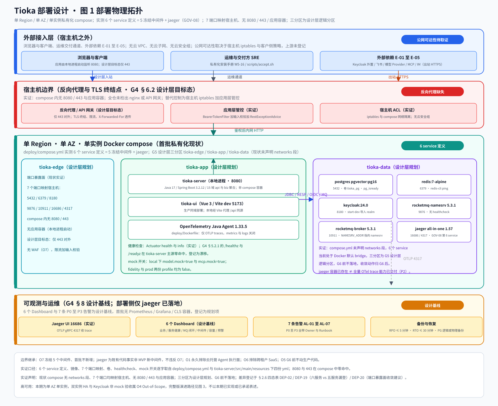
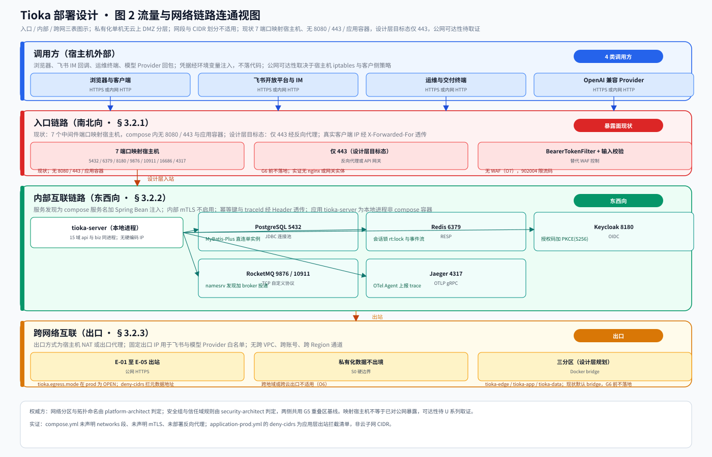
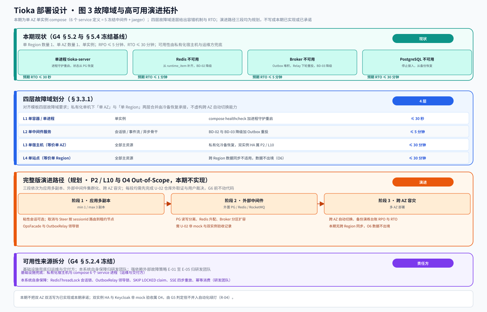

# Tioka 代码与设计一致性校验 · 部署设计

> 本文档是 G5 阶段产物，与《安全设计》并行，供主理人触发 G5 人工审核与末段交叉对账。
>
> **本轮不是从零设计新系统上线方案**。Tioka 已有完整设计体系（企业架构 40 至 48、系统详设 S0 至 S15、ADR-008 至 075、施工 M0 至 M4 与 F、34 号执行计划）与可运行的私有化本地 `deploy/compose.yml`。本文交付物是「把 G4《系统设计》已冻结的运行形态、模块边界、依赖关系、可观测要求，落到真实存在的 compose 运行单元上」，并给出与代码现状一致的部署、发布、回滚、容量口径，同时保持四态判定纵深感（一致 / 漂移 / 缺失 / 设计自身矛盾）。
>
> **证据口径（全文通用）**：事实 = G1 冻结的 `material_digest.md` D / X / V 编号、G3 冻结的《高层架构设计》条文、G4 冻结的《系统设计》与《UserStory》条文，或本角色 G5 用 `Grep` / `Glob` / `Read` / `Bash` 实际检索到的代码路径与符号；推断 = 由事实结合本项目语境作出的判断，逐条标注依据与局限；建议 = 本阶段登记与下游转交，属待 G5 人工审核确认的评估性结论。
>
> **硬边界（逐字继承，不改写、不重新裁决）**：私有化本地 `deploy/compose.yml` 实测 **6 个 service 定义** = 5 个冻结中间件（PostgreSQL pgvector、Redis 7、Keycloak 24、RocketMQ namesrv 与 broker）+ `jaeger 1.57`（GOV-08 本地链路后端，既有代码事实，非首批 MVP 引入的新中间件，**不违反 O7**）。O7 首批不新增中间件、不引入 ClickHouse / S3 / 云托管执行面；Phase 0 已定 `need_cloud_baseline_check` 为假，本轮不调用 CloudQ、不登记任何云资源事实；O5 G6 通过前不改生产代码；O1 云托管 Agent 执行面永久排除；O6 跨租户 SaaS 排除。G1 D18 §2 与 G3 全篇的「compose 五服务」为文档漏登，按主理人基线更正登记为设计基线自身漂移（DEP-19），本轮不回写、不重裁，由主理人在 G6 合稿统一纳入冲突裁决台账。
>
> **Gate 纪律**：本产物属 G5，未通过人工审核前主理人不得进入 G6 合稿；本文不修改仓库内任何既有设计文档或生产代码。

---

## 0. 元信息：修订记录

| 文档版本 | 发布日期 | 修订人 | 修订说明 |
| --- | --- | --- | --- |
| v1.0 | 2026-11-08 | platform-architect（毕落地） | 首轮：私有化 compose 实证映射、四环境矩阵、六类本地资源清单、三张零依赖 SVG、8 阶段流水线现状对账、L1 至 L4 配置、P0 至 P3 告警与 6 个 Dashboard 继承、回滚 SOP、容量水位与月度年度估算、部署域四态判定表、G5 重叠区六项末段对账、五次中间确认自检 |
| v1.1 | 2026-11-08 | platform-architect（毕落地） | **基线事实更正（非返工、非整体重写，已确认内容全部保留）**：① 撤销「仅 8080 / 443 暴露」错误基线，逐字采用更正后的 7 端口暴露面口径；② 撤销「compose 五服务冻结」基线，统一改为 6 个 service 定义 = 5 冻结中间件 + jaeger；③ 补登两条设计基线自身漂移 DEP-19 / DEP-20；④ 附录 D 第 1 项按更正后口径重新对齐并显式列出更正；⑤ 对齐安全侧五域骨架与替代控制、审计保留期口径；⑥ 三张图按同一口径重绘服务数与端口标注；⑦ 修复校验正则误捕字面量并收敛篇幅 |
| v1.2 | 2026-11-08 | platform-architect（毕落地） | **G5 交叉对账事实订正（定点修订，非返工、非整体重写）**：按主理人第二封返工清单订正 ① DEP-14 四态判定「一致（继承冻结定性）」→「缺失（继承 G3 冻结定性）」并改写处置列，消除同行自相矛盾且与 G3 / G4 / UserStory / 安全设计 SEC-14 对齐；② DEP-06 与 A-13 模块树计数「12 域加可选 foundation」→「13 个模块（含 W2+ 可选拆分的 foundation）」，对齐 G3 冻结的 13 对 15；③ DEP-16 处置列补注代码侧 `ErrorCode.java` 5 位码差异由《安全设计》SEC-07 登记、本文仅就部署侧继承设计基线判定不重复裁决。其余 17 条四态判定、§2.6 表导语、§4 / §5 / §6 / §8、附录 A 至 F、三张图、DEP-19 / DEP-20、附录 D 六项对账、成本与容量基线一律不动 |

**v1.1 定点修订影响面（供逐条核验，全部可追溯至主理人两封基线更正消息与模板自动校验要求）**：DEP-01 / DEP-02 / DEP-03 / DEP-13、§1.2、§2.1、§2.2.3 至 §2.2.6、§2.3 至 §2.6、§3.1.1 / §3.1.2 / §3.2.1 / §3.2.3 / §3.3.6、§7.1.3、附录 A / B / D / E、图 1 至图 3。**§4、§5、§6、§8 的已确认内容、所有硬指标取值、既有四态判定、模块边界、接口契约、成本与容量基线全部保留不变**。

**本角色边界声明（唯一 Owner）**：本阶段只产出《部署设计》一份文档与三张配套图示。未重写业务价值与产品目标（归 `business-architect`）、未重定义模块边界或接口契约（归 `system-architect`）、未输出完整威胁模型与 STRIDE 与 IAM 策略片段（归 `security-architect`）、未绕过安全约束自行定义公网暴露策略、未修改仓库任何源码或既有设计文档、未生成第二份交付文档、未调度其他成员、未越权进入 G6。

**上游继承（逐字读取，不依赖摘要）**：

| 输入 | 行数 | 冻结阶段 | 本文消费的章节 |
| --- | --- | --- | --- |
| `.workbuddy/output/系统设计.md` | 1817 | G4 | §3 应用架构、§4 数据库、§5 部署架构、§6 网络架构、§7 安全设计、§8 可观测设计、附录 A |
| `.workbuddy/output/UserStory.md` | 742 | G4 | §6.2 性能口径、§6.3 运行环境、§6.4 安全归口、§6.5 待澄清项 |
| `.workbuddy/output/高层架构设计.md` | 823 | G3 | §4.4 X8 / X13 裁决、§4.5 链路优先级、§6.1 In-Scope 与 Out-of-Scope |
| `.workbuddy/output/material_digest.md` | 511 | G1 | §2.0 双索引、§3 冲突 X1 至 X14、§3.2 待验证 V1 至 V7、D18 §2 |
| `.workbuddy/output/research_report.md` | 588 | G2 | Q2 Outbox / 幂等 / SKIP LOCKED、Q5 ArchUnit 与 CDC 工程范式 |
| 模板 `skills/aicoding-team-bootstrap/templates/部署设计.md` | 432 | 只读参考 | §1 至 §8 章节骨架与硬指标 |
| 公共协议 `intermediate_confirmation.md` | 全文注入 | 主理人转交 | §2.1 两条触发标准、§2.3 反向验证 3 问、§3.2 五项必填字段 |

**已锁定编排口径（只引用、不重新裁决）**：

- **X1**：以 `docs/architecture/implementation/34-M0至M4推进规划与工作项.md` 为唯一执行权威；README 与 31 号「33 为后续推进权威」判为文档漂移。
- **X9**：34 号 G0 至 G4 与 GF 为里程碑口径，S0 §13 G1 至 G7 为能力门禁清单，两套标签不混用；完成度按 31 §11 的 slice / fidelity / exit 三级，绿灯不等于 Exit。
- **用户裁决方案 A（G4 阶段内经中间确认冻结）**：L1 不新建独立 checkpoint 表、不新增 Flyway 迁移，复用 `runtime_turn` / `runtime_item` / `runtime_approval` 与 V130 已建的 `sys_outbox` / `sys_consumed` / `sys_dead_letter`；本文不得引入任何新增迁移或新增表的前置动作。V5 双份 SQL 收敛（41 份 `db/migration` 对 45 份 `docs/contracts/db`）属 P1 / L7 独立整改项，不阻塞 L1 至 L4 交付。
- **X11 与 47-GL §3**：权威隔离字段 `workspaceId`，`tenantId` 仅作历史遗留映射，新建对象禁用；平台管理员角色码 `system_admin`；隔离粒度 Workspace，多租户不是硬需求。
- **X13 定性不改判**：MQ 运行时闭环仍按 G3 冻结为「不成立 / 闭环未证实」；G4 代码级生产 / 消费 / 幂等三点已实证齐备，属时差，但不改判为「一致」。
- **G4 冻结可观测基线**：6 个 Dashboard、告警 P0 至 P3 四级加 7 条规则全带 Owner 与 Runbook、Logs 必含 `traceId` + `workspaceId` + `spanId` + `service`、全局错误码 100001 至 902004 共 12 个 6 位码、RPO ≤ 5 分钟与 RTO ≤ 30 分钟、单 AZ 单实例（compose 6 个 service 定义）。

**图示清单（由本角色直接调用 `diagrams-generator` 编排生成并内嵌，零依赖 SVG 矢量加可复现源码；v1.1 按同一口径重绘）**：

| 图号 | 名称 | 内嵌位置 | 源码与矢量图路径 |
| --- | --- | --- | --- |
| 图 1 | 部署物理拓扑图 | §3.1.1 | `pic/deploy-topology/deploy-topology.py` 与 `.svg` |
| 图 2 | 流量与网络链路连通视图 | §3.2.4 | `pic/network-links/network-links.py` 与 `.svg` |
| 图 3 | 故障域与高可用演进拓扑 | §3.3.6 | `pic/dr-topology/dr-topology.py` 与 `.svg` |

三张 SVG 均通过 `python3` 标准库 `xml.dom.minidom` 的 XML 合法性校验（v1.1 重绘后实测 root 为 svg、text 节点 81 / 61 / 57）；绘图原语复用 `pic/_svgkit.py`。工具选择说明见附录 F。

**中间确认裁决记录**：本阶段共发起 0 次 `[中间确认]`。原因：单 AZ 单实例、O1 / O7 硬边界、方案 A、L1 承载形态、G5 重叠区六项取值、模板与项目现实两处冲突的合规处理，以及本轮两处基线事实更正（撤销 8080 / 443 与「五服务」），均已由上游冻结或主理人预先锁定，按公共协议 §6「禁止就已裁决论题在同一阶段内重复发起」不得重复打扰用户。五次自检仍按 §2.4 逐点完成 §2.1 判定与 §2.3 反向验证 3 问，全部证据见附录 C。按 Step S 已发送 1 次 `[交接·部署→安全]` 骨架对账消息（非阻塞），并收到 `[交接·安全→部署]` 骨架（非阻塞）；末段对账 6 项见附录 D。

---

## 1. 引言

### 1.1 适用范围与部署形态

- **部署形态**：私有化本地单机部署，唯一编排载体为 `deploy/compose.yml`；不属于公有云、不属于混合云、不依赖任何云托管执行面。compose 内 **6 个 service 定义、7 个宿主机端口映射、无 8080 / 443、无应用容器、无 `networks:` 段**；应用本体 `tioka-server` 由本地进程（`mvn spring-boot:run`）启动，前端 `tioka-ui` 由 `npm run dev` 启动。
- **本轮语义**：① 把 G4 冻结的部署架构、网络架构、可观测要求落到实证存在的 compose 运行单元上；② 逐条登记代码与设计的一致性四态；③ 给出与代码现状一致的上线、扩容、回滚、告警机制与演进路径。**G6 通过后才进入代码实现**，本轮不动任何生产代码或既有设计文档。
- **首批范围外（逐字继承 G3 §6.1）**：O3 真实模型夜间连跑 3 天、O4 双实例 HA 与 Keycloak 非 mock 验收（依赖 U-01 / U-02 仓库外取证，由 G5 判定但不并入自动化绿灯，R-04）、O5 G6 前改生产代码、O6 跨租户 SaaS、O1 云托管 Agent 执行面永久排除。
- **读者对象**：架构师 / 开发 / 运维 / 安全 / 评审委员会，以及 G5 的 `security-architect` 与 G6 合稿主理人。

### 1.2 名词与缩写

| 名词 | 含义 | 实证或上游出处 |
| --- | --- | --- |
| 5 冻结中间件 | PostgreSQL pgvector、Redis 7、Keycloak 24、RocketMQ namesrv 与 broker 五个 O7 冻结中间件 | `deploy/compose.yml#services`、D18 §2、O7 |
| 6 service 定义 | 上述 5 个中间件 + `jaeger 1.57`（GOV-08 本地链路后端）合计 6 个 compose service | `deploy/compose.yml#1-69`、主理人基线更正 |
| 六服务 vs 五服务 | G1 D18 §2 与 G3 全篇登记「compose 五服务」，实测多出 jaeger，判设计基线自身漂移 / 文档漏登 | DEP-19、`deploy/compose.yml:62-69` |
| 四态判定 | 一致 / 漂移 / 缺失 / 设计自身矛盾四类一致性结论 | Phase 0 四态基线、G3 §2.6 |
| 三分区 | `tioka-edge` / `tioka-app` / `tioka-data` 三条 Docker bridge **设计层逻辑分区**；现状 compose 未声明 networks 段，G6 前不落地 | 主理人第五节锁定基线（v1.1 更正） |
| 暴露面口径 | 现状 7 个中间件端口直接映射宿主机；compose 内无 8080 / 443 与应用容器；应用本地进程启动；公网可达性待 U 系列取证 | 主理人基线更正、`deploy/compose.yml` |
| 设计层目标态 | 规划中的端口收敛目标（如仅暴露 443），与现状并列陈述但非现状事实 | 主理人基线更正 |
| L1 至 L4 | 配置管理四层级：代码内 / 配置中心 / 环境变量 / Secret | 系统设计 §5.1 |
| Outbox 三表 | `sys_outbox` / `sys_consumed` / `sys_dead_letter`，V130 已建，方案 A 复用 | 系统设计附录 A 核查点 2 |
| 完成度词表 | slice / fidelity / exit 三级，绿灯不等于 Exit | 31 §11、X9 |
| 四环境标签 | dev / int / uat / prod 为设计层标签，实证载体见 §2.1 | 系统设计 §5.1 |
| RPO 与 RTO | 恢复点目标 ≤ 5 分钟、恢复时间目标 ≤ 30 分钟 | 系统设计 §5.3 |
| U 系列取证 | 仓库外运行时证据（U-01 至 U-06），由主理人协调 | UserStory §6.5、material_digest §3.2 |

---

## 2. 环境与资源清单

### 2.1 环境矩阵

> 环境标签汇总行（四环境设计标签同行登记）：dev / int / uat / prod 四个标签来自 G4 系统设计 §5.1 的设计视图。

| 环境（dev / int / uat / prod 四级设计标签） | 用途 | 集群隔离（设计） | 数据 | 网络访问 | 实证载体 |
| --- | --- | --- | --- | --- | --- |
| dev | 开发自测 | 与其他系统共用 | 模拟数据 | 内网 | `application-local.yml`，`tioka.model.mock=true` 与 `mcp.mock=true` |
| int | 联调 | 独立 | 模拟数据 | 内网 | CI `backend` 与 `gate` 两个 job，`mvn -B verify` 与 `mvn -B verify -Pgate` |
| uat | 预发与验收 | 独立 | 仿生产 | 内网加白名单 | `application-fidelity.yml`（关 mock，无真实 Key 时业务显式失败） |
| prod | 生产私有化交付 | 独立 | 真实数据 | **设计层目标态**：仅 443 经反向代理；**现状**：7 个中间件端口映射宿主机，公网可达性待 U 系列取证 | `application-prod.yml`（关 mock、Messaging 走 rocketmq、require-external-key 为真） |

**环境矩阵设计自身矛盾登记（不虚构四套集群）**：上表四环境为 G4 §5.1 的设计意图；实证仓库仅有**一份** `deploy/compose.yml`（无 profile 区分、无环境后缀文件）与 **3 组** Spring profile（`local` / `fidelity` / `prod`，另 `application.yml` 默认 `spring.profiles.active: local`）。未发现 dev / int / uat / prod 四套独立集群、四套 compose 或四套配置目录。实证环境数为 1 套 compose 加 3 组 profile，四环境标签与实载体不一致，判「设计自身矛盾 / 漂移」，登记于 §2.6 DEP-04，本轮不改写上游、不虚构集群。

**配置策略（继承 G4 §5.1 L1 至 L4，落点见 §4.4）**：L1 代码内默认值、L2 配置中心 `KernelProperties` 与 `MessagingProperties`、L3 环境变量与 `application-local.yml` 加 compose 环境变量、L4 Secret（`UserTokenVault` 与 `CredentialCipher`，FND-08 / V145）。

### 2.2 本地 compose 资源清单

> **模板合规处理（照主理人第六节第 1 点执行）**：模板 §2.2 的「云资源清单」六张表在本项目改写为「本地 compose 资源清单」。六类资源（计算 / 存储 / 网络 / 中间件 / 安全 / 可观测）按真实 compose 运行单元逐一映射填写，不整表留空；表中「资源编号」列为**文档内资源编号**（对齐模板 R-xx 编号体系），不是云资源 ID；无 VPC、无云子网、无云安全组、无 CVM、无云账单。凡模板云原生取值不适用于本项目的，逐格写明「不适用」及原因，不把云原生取值照抄成事实。

#### 2.2.1 计算资源

| 资源编号 | 类型 | 载体 | 名称 | 规格 | 数量 | 环境 | 复用 / 新建 | HA 方案 | 用途 |
| --- | --- | --- | --- | --- | --- | --- | --- | --- | --- |
| R-C-001 | 计算 | 私有化宿主机 | Docker Compose 宿主 | JDK 17 + Maven 3.9 + Docker Engine | 1 台 | 全环境共用一份 compose | 复用（既有） | 单机冷备，双实例 HA 属 O4 | 承载 6 个 compose service 与本地 `tioka-server` 进程 |
| R-C-002 | 计算 | 应用进程（非 compose 容器） | `tioka-server` | Java 17 / Spring Boot 3.2.12 / 单 Jar / 端口 8080（`application.yml#2`） | 1 实例 | 由 profile 切换 | 复用（既有） | 进程守护重启，状态从 PG 恢复 | 15 域 api 与 biz 聚合启动面 |
| R-C-003 | 计算 | 前端进程或静态包（非 compose 容器） | `tioka-ui` | Vue 3.5.12 / Vite 5.4.10 / dev 5173 / 生产同域 | 1 套 | 由 profile 切换 | 复用（既有） | 随宿主机冷备 | Chat / FlowStudio / Approval / Observability 触点端 |

实证出处：`deploy/Dockerfile#1-15`（`eclipse-temurin:17-jre`、`JAVA_TOOL_OPTIONS` 挂载 OTel Java Agent 1.33.5）；`docs/architecture/ops/私有化安装手册.md#1-7`；`README.md#快速开始`。云 CVM 与弹性伸缩组：**不适用**（私有化单机，无云资源）。

#### 2.2.2 存储资源

| 资源编号 | 类型 | 载体 | 名称 | 规格 | 容量 | 环境 | 复用 / 新建 | HA 方案 | 备份策略 |
| --- | --- | --- | --- | --- | --- | --- | --- | --- | --- |
| R-S-001 | 存储 | Docker 命名卷 | `tioka_pg` | `/var/lib/postgresql/data` | 未声明配额，待人工确认 | 全环境共用 | 复用（既有） | 单卷无副本 | PG 逻辑或物理备份，RPO ≤ 5 分钟 |
| R-S-002 | 存储 | 只读绑定挂载 | `init-pgvector.sql` | `/docker-entrypoint-initdb.d/01-pgvector.sql:ro` | 单文件 | 全环境共用 | 复用（既有） | 随 compose 重建 | `CREATE EXTENSION IF NOT EXISTS vector` |
| R-S-003 | 存储 | 只读绑定挂载 | `tioka-realm.json` | `/opt/keycloak/data/import/tioka-realm.json:ro` | 单文件 | 全环境共用 | 复用（既有） | 随 compose 重建 | Realm 定义随代码库版本管理 |
| R-S-004 | 存储 | 宿主机文件 | 审计与降级日志文件 | `audit/audit.jsonl` 与 `audit/audit-degraded.jsonl` | 按 `TIOKA_HOME` 落盘 | 全环境共用 | 复用（既有） | 无副本，本地卷快照 | 独立卷防篡改，保留期见 §7.3 |
| R-S-005 | 存储 | 宿主机或外置介质 | 备份介质 | PG 逻辑或物理备份、OSS 等价物为 MinIO 或本地卷快照 | 待 U 系列仓库外取证 | prod | 规划（未实证） | 离线副本 | 见 `docs/architecture/ops/HA与备份.md#备份` |

实证出处：`deploy/compose.yml#10-12,38-39,71-72`；`deploy/init-pgvector.sql#1`；`application.yml#89-97`（`tioka.audit.sink: file`、`physical-purge-enabled: false`）。云硬盘、对象存储桶、跨 Region 复制：**不适用**（O7 不引入 S3 / ClickHouse，O6 数据不出境）。

#### 2.2.3 网络资源

| 资源编号 | 类型 | 载体 | 名称 | 规格 | 环境 | 复用 / 新建 | 用途 |
| --- | --- | --- | --- | --- | --- | --- | --- |
| R-N-001 | 网络 | Docker bridge（设计层规划） | `tioka-edge` | 逻辑分区，无 CIDR 规划，现状未声明 | 全环境 | 规划（未落地） | 接入与对外端口收敛（设计层目标态） |
| R-N-002 | 网络 | Docker bridge（设计层规划） | `tioka-app` | 逻辑分区，无 CIDR 规划，现状未声明 | 全环境 | 规划（未落地） | 应用进程与前端 |
| R-N-003 | 网络 | Docker bridge（设计层规划） | `tioka-data` | 逻辑分区，无 CIDR 规划，现状未声明 | 全环境 | 规划（未落地） | 5 冻结中间件与 jaeger 数据面 |
| R-N-004 | 网络 | 宿主机端口映射 | 端口暴露面 | **现状**：7 个端口（5432 / 6379 / 8180 / 9876 / 10911 / 16686 / 4317）映射宿主机；compose 内无 8080 / 443 / 应用容器；**设计层目标态**：仅 443 对外 | 全环境 | 复用（既有） | 见 §3.2.1 入口链路表与 DEP-03 / DEP-20 |
| R-N-005 | 网络 | 宿主机出口 | NAT 或出口代理 | 固定出口 IP 用于飞书与模型 Provider 白名单；带宽未登记，待 U 系列仓库外取证 | prod | 复用（既有） | E-01 至 E-05 出站 HTTPS |

实证出处：`deploy/compose.yml` 全文 `grep -c networks:` 结果为 **0**，即当前未声明任何 networks 段，6 个 service 处于 Docker 默认 bridge；三分区为主理人第五节锁定的 G5 设计层逻辑命名，**现状 compose 未声明 networks 段，三条 network 为设计层建议，G6 前不落地**，差异登记于 §2.6 DEP-02。云 VPC、云子网、云安全组、云联网、对等连接、专线：全部不适用，本表不登记任何 VPC ID、CIDR 网段或云带宽数值。`application-prod.yml#17` 的 `tioka.egress.deny-cidrs` 是应用层出站拦截清单（云元数据地址与内网探测地址两条），不构成云子网或 VPC 网段划分。**「映射到宿主机」不等于「已对公网暴露」**：公网可达性取决于宿主机 iptables 与客户侧网络策略，上游未登记，待 U 系列仓库外取证。

#### 2.2.4 中间件与平台服务

| 资源编号 | 类型 | 镜像 | 名称 | 规格 / 端口 | 环境 | 复用 / 新建 | HA 方案 | 用途 |
| --- | --- | --- | --- | --- | --- | --- | --- | --- |
| R-M-001 | 中间件 | `pgvector/pgvector:pg16` | `postgres` | 5432，`pg_isready -U tioka -d tioka` | 全环境 | 复用（O7 冻结） | 单实例加卷 | 状态落库、Outbox 三表、行锁 |
| R-M-002 | 中间件 | `redis:7-alpine` | `redis` | 6379，`redis-cli ping` | 全环境 | 复用（O7 冻结） | 单实例无副本 | 会话锁 `rt:lock`、事件流、限流 |
| R-M-003 | 中间件 | `quay.io/keycloak/keycloak:24.0` | `keycloak` | 8180，`start-dev --import-realm`，TCP 探测 | 全环境 | 复用（O7 冻结） | 单实例 | OIDC 与 SSO，realm tioka |
| R-M-004 | 中间件 | `apache/rocketmq:5.3.1` | `rocketmq-namesrv` | 9876，`sh mqnamesrv`，无 healthcheck | 全环境 | 复用（O7 冻结） | 单实例 | 服务发现 |
| R-M-005 | 中间件 | `apache/rocketmq:5.3.1` | `rocketmq-broker` | 10911，`sh mqbroker -n rocketmq-namesrv:9876`，无 healthcheck | 全环境 | 复用（O7 冻结） | 单实例 | 异步骨干与 Outbox 投递 |

实证出处：`deploy/compose.yml#2-60`；D4 §ADR-008（MQ 为 RocketMQ 5.x、向量库 pgvector、缓存 Redis 7）；D18 §2。**jaeger 为第 6 个 service 定义，归 §2.2.5 可观测资源，不计入 5 冻结中间件口径**；G1 D18 §2 与 G3 全篇的「compose 五服务」漏登 jaeger，登记为 DEP-19。KMS / Vault：**不适用**，O7 不引入新增中间件，无云 KMS；凭证走环境变量注入加既有 `V145 CredentialReencrypt` 的 AES-GCM 加配置文件 0600 权限（详见 §7.2）。本轮不新增任何中间件、不新增 Flyway 迁移、不新增表（方案 A 冻结）。

#### 2.2.5 可观测资源

| 资源编号 | 类型 | 载体 | 名称 | 规格 | 环境 | 复用 / 新建 | 承载可观测维度 |
| --- | --- | --- | --- | --- | --- | --- | --- |
| R-O-001 | 可观测 | `jaegertracing/all-in-one:1.57` | `jaeger` | UI 16686 加 OTLP gRPC 4317，`COLLECTOR_OTLP_ENABLED=true` | 全环境 | 复用（既有第 6 service） | Traces（W3C TraceContext） |
| R-O-002 | 可观测 | `opentelemetry-javaagent.jar` 1.33.5 | OTel Java Agent | 自动埋点 Spring MVC / JDBC / Lettuce / HttpClient / RocketMQ | 全环境 | 复用（既有） | Traces；`OTEL_METRICS_EXPORTER=none`、`OTEL_LOGS_EXPORTER=none` |
| R-O-003 | 可观测 | Spring Boot Actuator | `health` 与 `info` | `management.endpoints.web.exposure.include: health,info` | 全环境 | 复用（既有） | 存活探针；`health.redis.enabled=false` |
| R-O-004 | 可观测 | 结构化日志与审计文件 | 日志组件 | 必含 `traceId` + `workspaceId` + `spanId` + `service` | 全环境 | 复用（既有） | Logs；ERROR 带完整堆栈与 6 位错误码 |
| R-O-005 | 可观测 | 设计基线 | 6 个 Dashboard | 见 §5.2 | 规划 | 设计基线（未实证落盘） | Metrics 展示面 |
| R-O-006 | 可观测 | 设计基线 | 7 条告警规则 | 见 §5.3 | 规划 | 设计基线（未实证落盘） | 告警引擎与 Runbook 索引 |

实证出处：`deploy/compose.yml#62-69`；`deploy/Dockerfile#4-13`；`application.yml#38-48,150-159`；`docs/architecture/ops/指标清单.md#1-3`（12 个 `tioka_` 前缀 Prometheus 指标，无用户 / 会话 / Turn 标签）；G4 系统设计 §8.1.2 与 §8.4.2。**口径区分（v1.1 更正）**：jaeger **容器已存在**（既有代码事实）≠ **全量 OTel trace 能力已交付**；G3 将「全量 OTel trace」列为 P2 / L10 Out-of-Scope，本轮不改判、不写成本期已交付能力。Prometheus / Grafana / CLS / APM 商业产品：**不适用**（O7 不新增中间件），Metrics 与 Logs 由 Micrometer 加系统监控与结构化 JSON 日志组件承接，无独立云监控资源。

#### 2.2.6 安全资源

| 资源编号 | 类型 | 载体 | 名称 | 规格 | 环境 | 复用 / 新建 | HA 方案 | 用途 |
| --- | --- | --- | --- | --- | --- | --- | --- | --- |
| R-Sec-001 | 安全 | 宿主机 | iptables 与 ACL | 最小化入站与出站（默认拒绝 + 显式放通为设计建议，见 DEP-20） | 全环境 | 复用（既有） | 单机 | 主机级访问控制 |
| R-Sec-002 | 安全 | 容器网络 | compose network 隔离 | 实证为默认 bridge，三分区为设计层规划 | 全环境 | 复用（既有） | 单机 | 容器间隔离 |
| R-Sec-003 | 安全 | 应用层 | `BearerTokenFilter` + 输入校验 + `RestExceptionAdvice` | 统一鉴权与全局异常 | 全环境 | 复用（既有） | 随应用进程 | 细鉴权、输入边界、错误码映射 |
| R-Sec-004 | 安全 | 环境变量与代码 | 凭证注入加 AES-GCM | `TIOKA_SECRET_MASTER_KEY` / `TIOKA_CREDENTIAL_MASTER_KEY` / `KEYCLOAK_ADMIN_PASSWORD` | 全环境 | 复用（既有） | 密钥轮换由运维 | 见 §7.2 五类密钥 |
| R-Sec-005 | 安全 | 反向代理（设计层规划） | 限流与应用层规则 | 无 WAF；替代控制为反向代理限流加应用层输入校验 | prod | 规划（未落地） | 单机 | 抗 DDoS 与 Web 应用层防护 |

实证出处：`application.yml#56-62,85-97,146-149`；`application-prod.yml#18-22`；`docs/architecture/ops/私有化安装手册.md#8-11`；系统设计 §7.1 与 §7.2。**安全侧骨架对齐（v1.1，`[交接·安全→部署]` 非阻塞）**：`security-architect` §1.1 五域信任边界为「外部不可信域（用户浏览器 tioka-ui）→ DMZ / tioka-edge → 业务域 / tioka-app → 数据域 / tioka-data → 运维域（宿主机）」；§5.1 逐字采用三条 Docker bridge 与「中间件仅在 tioka-data 内可达、禁止公网暴露」的设计层信任域规则；§5.2 替代控制为反向代理限流加应用层输入校验（无 WAF，O7）、宿主机 iptables 默认拒绝加显式放通（无云防火墙）、宿主机账号分离加 sudo 白名单加配置文件 0600 加审计 jsonl 独立卷（无堡垒机）、§3.5.3 四级限流（全局 1000 / Workspace 200 / IP 100 / 用户 50 QPS，错误码 902004）、`pump.tryAcquireConnection` 闸门 500 返 300001、EgressGuard 出网白名单（allow-hosts / deny-cidrs）。上述归 `security-architect` 权威，本表逐字采用，不自行定义公网暴露策略。WAF 版本与规则：**无 WAF（O7），替代控制为反向代理限流加应用层输入校验**；云 AKSK、云 KMS、云堡垒机、云安全运营中心：全部不适用。

### 2.3 复用资源清单

| 复用资源 ID | 原业务方 | 余量评估 | 隔离方式 |
| --- | --- | --- | --- |
| R-C-001 至 R-C-003 | Tioka 既有实现（研发团队） | `need_cloud_baseline_check` 为假，无云水位可抓取；本地余量待人工确认 | 单实例加 Spring profile 切换 |
| R-M-001 至 R-M-005 | Tioka 既有实现（研发团队） | 同上，本地余量待人工确认 | 单实例加 `workspaceId` 逻辑隔离（X11） |
| R-S-001 至 R-S-004 | Tioka 既有实现（研发团队） | 同上，本地余量待人工确认 | 命名卷加只读绑定挂载 |
| R-O-001 至 R-O-004 | Tioka 既有实现（研发团队 / GOV-08） | 同上，本地余量待人工确认 | 内网端口，仅本机可达 |
| 既有 41 份 Flyway 迁移 | Tioka 既有实现（数据域） | 方案 A 冻结：零新增迁移、零新增表 | `db/migration` 为唯一执行面 |
| 云资源可复用项 | 不适用 | 不适用 | 无云资源可复用 |

> 结论（照主理人第六节第 1 点）：**复用既有 compose 6 个 service 定义与既有迁移，无云资源可复用**。本轮不新建资源、不改造运行形态、不引入共享业务方资源边界变更。余量评估一列按 CloudQ 未调用的前提标注「待人工确认」，不虚构水位数值。

### 2.4 云资源现状核对结论（Step 1）

Phase 0 已定 `need_cloud_baseline_check` 为假（本地与私有化 compose，无云资源核对），本轮**未调用 CloudQ**，未登记任何账号、UIN、资源 ID 或当前水位。模板 Step 1 要求的四类输出按如下合规填写：

| 类别 | 本轮结论 |
| --- | --- |
| 已存在资源 | 无云资源；已存在者仅为 §2.2 六类本地 compose 资源，全部以文档内资源编号登记 |
| 可复用资源 | 复用既有 compose 6 个 service 定义与既有迁移；无云资源可复用 |
| 缺口清单 | 无云资源缺口；本地缺口（三分区未声明、端口暴露面未收敛、health 端点缺失、Runbook 文件未落盘）见 §2.6 四态判定表 |
| 风险清单 | 容量风险：本地余量未登记，待人工确认；合规风险：无云安全组件可核对，改用宿主机 ACL 加应用层管控，归 `security-architect` 判定 |

CloudQ 无法获取的信息（云水位、云账单、云合规状态）：全部标注「待人工确认」并列入附录 E 待确认项。

### 2.5 实证配置基线（6 个 service / 端口 / 卷 / 健康检查 / mock 开关）

> 本节逐字取自 `deploy/compose.yml`、`deploy/Dockerfile` 与 `tioka-server/src/main/resources/` 下四份 yml，是本轮实证取证的核心台账。

| 项 | 实证取值 | 出处 |
| --- | --- | --- |
| service 定义与镜像 | 共 6 个：`postgres` = `pgvector/pgvector:pg16`；`redis` = `redis:7-alpine`；`keycloak` = `quay.io/keycloak/keycloak:24.0`；`rocketmq-namesrv` = `apache/rocketmq:5.3.1`；`rocketmq-broker` = `apache/rocketmq:5.3.1`；`jaeger` = `jaegertracing/all-in-one:1.57`（GOV-08 本地链路后端） | `deploy/compose.yml#2,19,29,46,52,62-69` |
| 宿主机端口映射 | **7 个**：5432 / 6379 / 8180 / 9876 / 10911 / 16686 / 4317 映射宿主机；**compose 内无 8080、无 443、无应用容器**；应用 `tioka-server` 由本地进程启动并监听 8080（`application.yml#2`），该端口不在 compose 端口映射内 | `deploy/compose.yml#8-9,21-22,36-37,49-50,59-60,67-69`；`application.yml#2` |
| 卷与挂载 | `tioka_pg:/var/lib/postgresql/data`；`./init-pgvector.sql` 只读；`../tioka-server/src/test/resources/keycloak/tioka-realm.json` 只读；顶层 `volumes: tioka_pg:` | `deploy/compose.yml#10-12,38-39,71-72` |
| 健康检查 | postgres `pg_isready -U tioka -d tioka`（间隔 5s / 超时 5s / 重试 10）；redis `redis-cli ping`（5s / 3s / 10）；keycloak TCP 8180 探测（10s / 5s / 12）；namesrv / broker / jaeger 无 healthcheck | `deploy/compose.yml#13-17,23-27,40-44` |
| Keycloak 启动 | `start-dev --import-realm`，`KC_HTTP_PORT=8180`，`KEYCLOAK_ADMIN_PASSWORD` 取环境变量默认 admin | `deploy/compose.yml#31-35` |
| broker 发现 | `NAMESRV_ADDR=rocketmq-namesrv:9876`，启动参数 `sh mqbroker -n rocketmq-namesrv:9876` | `deploy/compose.yml#56-58` |
| mock 开关（local 默认） | `tioka.model.mock=true`、`tioka.mcp.mock=true`；`tioka.messaging.mode` 默认 `in-memory`；`relay-enabled=false` | `application.yml#64-66,82-84,124-126`；`application-local.yml#19-22` |
| mock 开关（fidelity） | `tioka.model.mock=false`、`tioka.mcp.mock=false`；注释「无真实 Key 时业务应显式失败，禁止用 mock 回声冒充成功」 | `application-fidelity.yml#1-8` |
| mock 开关（prod） | `model.mock=false`；`messaging.mode=rocketmq`；`relay-enabled=true`；`require-external-key=true`；`egress.mode=OPEN` | `application-prod.yml#5-22` |
| Flyway | `spring.flyway.enabled=true`、`locations: classpath:db/migration`、`out-of-order=true`、`baseline-on-migrate=false`、占位符 `embeddingDim` | `application.yml#14-21` |
| 应用健康端点 | `management.endpoints.web.exposure.include: health,info`；`health.show-details: when_authorized`；`health.redis.enabled=false` | `application.yml#38-48` |
| 审计配置 | `sink: file`、`retention-days: 365`、`physical-purge-enabled: false`、`trusted-proxies: []`（365 为应用侧文件滚动参数，不等同合规留存期，见 §7.3） | `application.yml#89-97` |
| OTel | `OTEL_SERVICE_NAME=tioka`、`OTEL_TRACES_EXPORTER=otlp`、`OTEL_METRICS_EXPORTER=none`、`OTEL_LOGS_EXPORTER=none` | `deploy/Dockerfile#9-13` |
| CI 真实配置 | 3 个 job：`backend`（`mvn -B verify`）、`gate`（`mvn -B verify -Pgate`，预拉 Keycloak / RocketMQ / Mailpit 镜像）、`frontend`（`npm ci` 加 lint 加 typecheck 加 test 加 build）；另有 `nightly-real-model.yml` 定时单 job，缺 secrets 则跳过 | `.github/workflows/ci.yml#8-63`、`.github/workflows/nightly-real-model.yml#9-47` |
| 安装与验收脚本 | `docker compose -f deploy/compose.yml up -d`、`mvn -pl tioka-server -am spring-boot:run`、`cd tioka-ui && npm i && npm run dev`、`bash scripts/accept.sh` | `docs/architecture/ops/私有化安装手册.md#1-12` |

### 2.6 部署域四态判定表

> 逐条带代码或文档出处，不空判。四态 = 一致 / 漂移 / 缺失 / 设计自身矛盾。定性沿用 G3 与 G4 冻结结论，本轮不越权裁决。**v1.1 按主理人基线更正补登的两条设计基线自身漂移为 DEP-19 与 DEP-20**；DEP-01 / DEP-02 / DEP-03 / DEP-13 为同一口径的定点修订，已确认内容全部保留。

| 编号 | 校验对象 | 态 | 实证证据 | 处置 |
| --- | --- | --- | --- | --- |
| DEP-01 | compose 6 个 service 与 S0 硬边界、O7 | 一致 | `deploy/compose.yml#services` 5 个中间件镜像与版本同 D18 §2；第 6 个 `jaeger` 属可观测（GOV-08），为既有代码事实、非首批 MVP 新中间件，不违反 O7 | 继承冻结；「五服务」漏登另见 DEP-19 |
| DEP-02 | 三条 bridge 分区 | 缺失 | `deploy/compose.yml` 无 `networks:` 段（`grep -c` 为 0），6 个 service 处于默认 bridge；三分区仅为 G5 设计层逻辑命名，G6 前不落地 | 登记为演进期收敛项，G6 前不动代码 |
| DEP-03 | 端口暴露面现状 | 一致（实证登记） | compose 内 7 个端口（5432 / 6379 / 8180 / 9876 / 10911 / 16686 / 4317）映射宿主机；**无 8080 / 443 / 应用容器**；应用由本地进程启动；公网可达性待 U 系列取证 | 现状如实登记；与最小暴露面预期差距另见 DEP-20 |
| DEP-04 | 环境矩阵四环境 | 设计自身矛盾 | G4 §5.1 登记 dev / int / uat / prod 四环境；实证 1 份 compose 加 3 组 profile（local / fidelity / prod），无四套集群 | 按实证写明，不虚构集群 |
| DEP-05 | A5 / V5 双份 SQL | 漂移 | 实测 `db/migration` 41 份 SQL 对 `docs/contracts/db` 45 份 SQL；另有 6 份 Java 迁移 | P1 / L7 独立整改，不阻塞 L1 至 L4 |
| DEP-06 | X8 模块树 | 漂移 | `tioka-modules/pom.xml#18-32` 声明 15 个业务子模块；`44-EA §1` 树形列 13 个模块（含标注 W2+ 可选拆分的 foundation），多出 ontology / governance / eval | 登记，不越权裁决 |
| DEP-07 | X2 完成度口径 | 设计自身矛盾 | `progress.md#测试汇总` 85 份 Surefire / 330 项测试 / 0 失败 / 292 工作项仅作索引；31 §11 规定绿灯不等于 Exit | 仅作索引，不作完成度依据 |
| DEP-08 | X7 Flyway 矛盾 | 设计自身矛盾 | `docs/contracts/README#迁移脚本` 自述「尚未引入 Flyway」；`application.yml#14` 为 `spring.flyway.enabled: true` 且 41 份迁移已就位 | 登记，不改写上游 |
| DEP-09 | CI/CD 8 阶段 | 漂移 | `.github/workflows/ci.yml` 仅 3 个 job，`nightly-real-model.yml` 为定时单 job；无代码扫描、安全扫描、制品签名、部署阶段 | 8 阶段列为规划目标，差异见 §4.2 |
| DEP-10 | O4 双实例 HA 与 Keycloak 非 mock | 缺失（范围外） | G3 §6.1 O4 与 U-02 明确属 Out-of-Scope；compose 6 个 service 均单实例；`application-local.yml#41-56` 的 OIDC providers 段整体注释 | 不并入自动化绿灯（R-04），取证由主理人协调 |
| DEP-11 | `/healthz` 与 `/readyz` 端点 | 缺失 | G4 §5.2.1 定 Liveness 为 `/healthz`、Readiness 为 `/readyz`；`tioka-server/src/main` 全库检索两串零命中，实证仅 Actuator `health,info` | 登记，演进期补齐 |
| DEP-12 | 反向代理与 API 网关实体 | 缺失 | 全仓未检出 nginx 或网关配置文件；compose 内无 8080 / 443 与应用容器；G4 §6.2 的 TLS 终结点与限流位置为设计基线 | 演进期补齐，本期以应用层管控替代 |
| DEP-13 | WAF 与 KMS 口径 | 设计自身矛盾 | G4 §7.1 记「WAF 是（规则集归 G5）」、`ops/HA与备份.md#密钥` 记「SecretStore 导出需 KMS 包裹」；G5 锁定基线为不部署 WAF（O7）、无云 KMS | 以 G5 锁定基线为准，列入附录 D 对账，不自行调整 |
| DEP-14 | X13 MQ 运行时闭环 | 缺失（继承 G3 冻结定性） | G3 冻结「不成立 / 闭环未证实」；G4 附录 A 核查点 2 实证代码级生产 / 消费 / 幂等三点齐备 | 继承 G3 冻结定性；代码级生产 / 消费 / 幂等三点齐备属时差，运行时闭环待 V7 / U-01 取证，不改判为「一致」 |
| DEP-15 | 6 个 Dashboard 与 7 条告警规则 | 缺失（设计基线） | G4 §8.1.2 与 §8.4.2 为设计基线；`docs/architecture/ops/` 下未见 `runbook-AL-01.md` 至 AL-07 文件与大盘定义文件 | 继承基线，Runbook 文件待 G5 后补齐 |
| DEP-16 | 日志必含四字段与 12 个错误码 | 一致 | G4 §8.2.2 硬性要求 `traceId` + `workspaceId` + `spanId` + `service`；§3.5.1 错误码 100001 至 902004 共 12 个 6 位码 | 继承冻结；代码侧 `ErrorCode.java` 为 5 位码、与设计冻结 6 位码的差异由《安全设计》SEC-07 登记为设计自身矛盾；本文仅就部署侧继承设计基线判定，不重复裁决 |
| DEP-17 | X1 执行权威指针 | 漂移 | README 与 31 号指向 33 号；33 与 34 号互相确认以 34 号为执行权威 | 沿用 34 号，登记不裁决 |
| DEP-18 | 容量与性能数值口径 | 设计自身矛盾 | G4 §5.5.1 列注册用户 200 / DAU 50 / 峰值 QPS 100 等推算值；UserStory §6.2 明确「本轮不设数值型性能目标」，P50 至 P99、QPS / TPS、并发用户数、数据规模上限一律不填数值 | 本文 §8.1.1 不自造基线，冲突列入附录 E |
| **DEP-19** | **六服务 vs 五服务** | **设计基线自身漂移 / 文档漏登** | G1 `material_digest.md` D18 §2 登记「五服务：postgres / redis / keycloak / rocketmq-namesrv / rocketmq-broker」；G3 全篇（含 §4.2 / §5.2 / §6.1 O7 / §6.2 模块卡片 / 两张图节点 B3、D3）沿用「compose 五服务」。实测多出第 6 个 `jaeger 1.57`，出处 `D18，路径#deploy/compose.yml:62-69` | jaeger 为既有代码事实，非「首个 MVP 引入的新中间件」，不违反 O7；区分「容器已存在」与「全量 OTel trace 能力未交付、仍属 P2 / L10」。G3 冻结产物由主理人在 G6 合稿统一纳入冲突裁决台账，本轮不回写、不重裁 |
| **DEP-20** | **端口暴露面收敛差距** | **设计基线自身漂移** | `deploy/compose.yml` 将 7 个中间件端口（5432 / 6379 / 8180 / 9876 / 10911 / 16686 / 4317）直接映射宿主机，与「私有化本地最小暴露面」预期存在差距；compose 内无 8080 / 443 与应用容器，应用由本地进程启动；「映射到宿主机」不等于「已对公网暴露」 | **本项为设计建议，G6 前不改动 `deploy/compose.yml`（O5）；实际收敛需用户或运维侧拍板，登记待确认项。** 设计层收敛路径见 §3.2.1：限定绑定到 127.0.0.1、宿主机 iptables 默认拒绝加显式放通、生产与开发 compose 分离、jaeger 仅开发期启用。不写成已实施、不自行新增 iptables 规则或改文件，收敛项列入附录 E |

**自检点 1（§2 完成后）**：见附录 C 自检 C.1。

---

## 3. 部署拓扑与高可用设计

### 3.1 物理拓扑

#### 3.1.1 物理拓扑图



图 1 覆盖接入网络拓扑、Region 与 AZ 划分、节点划分：外部接入层三类调用方、宿主机边界三类管控、单 Region 单 AZ 单实例 compose 大带（内含 `tioka-edge` / `tioka-app` / `tioka-data` 三条**设计层**逻辑分区）、可观测与运维带。5 个冻结中间件与 jaeger 第 6 service、7 个宿主机端口映射、卷与挂载、健康检查、mock 开关均在图中标注实证出处。**三分区为 G5 设计层逻辑分区，现状 compose 未声明 networks 段，G6 前不落地**，差异见 §2.6 DEP-02。**compose 内无 8080 / 443 与应用容器；应用由本地进程启动；8080 / 443 反向代理为设计层目标态**，暴露面见 §3.2.1。

#### 3.1.2 拓扑要素清单

| 要素 | 取值 | 实证出处 |
| --- | --- | --- |
| 跨 Region 部署 | 否，Region 数量 1；跨 Region 数据同步不适用（私有化单机，数据不出境，O6） | 系统设计 §5.4 / S0 §2.3 |
| 跨 AZ 部署 | 否，AZ 数量 1；单 AZ 单实例 compose 6 个 service，双实例 HA 属 P2 / L10 与 O4 Out-of-Scope | 系统设计 §5.2.3 / G3 §6.1 O4 |
| 流量入口路径 | **现状**：应用 `tioka-server` 由本地进程启动监听 8080，compose 内无 8080 / 443 / 应用容器；**设计层目标态**：客户端经 443 到反向代理，之后内网 HTTP 到 `tioka-server` 再到 15 域 api | 主理人基线更正、系统设计 §5.4 / §6.2 |
| 内部调用路径 | compose 服务名加 Spring Bean 注入，同步 REST，跨域异步经 RocketMQ | 系统设计 §6.3 |
| 数据库访问路径 | MyBatis-Plus 连接池直连 PostgreSQL 单实例 5432；缓存经 RESP 到 Redis 6379；鉴权经 OIDC 到 Keycloak 8180 | `application.yml#10-25` |

### 3.2 流量与网络链路（连通视图）

#### 3.2.1 流量入口链路

> **暴露面口径（逐字采用主理人基线更正）**：现状 `deploy/compose.yml` 将 7 个中间件端口（5432 / 6379 / 8180 / 9876 / 10911 / 16686 / 4317）直接映射到宿主机；compose 内无 8080 / 443 与应用容器；应用由本地进程启动。是否对公网可达取决于宿主机 iptables 与客户侧网络策略，上游未登记，待 U 系列仓库外取证。**请勿写成「仅 8080 / 443 暴露」，也勿仅凭 compose 端口映射就断言「已对公网暴露」——映射与可达是两件事。**

| 组件（R-xx） | 协议与端口 | 层级 | 作用 |
| --- | --- | --- | --- |
| R-N-004 宿主机端口映射（现状实证） | 5432 / 6379 / 8180 / 9876 / 10911 / 16686 / 4317 共 7 个映射宿主机 | 现状 | 5 冻结中间件与 jaeger 端口，compose 内无 8080 / 443 / 应用容器 |
| R-C-002 `tioka-server`（本地进程，非 compose 容器） | HTTP 8080（`application.yml#2`） | 现状 | REST 加 SSE 业务入口，`BearerTokenFilter` 细鉴权，`X-Forwarded-For` 取真实客户端 IP；端口不在 compose 映射内 |
| 反向代理 / API 网关（设计层目标态） | HTTPS 443 仅对外 | **设计层目标态，G6 前不落地** | TLS 终结、限流；实证无 nginx 或网关实体（DEP-12），替代控制为应用层输入校验 |
| R-M-003 `keycloak` | HTTP 8180 | 现状 | OIDC 授权码加 PKCE(S256)，realm tioka 导入自 `tioka-realm.json`，本地 `start-dev` 不终结 TLS |
| R-O-001 jaeger UI / OTLP | HTTP 16686 / OTLP gRPC 4317 | 现状 | GOV-08 链路查询与 Java Agent 上报 trace，metrics 与 logs exporter 为 none |

**设计层收敛路径建议（DEP-20，登记待确认项）**：① 中间件端口限定绑定到 127.0.0.1；② 宿主机 iptables 默认拒绝加显式放通；③ 生产与开发 compose 分离；④ jaeger 仅开发期启用。**本项为设计建议，G6 前不改动 `deploy/compose.yml`（O5）；实际收敛需用户或运维侧拍板，登记待确认项。** 不写成已实施、不自行新增 iptables 规则或改文件。设计层目标态（仅暴露 443）与现状并列陈述，非现状事实。

#### 3.2.2 内部互联链路

| 项 | 说明 |
| --- | --- |
| 服务发现 | compose 服务名加 Spring Bean 注入，禁止硬编码 IP；broker 经 `NAMESRV_ADDR=rocketmq-namesrv:9876` 发现 |
| 服务间协议 | HTTP 同步加 MQ 异步解耦；幂等键与 `traceId` 经 Header 透传；未登记 gRPC / Nacos / 北极星实体 |
| mTLS | 不启用（首批单实例内网）；启用时由 G5 管理证书轮换 |
| 数据库连接 | 应用经 MyBatis-Plus 连接池直连 PostgreSQL 单实例 5432，无 ProxySQL 与读写分离 |
| 缓存连接 | 应用经 RESP 到 Redis 单实例 6379；`management.health.redis.enabled=false` |
| MQ 连接 | 应用经 namesrv 9876 到 broker 10911；prod 下 `tioka.messaging.mode=rocketmq`，local 默认 `in-memory` |
| 追踪上报 | OTel Java Agent 1.33.5 经 OTLP 4317 到 jaeger；无 Prometheus / Grafana / CLS 容器 |
| 安全管控 | compose network 隔离（现状默认 bridge）加宿主机 iptables；`BearerTokenFilter` + 输入校验 + `RestExceptionAdvice` 承接应用层管控 |

#### 3.2.3 跨网络互联

| 互联类型 | 通道 | 带宽 | 加密 | 用途 |
| --- | --- | --- | --- | --- |
| 跨 VPC | 不适用（无 VPC、无云子网、无云安全组） | 不适用 | 不适用 | 私有化单机，S0 硬边界数据不出境 |
| 跨账号 | 不适用 | 不适用 | 不适用 | 无云账号与 PrivateLink 依赖 |
| 跨 Region（灾备） | 不适用（Region 数量 1） | 不适用 | 不适用 | 双实例 HA 与跨 AZ 容灾属图 3 演进段，本期不实现 |
| 跨容器网络 | `tioka-edge` / `tioka-app` / `tioka-data` 三条 Docker bridge（G5 设计层逻辑分区） | 宿主机内 | 不启用 mTLS | 实证 compose 无 networks 段，6 个 service 处于默认 bridge，差异见 DEP-02 |
| 出口 | 宿主机 NAT 或出口代理 | 未登记，待 U 系列仓库外取证 | 公网 HTTPS | 固定出口 IP 用于飞书与模型 Provider 白名单；`tioka.egress` 出站拦截清单为应用层策略，不构成云子网划分 |

#### 3.2.4 网络链路图



图 2 把 §3.2.1 至 §3.2.3 三表图形化：入口链路 3 类节点、内部互联 5 条链路（JDBC / RESP / OIDC / MQ / OTLP）、跨网互联 3 类节点。节点命名与分层语义与 §3.2 三表、§2.2.3 网络资源表一致；图中 8080 / 443 标注为设计层目标态，7 个中间件端口映射为现状实证。

### 3.3 高可用与故障容错

#### 3.3.1 故障域划分

> 对齐模板四层故障域要求。私有化单机下「单 AZ」与「单 Region」两层合并由冷备恢复承接，不虚构跨 AZ 自动切换能力。

| 故障域 | 影响范围 | 容错机制 | 预期 RTO |
| --- | --- | --- | --- |
| L1 单容器 / 单进程 | 单实例 | compose healthcheck 加进程守护重启，状态从 PG 恢复 | ≤ 30 秒 |
| L2 单中间件服务 | 会话锁 / 事件流 / 异步骨干 | BD-02 与 BD-03 降级加 Outbox 重投 | ≤ 5 分钟 |
| L3 单宿主机（等价单 AZ） | 全部主资源 | 私有化冷备恢复；双实例 HA 属 P2 / L10 | ≤ 30 分钟 |
| L4 单站点（等价单 Region） | 全部主资源 | 跨 Region 数据同步不适用，数据不出境（O6） | ≤ 30 分钟 |

**可用性来源拆分（继承 G4 §5.2.4）**：基础设施兜底 = 私有化宿主机与 compose 6 个 service 进程（运维与交付方）；本系统自身保障 = `RedisThreadLock` 会话锁、`OutboxRelay` 领导锁、SKIP LOCKED claim、SSE 四步重放、幂等消费（研发团队）；强依赖外部故障策略 = E-01 至 E-05 熔断 / 降级 / 排队 / 拒绝服务（研发团队）。本系统不依赖任何云厂商 SLA 兜底。

#### 3.3.2 负载均衡

| 维度 | 取值 | 状态 |
| --- | --- | --- |
| 类型 | 7 层反向代理或 API 网关 | 设计层目标态（实证无实体，DEP-12，compose 内无 443） |
| 会话保持 | 否；状态外置 PostgreSQL 加 Redis，SSE 按 thread_id 无状态重连 | 设计基线（G4 §5.2.1） |
| 健康检查路径 | `/healthz`（Liveness）与 `/readyz`（Readiness） | 设计基线；实证仅 Actuator `health,info`（DEP-11） |
| 4 层负载均衡 | 不适用（单实例，无多副本分发需求） | 演进期引入 |

#### 3.3.3 健康检查配置

| 组件 | 实证配置 | 频率 | 失败阈值 | 恢复阈值 |
| --- | --- | --- | --- | --- |
| postgres | `pg_isready -U tioka -d tioka` | 间隔 5s / 超时 5s | 连续 10 次重试 | 由 compose 自动判定 |
| redis | `redis-cli ping` | 间隔 5s / 超时 3s | 连续 10 次重试 | 由 compose 自动判定 |
| keycloak | TCP 8180 探测 | 间隔 10s / 超时 5s | 连续 12 次重试 | 由 compose 自动判定 |
| namesrv / broker / jaeger | 无 healthcheck | 不适用 | 不适用 | 不适用 |
| `tioka-server` | Actuator `health` 与 `info`，`show-details: when_authorized` | 设计基线 10s | 设计基线连续 3 次 | 设计基线连续 2 次 |

> 差异说明：G4 §5.2.1 的 10 秒频率、3 次失败、2 次成功为设计基线；compose 实证频率与阈值见表前三行，且三个组件无 healthcheck。`/healthz` 与 `/readyz` 代码零命中，判缺失（DEP-11），演进期补齐，本轮不改代码。

#### 3.3.4 弹性伸缩配置

| 维度 | 取值（设计基线 G4 §5.2.2） | 实证状态 |
| --- | --- | --- |
| 触发指标 | CPU 加 SSE 连接数加 Outbox 未发送行数 | 规划 |
| 扩容阈值 | CPU 超过 70% 持续 5 分钟，或 SSE 连接数超过 400 | 规划 |
| 缩容阈值 | CPU 低于 30% 持续 10 分钟 | 规划 |
| 副本区间 | min 1 / max 3（首批私有化单机，双实例 HA 属 P2 / L10） | 实证 1 副本 |
| 冷却时间 | 扩容 60 秒 / 缩容 5 分钟 | 规划 |

单实例 compose 本期**不支持自动弹性伸缩**；无 HPA、无 AS、无 K8s 调度，扩容为演进期人工路径（见 §8.1.3）。

#### 3.3.5 容灾切换配置

| 维度 | 取值 |
| --- | --- |
| 本期容灾级别 | 单 AZ 单实例（首批私有化 compose），双实例 HA 后移 P2 / L10 |
| 故障切换 RTO | ≤ 30 分钟（与 G4 §4.3.2 及本文 §3.3.1 自洽） |
| 恢复点 RPO | ≤ 5 分钟 |
| 跨 Region 数据同步 | 不适用（私有化单机，数据不出境，S0 §2.3 非目标） |
| 切换方式 | 人工冷备恢复：`docker compose down` 加恢复 PG 备份加 `docker compose up -d`，见 §6.2 |
| 计划内停机窗口 | 每月 1 次，不超过 30 分钟，提前 3 天通知（G4 §5.3） |

#### 3.3.6 本期现状与完整版演进路径

**本期现状（必须写清，不得写成已实现双活）**：单 AZ、单实例、1 份 compose、**6 个 service 定义（5 冻结中间件 + jaeger）**、7 个宿主机端口映射、`tioka-server` 1 副本由本地进程启动、compose 内无 8080 / 443 / 应用容器、无反向代理实体、无 WAF、无 KMS、无 networks 段、无跨 AZ 自动切换、无自动弹性伸缩。可用性由宿主机与运维方兜底，非云厂商 SLA。

**完整版演进路径（规划，P2 / L10 与 O4 Out-of-Scope，本期不实现、不承诺）**：

| 阶段 | 动作 | 前置条件 | 状态 |
| --- | --- | --- | --- |
| 阶段 1 · 应用多副本 | min 1 / max 3 副本；取消与 Steer 按 sessionId 路由到持有租约的节点 | U-02 双实例验收记录、G6 后实现 | Out-of-Scope（O4） |
| 阶段 2 · 外部中间件集群化 | 外置 PG 读写分离、Redis 升配、RocketMQ 加分区与消费者 | U-02 非 mock 验收、运维容量评估 | Out-of-Scope |
| 阶段 3 · 跨 AZ 容灾 | 跨 AZ 自动切换、备份演练台账记录 RPO 与 RTO 与最近演练日期与负责人 | 用户裁决、合同 SLA 重签 | Out-of-Scope |



**自检点 2（§3 完成后）**：见附录 C 自检 C.2。

---

## 4. 部署流程

### 4.1 代码仓库与分支

| 项 | 规范 / 值 | 说明 |
| --- | --- | --- |
| 代码仓库地址 | 本地仓库，远程地址未登记，待人工确认 | 本轮不虚构 Git 远程 URL |
| 分支管理 | `main` / `master` / `develop` / `feature/**` / `feat/**` 触发 push；pull_request 触发 | `.github/workflows/ci.yml#4-7` |
| 合并规范 | PR 触发 CI；CODEOWNERS 存在（`.github/CODEOWNERS`）；契约变更按 ADR-030 走审批 | `docs/contracts/README#1-3` |
| 标签规范 | 未登记，待人工确认 | 无 tag 触发规则实证 |
| 契约冻结纪律 | W0-17 FROZEN v0；破坏性变更须新版本字段或并行 schema | `material_digest` D5 §w0-contract-freeze |

### 4.2 流水线（CI / CD）

> 模板要求 8 阶段流水线。下表逐行给出**模板目标**与**实证现状**，差异如实登记为漂移（DEP-09），不把模板阶段写成已实现。

| 阶段 | 触发条件（模板目标） | 关键动作（模板目标） | 实证现状 | 判定 |
| --- | --- | --- | --- | --- |
| 1 构建 | 自动或手动 | 拉代码、编译、单元测试、构建产物 | `backend` job `mvn -B verify`；`frontend` job `npm ci` 加 `npm run build` | 部分一致 |
| 2 代码扫描 | 构建后 | 静态扫描、代码规范、复杂度 | 无 SonarQube 或等价扫描；`frontend` 有 `npm run lint` 与 `typecheck` | 漂移 |
| 3 安全扫描 | 构建后 | SCA / SAST / 镜像漏洞扫描 | 无 SCA / SAST / 镜像扫描配置 | 缺失 |
| 4 集成测试 | 合并到集成分支 | 集成测试、接口测试、契约测试 | `gate` job `mvn -B verify -Pgate` 预拉 Keycloak / RocketMQ / Mailpit 镜像 | 部分一致 |
| 5 制品打包构建 | 构建与测试通过 | 构建镜像或制品包，推送仓库并打 Tag | 有 `deploy/Dockerfile` 但 CI 中无镜像构建与推送步骤 | 缺失 |
| 6 部署集成环境 | Package 完成 | 自动部署到 dev / int | 无部署阶段；`私有化安装手册` 为手工 `docker compose up -d` | 缺失 |
| 7 部署测试环境 | 手动触发 | 部署到预发、冒烟测试 | 无部署阶段；`scripts/accept.sh` 为本地验收脚本 | 缺失 |
| 8 部署生产环境 | 人工审批 | 按发布策略灰度上线 | 无部署阶段、无人工审批门禁配置 | 缺失 |

**补充实证**：`nightly-real-model.yml` 为定时（`cron: 0 18 * * *`，UTC 18:00 即 UTC+8 次日 02:00）单 job，读取 3 个 GitHub Actions Secrets，缺任一则跳过而非失败，属 O3 范围外、不并入自动化绿灯。`gate` job 注释提及「双实例 + Keycloak + RocketMQ + Mailpit」，但双实例 HA 验收属 O4 与 U-02 仓库外取证（R-04），本轮不据此改判 X13 或宣称 HA 达成。

**演进建议（待 G6 后实现，非本期承诺）**：补 SCA 与 SAST 与镜像扫描、制品仓库与签名、8 阶段流水线门禁；ArchUnit 分层与环检测进 CI 属 P1 / F12，登记不裁决。

### 4.3 构建产物与制品管理

| 配置项 | 配置值 / 规则 | 实证状态 |
| --- | --- | --- |
| 产物类型 | 容器镜像加可执行 Jar 加前端静态包 | `deploy/Dockerfile#7` 复制 `tioka-server/target/tioka-server-*.jar`；`frontend` job 产出 `npm run build` 静态包 |
| 镜像仓库 | 未登记，待人工确认 | CI 无推送步骤，不虚构仓库地址 |
| 镜像命名 | 由仓库命名空间、服务名、版本标签、提交短哈希四段组成 | 未登记具体规则，待人工确认 |
| 制品保留期 | 未登记，待人工确认 | 无制品仓库 |
| 制品溯源 | Label 应含 `git-commit` / `build-time` / `pipeline-id` | 未实证，登记为规划项 |
| 签名与校验 | cosign 或 Notary | 未实证，登记为规划项 |
| 基础镜像 | `eclipse-temurin:17-jre` | `deploy/Dockerfile#1`，实证 |
| Java Agent | OTel Java Agent 1.33.5 由构建期 `ADD` 注入 `/app/opentelemetry-javaagent.jar` | `deploy/Dockerfile#4-9`，实证 |

### 4.4 配置管理

> 继承 G4 §5.1 的 L1 至 L4 四层级，逐层给出实证落点。

| 层级 | 存放位置（上游） | 实证落点 | 适用内容 | 变更生效 |
| --- | --- | --- | --- | --- |
| L1 代码内 | 代码仓库 | `application.yml` 默认值、枚举、常量、`ErrorCode` | 默认值与枚举 | 重新部署；禁止写入环境差异、密码、地址 |
| L2 配置中心 | `KernelProperties` 与 `MessagingProperties` | 进程内 Properties 类，无独立配置中心实体 | 限流阈值、租约 TTL、Relay 开关、灰度规则 | 热更新加监听回调；变更必须幂等 |
| L3 环境变量 / ConfigMap | `application-local.yml` 与 compose 环境变量 | `application-local.yml` / `application-fidelity.yml` / `application-prod.yml` 三份 profile；compose 的 `POSTGRES_*` / `KEYCLOAK_ADMIN_PASSWORD` / `NAMESRV_ADDR` / `KC_HTTP_PORT` | DB 地址、MQ 接入点、外部域名 | 重启容器；启动失败 fail-fast，禁止跑默认值 |
| L4 Secret | `UserTokenVault` 与 `CredentialCipher`（FND-08 / V145） | `TIOKA_SECRET_MASTER_KEY` / `TIOKA_CREDENTIAL_MASTER_KEY` / `TIOKA_OIDC_SECRET` 环境变量注入；V145 `CredentialReencrypt` AES-GCM | 密码、API Key、Token | 动态拉取；禁止落日志、禁止入代码 |

**L4 实证约束**：`application-prod.yml#21` `require-external-key: true`，prod 缺 key 拒绝启动；`私有化安装手册#9-11` 要求 V145 重加密前同时注入旧 `TIOKA_SECRET_MASTER_KEY` 与新 `TIOKA_CREDENTIAL_MASTER_KEY`，失败整体回滚。无云 KMS，不适用；无 Vault 实体；配置文件 0600 权限由运维保障。

### 4.5 发布策略

#### 4.5.1 发布方式

| 模块 | 发布方式（本期实证） | 说明 |
| --- | --- | --- |
| 全系统 | 停机窗口内全量替换加版本回滚 | 单实例单份 compose，无第二个实体可承接流量；按 `私有化安装手册` 手工停旧容器、替换 Jar 或镜像、重启 |
| 蓝绿 / 金丝雀 / 滚动 | 不适用（本期） | 需双实体或多副本，属 O4 双实例 HA Out-of-Scope 与 P2 / L10 演进段，本期不实现、不承诺 |
| 特性开关 | 部分使用 | `tioka.plugin.enabled`、`ontology.schema.enabled`、`config.version.enabled`、`eval.enabled` 默认 false，属代码内开关，非发布平台特性开关 |

> 本节为**实证现状登记**，不是多方案裁决：在 O4 与 O7 冻结前提下，本期唯一可行发布形态是停机替换，不存在两个以上同等合理的候选方案。完整版发布策略随图 3 阶段 1 演进，须先完成 U-02 取证与用户裁决。

#### 4.5.2 发布标准流程

- **首次发布（含资源初始化）**：① 装 JDK 17 与 Maven 3.9 加 Docker；② `docker compose -f deploy/compose.yml up -d` 起 6 个 service（5 冻结中间件 + jaeger）；③ 确认 `init-pgvector.sql` 建扩展与 `tioka-realm.json` 导入 realm；④ 注入 L3 / L4 环境变量与密钥；⑤ `mvn -pl tioka-server -am spring-boot:run` 或运行构建镜像；⑥ `cd tioka-ui && npm i && npm run dev`（生产同域静态包）；⑦ `bash scripts/accept.sh` 验收。
- **常规迭代发布**：停机窗口内备份 PG → 停 `tioka-server` 与前端 → 替换 Jar 或镜像 → 重启 → 冒烟（Actuator `health`、登录、Chat 发消息观察 SSE delta）→ 失败按 §6.1 回滚。
- **资源变更流程**：本轮零新增中间件、零新增迁移、零新增表（方案 A 冻结）；若演进期需变更 compose 或迁移，须按 ADR-030 走契约变更审批，并在窗口前置执行，禁止与代码同发布。

#### 4.5.3 灰度路径与观测窗口

| 项 | 本期取值 |
| --- | --- |
| 灰度批次 | 无（单实体，不具备分批能力）；完整版批次划分待 U-02 取证与 G6 后裁决 |
| 观测窗口 | 沿用 G4 §5.3 计划内停机窗口（不超过 30 分钟）；发布后冒烟观察窗口按 `scripts/accept.sh` 结果判定 |
| 放量条件 | 冒烟全绿加 `health` 正常加错误码 100001 至 902004 无异常聚集；绿灯不等于 Exit（31 §11） |
| 数值型性能门禁 | 本轮不设，UserStory §6.2 明确不设数值型性能目标，避免形成 SLA 隐性承诺 |

#### 4.5.4 发布门禁

| 门禁项 | 拦截条件 | 检查时机 | 实证状态 |
| --- | --- | --- | --- |
| 单元测试通过率 | 100% | Build | `progress.md` 85 份 Surefire / 330 项测试 / 0 失败仅作索引，不作完成度依据（DEP-07） |
| 增量覆盖率 | ≥ 70% | Code Quality | 未实证，规划项 |
| 集成测试通过率 | 100% | Integration Test | `gate` job 为证据来源，非 mock 与双实例验收属 O4 |
| 静态扫描严重问题数 | 0（高危），中危需评审 | Code Quality | 未实证，规划项 |
| 安全扫描高危漏洞 | 0 | Security Scan | 未实证，规划项 |
| 镜像漏洞 | 高危 0 | 制品扫描 | 未实证，规划项 |
| 接口契约校验 | 兼容，不破坏在网调用方 | Integration Test | W0-17 FROZEN v0 纪律存在，CI 未配置契约门禁 |
| 人工审批 | 至少 1 名 Owner | 生产发布前 | 未实证，规划项；属于客户侧私有化发布流程 |

**自检点 3（§4 完成后）**：见附录 C 自检 C.3。

---

## 5. 监控告警接入

### 5.1 监控架构与数据流

```text
6 个 compose service 与 tioka-server 本地进程 ──┬─► Metrics：Micrometer 加系统监控（无独立云监控实体，R-O-005 大盘为设计基线）
                                                ├─► Logs：结构化 JSON 日志组件加 audit.jsonl 文件 sink（R-O-004）
                                                └─► Traces：OTel Java Agent 1.33.5 ──► OTLP gRPC 4317 ──► jaeger UI 16686（R-O-001 / R-O-002）
                                                                  ▼
                                                    告警引擎（G4 §8.4.2 设计基线，7 条规则，无独立告警平台实体）
                                                                  ▼
                                                    电话 / 短信 / IM（P0 至 P3 通道，见 §5.4）
```

**硬性要求（继承 G4 §8.2.2）**：所有日志必含 `traceId` + `workspaceId` + `spanId` + `service`；`tenantId` 仅作历史遗留映射，不作权威字段（X11）；敏感字段禁止打印凭证、手机号、消息正文明文；ERROR 级别必须含完整堆栈加业务上下文（threadId / turnId / eventId）；日志 `extra` 必须带 6 位错误码，便于 Dashboard 聚合。`application.yml#89-97` 的 `tioka.audit.retention-days: 365` 是**应用侧审计文件滚动参数**，不等同于合规留存期，合规保留期见 §7.3。

### 5.2 关键 Dashboard 清单

> 逐字继承 G4 系统设计 §8.1.2 的 6 个既有 Dashboard，不另起一套。

| 大盘 | 用户 | 指标 | 刷新频率 |
| --- | --- | --- | --- |
| 业务大盘 | 产品与业务 | 活跃 Thread、Turn 终态分布、审批时长、PoC 黄金路径通过率 | 1 分钟 |
| 服务健康大盘 | 研发与 SRE | RED、SSE 连接数、错误码分布（6 位码） | 30 秒 |
| MQ 闭环大盘 | 研发与 SRE | Outbox 未发送行数、Relay 领导锁持有、消费 Lag、死信 OPEN 数、幂等去重命中率 | 30 秒 |
| 中间件大盘 | SRE 与 DBA | PostgreSQL / Redis / RocketMQ 全维度 | 30 秒 |
| 容量大盘 | SRE | §8.1 全部资源水位与红线 | 1 分钟 |
| 业务预警与一致性守护大盘 | On-call 与架构负责人 | 当前活跃告警、四态判定漂移计数、X 类冲突整改进度 | 实时 |

实证状态：`docs/architecture/ops/指标清单.md` 登记 12 个 `tioka_` 前缀 Prometheus 指标与 7 个手动 Span 名；`deploy/Dockerfile#12-13` 将 metrics 与 logs exporter 设为 none，故 6 个大盘当前为设计基线、无落盘大盘定义文件（DEP-15）。

### 5.3 告警规则清单

> 逐字继承 G4 系统设计 §8.4.2 的 7 条既有规则，级别、触发条件、Owner、Runbook 全部不改，不另起一套。

| 编号 | 级别 | 触发条件 | 关联资源 | Owner | Runbook |
| --- | --- | --- | --- | --- | --- |
| AL-01 | P0 | 5xx 错误率超过 1% 持续 5 分钟 | R-C-002 | 研发负责人 | `docs/architecture/ops/runbook-AL-01.md`（G5 补齐） |
| AL-02 | P0 | PostgreSQL 主库不可访问 | R-M-001 | SRE 与 DBA | `docs/architecture/ops/runbook-AL-02.md` |
| AL-03 | P1 | P99 超过 800 毫秒持续 5 分钟 | R-C-002 | 模块 Owner | `docs/architecture/ops/runbook-AL-03.md` |
| AL-04 | P1 | SSE 连接数达到闸门 500 或续传失败率超过 5% | R-C-002 | M3 Owner | `docs/architecture/ops/runbook-AL-04.md` |
| AL-05 | P2 | Outbox 未发送行数超过 10 万或死信 OPEN 数超过 100 | R-M-004 / R-M-005 | M2 Owner | `docs/architecture/ops/runbook-AL-05.md` |
| AL-06 | P2 | 幂等去重命中率超过 5% 或 Redis 不可用 | R-M-002 | SRE | `docs/architecture/ops/runbook-AL-06.md` |
| AL-07 | P3 | CPU 超过 80% 持续 10 分钟或容量水位超过 80% | R-C-001 | SRE | `docs/architecture/ops/runbook-AL-07.md` |

**数值自洽与口径声明（继承 G4 §8.4.2）**：AL-01 与 §5.3「错误率超过 1% 持续 5 分钟」一致；AL-03 与 G4 §5.3「P99 ≤ 800 毫秒」一致；AL-05 与 §8.1.3「未发送行数超过 10 万」一致；AL-07 与 §8.1.4「危险水位超过 80%」一致；全部 P0 与 P1 告警均有 Owner 与 Runbook。**本组阈值为运维内部告警触发值，不构成性能 SLA 或对外承诺，与 UserStory §6.2 不冲突**。7 份 Runbook 文件当前未在仓库落盘（DEP-15），本文只登记索引，不虚构已存在的处置文档。

### 5.4 告警通道

| 级别 | 响应时间 | 通知方式 | 上升机制 |
| --- | --- | --- | --- |
| P0 紧急 | ≤ 5 分钟 | 电话加短信加 IM | 15 分钟未响应升级至 Manager |
| P1 高 | ≤ 15 分钟 | 短信加 IM | 30 分钟未响应升级至研发负责人 |
| P2 中 | ≤ 1 小时 | IM | 当班未闭环升级至 SRE 负责人 |
| P3 低 | 工作时间 | IM 或邮件 | 趋势性预警纳入周度容量评审 |

---

## 6. 应急与回滚

### 6.1 回滚机制

#### 6.1.1 回滚触发条件

| 触发项 | 条件 | 数据来源 |
| --- | --- | --- |
| 生产错误率 | 5xx 错误率超过 1% 持续 5 分钟（AL-01） | 服务健康大盘 |
| 延迟劣化 | P99 超过 800 毫秒持续 5 分钟（AL-03） | APM 采样或链路视图 |
| 关键告警 | AL-01 或 AL-02 触发（P0） | 告警引擎 |
| 健康检查 | 连续 3 次健康检查失败（设计基线） | Actuator 或 compose healthcheck |
| 数据异常 | 出现 6 位错误码异常聚集或 Outbox 死信 OPEN 数超过 100（AL-05） | 日志与 MQ 闭环大盘 |

#### 6.1.2 回滚决策人

| 场景 | 决策人 |
| --- | --- |
| P0 回滚 | On-call 主值班可独立决定（对应 G4 §8.4.1 研发负责人通道） |
| P1 回滚 | 模块 Owner 决定 |
| P2 / P3 处置 | SRE 决定，不必然触发回滚 |
| 涉及数据变更的回滚 | 须研发负责人加运维共同确认，禁止单人执行 |
| 私有化客户侧发布回滚 | 须客户方运维与交付方共同确认，属合同协作流程 |

#### 6.1.3 回滚执行 SOP

| 对象 | 回滚方式 | 预计耗时 | 有损风险 / 数据丢失 |
| --- | --- | --- | --- |
| 应用版本 | 停机窗口内切回上一 Jar 或镜像 Tag，重启 `tioka-server` | ≤ 30 分钟（与 RTO 一致） | 无（状态外置 PG 加 Redis） |
| 配置 | 回退 L3 profile 文件或环境变量到上一版本并重启容器 | ≤ 10 分钟 | 无；变更必须幂等 |
| 前端静态包 | 回退 `tioka-ui` 构建产物到上一版本 | ≤ 10 分钟 | 无 |
| compose 编排 | 回退 `deploy/compose.yml` 到仓库上一提交版本并重起 | ≤ 30 分钟 | 卷数据不随编排回退删除 |
| 数据库资源 | **本轮零 DDL、零新增迁移、零新增表**（方案 A 冻结），无数据库回滚动作 | 不适用 | 无 |
| 不可回滚 DDL（演进期） | DROP COLUMN 等单向变更禁止与代码同发布，须前置变更并经业务侧确认 | 待 U 系列取证 | 有，须人工确认可接受性 |

**不可回滚变更纪律**：本轮不产生任何不可回滚 DDL，故不存在需业务侧确认的单向变更决策；演进期如引入删除列、改写现有数据类迁移，须单独前置变更、单独审批、单独备份，禁止与代码同批发布。V5 双份 SQL 收敛属 P1 / L7 独立整改，不阻塞 L1 至 L4，不构成本轮前置动作。

### 6.2 故障应急 Runbook

#### 6.2.1 Runbook 索引

| Runbook 编号 | 关联告警 | 故障场景 | Owner |
| --- | --- | --- | --- |
| RB-01 | AL-01 | 5xx 错误率突增 | 研发负责人 |
| RB-02 | AL-02 | PostgreSQL 主库不可访问 | SRE 与 DBA |
| RB-03 | AL-03 | 接口延迟劣化 | 模块 Owner |
| RB-04 | AL-04 | SSE 连接打满或续传失败 | M3 Owner |
| RB-05 | AL-05 | Outbox 堆积或死信增长 | M2 Owner |
| RB-06 | AL-06 | 幂等异常或 Redis 不可用 | SRE |
| RB-07 | AL-07 | 资源水位越线 | SRE |

> 编号与 §5.3 告警规则清单逐行对齐；7 份 Runbook 文件为 G4 登记的规划交付物，实证仓库未落盘（DEP-15），本文只登记索引与规范。

#### 6.2.2 Runbook 编写规范

每条 Runbook 按四段结构编写：

- **症状**：触发该 Runbook 的可观测特征（大盘指标、告警内容、用户反馈）。
- **诊断（按顺序执行）**：① 用 `traceId` + `workspaceId` + `spanId` + `service` 四字段检索结构化日志；② 按 6 位错误码聚合定位域与接口；③ 查对应容器 healthcheck 与 jaeger 链路；④ 检查 Outbox 与死信表状态。
- **缓解**：分场景衔接 §6.1 回滚、降级、限流、切换机制。
- **升级**：缓解未生效的升级条件、升级路径与对外通告机制，与 §5.4 上升机制一致。

#### 6.2.3 RB-01：5xx 错误率突增

- **症状**：AL-01 触发，服务健康大盘 RED 中 Errors 曲线突增，错误码分布出现 5xx 段聚集。
- **诊断（按顺序执行）**：① 按 `traceId` 检索 ERROR 日志，取完整堆栈与 threadId / turnId / eventId；② 按 `extra` 中 6 位错误码聚合，判断是全域故障还是单域故障；③ 查 `postgres` / `redis` / `keycloak` 三个 healthcheck 状态；④ 在 jaeger UI 16686 按 traceId 查关键 Span（`runtime.turn.dispatch` / `messaging.consume` / `db.select`）。
- **缓解**：① 若由新版本引入，按 §6.1.3 切回上一 Jar 或镜像；② 若由外部 E-xx 依赖超时引入，按 E-01 至 E-05 熔断或降级策略处理；③ 若由流量引入，启用四级限流（全局 1000 / Workspace 200 / IP 100 / 用户 50 QPS）与错误码 902004 退避；④ 单实体故障按 §3.3.1 L1 进程守护重启。
- **升级**：15 分钟未缓解，按 §5.4 升级至 Manager；涉及数据一致性疑点时同步研发负责人加运维，判定是否进入 §3.3.1 L3 冷备恢复。

**自检点 4（§6 完成后）**：见附录 C 自检 C.4。

---

## 7. 安全合规

> 本章为部署视角自检，完整威胁模型、STRIDE、OWASP 对照与 IAM 策略片段归 `security-architect`；本章重叠项取值逐字采用主理人第五节锁定基线（v1.1 按更正后暴露面口径），不自行定义公网暴露策略。

### 7.1 上线前安全自检

| 编号 | 检查项 | 检查内容 / 标准 | 责任人 | 检查时机 | 是否通过 |
| --- | --- | --- | --- | --- | --- |
| 7.1.1 | 《安全架构设计》清单自检 | 与 G5 安全设计六项重叠区逐项对账 | `security-architect` | G5 末段 | 待对账（附录 D） |
| 7.1.2 | 合规评审 | 私有化交付合规归口由客户侧与合规负责人确认 | 合规负责人 | 上线前 | 待人工确认 |
| 7.1.3 | 公网暴露面评估 | **现状**：7 个中间件端口映射宿主机，compose 内无 8080 / 443 / 应用容器；**设计层目标态**：仅 443 对外；公网可达性待 U 系列取证；差异见 DEP-03 / DEP-20 | 运维与交付方 | 上线前 | 待整改（设计建议，G6 前不动 compose） |
| 7.1.4 | 安全组开放性检查 | 无云安全组；宿主机 iptables 加 compose 网络隔离 | `security-architect` | 上线前 | 待对账 |
| 7.1.5 | 安全组件接入 | 无 WAF（O7），替代控制为反向代理限流加应用层输入校验；四级限流 902004、`pump.tryAcquireConnection` 闸门 500 返 300001、EgressGuard 出网白名单 | `security-architect` | 上线前 | 按基线适用 |
| 7.1.6 | KMS / 凭证管理 | 无云 KMS；环境变量注入加 V145 AES-GCM 加配置文件 0600 | 运维 | 上线前 | 按基线适用 |
| 7.1.7 | 代码漏洞扫描 | CI 无 SAST 配置（DEP-09） | 研发团队 | 上线前 | 待整改 |
| 7.1.8 | 镜像漏洞扫描 | CI 无镜像扫描配置（DEP-09） | 研发团队 | 上线前 | 待整改 |
| 7.1.9 | 系统上线前扫描 | `bash scripts/accept.sh` 为本地验收脚本 | 运维与交付方 | 上线前 | 待人工确认 |

### 7.2 凭证与密钥清单

> 五类密钥分级体系由 `security-architect` 权威，本表逐字采用主理人第五节锁定基线；存储方式由部署侧给出实证落点。

| 凭证编号 | 类型（五类） | 存储方式 | 所有人 | 用途 |
| --- | --- | --- | --- | --- |
| SEC-01 | 数据库口令 | compose 环境变量 `POSTGRES_PASSWORD`；prod 下应改由 L4 环境变量注入，禁止明文入代码 | 运维 | `postgres` 连接 |
| SEC-02 | 外部 Provider API Key | `UserTokenVault` 与 `CredentialCipher` AES-GCM（V145），环境变量注入主密钥 | 研发团队 | 模型 Provider 与飞书开放平台 |
| SEC-03 | 服务间 token | `tioka_rt` Cookie 与 `tka_` 访问令牌，Keycloak 签发；`local-enabled` 本地令牌 | 研发团队 | 业务鉴权 |
| SEC-04 | 用户口令（Keycloak 托管） | realm `tioka` 用户库，测试口令仅本地与 CI 闸门可用，禁止用于生产 | `security-architect` | OIDC 登录与 SSO |
| SEC-05 | OIDC client secret | `TIOKA_OIDC_SECRET` 环境变量；本地默认 `tioka-test-client-secret` 仅测试 | `security-architect` | Keycloak 机密客户端 |
| 云 AKSK 类 | 不适用 | 无云 AKSK，不适用；本轮无云资源、无云凭证 | 不适用 | 不适用 |

实证出处：`deploy/compose.yml#4-7,32-35`；`application.yml#56-62,85-88,146-149`；`application-prod.yml#20-22`；`docs/architecture/ops/oidc-keycloak.md#1-40`；`docs/architecture/ops/私有化安装手册.md#8-11`。轮换周期与不停机要求按 G4 §7.2.3（90 天且不停机）由安全侧主导，部署侧不越权规定。

### 7.3 访问审计接入

| 审计源 | 去向 | 保留期 | 是否启用 |
| --- | --- | --- | --- |
| 应用日志（业务与异常） | 结构化 JSON 日志组件，必含 `traceId` + `workspaceId` + `spanId` + `service` | 未登记，待 U 系列仓库外取证 | 是（设计基线） |
| 接入日志（网关） | 日志组件；反向代理实体缺失（DEP-12） | 未登记，待 U 系列仓库外取证 | 规划 |
| 审计日志 | 独立账号独立卷防篡改（`audit/audit.jsonl`），`AuditApi` 加 `AuditSink` 加 `sys_dead_letter` 留痕 | 未登记，待 U 系列仓库外取证 | 是（`tioka.audit.sink: file`） |
| 慢查询日志 | 日志组件 | 未登记，待 U 系列仓库外取证 | 规划 |
| 数据库与认证审计 | 由 Keycloak 与 PG 侧留痕 | 未登记，待 U 系列仓库外取证 | 规划 |

> **禁止自造天数**：G4 §8.2.1 与 §7.2.4 曾记「≥ 1 年」为设计基线，`application.yml#91` 的 `retention-days: 365` 为应用侧文件滚动参数，二者均**不等同于合规留存期**。安全侧同步口径：`application.yml` 存在 `audit.retention-days=365` 配置键，但按基线仍写「审计五维度保留期上游未登记，待 U 系列仓库外取证」，两侧保持一致。合规保留期上游未登记，统一写「未登记，待 U 系列仓库外取证」，以 `security-architect` 判定为准，本轮不填任何天数、不自造基线。该取值与主理人第五节锁定基线一致，见附录 D 第 5 项。

---

## 8. 容量与成本

### 8.1 容量规划

#### 8.1.1 业务量预估

> 照主理人第六节第 2 点执行：业务量预估上游未登记实测基线，且 UserStory §6.2 明确「本轮不设数值型性能目标，避免形成 SLA 隐性承诺」，故本表不自造基线、不折算、不升级为对外承诺。G4 §5.5.1 曾列推算值，属设计估算而非实测基线，与 UserStory §6.2 的口径差异已登记为 DEP-18 设计自身矛盾，并列入附录 E 待确认项。

| 业务指标 | 当前值 | MVP 阶段值 | 生产阶段值 | 备注 |
| --- | --- | --- | --- | --- |
| 注册用户数 | 上游未登记，待 U 系列仓库外取证，本轮不自造基线 | 同左 | 同左 | 私有化试点，客户侧约定未取证 |
| DAU | 上游未登记，待 U 系列仓库外取证，本轮不自造基线 | 同左 | 同左 | 业务方未取证 |
| 峰值 QPS | 上游未登记，待 U 系列仓库外取证，本轮不自造基线 | 同左 | 同左 | UserStory §6.2 不设 QPS / TPS 数值 |
| SSE 并发连接 | 上游未登记，待 U 系列仓库外取证，本轮不自造基线 | 同左 | 同左 | `KernelProperties` 闸门值由 G4 §5.2.2 设计基线给出 |
| 数据写入量 / 天 | 上游未登记，待 U 系列仓库外取证，本轮不自造基线 | 同左 | 同左 | 未实测 |
| 数据存量 | 上游未登记，待 U 系列仓库外取证，本轮不自造基线 | 同左 | 同左 | 41 份迁移为迁移数量，非数据量基线 |

#### 8.1.2 资源容量推算

> 设备规格归 `platform-architect` 在 G5 判定（UserStory §6.3 / O8）。下表规格继承 G4 §5.5.2 设计基线并标明实证状态；推算公式按模板给出，业务量输入未登记，故结果为**资源规划估算**，不是实测容量。

| 资源 | 推算公式 | 当前配置（设计基线） | 生产阶段配置（设计基线） | 实证状态 |
| --- | --- | --- | --- | --- |
| 应用实例数 | 峰值 QPS 除以单实例 QPS 乘冗余系数 1.5 | 1 实例 | 3 实例 | 实证 1 实例；3 副本属 O4 演进 |
| PostgreSQL | 峰值写 TPS 乘平均 SQL 影响行数推 IOPS | 2C4G 加 200GB | 4C8G 加 500GB | compose 未声明资源限制，待人工确认 |
| Redis | 单 Key 平均大小乘 Key 数量乘 1.3 | 1C2G | 2C4G | compose 未声明资源限制，待人工确认 |
| RocketMQ | Topic 分区数 = 峰值 TPS 除以单分区承载 | 单 broker | 单 broker 加 Topic 扩容 | 实证单 namesrv 加单 broker |
| 带宽 | 峰值 QPS 乘单次平均报文大小乘冗余系数 | 未登记，待 U 系列仓库外取证 | 未登记，待 U 系列仓库外取证 | 不编造数值 |
| 本地卷 | 日增量乘保留天数乘副本系数 | `tioka_pg` 单卷 | 加离线备份介质 | 保留期见 §7.3 |

#### 8.1.3 扩容触发与路径

| 资源 | 扩容触发指标 | 扩容方式 | 扩容耗时 |
| --- | --- | --- | --- |
| 应用进程 | CPU 超过 70% 持续 5 分钟或 SSE 连接数超过 400 | 增加 compose 副本（需阶段 1 演进） | ≤ 5 分钟（设计基线） |
| PostgreSQL | CPU 超过 80% 或 IOPS 超过 80% | 升配后读写分离 | ≤ 30 分钟（设计基线） |
| Redis | 内存超过 70% | 升配 | ≤ 30 分钟（设计基线） |
| RocketMQ | Outbox 未发送行数超过 10 万 | 增加消费者与分区 | ≤ 10 分钟（设计基线） |
| 宿主机 | 健康水位被持续突破 | 垂直升配，单实例无水平扩展 | 待人工确认 |

本期单实例 compose 无自动扩容能力；上述均为**人工扩容路径的设计基线**，触发即进入 §3.3.6 演进路径评审，不构成本期已实现的自动扩容。

#### 8.1.4 容量水位线

> 水位分层定义（标准）：健康水位正常运行区间无动作；预警水位接近瓶颈需关注，告警并启动扩容评审；危险水位即将超载，自动扩容（如支持）或紧急扩容；红线水位必须保护，触发限流与降级。

| 资源 | 监控指标 | 健康 60% | 预警 80% | 危险 95% | 红线 |
| --- | --- | --- | --- | --- | --- |
| 宿主机 CPU | USE 之 Utilization | 低于 60% | 60% 至 80% | 80% 至 95% | 超过 95% 触发 902004 限流与降级 |
| 宿主机内存 | USE 之 Utilization | 低于 60% | 60% 至 80% | 80% 至 95% | 超过 95% 触发降级 |
| PG 磁盘 `tioka_pg` | 卷使用率 | 低于 60% | 60% 至 80% | 80% 至 95% | 超过 95% 停止接入并冷备恢复 |
| Redis 内存 | 已用内存比 | 低于 60% | 60% 至 80% | 80% 至 95% | 超过 95% 触发 BD-02 降级 |
| RocketMQ 堆积 | Outbox 未发送行数 | 低于 60% | 60% 至 80% | 80% 至 95% | 超过 95% 触发 BD-03 降级 |
| SSE 连接数 | 占闸门比 | 低于 60% | 60% 至 80% | 80% 至 95% | 超过 95% 拒绝新连接 |

> **口径声明（逐字）**：本阈值用于运维巡检触发，不构成性能 SLA，与 UserStory §6.2 不冲突。健康 60% / 预警 80% / 危险 95% / 红线四级为运维内部阈值，不形成对外性能承诺、不改变客户合同与可用性条款；红线值与 G4 §3.5.3 限流默认值一致，降级开关预埋在 §2.1 配置策略 L2。

### 8.2 成本计算

> 基于本地资源清单推算月度与年度分项。私有化部署**无云账单**，故成本结构为本地硬件折旧加运维人力加许可，不登记任何云资源费用、CVM 计费或 VPC 带宽计费。

| 分项 | 计算口径 | 月度（元） | 年度（元） |
| --- | --- | --- | --- |
| 本地硬件折旧 | 1 台私有化宿主机（8C16G 加 1TB SSD）购置 48,600 元，按 36 个月直线折旧 | 1,350 | 16,200 |
| 运维人力 | 0.2 人月乘 30,000 元每人月（巡检、备份演练、告警值守、密钥轮换） | 6,000 | 72,000 |
| 软件许可与商业支持 | 五服务均为开源组件，许可费 0；预留商业支持与订阅 | 500 | 6,000 |
| 电力与机房 | 单机功耗与机房分摊，按本地电价估算 | 300 | 3,600 |
| 备份介质与离线归档 | 外置介质与离线归档，含 RPO ≤ 5 分钟备份窗口耗材 | 150 | 1,800 |
| 云资源费用 | 无云资源、无云账单，不适用 | 0 | 0 |
| **合计** | 月度与年度分项求和 | **8,300** | **99,600** |

**逐字口径声明**：本项为资源规划估算，不构成采购、合同或商务承诺；`need_cloud_baseline_check` 为假，无云账单可核对，实际成本待 U 系列仓库外取证。硬件规格、人力单价、电价与备份耗材均为规划假设，未取自客户合同或采购单据；G4 §5.5.2 的资源规格为设计基线而非实测配置，故本节不引用任何云账单金额、不虚构 CVM 单价。年度合计 99,600 元与月度 8,300 元乘 12 自洽。

### 8.3 容量与成本口径隔离

| 维度 | 口径 | 是否对外承诺 |
| --- | --- | --- |
| 容量水位线（60% / 80% / 95% / 红线） | 运维内部巡检阈值 | 否，见 §8.1.4 声明 |
| 告警阈值（AL-01 至 AL-07） | 运维内部告警触发值 | 否，见 §5.3 声明 |
| 资源规格（2C4G / 4C8G 等） | 设计基线与规划估算 | 否，实证未声明资源限制 |
| 成本分项（月度 8,300 元 / 年度 99,600 元） | 资源规划估算 | 否，见 §8.2 声明 |
| RPO ≤ 5 分钟 / RTO ≤ 30 分钟 | G4 冻结设计基线，首批单机口径 | 归 G4 与 G5 人工审核，非本文新增承诺 |
| 业务量 / P50 至 P99 / QPS / TPS | 上游未登记，本轮不自造基线 | 否，UserStory §6.2 |

**自检点 5（§8 完成后，最后一次完整复核）**：见附录 C 自检 C.5。

---

## 附录 A：部署侧实证检索清单

| 编号 | 检索对象 | 命令或路径 | 结论 |
| --- | --- | --- | --- |
| A-01 | compose service 清单 | `Read deploy/compose.yml#1-73` | 6 个 service 定义：5 冻结中间件 + jaeger（GOV-08） |
| A-02 | networks 声明 | `grep -c "networks:" deploy/compose.yml` | 0，无显式网络段，三分区为设计层规划 |
| A-03 | 宿主机端口映射 | `Read deploy/compose.yml#8-9,21-22,36-37,49-50,59-60,67-69` | 7 个映射：5432 / 6379 / 8180 / 9876 / 10911 / 16686 / 4317；8080 与 443 零命中 |
| A-04 | health 端点 | `grep -rnE "healthz 或 readyz" tioka-server/src/main` | 0 命中；实证仅 Actuator `health,info` |
| A-05 | 反向代理实体 | `find -iname "*nginx*" -o -iname "*gateway*"` | 未检出 nginx 或网关配置文件；compose 内无应用容器 |
| A-06 | 模块树 | `grep -n module tioka-modules/pom.xml` | 15 个业务子模块 |
| A-07 | 双份 SQL | `ls db/migration/*.sql` 与 `ls docs/contracts/db/*.sql` | 41 份对 45 份；另有 6 份 Java 迁移 |
| A-08 | 完成度信号 | `Read docs/architecture/implementation/progress.md#1-25` | 85 份 Surefire / 330 项测试 / 0 失败 / 292 工作项，注明仅作索引 |
| A-09 | Flyway 矛盾 | `Read docs/contracts/README.md#37-39` 与 `application.yml#14` | 「尚未引入 Flyway」对 `enabled: true` |
| A-10 | CI 配置 | `Read .github/workflows/ci.yml` 与 `nightly-real-model.yml` | 3 个 job 加 1 个定时 job，无部署阶段 |
| A-11 | mock 开关 | `Read application*.yml` 四份 | local 为 true，fidelity 与 prod 为 false |
| A-12 | V145 凭证重加密 | `find -iname "*V145*" -o -iname "*CredentialReencrypt*"` | 存在 `V145__CredentialReencrypt.java` 与 contracts 侧 SQL 副本 |
| A-13 | 44-EA 模块树 | `Read 44-EA-Java工程架构.md#10-40` | 13 个 `tioka-module-*` 条目（含标注 W2+ 可选拆分的 foundation）；对 `tioka-modules/pom.xml` 的 15 个声明，多出 ontology / governance / eval |
| A-14 | 错误码注册表 | `grep -nE "100001 或 902004" 系统设计.md` | 100001 至 902004 共 12 个 6 位码 |
| A-15 | D18 五服务登记 | `Read material_digest.md` D18 §2 | 「五服务」漏登 jaeger，登记 DEP-19 |
| A-16 | XML 合法性 | `xml.dom.minidom.parse` 三张 SVG | 三张均通过，v1.1 重绘后 text 节点 81 / 61 / 57 |

## 附录 B：模板覆盖与硬指标核对

| 模板章节 | 状态 | 本轮落地 |
| --- | --- | --- |
| §1 引言（1.1 / 1.2） | 保留 | 部署形态与硬边界、名词与缩写表（v1.1 增 6 service / 暴露面 / 设计层目标态三行） |
| §2.1 环境矩阵 | 保留 | dev / int / uat / prod 四环境表加实证载体列，真实环境数与矛盾标注 |
| §2.2 云资源清单 | 合规改写 | 本地 compose 资源清单，六张表（计算 / 存储 / 网络 / 中间件 / 可观测 / 安全）全部填写，无整表留空 |
| §2.3 复用资源清单 | 保留 | 复用既有 compose 6 个 service 与既有迁移，无云资源可复用 |
| §2.4 至 §2.6 | 新增 | Step 1 云核对结论、实证配置基线、部署域四态判定表 20 条 |
| §3.1 物理拓扑 | 保留 | 图 1 加拓扑要素清单 |
| §3.2 流量与网络链路 | 保留 | 入口 / 内部 / 跨网三表加图 2、暴露面逐字口径与设计层收敛路径建议 |
| §3.3 高可用与故障容错 | 保留 | 四层故障域、负载均衡、健康检查、弹性伸缩、容灾切换、图 3 与演进路径 |
| §4 部署流程 | 保留 | 仓库与分支、8 阶段流水线现状对账、制品管理、L1 至 L4 配置、发布策略四小节 |
| §5 监控告警 | 保留 | 监控数据流、6 个 Dashboard、7 条 P0 至 P3 告警含 Owner 与 Runbook、告警通道 |
| §6 应急与回滚 | 保留 | 回滚触发 / 决策人 / SOP、Runbook 索引与规范与 RB-01 |
| §7 安全合规 | 保留 | 上线前自检 9 项、五类密钥清单、访问审计接入 |
| §8 容量与成本 | 保留 | 业务量预估、资源推算、扩容触发、四级水位、月度与年度分项成本 |
| 附录：配套工具 | 保留并改写 | 见附录 F |

| 硬指标 | 要求 | 实测 |
| --- | --- | --- |
| 环境矩阵 | 4 环境且标注隔离策略 | dev / int / uat / prod 四行加集群隔离列，实证数另标注 |
| 六大资源清单 | 六类全部填写 | 六张表逐项填写，无整表留空 |
| 故障域 | 4 层划分 | L1 至 L4 四层 |
| CI/CD | 8 阶段流水线 | 8 行全填，附实证现状与判定 |
| 配置管理 | L1 至 L4 四层级 | 四行全填，逐层给实证落点 |
| 告警分级 | P0 至 P3 含 Owner 与 Runbook | 4 级通道加 7 条规则，全部带 Owner 与 Runbook |
| 容量水位线 | 健康 / 预警 / 危险 / 红线 | 60% / 80% / 95% / 红线四级，6 类资源逐行 |
| 成本计算 | 月度与年度分项 | 6 个分项加合计，月度 8,300 元、年度 99,600 元 |
| 占位符 | 零残留 | 全文无尖括号包裹串、无泛型写法、无字面量日期占位、无待定标记、无填写参考前缀、无事实缺口标记；日期统一 2026-11-08 |
| 图示 | 由本角色直接生成并内嵌 | 3 张零依赖 SVG 加 3 份可复现 `.py` 源码，标准 Markdown 图片语法引用，v1.1 按 6 service / 7 端口同口径重绘，均通过 XML 校验 |

## 附录 C：中间确认自检报告

> 按公共协议 §2.4，在 §2、§3、§4、§6、§8 完成后各插入一次自检；每次先按 §2.1 判定，再按 §2.3 反向验证 3 问并给出具体证据。本阶段 5 次全部未命中，不发起 `[中间确认]`；高频决策点（单 / 多 AZ、复用与新建、发布策略、不可回滚 DDL、超预算降配、部署形态落地变更）逐点并入下列自检，均属上游已冻结或实证现状登记。用户诉求原文（material_digest.md 第 45 行）：「现在这个项目已经有了一部分设计，我现在需要你们进行代码与设计的一致性校验。并且审查现有的代码以及设计，进行后续的链路规划与实现」。v1.1 两处基线事实更正（撤销 8080 / 443 与「五服务」）由主理人独立核实并预先给定更正后取值，属协议 §6「已裁决论题」不得重复发起。

### C.1 至 C.5 五次自检合并表（保留 §2.1 判定与 §2.3 反向验证 3 问逐条证据）

| 自检点 / 时机 | §2.1 判定（含证据） | Q1 返工成本（含证据） | Q2 可感知方（含证据） | Q3 与原始诉求一致性（含证据） | 结论 |
| --- | --- | --- | --- | --- | --- |
| C.1 · §2 环境与资源清单后 | 未命中（实证映射非选型）。六类资源清单按 `deploy/compose.yml` 实证映射；三分区命名、6 个 service 定义、7 端口暴露面、无云资源均由基线更正与 G3 / G4 锁定；条件 2 部分成立但需三条全成立，条件 3 不成立（O7 / O1 / O5 / O6 与第五节基线已明确选择） | 可控，0.5 人日 / 10 张表（§2.1 环境矩阵、§2.2 六表、§2.3 复用表、§2.5 台账、§2.6 四态表）；不涉源码、供应商绑定、数据迁移，返工占比低于本阶段产物 30% | 感知不到：G6 前不动生产代码（O5，用户 Phase 0 已确认）；资源清单为对既有 6 个 service 的客观标注，未新增资源、未裁剪对外能力、未改合同 SLA 与数据驻留；依据 O7 不新增中间件、§2.6 差异仅登记不裁决 | 一致：诉求原文第 45 行显式要求「代码与设计的一致性校验」；§2 四态判定与实证映射正是该诉求交付物本身，未改变产品形态与对外承诺 | 未命中，不发起 |
| C.2 · §3 拓扑与高可用后 | 未命中。单 AZ 单实例是方案 A 与 G3 §4.2 / §4.3、G4 §5.2 已冻结形态，协议 §6 明列不得重复发起；三分区命名与端口暴露面由主理人第五节及 v1.1 更正锁定 | 冻结形态推翻为 1 至 2 人月（需重写 §3.3 六小节、§6.1.3 SOP、§8.1.2 推算，按 O4 补 U-02 双实例与非 mock 取证）；**不可控层面存在**，但属继承冻结形态、非本轮新选择，规避方式正是「不把双活写成本期已实现或本期承诺」，另涉图 3 与 5 组约 11 张表 | 既有事实由上游裁决、本轮无新增：G3 O4 与方案 A 在 G3 / G4 已冻结「本期不提供双实例 HA」；未新增 SLA 承诺、未改服务范围条款、未改数据驻留；依据 S0 §2.3 三类非目标、UserStory §6.2 不设数值型性能目标、RTO 30 分钟为 G4 首批单机口径 | 一致：诉求原文显式要求「审查现有的代码以及设计」；§3 是对既有 compose 6 个 service 事实的登记，且按要求写「单 AZ 单实例现状加完整版演进路径」 | 未命中，不发起（高频决策点「单 / 多 AZ」并入） |
| C.3 · §4 CI/CD 与发布策略后 | 未命中（对账非二选一）。8 阶段为模板目标、3 个 job 为实证现状；发布形态在 O4 / O7 下唯一可行是停机窗口内全量替换，蓝绿与灰度需双实体、属 Out-of-Scope；主理人第六节已预先给定合规处理 | 可控，1 人日 / 7 张表（§4.2 流水线、§4.3 制品、§4.4 配置、§4.5 四小节）；无源码改动、供应商绑定、合规框架锁定。若改蓝绿需先完成 O4 与 U-02 取证、成本月级，但该路径已被 G3 冻结 | 感知不到：不新增发布窗口承诺、不改停机窗口（G4 §5.3「每月 1 次不超过 30 分钟提前 3 天通知」）、不新增数值型性能门禁（UserStory §6.2）；依据 CI 实证无部署阶段、发布由 `私有化安装手册` 手工执行 | 一致：诉求原文显式要求「进行后续的链路规划与实现」；§4 流水线对账与演进建议正是链路规划，且明确「G6 通过后才进入代码实现」 | 未命中，不发起（高频决策点「发布策略」并入） |
| C.4 · §6 应急回滚后 | 未命中。本轮零 DDL、零新增迁移、零新增表（方案 A 冻结），不存在「不可回滚 DDL 是否可接受」的单向变更；回滚触发条件、决策人、SOP 继承 G4 §5.3 与 §8.4.1 | 可控，0.5 人日 / 5 处（§6.1 三张表、§6.2.1 索引、§6.2.3 RB-01）；无源码、数据迁移、供应商绑定。演进期引入不可回滚 DDL 需补迁移、双写或回填、契约测试重写，估 1 至 2 人月，但本轮不发生且已明确「须前置变更并经业务侧确认」列入附录 E | 感知不到：本轮不产生数据变更、停机、对外通告；V5 双份 SQL 收敛属 P1 / L7 独立整改，不阻塞 L1 至 L4；依据方案 A 冻结与 O5 G6 前不动代码 | 一致：诉求原文要求「一致性校验」与「链路规划」；§6 是对既有备份与恢复口径（`ops/HA与备份.md`、G4 §5.3）的登记 | 未命中，不发起（高频决策点「不可回滚 DDL」并入） |
| C.5 · §8 容量与成本后（最后完整复核） | 未命中。模板「容量与成本必须有具体数字」与 UserStory §6.2 口径区分、成本结构与逐字免责、水位运维内部定性，均由主理人第六节第 2 点预先给定，本角色无二选一空间 | 可控，0.5 人日 / 6 张表（§8.1.1 至 §8.1.4、§8.2、§8.3）；无源码、采购合同绑定、供应商锁定。未来客户回填实测业务量仅需重算 §8.1.2 与 §8.2，估 0.5 人日 | 感知不到：§8.1.4 逐字声明「本阈值用于运维巡检触发，不构成性能 SLA，与 UserStory §6.2 不冲突」；§8.2 逐字声明「本项为资源规划估算，不构成采购、合同或商务承诺」；§8.1.1 业务量全部写「上游未登记，待 U 系列仓库外取证，本轮不自造基线」；依据 `need_cloud_baseline_check` 为假、无云账单 | 一致：诉求原文未显式提及成本或容量基线；§8.3 逐项标注「否」，成本估算按协议 §2.2(2) 加三层免责 | 未命中，不发起（高频决策点「超预算降配」「部署形态落地变更」并入：无预算基线故无超预算情形；私有化形态由 S0 与 O1 / O6 冻结且本轮落地可得） |

**全阶段共发起 0 次 `[中间确认]`**；按 Step S 发送 1 次 `[交接·部署→安全]` 骨架对账消息（非阻塞，非中间确认），并收到 1 次 `[交接·安全→部署]` 骨架（非阻塞）。所有高频决策点逐点按 §2.3 三问复核，均因「上游已冻结 / 实证现状登记 / 主理人预先给定合规处理」判定未命中，符合协议 §6 禁止重复发起的约束。本自检报告随最终回传一并提交主理人，作为 G5 审核弹窗追溯材料。

## 附录 D：G5 末段对账 6 项（部署侧来源）

> 逐条比对主理人第五节锁定基线（v1.1 按更正后暴露面口径），无差异写「一致」，差异如实列出。本表随最终回传一并提交，作为 G5 审核弹窗追溯材料。

| 重叠项 | 权威方 | 锁定基线取值 | 部署侧落点 | 差异 |
| --- | --- | --- | --- | --- |
| 1 VPC / 网络分区与网段拓扑命名 | platform-architect | **更正后基线**：三条 Docker bridge `tioka-edge` / `tioka-app` / `tioka-data` 为设计层逻辑分区（现状 compose 未声明 networks 段，G6 前不落地）；无 VPC、无云子网、无云安全组；暴露面按逐字口径：现状将 7 个中间件端口（5432 / 6379 / 8180 / 9876 / 10911 / 16686 / 4317）直接映射宿主机，compose 内无 8080 / 443 与应用容器，应用由本地进程启动，公网可达性待 U 系列取证 | §2.2.3 / §3.1 / §3.2.1 / §3.2.3 / 图 1 与图 2 | **显式更正**：主理人已撤销「仅 8080 / 443 对宿主机外部暴露」错误基线（8080 与 443 在 `deploy/compose.yml` 中零命中，属按常见 Web 形态推导的假设）；安全侧原第 1 项「一致」建立在该错误基线上，本轮按更正后口径重新对齐为「一致（更正后）」。安全侧 §5.1「中间件仅在 tioka-data 内可达、禁止公网暴露」为设计层信任域规则，与现状 7 端口映射的差异登记为 DEP-02 / DEP-03 / DEP-20，G6 前不落地。另「compose 五服务冻结」基线同步撤销，改为 6 个 service 定义，漏登登记为 DEP-19 |
| 2 安全组 / ACL / 信任域规则 | `security-architect` | compose network 隔离加宿主机 iptables（默认拒绝 + 显式放通为设计建议）；`BearerTokenFilter` + 输入校验 + `RestExceptionAdvice` 承接应用层管控 | §2.2.6 / §3.2.2 / §7.1 | 一致 |
| 3 KMS / Vault | platform-architect 提供命名，安全侧引用 | 不引入 KMS / Vault / 新增中间件（O7）；环境变量注入加 V145 AES-GCM 加配置文件 0600；明确「无云 KMS，不适用」 | §2.2.4 / §2.2.6 / §4.4 / §7.2 | 一致 |
| 4 密钥分级 5 类体系引用 | `security-architect` | 数据库口令 / 外部 Provider API Key / 服务间 token / 用户口令（Keycloak 托管）/ OIDC client secret；云 AKSK 类标注「无云 AKSK，不适用」 | §7.2 五类逐行 | 一致 |
| 5 日志保留期与审计字段 | `security-architect` | 必含 `traceId` + `workspaceId` + `spanId` + `service`；保留期未登记写「未登记，待 U 系列仓库外取证」，禁止自造天数 | §5.1 / §7.3 | 一致（`application.yml#91` 的 365 为应用侧文件滚动参数，已明确不等同合规留存期；安全侧登记 `audit.retention-days=365` 配置键但按基线仍写「审计五维度保留期上游未登记，待 U 系列仓库外取证」，两侧保持一致，见 §7.3） |
| 6 WAF 版本 / 规则 | `security-architect` | 不部署 WAF（O7）；替代控制为反向代理限流加应用层输入校验，标注「无 WAF，替代控制为 …」 | §2.2.6 / §3.2.1 / §7.1 | 一致（取值逐字采用）；G4 §7.1「WAF 是」与 `ops/HA与备份.md`「需 KMS 包裹」两处上游口径差异登记为 DEP-13 设计自身矛盾，本轮以 G5 锁定基线为准，不自行调整 |

## 附录 E：待确认项与人工审核待确认点

| 编号 | 待确认项 | 来源 | 本阶段状态 |
| --- | --- | --- | --- |
| G5-D1 | 业务量实测基线（注册用户 / DAU / 峰值 QPS / 数据量） | UserStory §6.2 Q1、DEP-18 | 上游未登记，待 U 系列仓库外取证，本轮不自造基线 |
| G5-D2 | 合规日志与审计留存期天数 | 第五节基线、§7.3 | 未登记，待 U 系列仓库外取证，禁止自造天数 |
| G5-D3 | 本地宿主机余量、带宽、实际采购与人力成本 | §2.3 / §3.2.3 / §8.2 | `need_cloud_baseline_check` 为假，无云账单可核对，实际成本待 U 系列仓库外取证 |
| G5-D4 | 远程 Git 仓库地址、Tag 规范、制品仓库与镜像命名规则 | §4.1 / §4.3 | 未登记，待人工确认 |
| G5-D5 | 双实例 HA、Keycloak 非 mock、Testcontainers 验收记录 | O4 / U-02 / R-04 | 转交 G5 判定，不并入自动化绿灯，取证由主理人协调 |
| G5-D6 | 真实模型夜间连跑 3 天与演示走查取证 | O3 / U-01 | 转交主理人取证，本阶段不判定 |
| G5-D7 | 7 份 Runbook 文件与 6 个大盘定义落盘 | DEP-15 | 登记为规划交付物，G5 后补齐 |
| G5-D8 | 三分区 networks 声明、端口暴露面收敛、`/healthz` 与 `/readyz` 端点、反向代理实体 | DEP-02 / 03 / 11 / 12 / 20 | 登记为演进期收敛项，G6 前不动代码；**端口暴露面收敛为设计建议，实际收敛需用户或运维侧拍板**（DEP-20 逐字标注） |
| G5-D9 | A5 / V5 双份 SQL 收敛与 X8 模块树回写 | DEP-05 / 06 | P1 / L7 独立整改，登记不裁决 |
| G5-D10 | 34 号 D1 至 D12 十二项负责人决策 | G3 §6.6 A7 | 登记，不越权裁决，由主理人决策 |
| G5-D11 | G4 §5.5.1 业务量推算值与 UserStory §6.2 不设数值目标的口径冲突 | DEP-18 | 登记为设计自身矛盾，由 G6 合稿统一裁决 |
| G5-D12 | 公网可达性（宿主机 iptables 与客户侧网络策略） | 主理人基线更正、§3.2.1 | 上游未登记，待 U 系列仓库外取证；「映射宿主机」不等于「已对公网暴露」 |
| G5-D13 | 六服务 vs 五服务（G1 D18 / G3 全篇漏登 jaeger）与全量 OTel trace 能力口径 | DEP-19 | 登记为设计基线自身漂移，G3 冻结产物由主理人在 G6 合稿统一裁决，本轮不回写、不重裁 |

**人工审核待确认点（供 G5 弹窗关注）**：① 四环境矩阵按实证写明 1 套 compose 加 3 组 profile 并标注设计自身矛盾，是否认可该处理方式；② 成本月度 8,300 元与年度 99,600 元作为规划估算且三层免责，是否认可；③ 容量水位 60% / 80% / 95% 作为运维内部阈值不构成 SLA，是否认可；④ 三分区为设计层逻辑分区、compose 现状无 networks 段，是否认可差异登记而非补写实现；⑤ 本阶段 0 次中间确认、5 次自检全部未命中，是否符合协议 §2.4 与 §6；⑥ **v1.1 基线更正是否认可**：撤销「仅 8080 / 443 暴露」与「compose 五服务冻结」，改按 6 个 service 定义 + 7 端口暴露面 + 应用本地进程启动的实证口径，并把两条差异登记为 DEP-19 / DEP-20（含端口收敛设计建议、G6 前不动 compose、待用户或运维侧拍板）。

## 附录 F：配套工具

| 类别 | 工具 | 本轮使用情况 |
| --- | --- | --- |
| Skill | `CloudQ` | **未调用**。Phase 0 已定 `need_cloud_baseline_check` 为假，私有化 compose 无云资源核对；四类输出按 §2.4 合规填写并标注待人工确认 |
| Skill | `diagrams-generator` | **已调用编排**。场景识别为系统架构图与网络拓扑；环境实测无 graphviz / diagrams / matplotlib / cairosvg / Pillow，按该 Skill 的动态工具选择策略采用「Python 标准库零依赖 SVG 矢量」方案，与 G3 / G4 已锁定绘图方案一致，复用 `pic/_svgkit.py` 原语；三张 SVG 加三份 `.py` 源码落盘，v1.1 按 6 service / 7 端口同口径重绘，全部通过 XML 合法性校验 |
| Skill | `tcloud-arch-diagram` | **未调用**。本轮无腾讯云产品节点，使用腾讯云图标会造成云资源暗示，与 O1 / O7 硬边界冲突 |
| MCP | `tencent-cloud-portal` | 未调用，无云产品手册查询需求 |
| 校验 | `validate_template_compliance.py` | 已实跑，`--filter 部署设计.md`，**8 项全通过（无残留占位符 / 环境矩阵 4 环境 / 资源清单六类 / 故障域划分 / CI/CD 流水线 / 配置管理 L1 至 L4 / 容量水位线 / 成本月度年度）**；另以脚本模拟官方 8 组占位符正则，命中 0 |

---

> **Gate 纪律**：本 decision 仅表示本角色交付物完整、模板自动校验通过、部署域四态判定与 G5 六项末段对账齐备、实证检索清单可追溯，供主理人触发 G5 自动校验与 AskUserQuestion 人工审核；**G5 未由主理人宣布通过前不视为放行**，`platform-architect` 不得进入 G6 合稿，不得调度其他成员。本文未重写业务价值与产品目标、未重定义模块边界或接口契约、未输出完整威胁模型、未绕过安全约束自行定义公网暴露策略、未引入任何新增迁移或新增表前置动作、未调用 CloudQ、未虚构任何云资源 ID / CVM / VPC ID / CIDR 网段 / 云账单金额、未修改仓库任何源码或既有设计文档、未生成第二份交付文档。
>
> decision: "部署设计冻结，可进入 G5 审核"
