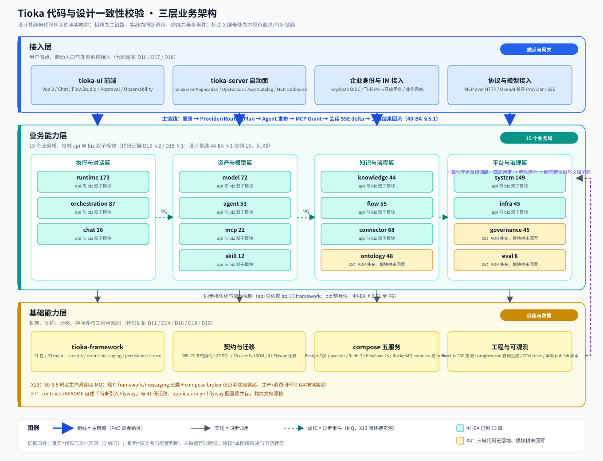
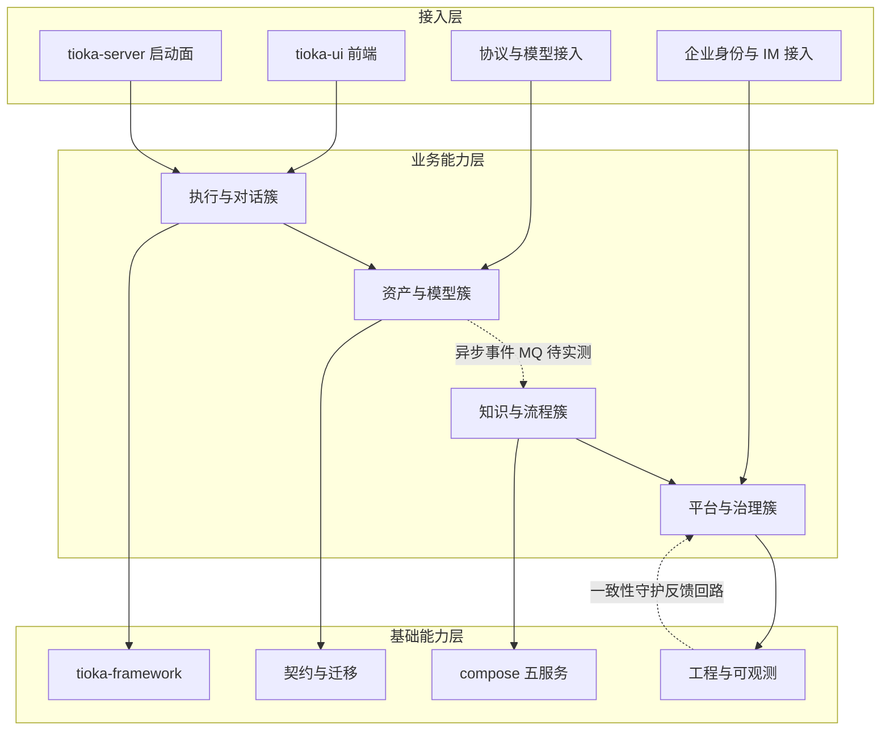
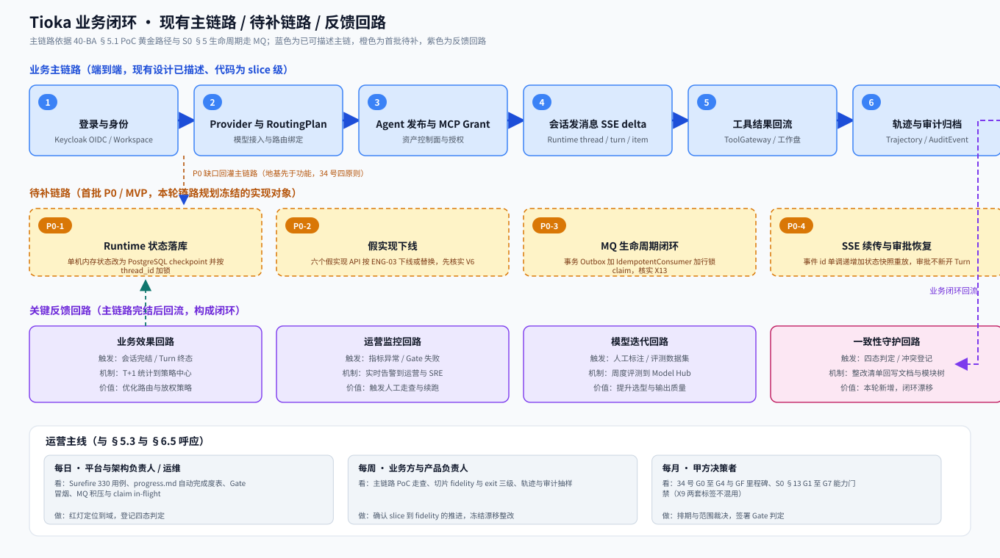
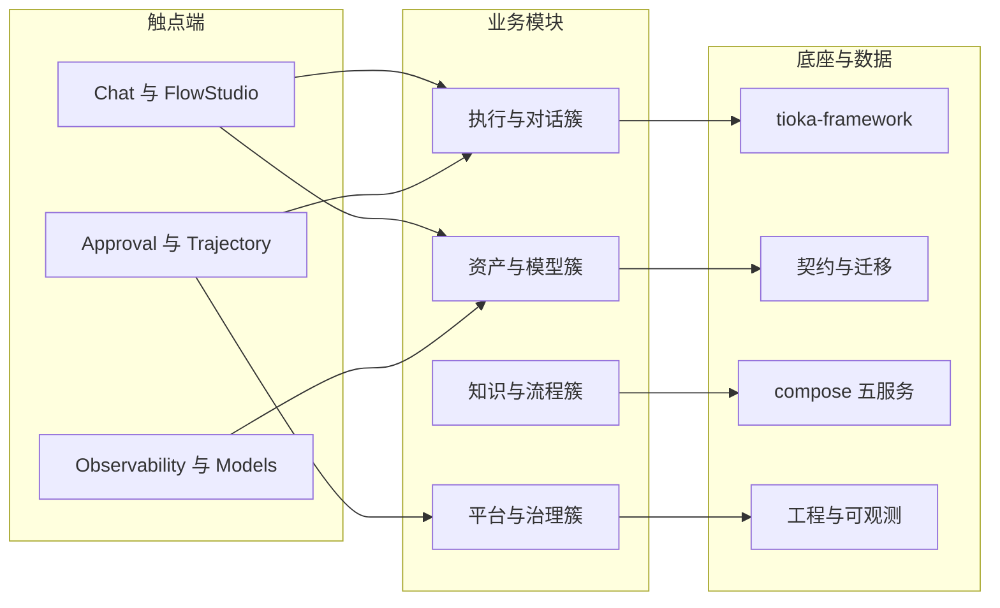

# Tioka 代码与设计一致性校验 · 高层架构设计

> 本文档是 G3 阶段产物，是 `system-architect`（G4 系统设计）与 `product-story-designer`（G4 UserStory）的**唯一上游边界基线**。
>
> **本轮不是从零做新系统架构**。Tioka 已有完整设计体系（企业架构 40–48、系统详设 S0–S15、ADR-008 至 075、施工 M0 至 M4 与 F、34 号执行计划、9 份既有调研、30 张图），代码已有 883 个 main 与 258 个 test Java、15 个业务域、41 份 Flyway 迁移、Vue 3 前端、compose 五服务。本轮交付物是「代码与设计一致性校验 + 双向审查 + 后续链路规划」，各章按此语义填充。
>
> **证据口径（全文通用，明确区分三类）**：
> - **事实**：来自 G1 冻结的 `material_digest.md`（D 编号与 X 编号）或 G2 冻结的 `research_report.md`（SR 编号 / B 编号）中可直接定位的原文、数字、路径、状态词。
> - **推断**：由事实结合本项目语境作出的判断，逐条标注依据与局限，不写成事实。
> - **建议**：本阶段的裁决、范围裁剪与下游转交，属于待 G3 人工审核确认的评估性结论，不是既成事实。
>
> 上游输入：用户原始诉求（见 §0）、Phase 0 编排决策、`material_digest.md`（511 行，G1 冻结）、`research_report.md`（588 行，G2 冻结）、主理人转交的高层架构模板与中间确认协议。下游产出：G4 系统设计与 UserStory、G5 部署与安全设计、G6 集成交付。

---

## 0. 元信息：修订记录

```yaml
标题: Tioka 代码与设计一致性校验 - 高层架构设计 v1.0
版本: v1.0
状态: Reviewing
创建日期: 2026-11-08
最后更新: 2026-11-08
作者: business-architect（业务架构师 许边界）
评审人:
  - team-lead（主理人，G3 自动校验与 AskUserQuestion 人工审核）
  - 用户（Phase 0 编排决策与 G3 产物审核）

关联文档:
  上游输入:
    - 用户原始诉求: 现在这个项目已经有了一部分设计，我现在需要你们进行代码与设计的一致性校验。并且审查现有的代码以及设计，进行后续的链路规划与实现
    - 资料摘要: .workbuddy/output/material_digest.md（G1 冻结，511 行）
    - 行业调研报告: .workbuddy/output/research_report.md（G2 冻结，588 行）
    - 设计基线: docs/architecture/enterprise/ 40-BA 至 48-CS、systems/ S0 至 S15、adr/ ADR-008 至 075、implementation/ 34 号计划
  下游产出:
    - 系统设计: .workbuddy/output/系统设计.md（G4，待生成）
    - 部署设计: .workbuddy/output/部署设计.md（G5，待生成）
    - 安全设计: .workbuddy/output/安全设计.md（G5，待生成）
    - UserStory: .workbuddy/output/UserStory.md（G4，待生成）
  图示:
    - 三层业务架构图: .workbuddy/output/pic/business-architecture/business-architecture.svg
    - 业务闭环图: .workbuddy/output/pic/business-closure/business-closure.svg
```

| 版本 | 日期 | 作者 | 变更内容 | 评审状态 |
| --- | --- | --- | --- | --- |
| v1.0 | 2026-11-08 | business-architect（许边界） | 首轮：四态判定表、边界与优先级裁决、三层业务架构图与业务闭环图、D-01 至 D-06 处理结论、四次中间确认自检 | 待 G3 审核 |

**本角色边界声明**：本阶段只冻结业务边界、模块范围、MVP 范围、角色场景与功能清单；未决定数据库表结构（归 `system-architect`）、未规定资源规格与运行时拓扑（归 `platform-architect`）、未编写部署或安全最终方案、未修改仓库任何源码或既有设计文档、未生成本文之外的交付文档、未下发或调度其他成员。

**两处已锁定编排口径（本阶段只引用、不重新裁决）**：
- **X1**：以 `docs/architecture/implementation/34-M0至M4推进规划与工作项.md` 为执行权威；README 与 31 号文档「33 为后续推进权威」的指针判为文档漂移，列入整改清单。
- **X9**：采用 34 号的 G0 至 G4 与 GF 作为里程碑口径；S0 §13 的 G1 至 G7 作为能力门禁清单独立核对，两套标签不混用；完成度词表统一按 31 §11 的 slice / fidelity / exit 三级。

---

## 1. 需求概要

### 1.1 需求概要说明

Tioka 已具备完整设计体系与可运行代码骨架（15 个业务域、883 个 main Java、41 份 Flyway 迁移、compose 五服务、Vue 3 前端），但设计文档族之间存在多处自相矛盾的权威指针、模块树与完成度口径（G1 登记 X1 至 X14 共 14 条冲突），代码是否逐域实现设计基线尚未逐项核对。本轮由用户「代码与设计一致性校验 + 审查现有代码与设计 + 后续链路规划与实现」的诉求触发，交付物为：全仓分域四态判定（一致 / 漂移 / 缺失 / 设计自身矛盾）、冲突裁决台账、后续链路 P0 至 P2 优先级规划。系统定位一句话：本轮是既有 Tioka 平台的**一致性校验与链路规划基线**，不新建业务系统、不改变运行时拓扑。

### 1.2 关键决策摘要

| 编号 | 决策类别 | 决策内容 | 关联章节 |
| --- | --- | --- | --- |
| D1 | 范围决策 | 本轮只做一致性校验、双向审查与链路规划；G6 通过后才进入代码实现，G6 前不动生产代码 | §6.1 需求边界 |
| D2 | 基线决策 | 校验基线为 S0 至 S15、40 至 48、ADR、34 号计划；按 X1 以 34 号为执行权威，按 X9 不混用两套 Gate 标签 | §2.6 / §4.4 |
| D3 | MVP / 完整版边界 | P0 为 4 条地基链路（状态落库、假实现下线、MQ 闭环核验、SSE 续传与审批恢复）；模型网关配额、审计哈希链、三模块密度、双实例 HA 后移（本项经中间确认，用户裁决「方案 A：最小地基集（推荐）」冻结，见 §4.6 / 附录 C.7） | §4.3 / §6.3 |
| D4 | 复用 vs 新建 | 100% 复用现有 15 个业务域、compose 五服务与 framework 底座；不新建运行时、不引入云托管执行面 | §4.2 / §5.2 |
| D5 | 部署形态 | 私有化本地 compose 五服务；多租户不是硬需求，隔离粒度为 Workspace | §4.2 |

**硬指标**：共 5 条（≥3、≤5），每条可映射到正文具体章节。

### 1.3 价值主张

| 价值维度 | 量化目标 | 度量指标 | 当前值 | 目标值 | 截止时间 |
| --- | --- | --- | --- | --- | --- |
| 效率 | 四态判定覆盖 16 个业务架构域校验对象，逐条带 D 编号出处 | 带出处判定条目数 / 判定条目总数 | 0 | 16 / 16 | G3 交付 |
| 合规 | 14 条冲突记录逐条给出裁决或转交，裁决率 100% | 已裁决条目数 / 冲突总数 | 0 | 14 / 14 | G3 交付 |
| 收入 | 首批 P0 链路不超过 4 条，每条映射 34 号工作项与代码域 | 完成映射的 P0 条目数 | 0 | 4 / 4 | MVP 冻结 |
| 成本 | 首批实现新增中间件 0 个、新增云托管执行依赖 0 个、G6 前生产代码改动 0 处 | 新增组件数与代码改动数 | 0 | 0 / 0 / 0 | 首批实现准入 |
| 体验 | 完成度词表统一为 slice / fidelity / exit 三级，Gate 标签混用处 0 | 混用处计数 | 多套并存 | 0 | G3 交付 |

**硬指标**：业务价值 3 条（效率 / 合规 / 收入）、技术与成本价值 2 条（成本 / 体验），共 5 条；每条含可量化数字，无「提升 / 优化 / 加强 / 更好」等模糊词。

---

## 2. 需求分析 & 痛点解构

### 2.1 核心角色关注点（甲方决策者角色 / 最终用户角色 / 受影响方角色）

> 本表按甲方决策者、最终用户、受影响方三类核心角色逐行登记角色关注点，三类维度各至少一行，每行给出 Top1 关心点，来源均为本项目真实干系人与 G1 冻结证据。
>
> 其中运维与交付方作为受影响方角色登记，平台与架构负责人作为甲方决策者角色登记，业务方与最终用户作为最终用户角色登记；角色清单与 §4.2 服务对象、§6.5 管理端原型一致。

| 角色 | 业务身份 | 主要操作 | Top1 关心点 | 来源 |
| --- | --- | --- | --- | --- |
| 甲方决策者：平台与架构负责人 | Tioka 平台 owner、架构评审人 | 审阅四态判定与冲突裁决、签署 Gate、冻结链路优先级 | 校验基线唯一、结论可追溯，不因文档矛盾重复返工 | 用户诉求；D5 §34 头部；D2 §README 1 |
| 最终用户 A：业务方与产品负责人 | 使用 Chat / FlowStudio / Approval 的业务与产品人员 | 发起会话、编排流程、审批放权、查看轨迹 | 首批实现链路是否覆盖可演示的 PoC 黄金路径 | D2 §40-BA 5.1；D17 §3 |
| 最终用户 B：开发与测试工程师 | 按 G4 系统设计与 UserStory 实现首批链路 | 契约核对、切片交付、跑 Gate 冒烟与集成测试 | 范围边界明确，P0 清单可直接拆任务，不含歧义口径 | D5 §31 11；D11 §contracts/README |
| 受影响方：终端用户 | 通过 Chat 与 IM 触达系统的企业员工 | 发消息、观察 SSE delta、查看工具结果回流 | 链路可用性与审批恢复不丢上下文 | D2 §40-BA 5.1；D3 §S1 5 |
| 受影响方：运维与交付方 / SRE | 私有化交付、compose 五服务运维 | 部署、监控指标与告警、Gate 走查、备份与 HA | 完成度口径可信，绿灯不等于 Exit，验收证据完整 | D5 §31 11；D5 §w1-poc-gate-signoff；D10 §ops 清单 |

**硬指标**：5 类角色（甲方决策者 1、最终用户 2、受影响方 2），每行均有 Top1 关心点，无笼统表述。

### 2.2 核心痛点

| 编号 | 痛点描述 | 现象 / 数据（G1 证据） | 影响角色 | 影响程度 | 优先级 |
| --- | --- | --- | --- | --- | --- |
| P1 | 执行权威与文档权威源自相矛盾，一致性校验基线不唯一 | X1：README §24 与 31 头部两处指 33，33 / 34 / design-notes / enterprise / 34 分阶段五处指 34；X3：enterprise/README 称 docs/architecture 唯一权威，feishu-docs/Tioka/README 称镜像为源；实测 `_generated/` 目录不存在 | 甲方决策者、最终用户 B | 高（阻断校验） | P1 |
| P2 | 完成度信号多套口径并存，自动化绿灯被误当作 Exit | X2：归档快照主源约 1.17 万行 Java、mvn test 红、1 个 commit，对比 progress.md 330 用例 0 失败、git 288 commit；X5：33 §1.1 记「未完成」而 §17 记 R0 / R1「已完成」；X9：S0 §13 G1 至 G7 与 34 号 G0 至 G4 / GF 语义不同 | 甲方决策者、运维与交付方 | 高（验收可信度） | P1 |
| P3 | 设计模块树与代码模块树不一致 | X8：44-EA §1 与 module-dependencies §1 列 13 个业务模块，tioka-modules/pom.xml 声明 15 个，多出 ontology（48 java）、governance（45 java）、eval（8 java） | 最终用户 B、甲方决策者 | 中（范围歧义） | P2 |
| P4 | MQ 生命周期闭环未证实，异步骨干可能为空壳 | X13：S0 §5 规定生命周期走 MQ；design-notes/01 与 33 §1.1 记「只有 `*MqTopics` 常量类，Java 无生产消费」；现状 framework/messaging 有 EventPublisher / DomainEvent / IdempotentConsumer 三类，compose 有 namesrv 与 broker，但闭环需按域实测（V7） | 最终用户 A / B、运维与交付方 | 高（主链路完整性） | P1 |
| P5 | Gate 与 Exit 编号语义冲突，里程碑与能力门禁混用 | X9：S0 §13 以 G1 至 G7 表能力门禁，34 号以 G0 / G1 / G2 / G3 / G4 / GF 表里程碑；35 §1 另记 G3 新增 4 用例、G4 十七用例；31 §11 禁止宣称「W1 至 W5 Exit / G1 至 G7 已过」 | 甲方决策者、运维与交付方 | 中（排期与验收） | P2 |
| P6 | 飞书镜像与本地文档双份漂移，行数与文件集均不一致 | X3 / X4：七份同名企业架构文档中五份行数不同（40-BA 181 对 221、43-AA 151 对 176、45-FE 202 对 252 等）；镜像多 47-图形、缺 47-GL 与 48-CS，含两处 DIAGRAMS:BEGIN 标记而本地为零 | 运维与交付方、最终用户 B | 中（文档新鲜度） | P2 |
| P7 | 34 号计划工作状态与代码现状不同步，G1 判定依赖仓库外证据 | D5 §34 2 记 M0 已合入、M1 全部 28 后端项与 9 前端项由 PR 24 合入、只剩 G1 判定；G1 条件为夜间真实模型连跑 3 天与 `ops/m1-closure-walkthrough.md` 人工勾选（V2）；35 §1 记 M4-01 至 M4-06 施工设计缺、前端页面规格缺 | 甲方决策者、运维与交付方 | 中（排期可执行性） | P2 |
| P8 | 设计内部依赖环与分层渗漏 | X6：module-dependencies §2 编译期图存在 AG 指向 MCP 与 MCP 指向 AG 的反向边，§3 又写 mcp-biz 允许依赖 agent-api，与 44-EA §3 仅 system-api 冲突；D7 §01 记 tioka-server 两个 Controller 直接 import 各域实现类 | 最终用户 B | 中（架构守护） | P2 |

**优先级标准**：P1 直接影响校验基线或主链路完整性，不解决无法冻结边界；P2 影响范围歧义与运营效率，可在 MVP 后迭代；P3 为长尾体验问题，列入完整版。

**硬指标**：8 条痛点，每条有 X 编号或 D 编号数据佐证；P1 共 3 条（P1 / P2 / P4），均在 §2.3 有对应 V 级目标。

### 2.3 期待目标

| 编号 | 目标描述 | 对齐痛点 | 度量指标 | 当前值 | 目标值 | 截止时间 |
| --- | --- | --- | --- | --- | --- | --- |
| V1 | 四态判定覆盖 16 个业务架构域校验对象，逐条带 D 编号与路径出处 | P1 / P3 / P5 / P6 | 带出处判定条目数 / 判定总数 | 0 / 16 | 16 / 16 | G3 交付 |
| V2 | 14 条冲突记录逐条给出裁决或转交说明，裁决率 100% | P1 / P2 / P5 | 已裁决条目数 / 冲突总数 | 0 / 14 | 14 / 14 | G3 交付 |
| V3 | 首批 P0 链路不超过 4 条，每条映射 34 号工作项与代码域 | P4 / P7 | 完成映射的 P0 条目数 | 0 / 4 | 4 / 4 | MVP 冻结 |
| V4 | MQ 闭环按 3 个核验点（生产 / 消费 / 幂等）给出「已证实 / 未证实 / 待补」结论 | P4 | 已标注结论的核验点数 | 0 / 3 | 3 / 3 | 首批实现准入 |
| V5 | 完成度词表统一为 3 级（slice / fidelity / exit），两套 Gate 标签混用处为 0 | P2 / P5 | 混用处计数 | 多套并存 | 0 | G3 交付 |
| V6 | 34 号工作状态逐项核对，6 项登记全部给出「一致 / 待外部取证 / 转交」结论 | P7 | 已结论登记项数 | 0 / 6 | 6 / 6 | G3 交付 |

**硬指标**：6 条目标，每条含数字且对齐至少 1 条痛点；3 条 P1 痛点（P1 对应 V1 / V2、P2 对应 V2 / V5、P4 对应 V3 / V4）均有对应 V 级目标。

### 2.4 基线复用

> 先盘点再决定新建。以下为本轮可直接复用的既有能力，凡列入 §2.5 功能缺口的能力均已确认基线无法直接覆盖。

| 复用类别 | 现有能力 | 复用方式 | 来源系统 | 备注 |
| --- | --- | --- | --- | --- |
| 核心底座 | 15 个业务域、每域 api 与 biz 双子模块、818 个 main 源 | 直接作为校验对象与链路承载 | D13 §2 与 §3；D15 §1 | 三域（ontology / governance / eval）为 X8 争议点，见 §4.4 |
| 框架底座 | tioka-framework 11 包、53 个 main 源（security / error / messaging / persistence / trace 等） | 直接复用，不新建框架 | D14 §1 与 §2 | messaging 三类的闭环待实测 |
| 契约与数据 | 41 份 Flyway 迁移、45 份 contracts/db SQL、39 份 events JSON Schema、W0-17 冻结契约 | 直接复用为契约基线 | D11 §contracts/README；D16 §2 | 双份 SQL 副本需先按 V5 收敛 |
| 中间件 | compose 五服务：PostgreSQL pgvector、Redis 7、Keycloak 24、RocketMQ namesrv 与 broker | 直接复用，不新增中间件 | D18 §2；D4 §ADR-008 | ADR-008 已冻结 RocketMQ 5.x |
| 前端 | Vue 3 / Pinia / Element Plus / Vite、64 个 ts 与 63 个 vue、Chat 与 FlowStudio 等页面 | 直接复用页面清单 | D17 §1 至 §3 | 无 tsx，X12 口径按实测修正 |
| 监控与完成度 | Surefire 85 份报告 / 330 用例、progress.md 自动生成、scripts 中 publish 与 gen-progress | 直接复用为工程信号 | D19 §1 至 §4；D5 §progress | 绿灯不等于 Exit（31 §11） |
| 文档体系 | S0 至 S15、40 至 48、ADR-008 至 075、34 号计划、30 张 drawio | 直接复用为设计基线 | D2 / D3 / D4 / D5 / D9 | 权威源唯一为 docs/architecture |

**硬指标**：7 类基线全部先盘点；§2.5 中每条缺口均注明基线无法直接覆盖的原因。

### 2.5 功能缺口

| 阶段 | 功能缺口 | 基线为何无法覆盖 | 必要性 | 优先级 | 对齐目标 |
| --- | --- | --- | --- | --- | --- |
| 校验期 | 全仓分域四态判定矩阵与 14 条冲突裁决台账 | 现有文档只并列冲突、不裁决（D1 §3 说明） | 必须 | MVP | V1 / V2 |
| 校验期 | 34 号计划工作状态逐项核对与仓库外取证转交清单 | progress.md 自述「仅作索引」，不作为完成度依据 | 必须 | MVP | V6 |
| 首批实现期 | Runtime 状态落库与按 thread_id 会话加锁 | 归档快照记单机内存状态（D7 §01），现有 PG 可承载但无 checkpoint 表 | 必须 | MVP | V3 |
| 首批实现期 | 六个假实现 API 下线或替换 | V6 状态未对账，ENG-03 要求「假实现先下线」 | 必须 | MVP | V3 |
| 首批实现期 | MQ 生产 / 消费 / 幂等三点核验与补链 | framework/messaging 三类与 broker 仅证明底座就绪，闭环未证实（X13） | 必须 | MVP | V4 |
| 首批实现期 | SSE 事件续传与审批挂起恢复 | 现有 SSE 为 slice，缺事件 id 单调递增加状态快照重放 | 必须 | MVP | V3 |
| 完整版期 | 模型网关配额与成本归集、审计字段语义与 traceId 贯通 | M1-03 已有排期但首批不纳入，字段语义可先行 | 重要 | P1 | V3 |
| 完整版期 | ArchUnit 分层 / 环检测与契约测试 CDC | 44-EA §2 R1 至 R6 与 W0-09 已规划但未见落地证据 | 重要 | P1 | V1 / V5 |
| 完整版期 | 审计哈希链、全量 OTel trace、双实例 HA 与真实模型连跑 3 天 | 依赖 digest 迁移、仓库外取证与 U-01 / U-02 | 重要 | P2 | V6 |

**硬指标**：9 条缺口，每条对齐 §2.3 至少 1 条目标；5 条 MVP 缺口在 §6.3 功能清单中均有 MVP 标记。

### 2.6 业务架构域四态判定表（本轮核心）

> 判定范围为业务架构域：40-BA 业务架构、S0 体系总览与边界、业务相关 ADR、34 号计划工作状态。四态为「一致 / 漂移 / 缺失 / 设计自身矛盾」。证据列标注事实（D 编号）或推断（已注明局限）。

| 编号 | 校验对象 | 设计基线 | 代码证据 | 四态 | 判定依据与证据性质 |
| --- | --- | --- | --- | --- | --- |
| BA-01 | 40-BA §1 业务能力地图 L1 至 L2 与五类端到端场景 | D2 §40-BA 1 | D13 §2 十五业务域；D17 §3 前端页面 | 一致 | 能力地图与域划分可逐项映射（事实） |
| BA-02 | 40-BA §5.1 PoC 黄金路径 | D2 §40-BA 5.1 | D15 §3 runtime / model / agent / mcp / chat 域 api | 一致 | 六步路径均有对应域与 api，但为 slice 而非 fidelity（事实 + 31 §11 口径） |
| BA-03 | S0 §1.1 至 1.2 硬边界（禁外部 harness / 云 AgentRun 当执行依赖、禁 biz 直连外部 SDK、禁 biz 互依） | D3 §S0 1.1 至 1.2 | D18 §2 私有化 compose 五服务；D2 §44-EA 2 | 一致 | 未见云托管执行依赖；biz 互依有渗漏但属 X6（事实，见 BA-16） |
| BA-04 | S0 §2.3 非目标（外购运行时 / 云托管执行 / 跨租户 SaaS） | D3 §S0 2.3 | D16 §3 model.mock 与 mcp.mock 本地默认 | 一致 | 部署形态与默认配置一致（事实） |
| BA-05 | S0 §5 系统级生命周期走 MQ | D3 §S0 5 | D14 §3 messaging 三类；D18 §2 broker | 缺失 | 底座就绪但生产消费闭环未证实，X13 与 V7（事实 + 推断：按类名与配置判断，未做运行时验证） |
| BA-06 | S0 §13 门禁 G1 至 G7 与 34 号 G0 至 G4 / GF | D3 §S0 13；D5 §34 分阶段 | D5 §35 1 用例计数 | 设计自身矛盾 | 同为 G 标签指向不同能力簇与里程碑，X9（事实）；按主理人锁定口径不混用 |
| BA-07 | 44-EA §1 模块树十三业务域 | D2 §44-EA 1；D10 §1 | D13 §2 十五子模块；D15 §1 三域源码 48 / 45 / 8 java | 漂移 | 设计已由 ADR-025 / 031 / 036 补充三域，模块树未回写，X8（事实） |
| BA-08 | ADR-015 术语取代注（Workspace / system_admin） | D4 §ADR-015 页首；D2 §47-GL 3 | D2 §47-GL 4 遗留十三项 | 漂移 | 权威术语与历史代码残留并存，X11；47-GL 已自我登记（事实） |
| BA-09 | ADR-025 / 031 / 036 补充 governance / eval / ontology 三域 | D2 §README 24 至 86；D4 §ADR-025 等 | D15 §1 三域源码与 api / biz 拆分 | 一致 | ADR 补充与代码落地一致，漂移仅在模块树回写（事实） |
| BA-10 | 文档单源 ENG-07（docs/architecture 唯一权威、publish 脚本生成镜像） | D2 §README 1；D10 §9；D11 §archive/README | D12 §README 首段与 §行数复核；`_generated/` 不存在 | 漂移 | 镜像仍为手工源、行数与文件集不一致，X3（事实） |
| BA-11 | 镜像行数与文件集一致性 | D2 §40-BA 至 48-CS | D12 §行数复核七份对比 | 漂移 | 五份行数不同，多 47-图形、缺 47-GL 与 48-CS，X4（事实） |
| BA-12 | 33 号内部完成度口径（§1.1 未完成 vs §17 已完成） | D5 §33 1.1；D5 §33 17 | D5 §31 11 完成度词表 | 设计自身矛盾 | 同文两处口径并存，X5（事实） |
| BA-13 | 执行权威指针 | D1 §24；D5 §31 1 | D5 §34 头部；D7 §README 8 | 设计自身矛盾 | 两处指 33、五处指 34，X1（事实）；按主理人锁定以 34 为权威 |
| BA-14 | 契约目录自述「尚未引入 Flyway」 | D11 §contracts/README 迁移脚本 | D16 §2 41 份迁移；D16 §3 flyway 配置段 | 漂移 | 文档新鲜度落后于代码，X7；双份 SQL 副本未删除（事实） |
| BA-15 | 前端技术栈与文件类型 | D6 §00 6 第 1 项；D4 §ADR-028 | D17 §1 package.json；D17 §2 64 ts 与 63 vue | 一致 | 00 总纲更正为 Vue 3 已落地，X12；类型枚举按实测修正（事实） |
| BA-16 | 依赖矩阵与 44-EA §2 R1 至 R6 | D2 §44-EA 2 与 §3；D10 §4 | D10 §2 编译期图 AG 与 MCP 反向边；D7 §01 两个 Controller 直接 import | 设计自身矛盾 | 同一依赖文档内部对 mcp 到 agent 描述不一致，X6（事实） |

**四态汇总**：一致 6 条（BA-01 / 02 / 03 / 04 / 09 / 15）、漂移 5 条（BA-07 / 08 / 10 / 11 / 14）、缺失 1 条（BA-05）、设计自身矛盾 4 条（BA-06 / 12 / 13 / 16），合计 16 条；P1 痛点 P1 / P2 / P4 均已落入判定表。

### 2.7 34 号计划工作状态核对

> 逐项核对 G1 冻结的 `material_digest.md` §3.1 六项登记，给出本阶段处理结论；本角色不判定 34 号计划实际完成百分比。

| 项 | 登记内容（D5 出处） | 本阶段结论 | 性质 |
| --- | --- | --- | --- |
| 阶段进度 | M0 已合入（PR 8、10 至 12）；M1 全部 28 后端项与 9 前端项由 PR 24 合入；OBS-01 / 02 与 UTC 由 PR 27 合入 | 记为设计自述状态，按 31 §11 保守取 slice；不作完成度背书 | 事实 + 建议 |
| G1 判定条件 | 夜间真实模型 workflow 连跑 3 天、演示走查清单 `ops/m1-closure-walkthrough.md` 人工勾选 | 属仓库外证据（V2 / U-01），转交主理人向用户或运维取证；本阶段不判定 | 转交 |
| 工作项登记 | progress.md 解析 292 个工作项 ID，另标注 92 项省略，声明「仅作索引」 | 仅作为索引，不作为完成度依据；列入 Out-of-Scope 的「绿灯即 Exit」误读 | 建议 |
| 施工设计缺口 | M3 后段第 67 至 75 条约 60 人天只有 ADR 无施工对照；M4-01 至 M4-06 施工设计缺；前端页面规格缺 | 转交 G4 系统设计与 UserStory 作为范围输入，本阶段不补写施工设计 | 转交 |
| 待负责人决策 | D1 至 D12 共十二项，D2「Q8 规格 v2.3 十组样本租约脱敏入库」标注卡住合同主链起点 | 登记为人工审核待确认项（§6.6），不越权裁决 | 转交 |
| 本角色备注 | 设计自述状态须由下游按域以代码证据核对 | 本表即核对结论；逐域判定见 §2.6，按域实测留 G4 | 建议 |

---

## 3. 行业调研

> 本章整合 G2 冻结的 `research_report.md`。严格区分事实、推断、建议：**加权打分是评估性建议，不是已冻结决策**；research §4.4 原文明确「本节所有『建议方式』『建议 MVP』『推荐方案』均为 research-analyst 的评估性建议，不构成对下游的已冻结输入」。

### 3.1 行业标杆系统分析

| 标杆系统 | 厂商 / 来源 | 场景覆盖 | 技术亮点 | 商业模式 | 适用度 | 证据性质 |
| --- | --- | --- | --- | --- | --- | --- |
| B1 Dify | LangGenius / 开源社区 | SSE 续传、workflow 人审暂停、Agent 工具循环 | workflow_run_id 重连、状态快照重放、continue_on_pause | 开源自托管 + Cloud SaaS | 高 | 事实（SR-01 至 03） |
| B2 LangGraph | LangChain | 状态机、审批挂起恢复、按会话加锁 | checkpointer、interrupt 与 resume、PostgresSaver | 开源库 + 平台商用 | 高 | 事实（SR-04 至 07） |
| B3 OpenAI Responses API 与 Agents SDK | OpenAI | agentic loop、conversation state、paused runs | previous_response_id、Items 事件模型、WebSocket stream_id | 头部商业 SaaS（闭源托管，按量计费） | 中 | 事实（SR-08 至 11） |
| B4 Amazon Bedrock Agents | AWS | 多步编排、会话历史、分步 trace | InvokeAgent、TracePart 字段 | 头部商业 SaaS（全托管云，按量计费） | 低 | 事实（SR-12 / 13） |
| B5 LiteLLM Gateway | BerriAI 社区 | 统一路由、配额、成本归集 | virtual key、四级限流、router 回退、异步 spend logging | 开源自托管 + Enterprise | 高 | 事实（SR-25 / 26） |
| B6 Langfuse | Langfuse / ClickHouse | 评测、trace 与成本 | 层次化 trace、datasets 与 experiments、OTel 原生 | 开源 MIT + Cloud 订阅 | 中 | 事实（SR-24 / 27） |

**硬指标**：6 家（≥3），含头部 SaaS 代表 2 家（B3 / B4）、开源或自研代表 4 家（B1 / B2 / B5 / B6）。B4 与 B3 的云托管执行依赖受 S0 §1.1 至 1.2 硬边界约束，仅作语义对照，不作为执行底座候选（research §3.2 / R-02，属**建议**，本阶段裁决见 §4.2）。

### 3.2 方案对标及优先级打分

> **对比矩阵（5 维度，权重之和 1.00）**。打分对象是「该标杆的工程范式对 Tioka 自研链路的借鉴适用度」，不是采购或引入评估；分值沿用 G2 冻结结论，本阶段不重设权重、不重新打分。

| 评估维度 | 权重 | 权重理由 | B1 | B2 | B3 | B4 | B5 | B6 |
| --- | --- | --- | --- | --- | --- | --- | --- | --- |
| 场景契合度 | 0.30 | 与 G1 登记主链路缺口的直接对应度 | 5 | 5 | 4 | 4 | 4 | 4 |
| 技术成熟度 | 0.20 | 有可核验官方文档与生产验证 | 5 | 5 | 5 | 5 | 5 | 5 |
| 集成难度（反向） | 0.15 | 能否在 Java 17 栈自研复刻而不引入外部运行时 | 4 | 4 | 3 | 2 | 4 | 3 |
| 成本（反向） | 0.15 | 优先开源可自托管、无强制采购与长期商务条款 | 5 | 5 | 2 | 2 | 5 | 4 |
| 合规可控性 | 0.20 | 私有化 compose 五服务、数据不出境、S0 硬边界 | 5 | 4 | 2 | 1 | 5 | 5 |
| **加权总分** | **1.00** | 五维权重之和为 1.00 | **4.85** | **4.65** | **3.35** | **3.00** | **4.55** | **4.25** |

**结论摘要（事实层：G2 冻结的评分结果）**：
- **优先借鉴**：B1 Dify（4.85）、B2 LangGraph（4.65）、B5 LiteLLM（4.55）。
- **部分借鉴**：B6 Langfuse（4.25）、B3 OpenAI（3.35）。
- **不借鉴（否决）**：B4 Amazon Bedrock Agents（3.00）——云托管执行依赖违反 D3 §S0 1.1 至 1.2「禁止把外部 harness 或云 AgentRun 当执行依赖」。

**本阶段消费结论（建议层，待 G3 人工审核）**：
1. 三层结论按**工程范式与事件契约**纳入本轮链路规划，不引入任何标杆运行时；B1 的事件续传四件套、B2 的 checkpoint 与 interrupt 语义、B5 的异步记账职责分别落入 P0-1、P0-4、P1 模型网关。此为**建议**。
2. B4 的否决由本阶段在 §4.2「边界（不做）」与 §6.1 Out-of-Scope 显式承接，并作为阶段内中间确认的一个候选维度（见 §4.6 与附录 C）。此为**建议**。
3. 加权打分不得被下游当作采购或引入授权（research §4.4 / R-06）；本阶段是唯一边界冻结方。此为**事实（协议口径）+ 建议（执行纪律）**。
4. 权重稳健性复算（私有化强化权重）证明三层分组不反转（research §3.1），本阶段沿用，不另起评估。此为**事实**。

### 3.3 完整报告参考

- 完整报告路径：`.workbuddy/output/research_report.md`（G2 冻结，588 行，38 条可核验 https 来源）。
- 调研工具：`research-analyst` 使用的联网检索与 evidence 分级方法（见附录 B）。
- 调研日期：2026-11-08。
- 调研归档：`docs/architecture/research/` 01 至 09 为项目既有九份基线调研（D8），非本轮联网调研；两者不混同。
- 待外部验证项：U-01 至 U-06 与 V1 至 V7 由主理人取证，本阶段不伪造 URL、不写入商务报价（research §5.2 / U-06）。

### 3.4 G2 依赖项 D-01 至 D-06 逐条处理结论

> 主理人要求：research §5.3 的六项依赖必须逐条给出本阶段处理结论或转交说明，不得遗漏。

| 编号 | 依赖项（research §5.3） | 本阶段处理结论 | 性质 |
| --- | --- | --- | --- |
| D-01 | Outbox、幂等消费、SKIP LOCKED claim 的职责边界 | **转交 G4 `system-architect`**：属系统设计与接口契约职责，本阶段不越权决定。本阶段仅在 §2.6 BA-05 判「缺失」、§5.2 标注 framework/messaging 与 Orchestration claim API 的依赖来源、§4.5 把「生产 / 消费 / 幂等」三点核验列为 P0-3 准入 | 转交 + 边界标注 |
| D-02 | 云托管与外部执行依赖的排除边界 | **本阶段裁决**：S0 §1.1 至 1.2 硬边界仍适用，B4 已由 G2 否决，云托管执行面列入 §6.1 Out-of-Scope；不采购、不引入、不写入首批范围。该裁决同时作为阶段内中间确认的候选维度（§4.6） | 裁决 |
| D-03 | 模型网关配额、成本归集、审计哈希链纳入 M1 还是后移 | **本阶段裁决**：按 X9 采用 34 号 G0 至 G4 / GF 里程碑口径，不重排 M1-03；审计哈希链首批仅做字段语义与 traceId 贯通（P1），digest 锚定与迁移后移 P2；成本归集沿用 M1-03 既有排期 | 裁决 |
| D-04 | 非 mock 验收的 Gate 分级落点 | **转交 G5 + 沿用 X9**：本阶段按 31 §11 三级词表与 X9 两套标签不混用；真实模型连跑 3 天、双实例 HA、Keycloak 非 mock 验收列入 Out-of-Scope（首批范围外），取证由主理人协调（§2.7 / V2 / U-01） | 转交 |
| D-05 | ArchUnit、契约测试、文档单源的落地顺序 | **本阶段裁决顺序**：先修 X3 / X4 镜像漂移与 X8 模块树回写（P1 工程基线），再落 ArchUnit 分层 / 环检测与契约测试 CDC（P1 后半），对齐 44-EA §2 R1 至 R6 与 W0-17 契约冻结；实施排期归 G4 / G6 | 裁决 |
| D-06 | 模块树漂移 X8 的定性 | **本阶段裁决**：判为「漂移」，具体为「设计已由 ADR-025 / 031 / 036 补充三域，44-EA §1 与 module-dependencies §1 未回写」，属文档漂移而非架构漂移；15 域为事实基线；整改动作列入 P1（§4.4） | 裁决 |

---

## 4. 方案决策

### 4.1 价值定位澄清

```
对外价值（客户侧）: 交付一份可追溯、可逐 Gate 审核的一致性校验与链路规划基线，使 G6 后首批实现的 4 条链路每条都能映射到 34 号工作项与代码域（V3：4 / 4），不含歧义口径
对内价值（运营侧）: 14 条冲突逐条裁决（V2：14 / 14）、16 个校验对象四态判定带 D 编号出处（V1：16 / 16）、完成度词表统一为 slice / fidelity / exit 三级（V5：混用 0 处）
差异化价值        : 相对既有 33 号「勾选剧场」与多套完成度口径，本轮把「文档自述状态」与「代码可核验状态」分离，绿灯不再等同 Exit；全仓分域全覆盖而非抽样，四态判定把「设计自身矛盾」单列，避免把文档冲突误判为代码漂移
```

**与产品矩阵的关系**：本轮在 Tioka「企业级 Agent 套件」价值主线中承担**校验与规划的边界基线**职责，与 34 号执行计划、G4 系统设计与 UserStory、G5 部署与安全设计形成完整业务闭环（见 §5.2、§5.3）。

### 4.2 系统定位澄清

| 维度 | 内容 |
| --- | --- |
| 系统名称 | Tioka 代码与设计一致性校验及后续链路规划（本轮交付物，不是新产品名） |
| 系统类型 | 既有系统扩展 + 一致性校验与双向审查；不新建业务系统、不重做全量架构文档 |
| 部署形态 | 私有化 / 本地 compose 五服务；S0 §1.1 至 1.2 硬边界与 Phase 0「need_cloud_baseline_check 为假（本地与私有化 compose，无云资源核对）」共同冻结 |
| 多租户 | 否；34 号确认「多租户不是硬需求」，隔离粒度为 Workspace，平台管理员角色码 system_admin（ADR-015 术语取代注与 47-GL §3） |
| 服务对象 | 平台与架构负责人、业务方与最终用户、运维与交付方（对齐 §2.1 五类角色） |
| 上游依赖 | docs/architecture 设计基线（S0 至 S15、40 至 48、ADR、34 号）、代码仓、`material_digest.md`、`research_report.md`（详见 §5.2） |
| 下游消费者 | G4 系统设计与 UserStory、G5 部署与安全设计、G6 集成交付一致性矩阵（详见 §5.2） |
| 边界（不做） | 云托管执行面与跨租户 SaaS（S0 非目标）、G6 前改动生产代码、真实模型夜间连跑 3 天与双实例 HA 的首批验证、重做全量架构文档 |

**边界继承说明（事实）**：S0 §2.3 已把「外购运行时 / 云托管执行 / 跨租户 SaaS」列为不在范围内；B4 否决与 D-02 均是对该既有硬边界的承接，不是本阶段新增的对外承诺。

### 4.3 MVP 与完整版决策

> 用户 Phase 0 已确认「审计 + 规划 → 分批实现，G6 通过后才进入代码实现」。本表时间窗按 G3 至 G7 阶段口径，不沿用模板的周次口径；范围编号对应 §4.5 链路清单与 §6.3 功能清单。

| 阶段 | 时间窗 | 范围（链路编号） | 架构差异点 | 退出标准 | 不做（延后） |
| --- | --- | --- | --- | --- | --- |
| MVP（首批实现） | G3 冻结至 G6 通过后首批 | L1 至 L4（4 条地基链路：状态落库、假实现下线、MQ 闭环核验、SSE 续传与审批恢复；经中间确认，用户裁决方案 A 最小地基集冻结） | 完全复用现有 compose 五服务与 15 业务域；不新增中间件、不引入外部执行面；契约走 W0-17 冻结口径 | 4 条链路逐条跑通契约测试 + 黄金路径 E2E + MQ 三点核验结论齐备（V3：4 / 4、V4：3 / 3） | L5 至 L9 全部延后 |
| 完整版 | G6 后第二批起 | L5 至 L9（模型网关配额、审计字段贯通、X 类文档整改与模块树回写、ArchUnit 与契约测试、三模块密度对齐） | 在 MVP 骨架上叠加，不改 compose 五服务；digest 锚定与 HA 走独立迁移与验收 | 各批按 34 号 G0 至 G4 / GF 里程碑与 S0 §13 能力门禁分别核对，两套标签不混用（X9） | 双实例 HA、真实模型连跑 3 天、全量 OTel trace（P2） |

**演进纪律（重要）**：
- MVP 的架构骨架是完整版的**子集**：4 条地基链路只改实现密度、不改分层与依赖方向，不允许 MVP 上线后推倒重来。
- MVP 中不落地的「真实模型连跑 / Keycloak 非 mock / 双实例 HA」在完整版有明确替换计划：随 U-01 / U-02 取证后由 G5 判定，不并入自动化绿灯（R-04）。
- 禁止为赶工引入完整版无法继承的临时架构：状态持久化必须落现有 PostgreSQL，不得用内存态或 H2 临时代替（B2 官方明确 InMemorySaver 重启即丢失，SR-04）。
- 本表 P0 取值经中间确认已冻结：用户裁决「方案 A：最小地基集（推荐）」；取值与原推荐方案 A 工作基线一致，故本表数值不变，仅状态由「待裁决」转为「已冻结」（协议 §5 定点修订），详见 §4.6 与附录 C.7。

### 4.4 关键冲突的业务层裁决（不得模糊带过）

> 主理人要求对 X8 / X13 / X3 / X4 在业务层面给出明确裁决。X1 / X9 为主理人已锁定口径，本节只引用、不重新裁决。

| 编号 | 裁决结论 | 裁决依据（事实） | 业务层处置 |
| --- | --- | --- | --- |
| X8 模块树 13 对 15 | **裁定为「漂移」，且是「设计已补充、模块树未回写」的文档漂移，不是架构漂移，更不是代码擅自新增** | 44-EA §1 与 module-dependencies §1 列 13 域（D2 / D10）；tioka-modules/pom.xml 声明 15 域（D13 §2）；三域各有 api 与 biz 双子模块与 48 / 45 / 8 个 java（D15 §1）；enterprise/README 24 至 86 的 ADR 表已登记 ADR-025 / 031 / 036 对应 governance / eval / ontology（D2）；47-GL 无「三域待建」登记 | 以 15 域代码为事实基线纳入 §5.1 与 §6.2；不删除三域、不判为缺失；整改动作 = 回写 44-EA §1 与 module-dependencies §1 模块树，列 P1 / L7；不并入首批 P0（R7 建议不纳入 MVP） |
| X13 MQ 闭环是否成立 | **裁定为「不成立（闭环未证实）」**，即本阶段不宣称 S0 §5 的生命周期 MQ 闭环已达成 | S0 §5 规定生命周期走 MQ（D3）；design-notes/01 与 33 §1.1 记「只有 `*MqTopics` 常量类、Java 无生产消费」（D7 / D5）；现状 framework/messaging 有 EventPublisher / DomainEvent / IdempotentConsumer 三类（D14 §3）、compose 有 namesrv 与 broker（D18 §2）；V7 明确绿灯不等于闭环；33 §1.1 为 2026-11-05 归档快照 | 三类与 broker 只证明**底座就绪**，不构成闭环；把「生产 / 消费 / 幂等」三点核验列为 P0-3 准入（V4：3 / 3）；未实测前不新增依赖 MQ 的业务能力承诺，也不把 BA-05 从「缺失」改判为「一致」；按域实测归 G4 |
| X3 文档权威源与镜像生成机制 | **裁定为「漂移」**：唯一权威源为 docs/architecture；feishu-docs/Tioka 为手工同步镜像且已漂移 | enterprise/README 1 与 ADR ENG-07（D2）、feishu-doc-sync §9（D10）、archive/README（D11）三处一致声明单源与 publish / gen-progress 两脚本；而 feishu-docs/Tioka/README 称「以本目录 Markdown 为源，改完后 push」（D12）；实测 `_generated/` 目录不存在、镜像无「自动生成，勿改」页首 | 镜像不参与校验基线，不据镜像行数做一致性判定；README 的「以镜像为源」表述列整改；publish / gen-progress 为唯一合法生成通道，需补齐脚本执行；列 P1 / L7 |
| X4 双份镜像行数与文件集 | **裁定为「漂移」，是 X3 的具体表现，与 X3 合并整改** | 七份同名文档中五份行数不同（40-BA 181 对 221、43-AA 151 对 176、44-EA 196 对 219、45-FE 202 对 252、46 139 对 146）；镜像多 47-图形多轮评审记录、缺 47-GL 与 48-CS；镜像 40-BA 含两处 DIAGRAMS:BEGIN 而本地为零（D12 §行数复核） | 不逐份手工改镜像；以 publish 脚本重生成后核对行数与文件集，列 P1 / L7；本轮 16 条四态判定全部以 docs/architecture 为准 |
| X1（已锁定，仅引用） | 以 34 号为执行权威 | 主理人 Phase 3 编排口径 | README §24 与 31 头部的 33 号指针列整改清单，不在本阶段重新裁决 |
| X9（已锁定，仅引用） | 34 号 G0 至 G4 / GF 为里程碑口径，S0 §13 G1 至 G7 为能力门禁清单，两套标签不混用；完成度按 31 §11 三级 | 主理人 Phase 3 编排口径 | 全文统一按此口径书写；§4.3 退出标准与 §5.3 运营主线分别标注两套标签 |

### 4.5 后续链路优先级裁决清单

> 优先级编码：P0 = 首批实现链路（MVP）、P1 = 第二批工程基线与诊断收口、P2 = 完整版或里程碑后段。每条给出理由、34 号或 ADR 映射、退出标准。

| 编号 | 链路 | 优先级 | 裁决理由 | 映射 | 退出标准 |
| --- | --- | --- | --- | --- | --- |
| L1 | Runtime 状态落库与按 thread_id 会话加锁 | P0 | 直击 D7 §01 登记的单机内存状态与不可水平扩展；B2 PostgresSaver 语义成熟；复用现有 PostgreSQL | RT 状态机（S1 5 / ADR-016）、34 号 M1 安全可用的单内核 | 进程重启后状态可恢复，同 thread 并发串行化，契约测试绿 |
| L2 | 六个假实现 API 下线或替换 | P0 | 34 号四原则「假实现先下线」；V6 待按 D7 §01 表名逐类检索确认，本报告不假设其已下线 | ENG-03、34 号摘要四原则 | 六类逐类给出「仍存在 / 已下线 / 已替换」结论并可检索 |
| L3 | MQ 生产 / 消费 / 幂等三点核验与补链 | P0 | S0 §5 生命周期走 MQ；X13 裁定闭环未证实；D-01 转交 G4 前须先有核验结论 | 34 号 M2「RocketMQ + outbox」、framework/messaging（D14 §3） | V4 三点各标注「已证实 / 未证实 / 待补」并给出按域实测入口 |
| L4 | SSE 事件续传与审批挂起恢复 | P0 | 40-BA §5.1 PoC 黄金路径的交付环节；B1 事件续传四件套与 B3 paused run 语义可借鉴 | w0-contract-freeze Part Schema v0 / RuntimeEventType（D5）、S1 5 | 事件 id 单调递增加状态快照重放，审批跨多次不新开 Turn |
| L5 | 模型网关配额与成本归集 | P1 | B5 请求生命周期与异步记账划分清晰；M1-03 已有排期，不重排（D-03） | ADR-017 模型网关配额审计、34 号 M1-03 | 记账走异步后台、不进请求路径 |
| L6 | 审计字段语义与 traceId 贯通 | P1 | 哈希链涉及 digest 迁移，首批仅做字段语义（R6 / D-03） | ADR-072 / 073 / 075、framework/trace（D14 §2） | 字段内部适配层，不直接暴露为对外契约（R-07） |
| L7 | X 类文档整改与模块树回写 | P1 | X8 / X3 / X4 / X1 / X7 的整改是 P1 工程基线前提（D-05 顺序裁决） | ENG-07、44-EA §1、module-dependencies §1 | 15 域模块树回写、publish 重生成后行数与文件集一致 |
| L8 | ArchUnit 分层 / 环检测与契约测试 CDC | P1 | 44-EA §2 R1 至 R6 与 W0-09 已规划；X6 依赖环需自动守护 | D-05、W0-17 契约冻结 | 环检测规则进 CI，破坏性契约变更走并行 schema |
| L9 | 三模块（ontology / governance / eval）密度对齐 | P2 | R7 建议不并入 MVP；X8 裁决已确认三域为事实基线，密度低于地基优先级 | ADR-025 / 031 / 036、34 号 M3 后段 | 按 34 号 M3 里程碑单独核对 |
| L10 | 双实例 HA、真实模型夜间连跑 3 天、全量 OTel trace、审计哈希链 | P2 / Out-of-Scope（首批） | 依赖 U-01 / U-02 仓库外取证；34 号把连跑列为 G1 判定条件；R-03 / R-04 列为高风险 | 34 号 G1 判定、U-01 / U-02 / V2 / V7 | 由 G5 判定，不并入自动化绿灯 |

### 4.6 阶段内中间确认标记（经中间确认 · 用户已裁决方案 A）

> **经中间确认（用户已裁决方案 A 并冻结）**：§4.3 的 P0 链路清单、§6.1 的 In-Scope 与 Out-of-Scope、§6.3 的功能清单 P0 行，共同构成论题「后续链路首批实现范围与执行底座边界的取舍口径」。该论题按公共协议 §2.1 三条件与 §2.3 反向验证 3 问判定为**命中**，由本角色通过 SendMessage 以 `[中间确认]` 前缀向 team-lead 发起单题确认（候选方案 A / B / C，推荐 A），五项必填字段齐全；判定与三问证据见附录 C 自检点 2 与自检点 4。用户已于 2026-11-08 经 AskUserQuestion 逐字选中「方案 A：最小地基集（推荐）」，team-lead 回注裁决原文，本论题关闭、取值冻结，逐字记录见附录 C.7。
>
> **裁决回注与冻结结论（经中间确认）**：用户回应原文（逐字，AskUserQuestion 选中项标签）「方案 A：最小地基集（推荐）」，未附自由文本补充意见；该选中项描述原文（逐字）「仅 L1–L4 四条：Runtime 状态落库与会话加锁、假实现下线、MQ 闭环核验补链、SSE 续传与审批挂起恢复。模型网关/审计/X8 整改/HA/真实模型连跑后移 P1/P2 或出局。」；弹窗问题描述中与本裁决相关的原文（逐字）「三个方案都维持排除云托管执行面（S0 硬边界）」。裁决取值与首轮按推荐方案 A 写实的工作基线完全一致，故 §4.3 / §6.1 / §6.3 的范围数值、四态判定与 P0 标记一律不变，仅按公共协议 §5 把「待裁决 / 工作基线 / 不作为已冻结取值」的最终措辞定点更新为「经中间确认 · 已冻结」，同步关闭 §6.6 A1、追加附录 C.7 裁决记录；其余已完成章节一律保留、不推翻、不整体重写，同一论题按协议 §6 不重复发起。

---

## 5. 业务架构设计

### 5.1 业务架构图

本系统三层业务架构自上而下为：**接入层 → 业务能力层 → 基础能力层**，每层标准名、组件与数据流见图 1 与下表。

> **图 1 · 三层业务架构图**（由本角色直接调用 `diagrams-generator` 生成，零依赖 SVG 矢量图；主链路为粗线、同步调用为实线、异步事件为虚线）
>
> 
>
> 源码：`.workbuddy/output/pic/business-architecture/business-architecture.py`；矢量图：`.workbuddy/output/pic/business-architecture/business-architecture.svg`。

**4.1 架构理解**：这是一张按 Tioka 真实组件绘制的分层事实映射图，不是新系统设计图。接入层是用户触点、启动入口与外部系统接入；业务能力层是 15 个业务域按四簇归组；基础能力层是框架、契约、迁移、中间件与工程可观测。图中标出 X8（三域代码已落地但模块树未回写）与 X13（MQ 底座就绪但闭环待实测）两处本轮关键判定。

**4.2 组件清单（按层）**：
- **接入层**：tioka-ui 前端（Vue 3，Chat / FlowStudio / Approval / Observability 等页面，D17 §3）、tioka-server 启动面（TiokaServerApplication / OpsFacadeController / AssetCatalogController / TiokaMcpOutboundServer / RestExceptionAdvice，D16 §1）、企业身份与 IM 接入（Keycloak OIDC / 飞书 IM 与开放平台 / 业务系统，D18 §2 / D10）、协议与模型接入（MCP over HTTP / OpenAI 兼容 Provider / SSE，D1 §21）。
- **业务能力层（15 域，按簇）**：执行与对话簇（runtime 173 / orchestration 87 / chat 16）、资产与模型簇（model 72 / agent 53 / mcp 22 / skill 12）、知识与流程簇（knowledge 44 / flow 55 / connector 68 / ontology 48）、平台与治理簇（system 149 / infra 45 / governance 45 / eval 8）。括号内为各域 main 源数，出处 D15 §1。
- **基础能力层**：tioka-framework（11 包 / 53 main，D14）、契约与迁移（W0-17 冻结契约 / 45 份 contracts 内 SQL / 39 份 events JSON / 41 份 Flyway 迁移，D11 / D16）、compose 五服务（PostgreSQL pgvector / Redis 7 / Keycloak 24 / RocketMQ namesrv 与 broker，D18 §2）、工程与可观测（Surefire 330 用例 / progress.md 自动生成 / OTel trace / 单源 publish 脚本，D19 / D2）。

**4.3 连接关系**：
- 接入层到业务能力层：粗线主链路，走登录、Provider 与 RoutingPlan、Agent 发布、MCP Grant、会话 SSE delta、工具结果回流（40-BA §5.1）。
- 业务能力层内部：虚线异步事件（MQ），四簇之间经 framework/messaging 传递；闭环状态标注为 X13 待实测。
- 业务能力层到基础能力层：实线同步持久化与契约依赖；api 只依赖 api 加 framework，biz 禁互依（44-EA §2 R1 至 R6，X6 已登记渗漏）。
- 基础能力层到业务能力层：紫色虚线为一致性守护反馈回路，把四态判定与整改清单回写模块树与文档单源。

**4.4 Mermaid 预览**（内嵌同义图，便于飞书 push 阅读，与 D9 §README 视觉体系一致）：



**4.5 工具选项表**（diagrams-generator Phase 1 强制项；场景识别为系统架构图 / 分层架构图）：

| 方案 | 工具 | 速度 | 质量 | 输出格式 | 说明 |
| --- | --- | --- | --- | --- | --- |
| **A** | Mermaid 内嵌 | 快 | 3 星 | Markdown 内嵌 | 零依赖、可随文档逐字注入下游、与 D9 视觉体系一致 |
| **B** | Python 标准库零依赖 SVG | 快 | 4 星 | SVG 矢量 | 无第三方库，输出可缩放矢量图与可复现源码 |
| **C** | `diagrams` 加 `graphviz` | 快 | 4 星 | PNG / SVG | 云图标丰富，但本环境缺 graphviz 二进制与 Python 库 |

**推荐**：方案 A 加方案 B 组合。理由：本环境实测无 graphviz、无 diagrams、无 matplotlib、无 cairosvg 与 Pillow；方案 C 需安装系统级依赖，与「G6 前不动环境、不改仓库」约束不符。主理人已在编排层锁定「三层业务架构图由 business-architect 直接调用 diagrams-generator 生成并内嵌」的工具方案与产出目标，本角色据此直接采用推荐组合，不就该工具选择另行发起阶段内中间确认（属编排层已明确事项，协议 §6 禁止重复打扰）。已产出 2 张 SVG（图 1 与图 2）与 2 份可复现 `.py` 源码，均通过 XML 合法性校验。

### 5.2 系统依赖架构

> 表头「依赖类型 / 系统模块 / 提供方 / 依赖能力 / 接入方式 / 同步异步 / 关键约束」为硬要求，逐条标注现有 compose 五服务与 15 个业务域。

| 依赖类型 | 系统 / 模块 | 提供方 | 依赖能力 | 接入方式 | 同步/异步 | 关键约束 |
| --- | --- | --- | --- | --- | --- | --- |
| 上游 | docs/architecture 设计基线（S0 至 S15、40 至 48、ADR、34 号） | 平台与架构负责人 | 设计基线、契约、Gate 定义 | 文件读取 / 路径定位 | 同步 | 权威源唯一为 docs/architecture；X3 / X4 镜像漂移不参与校验 |
| 上游 | 代码仓（tioka-framework / tioka-modules / tioka-server / tioka-ui） | 开发团队 | 模块树、关键类、配置与 SQL、前端页面 | 文件读取 / 路径定位 | 同步 | 15 域为事实基线；api 与 biz 双子模块拆分（D13 §3） |
| 上游 | G1 与 G2 冻结产物 | knowledge-ingest-engineer / research-analyst | 资料摘要、行业证据链 | 文件读取 | 同步 | 加权打分为评估非授权（research §4.4） |
| 上游 | Keycloak 24（compose） | 运维与交付方 | OIDC 认证与单点登录 | OIDC / HTTPS | 同步 | 非 mock 验收属 U-02，首批范围外 |
| 上游 | 飞书开放平台与 IM | 外部系统 | 入站消息、卡片、文档同步 | HTTPS / 开放平台 API | 异步 | knowledge-biz 经 KnowledgeSyncApi 委托 FeishuDocSyncApi，不直连飞书 SDK（D10 §2） |
| 上游 | OpenAI 兼容 Provider | 外部模型供应商 | 模型调用与 SSE 流 | HTTPS / SSE | 同步 | 默认 model.mock，真实端点属 U-01；不得作为执行依赖（S0 §1.1 至 1.2） |
| 业务域（15） | runtime / orchestration / chat / model / agent / mcp / skill / knowledge / flow / connector / ontology / system / infra / governance / eval | 各域开发团队 | 执行、编排、对话、模型路由、资产、知识、流程、连接、本体、平台、治理、评测 | api 接口 + biz 实现 | 同步为主 | biz 禁互依、runtime-biz 禁直连 connector、MQ Topic 只在 api 常量类（44-EA §2 R1 至 R6；X6 已登记渗漏） |
| 复用底座 | tioka-framework | 平台团队 | Principal / ErrorCode / EventPublisher / DomainEvent / IdempotentConsumer / trace | Java API | 混合 | 11 包 / 53 main；messaging 闭环按 X13 待实测 |
| 复用底座 | PostgreSQL pgvector（compose） | 运维与交付方 | 状态持久化、向量检索、checkpoint、outbox、行锁 claim | JDBC / MyBatis-Plus | 同步 | 41 份 Flyway 迁移；新增 outbox 前先按 V5 收敛双份 SQL 副本 |
| 复用底座 | Redis 7（compose） | 运维与交付方 | 缓存与限流计数 | RESP | 同步 | 明确不作为状态持久化（B2 / SR-04） |
| 复用底座 | RocketMQ namesrv 与 broker（compose） | 运维与交付方 | 异步生命周期事件 | MQ 生产 / 消费 | 异步 | ADR-008 已冻结 RocketMQ 5.x；至少一次投递、消费者须幂等（SR-15 / SR-16） |
| 复用底座 | 契约与迁移（W0-17、45 SQL、39 events JSON、41 Flyway） | 平台与架构负责人 | 契约冻结、事件 Schema、迁移 | 文件 / Flyway | 混合 | 破坏性变更须并行 schema，未通过冻结点不得合并 Runtime 业务实现 PR |
| 下游 | G4 系统设计与 UserStory | system-architect / product-story-designer | 边界基线、模块范围、P0 功能清单 | 本文逐字注入 | 同步 | G3 未通过人工审核前不得消费 |
| 下游 | G5 部署与安全设计 | platform-architect / security-architect | 边界、Out-of-Scope、合规约束 | 本文逐字注入 | 同步 | 本阶段不规定资源规格与运行时拓扑 |
| 下游 | G6 集成交付一致性矩阵 | 主理人 | 四态判定汇总、冲突裁决台账 | 本文逐字注入 | 同步 | 14 条冲突逐条可追溯 |
| 数据订阅 | Surefire 报告与 progress.md | CI 机器人 | 330 用例信号、292 工作项索引 | 自动生成 | 异步 | 绿灯不等于 Exit（31 §11 / V7）；仅作索引 |

**硬指标**：每条依赖均明确「接入方式 + 同步异步 + 关键约束」；3 条 P1 痛点对应的核心能力（校验基线唯一性、完成度口径、MQ 闭环）均可在本表找到来源（上游设计基线、完成度信号订阅、RocketMQ 底座）。

### 5.3 业务闭环

**业务主链路（端到端，依据 40-BA §5.1 与 S0 §5）**：

```
登录与身份 → Provider 与 RoutingPlan 配置 → Agent 发布与 MCP Grant → 会话发消息 SSE delta → 工具结果回流 → 审批挂起与恢复 → 轨迹与审计归档 → 反馈回路
```

**待补链路（首批 P0，本轮规划的实现对象）**：L1 Runtime 状态落库与按会话加锁、L2 六个假实现下线或替换、L3 MQ 生产 / 消费 / 幂等三点核验与补链、L4 SSE 事件续传与审批挂起恢复。四条链路均回灌主链路，遵循 34 号「地基先于功能、假实现先下线」四原则。

> **图 2 · 业务闭环图**（主链路 + 待补链路 + 反馈回路 + 运营主线）
>
> 
>
> 源码：`.workbuddy/output/pic/business-closure/business-closure.py`；矢量图：`.workbuddy/output/pic/business-closure/business-closure.svg`。

**关键反馈回路**：

| 回路 | 触发点 | 反馈对象 | 反馈机制 | 价值 |
| --- | --- | --- | --- | --- |
| 业务效果回路 | 会话完结 / Turn 终态 | 策略中心与路由配置 | T+1 离线统计 | 优化路由与可信放权策略 |
| 运营监控回路 | 指标异常 / Gate 失败 | 运营与 SRE | 实时告警与人工走查 | 触发续跑与故障响应 |
| 模型迭代回路 | 人工标注 / 评测数据集 | Model Hub 与评测域 | 周度评测与数据集回归 | 提升选型与输出质量 |
| 一致性守护回路（本轮新增） | 四态判定 / X 类冲突登记 | 整改清单与文档单源 | 整改回写模块树与 docs/architecture | 把「设计自身矛盾」与「漂移」闭环，防止重复返工 |

**运营主线**：
- **每日**：平台与架构负责人、运维与 SRE 看 Surefire 330 用例、progress.md 自动完成度表、Gate 冒烟、MQ 积压与 claim in-flight；红灯定位到具体业务域并登记四态判定。
- **每周**：业务方与产品负责人看主链路 PoC 走查、slice 到 fidelity 到 exit 三级推进、轨迹与审计抽样；确认保真推进并冻结漂移整改清单。
- **每月**：甲方决策者看 34 号 G0 至 G4 / GF 里程碑与 S0 §13 G1 至 G7 能力门禁（按 X9 两套标签不混用）；做排期与范围裁决、签署 Gate 判定。

**闭环完整性**：主链路 8 环节齐备、待补链路 4 条、反馈回路 4 条（含本轮新增的一致性守护回路）、运营主线 3 个周期，构成含主链路与反馈回路的完整业务闭环。

---

## 6. 产品需求及原型

### 6.1 需求边界

**In-Scope（本期必做，共 12 条）**：

| 编号 | 范围判定 | 本期必做事项 | 对齐目标 |
| --- | --- | --- | --- |
| S1 | In-Scope | 全仓分域四态判定矩阵（16 个业务架构域校验对象，逐条带 D 编号出处） | V1 |
| S2 | In-Scope | 14 条冲突记录逐条裁决或转交台账 | V2 |
| S3 | In-Scope | 34 号计划工作状态 6 项逐项核对与仓库外取证转交清单 | V6 |
| S4 | In-Scope | 后续链路 P0 / P1 / P2 优先级清单与理由（10 条链路） | V3 |
| S5 | In-Scope | 三层业务架构图、系统依赖架构、业务闭环图（含主链路与反馈回路） | V1 |
| S6 | In-Scope | 首批 P0 链路 L1 至 L4 的业务边界、退出标准与映射（经中间确认，用户裁决方案 A 最小地基集冻结，取值不变） | V3 / V4 |
| S7 | In-Scope | X8 / X13 / X3 / X4 业务层明确裁决 | V2 |
| S8 | In-Scope | G2 依赖 D-01 至 D-06 逐条处理结论或转交说明 | V2 |
| S9 | In-Scope | 15 个业务域与 compose 五服务在依赖架构中的标注 | V1 |
| S10 | In-Scope | 核心角色 5 类、痛点 8 条、期待目标 6 条与功能缺口 9 条 | V1 / V2 |
| S11 | In-Scope | 功能清单（P0 全部标记 MVP）与产品模块全景图 | V3 |
| S12 | In-Scope | 现有前端触点端页面清单与关键交互约束（Chat / FlowStudio / Approval / Observability 等） | V1 |

**Out-of-Scope（本期不做，逐条列原因，共 8 条）**：

| 编号 | 不做的事 | 边界判定 | 原因 | 后续计划 |
| --- | --- | --- | --- | --- |
| O1 | 云托管 Agent 执行面与外部执行器引入 | Out-of-Scope | S0 §1.1 至 1.2 硬边界禁止把外部 harness 或云 AgentRun 当执行依赖；B4 已由 G2 否决（R-02 / D-02） | 永久不做；仅借鉴事件契约与字段语义（经中间确认：三方案共同维持排除云托管执行面，方案 A 冻结） |
| O2 | 重做全量架构文档或另起一套架构体系 | Out-of-Scope | 本轮是一致性校验与链路规划，已有 S0 至 S15、40 至 48、ADR 完整体系 | 不做；只回写漂移点（X8 / X3 / X4 / X1） |
| O3 | 真实模型夜间 workflow 连跑 3 天 | Out-of-Scope | 34 号 G1 判定条件，属仓库外运行时证据（V2 / U-01）；Phase 0 已定 G6 后才进入代码实现 | 由主理人向用户或运维取证，G5 判定（经中间确认：方案 A 裁决真实模型连跑后移 P1 / P2 或出局） |
| O4 | 双实例 HA 与 Keycloak 非 mock 验收 | Out-of-Scope | 首批范围外，依赖 U-02 取证与 R-04 风险约束，不并入自动化绿灯 | G5 部署与安全设计判定（经中间确认：方案 A 裁决双实例 HA 后移 P1 / P2 或出局） |
| O5 | G6 通过前改动生产代码 | Out-of-Scope | 用户 Phase 0 已确认「审计 + 规划 → 分批实现，G6 通过后才进入代码实现」 | G6 后按 P0 清单分批实现 |
| O6 | 跨租户 SaaS 与外购运行时 | Out-of-Scope | S0 §2.3 明列三类非目标；34 号确认「多租户不是硬需求」 | 永久不做 |
| O7 | 首个 MVP 引入 ClickHouse / S3 / 新增中间件或商业采购 | Out-of-Scope | compose 五服务冻结、ADR-008 已定 RocketMQ 5.x；B6 整体引入需额外底座（research §2.2.6） | 只借鉴 OTel GenAI 字段语义；U-06 商务取证另行授权（经中间确认：方案 A 维持最小地基集，模型网关配额 / 审计 / X8 整改 / HA 不进首批） |
| O8 | 决定数据库表结构、资源规格、运行时拓扑、部署与安全的最终方案 | Out-of-Scope | 分别归 `system-architect`、`platform-architect`、`security-architect`，本阶段禁止越权 | G4 / G5 各角色按本文边界展开 |

**硬指标**：In-Scope 12 条（≤15）；Out-of-Scope 8 条（≥3），每条含「不做的事 / 原因 / 后续计划」。

### 6.2 产品模块全景图

**模块卡片字段**（每个模块必填）：模块名称（标准名）、一级归属（接入层 / 业务能力层 / 基础能力层）、责任团队、上游、下游、MVP 是否包含。

| 模块名称（标准名） | 一级归属 | 责任团队 | 上游 | 下游 | MVP 是否包含 |
| --- | --- | --- | --- | --- | --- |
| tioka-ui 触点端 | 接入层 | 前端团队 | 企业用户 / Keycloak | Chat 与 Flow 等 15 域 api | 是（复用，不改拓扑） |
| tioka-server 启动面 | 接入层 | 平台团队 | tioka-ui / 外部协议 | 15 域 api | 是（复用） |
| 执行与对话簇（runtime / orchestration / chat） | 业务能力层 | Runtime 与编排团队 | 接入层 / model 域 api | framework / PostgreSQL / RocketMQ | 是（L1 / L3 / L4 落点） |
| 资产与模型簇（model / agent / mcp / skill） | 业务能力层 | 资产与模型团队 | 接入层 / Provider | framework / 契约层 | 是（L2 假实现核验涉及） |
| 知识与流程簇（knowledge / flow / connector / ontology） | 业务能力层 | 知识与流程团队 | 接入层 / 飞书开放平台 | framework / PostgreSQL | 否（P1 / P2 密度） |
| 平台与治理簇（system / infra / governance / eval） | 业务能力层 | 平台与治理团队 | 接入层 / Keycloak | framework / 审计与可观测 | 否（P1 / P2 密度） |
| tioka-framework | 基础能力层 | 平台团队 | 全部业务域 | PostgreSQL / RocketMQ | 是（L3 核验落点） |
| 契约与迁移 | 基础能力层 | 平台与架构负责人 | W0-17 / ADR | 全部业务域 api | 是（复用冻结契约） |
| compose 五服务 | 基础能力层 | 运维与交付方 | 部署配置 | 全部业务域 | 是（复用，不新增） |
| 工程与可观测 | 基础能力层 | CI 机器人与 SRE | Surefire / OTel | 运营主线 | 是（复用信号） |



### 6.3 功能清单

> **P0 与 MVP 硬约束**：本节所有 P0 功能必须在 MVP 范围内标记，P0 与 MVP 一一对应，不允许 P0 落在完整版范围；每个功能反向映射 §2.5 功能缺口与 §2.3 期待目标。F6 至 F9 对应首批 L1 至 L4 地基链路，经中间确认由用户裁决「方案 A：最小地基集（推荐）」冻结为 P0 / MVP，取值不变。

| 编号 | 一级模块 | 二级功能 | 功能描述 | 优先级 | MVP 范围 | 完整版范围 | 对齐目标 |
| --- | --- | --- | --- | --- | --- | --- | --- |
| F1 | 一致性校验 | 四态判定矩阵 | 16 个业务架构域逐条判定并带 D 编号出处 | P0 | 标记 MVP | 标记纳入 | V1 |
| F2 | 一致性校验 | 冲突裁决台账 | 14 条 X 编号逐条裁决或转交 | P0 | 标记 MVP | 标记纳入 | V2 |
| F3 | 一致性校验 | 34 号状态核对 | 6 项登记逐项结论 + 仓库外取证转交清单 | P0 | 标记 MVP | 标记纳入 | V6 |
| F4 | 链路规划 | P0 至 P2 清单 | 10 条链路的优先级、理由、映射与退出标准 | P0 | 标记 MVP | 标记纳入 | V3 |
| F5 | 链路规划 | 业务架构图与闭环 | 三层图、依赖架构、主链路与反馈回路 | P0 | 标记 MVP | 标记纳入 | V1 |
| F6 | 首批实现链路 | L1 状态落库 | checkpoint 表与按 thread_id 会话加锁（经中间确认，方案 A 冻结为 P0 / MVP） | P0 | 标记 MVP | 标记纳入 | V3 |
| F7 | 首批实现链路 | L2 假实现下线 | 六类假实现逐类给出结论并下线或替换（经中间确认，方案 A 冻结为 P0 / MVP） | P0 | 标记 MVP | 标记纳入 | V3 |
| F8 | 首批实现链路 | L3 MQ 闭环核验 | 生产 / 消费 / 幂等三点结论与补链入口（经中间确认，方案 A 冻结为 P0 / MVP） | P0 | 标记 MVP | 标记纳入 | V4 |
| F9 | 首批实现链路 | L4 SSE 续传 | 事件 id 单调递增加状态快照重放、审批不新开 Turn（经中间确认，方案 A 冻结为 P0 / MVP） | P0 | 标记 MVP | 标记纳入 | V3 |
| F10 | 工程基线 | X 类整改与模块树回写 | X8 / X3 / X4 / X1 / X7 整改与 publish 重生成 | P1 | 不标记 | 标记纳入 | V1 / V2 |
| F11 | 模型与可观测 | 配额成本与字段贯通 | 异步记账、gen_ai 字段适配层、traceId 贯通 | P1 | 不标记 | 标记纳入 | V3 |
| F12 | 架构守护 | ArchUnit 与契约测试 | 分层 / 环检测进 CI、并行 schema 破坏性变更流程 | P1 | 不标记 | 标记纳入 | V1 / V5 |
| F13 | 完整版 | 三模块密度与 HA 验收 | 三域密度对齐、双实例 HA、真实模型连跑、哈希链 | P2 | 不标记 | 标记纳入 | V6 |

**硬指标**：9 条 P0 功能（F1 至 F9）在 MVP 范围内全部标记；每条功能可反向映射 §2.5 功能缺口与 §2.3 期待目标；P0 与 MVP 在同一行关联出现。

### 6.4 产品原型 - Chat 与 FlowStudio 触点端

> 本节按 §6.2 模块全景图中的核心触点端命名，页面取自 Tioka 现有 `tioka-ui/src/views/`（D17 §3），不套用模板中的坐席工作台页面。

**核心页面清单**：

| 页面 | 用途 | 关键交互 | MVP |
| --- | --- | --- | --- |
| Chat | 会话发消息、观察 SSE delta、工具结果回流（40-BA §5.1 黄金路径） | SSE 增量渲染、断线按 Last-Event-ID 续传、审批挂起不新开 Turn | 标记纳入 |
| FlowStudio | Flow DAG 编排与发布、节点连线与预演 | 画布编辑、发布版本冻结、预演与变更单 | 不标记（P1） |
| Trajectory | 单条运行轨迹全貌与时间线 | 事件时间轴回放、证据包查看、按 traceId 检索 | 标记纳入 |
| Models | Provider 与 RoutingPlan 配置、模型目录 | 接入目录、固定与智能路由绑定、同轮不换模 | 不标记（P1） |

**关键交互约束**：
- SSE 断线重连：按事件 id 单调递增加状态快照重放，响应对齐 L4 退出标准；不得因重连重复执行工具调用。
- 审批挂起恢复：审批作为 paused run 而非新 Turn，跨多次人工介入保持同一条流（B1 / B3 语义）。
- 核心路径步数：PoC 黄金路径 6 步内可走通，不新增中间确认页面。

**原型位置**：`tioka-ui/src/views/` 下现有 Chat、FlowStudio、Trajectory、Models 页面与 `tioka-ui/src/items/ItemRenderer.vue` 的 Part 渲染体系（D17 §3）；走查记录见 `docs/architecture/implementation/depth-p0-checklist.md`（D5）。本阶段不新增页面、不修改前端源码。

### 6.5 产品原型 - Approval 与 Observability 触点端

> 本节按 §6.2 模块全景图中的管控与可观测触点端命名，页面取自 Tioka 现有前端（D17 §3），含 admin 九页与 M3 占位页。

**核心页面清单**：

| 页面 | 用途 | 关键交互 | MVP |
| --- | --- | --- | --- |
| Approval | 审批台与续跑、工具风险与审批视图 | 待办筛选、一键批准或驳回、挂起后续跑 | 标记纳入 |
| Observability | trace、成本与指标看板、Gate 状态 | 实时刷新、按 traceId 下钻、指标异常告警 | 标记纳入 |
| Knowledge | 知识入库、检索问答与引用 | 入库任务、检索召回、引用回显 | 不标记（P1） |
| Agents 与 Skills 与 Mcp | 资产发布、Skill 执行链、MCP Grant | 版本发布与拒改、Grant 授权、执行链查看 | 不标记（P1） |
| admin 九页与 Login | 身份、组织、权限、租户空间与登录 | 单点登录、RBAC 配置、Workspace 隔离 | 标记纳入（复用） |
| M3 与 orch 与 rules 与 connect 与 im 与 ops 占位页 | 合同场景、编排规则、连接器、IM 与运维入口 | 占位与跳转，Placeholder 对应未完成链路 | 不标记（P2） |

**关键交互约束**：
- 审批与轨迹联动：Approval 的每次续跑必须能在 Trajectory 回放，形成可审计证据包（ADR-075）。
- 完成度展示：Observability 与 progress.md 只展示 slice / fidelity / exit 三级状态，不出现「工程就绪 / 真 PoC Exit / 可卖 Exit」等禁用对外词（31 §11）。
- Gate 标签：里程碑按 34 号 G0 至 G4 / GF、能力门禁按 S0 §13 G1 至 G7 分列展示，两套标签不混用（X9）。

**原型位置**：`tioka-ui/src/views/` 下 Approval、Observability、Knowledge、Agents、Skills、Mcp、admin 与 Login 等现有页面及 `tioka-ui/src/router`（D17 §3）。M3 占位页与未完成链路的对应关系转交 G4 前端域按页核对（V4）。

### 6.6 人工审核待确认项（G3 弹窗关注点）

| 编号 | 待确认项 | 来源 | 本阶段状态 |
| --- | --- | --- | --- |
| A1 | 阶段内中间确认：后续链路首批实现范围与执行底座边界（方案 A / B / C，推荐 A） | 附录 C 自检点 2 / 附录 C.7 | 已关闭：用户裁决「方案 A：最小地基集（推荐）」，经中间确认冻结，见 §4.6 / 附录 C.7 |
| A2 | 34 号 G1 判定所需的真实模型连跑 3 天与演示走查取证 | V2 / U-01 / §2.7 | 转交主理人取证 |
| A3 | Testcontainers 与 Keycloak 非 mock、双实例 HA 验收记录是否在仓库内 | V7 / U-02 | 转交 G5 |
| A4 | 六个假实现 API 是否已按 ENG-03 下线 | V6 / U-03 / L2 | 转交 G4 按 D7 §01 表名逐类检索 |
| A5 | 41 份 db/migration 与 45 份 contracts/db SQL 是否同版本、哪些已执行 | V5 / U-05 / R-05 | 转交数据域架构师按版本号逐份对账 |
| A6 | 30 张 drawio 图形内容与设计文字是否一致、45-FE 页面规格是否在 FE-00 落地 | V3 / V4 | 转交 G4 前端域与图形渲染后人工查看 |
| A7 | 34 号待负责人决策 D1 至 D12 十二项（含 Q8 规格十组样本租约脱敏入库卡住合同主链起点） | D5 §35 6 | 登记，不越权裁决，由主理人决策 |

---

## 附录 A：生成流程方法论

> 本附录描述本轮高层架构设计的生成方法论，按目标、工具、产物形态组织，作为正文章节的产出依据；内容为 Tioka 本轮真实执行过程，不套用模板中的客服或外呼领域背景。

### A.0 生成流程总览

| 步骤 | 名称 | 核心产出 | 落入正文章节 |
| --- | --- | --- | --- |
| Step0 | 逐字读取模板、material_digest.md、research_report.md、中间确认协议与校验脚本 | 硬指标清单与占位符正则清单 | §0 / 附录 D |
| Step1 | 行业调研整合 | 6 家标杆、5 维矩阵、三层结论、D-01 至 D-06 处理结论 | §3 |
| Step2 | 需求与痛点解构 | 5 类角色、8 条痛点、6 条目标、16 条四态判定、34 号状态核对 | §2 |
| Step3 | 能力盘点与系统定位 | 价值三段式、系统定位表、依赖架构 | §4.1 / §4.2 / §5.2 |
| Step4 | 生成系统高层架构设计 | 三层业务架构图、业务闭环图、系统依赖表 | §5 |
| Step5 | 产品需求及原型 | 需求边界、模块全景、功能清单、触点端页面清单 | §6 |
| Step6 | 四次中间确认自检、自动校验、回传 | 自检报告、模板覆盖核对、decision | 附录 C / 附录 D / 文末 |

### A.1 本轮实际执行顺序

先读模板、校验脚本与中间确认协议确认 12 项检查矩阵与占位符正则，再逐字读取 G1 冻结的 `material_digest.md`（511 行）与 G2 冻结的 `research_report.md`（588 行）建立设计基线与代码证据双索引；随后按 §1 至 §6 逐章填充，在 §2 / §4 / §5 / §6 完成后各插入一次中间确认自检；之后直接调用 `diagrams-generator` 生成两张零依赖 SVG 图并内嵌 Mermaid 预览；最后运行 `validate_template_compliance.py` 完成 12 项自动校验并回传。

### A.2 生成纪律

1. **不从零设计**：各章均按「一致性校验 + 双向审查 + 链路规划」语义填充，真实组件、页面名、模块数、迁移数全部来自 D 编号证据。
2. **证据可分离**：事实、推断、建议在 §0 声明口径，§2.6 判定表与 §3 调研章节逐条标注，推断不写成事实。
3. **冲突必裁决**：主理人点名的 X8 / X13 / X3 / X4 在 §4.4 给出明确裁决；X1 / X9 为已锁定口径只引用不重裁。
4. **不越权**：不决定表结构、不规定资源规格、不写部署与安全最终方案、不修改仓库源码、不生成第二份交付文档。
5. **占位符零残留**：全文禁用尖括号包裹字符串、日期占位、待定标记、示例前缀；日期统一为 2026-11-08。

---

## 附录 B：配套工具清单

| 用途 | 本轮真实工具 | 说明 |
| --- | --- | --- |
| 上游逐字读取 | `Read` | 模板、material_digest.md、research_report.md、校验脚本 |
| 资料定位与检索 | `Grep` / `Glob` | D 编号与 X 编号交叉核对 |
| 绘图 | `diagrams-generator`（Skill） | Mermaid 内嵌方案 A + Python 标准库零依赖 SVG 方案 B |
| 图源码校验 | `python3` 标准库 `xml.dom.minidom` | 两张 SVG 均通过 XML 合法性校验 |
| 正则行为验证 | `python3` 加载 `validate_template_compliance.py` | 实测 In-Scope 与 Out-of-Scope 计数、占位符误报边界 |
| 合规自动校验 | `validate_template_compliance.py --filter 高层架构设计.md` | 主理人 G3 执行的 12 项检查 |
| 团队协作与中间确认 | `SendMessage` / `TaskUpdate` / `TaskList` | 阶段内单题确认与产物回传 |
| 行业调研（上游） | `research-analyst` 联网检索与 evidence 分级 | 38 条可核验 https 来源，G2 已冻结 |

**本轮未使用**：`docx` / `pdf` / `pptx` / `xlsx`（原始资料中无此四类）；`diagrams` / `graphviz` / `matplotlib` / `cairosvg` / `Pillow`（环境实测均未安装，故改走零依赖 SVG）。

---

## 附录 C：中间确认自检报告

> 按公共协议 §2.4，在 §2、§4、§5、§6 完成后各插入一次自检；每次先按 §2.1 判定，再按 §2.3 反向验证 3 问并给出具体证据。本阶段 §4 与 §6 命中同一论题，按协议 §6「禁止就已裁决论题重复发起」合并为**一条** `[中间确认]`，不重复打扰用户。自检报告随最终回传提交，供 G3 审核弹窗追溯。

### C.1 自检点 1：§2 完成系统定位与价值定位后

| 项 | 判定与证据 |
| --- | --- |
| §2.1 条件 1（≥2 方案且无法单方裁决） | 不成立。系统类型（既有系统扩展 + 校验）、部署形态（私有化 compose 五服务）、多租户（否、Workspace 隔离）分别由用户诉求、S0 §1.1 至 1.2 与 §2.3 硬边界、Phase 0「need_cloud_baseline_check 为假」、34 号「多租户不是硬需求」共同冻结，不存在第二种合理形态 |
| §2.1 条件 2（影响下游） | 成立（决定 G5 部署与安全设计的输入边界），但需三条件全部成立才触发 |
| §2.1 条件 3（上游未明确选择） | 不成立。S0 硬边界与 Phase 0 编排决策已对该决策点明确选择 |
| §2.1 结论 | 未命中方案分歧型 |
| §2.3 Q1 返工成本 | 返工范围 = §2.1 角色表、§4.1 价值三段式、§4.2 系统定位表共 3 张表，以及术语映射 1 节；切换成本按文档改写作 0.5 人日，不涉及源码、不涉及供应商绑定、不涉及数据迁移，返工占比低于本阶段产物 30%。判定可控，未命中 §2.2(1) |
| §2.3 Q2 可感知方 | 用户 / 客户 / 监管三方均感知不到：系统定位是内部审查口径，不改变用户可见功能、交互路径、产品形态、SLA 条款、数据驻留或审计要求。判断依据：G6 前不动生产代码（用户 Phase 0 已确认），且 G3 产物审核弹窗为既定确认通道（协议 §7）。判定感知不到，未命中 §2.2(2) |
| §2.3 Q3 与原始诉求一致性 | `material_digest.md` 第 45 行用户诉求原文：「现在这个项目已经有了一部分设计，我现在需要你们进行代码与设计的一致性校验。并且审查现有的代码以及设计，进行后续的链路规划与实现」。本决策未改变产品形态与对外承诺，系统定位为「一致性校验与链路规划基线」，与诉求一致。判定一致，未命中 §2.2(3) |
| 本点结论 | 未命中，不发起中间确认 |

### C.2 自检点 2：§4 完成 MVP / 完整版与部署形态决策后（命中）

| 项 | 判定与证据 |
| --- | --- |
| §2.1 条件 1 | 成立。首批 P0 范围至少有三种合理裁剪：方案 A 四条地基链路（L1 至 L4）、方案 B 在 A 上叠加模型网关配额与审计字段贯通、方案 C 在 A 上叠加 X8 三模块密度对齐与 X 类文档整改；research §4.2 R1 至 R7 仅为评估性建议（§4.4 明确不构成已冻结输入），无法仅凭专业判断单方排除 B 或 C |
| §2.1 条件 2 | 成立。P0 清单直接决定 G4 系统设计与 UserStory 的功能范围、G6 后代码实现排期、以及是否引入云托管执行面这一合规边界 |
| §2.1 条件 3 | 成立。用户诉求只写「进行后续的链路规划与实现」，未指定首批做哪几条链路；主理人 Phase 3 指令要求本角色「给出 P0 / P1 / P2 明确清单与理由」，属授权裁决而非替用户选定具体方案；research 打分按协议 §2.1 重要澄清属评估而非授权 |
| §2.1 结论 | 三条件全部成立，命中方案分歧型 |
| §2.3 Q1 返工成本 | 返工范围 = §4.3 MVP 表、§4.5 优先级清单、§6.1 In-Scope 与 Out-of-Scope 两张表、§6.3 功能清单，共 5 张表；并传导到 G4 系统设计与 UserStory 的模块与故事清单、G6 后首批实现排期。若 G6 后已按方案 A 实现 L1 至 L4 再改为方案 C，切换成本按四条链路自研工作量估 2 至 3 人月，达到协议 §2.2(1)「≥1 人月」硬指标；返工范围约本阶段产物的 30%。判定不可控，**命中 §2.2(1)** |
| §2.3 Q2 可感知方 | **用户 / 甲方决策者可感知**：首批实现哪些链路决定 G6 后交付哪些可运行功能与交互路径（Chat SSE 续传、审批恢复、MQ 闭环是否可见），属协议 §2.2(2)「功能是否提供、用户操作步骤增减」；云托管执行面是否排除还涉及第三方集成边界与数据不出境承诺。**命中 §2.2(2)** |
| §2.3 Q3 与原始诉求一致性 | 用户诉求原文（第 45 行）显式提及「后续的链路规划与实现」，但未显式提及「首批做哪几条」；本决策改变 G6 后交付范围与产品形态。按协议 §2.3 判定规则「用户诉求未显式提及但本决策改变了产品形态 / 对外承诺」，**命中 §2.2(3)** |
| 本点结论 | **命中，已发起 `[中间确认]`**（单题，五项必填字段齐全）。论题：后续链路首批实现范围与执行底座边界的取舍口径。候选方案 A / B / C，推荐 A。阻塞范围：§4.3 MVP 表 P0 行、§6.1 In-Scope 与 Out-of-Scope 中 P0 相关条目、§6.3 功能清单 P0 行与最终 decision 的冻结措辞；可并行：§1 / §2 / §3、§4.1 / §4.2 / §4.4 / §4.5、§5 全部、§6.2 / §6.4 / §6.5 / §6.6、附录 A / B / D 均已完成且不受阻塞。期望回答时限：本阶段内，G3 人工审核弹窗之前 |

### C.3 自检点 3：§5 完成三层业务架构图与业务闭环设计后

| 项 | 判定与证据 |
| --- | --- |
| §2.1 条件 1 | 不成立。三层组件按 Tioka 真实代码事实映射（15 域、compose 五服务、framework 11 包），无方案分歧；主链路按 40-BA §5.1 已冻结的 PoC 黄金路径展开；四条反馈回路为并列登记而非择一，不存在「多种闭环方式必须选一种」的裁决 |
| §2.1 条件 2 | 部分成立（图与依赖表供 G4 / G5 消费），但需三条件全部成立 |
| §2.1 条件 3 | 不成立。主理人 Phase 3 指令已明确「三层业务架构图按 Tioka 现有真实组件绘制」「系统依赖架构标注现有 compose 五服务与 15 个业务域」「业务闭环必须含现有主链路与待补链路、反馈回路」 |
| §2.1 结论 | 未命中 |
| §2.3 Q1 返工成本 | 返工范围 = §5.1 图 1 与 Mermaid 预览、§5.2 依赖表、§5.3 闭环表与图 2，共 3 处图示与 2 张表；切换成本按重绘与改表估 1 人日，均为文档与矢量图，无源码改动、无供应商绑定、无合规框架锁定。判定可控，未命中 §2.2(1) |
| §2.3 Q2 可感知方 | 用户 / 客户 / 监管均感知不到：三层图与闭环图是设计表达，不改变用户可见功能、交互路径、合同 SLA、数据驻留或审计属性。判断依据：G6 前不动生产代码，且图中节点全部为既有组件的事实映射，未新增或裁剪任何对外能力。判定感知不到，未命中 §2.2(2) |
| §2.3 Q3 与原始诉求一致性 | 用户诉求原文（第 45 行）要求「审查现有的代码以及设计，进行后续的链路规划」；§5 的三层图、依赖架构与业务闭环正是「审查」与「链路规划」的可视化表达，未改变产品形态与对外承诺。判定一致，未命中 §2.2(3) |
| 本点结论 | 未命中，不发起中间确认 |

### C.4 自检点 4：§6 完成 In-Scope / Out-of-Scope 与功能清单后（最后一次完整复核）

| 项 | 判定与证据 |
| --- | --- |
| §2.1 判定 | 与自检点 2 为同一论题（P0 首批范围），按协议 §6「禁止成员就已裁决论题在同一阶段内重复发起」，**不重复发起**；其余边界项（O1 云托管、O5 G6 前不动代码、O8 不越权）分别在 S0 §1.1 至 1.2 硬边界、用户 Phase 0 编排决策、主理人 Phase 3 唯一 Owner 指令中已明确，条件 3 不成立 |
| §2.3 Q1 返工成本 | 返工范围 = §6.1 两张边界表、§6.2 模块卡片表、§6.3 功能清单共 4 张表；切换成本按改表估 0.5 人日，无外部依赖、无长期商务条款、无合规框架锁定。判定可控，未命中 §2.2(1) |
| §2.3 Q2 可感知方 | 除自检点 2 已发起并覆盖的 P0 交付范围外，其余边界均为「明确不做」的澄清：不新增云托管执行面、不重做全量文档、G6 前不动生产代码、不越权决定下游方案，均维持现状，用户 / 客户 / 监管感知不到新增变化；判断依据为 S0 §2.3 已把这三类列为既有非目标、Phase 0 已确认分批实现。判定感知不到，未命中 §2.2(2) |
| §2.3 Q3 与原始诉求一致性 | 用户诉求原文（第 45 行）显式要求「一致性校验」与「后续链路规划与实现」；In-Scope 12 条全部服务于这两项，Out-of-Scope 8 条均为对既有硬边界与编排决策的承接，未偏离显式诉求。判定一致，未命中 §2.2(3) |
| 本点结论 | 同一论题不重复发起；其余边界未命中，全阶段共发起 1 次 `[中间确认]` |

### C.5 自检汇总

| 自检点 | 时机 | §2.1 判定 | Q1 返工 | Q2 感知 | Q3 一致性 | 是否发起 |
| --- | --- | --- | --- | --- | --- | --- |
| C.1 | §2 系统定位与价值定位后 | 未命中（S0 与 Phase 0 已冻结） | 可控（0.5 人日 / 3 表 1 节） | 感知不到（内部审查口径） | 一致（引用第 45 行原文） | 否 |
| C.2 | §4 MVP 与部署形态后 | **命中（三条件全成立）** | 不可控（2 至 3 人月 / 5 表 + G4 与 G6） | **用户与甲方可感知** | **改变交付形态** | **是（1 题）** |
| C.3 | §5 三层图与业务闭环后 | 未命中（真实组件事实映射） | 可控（1 人日 / 3 图 2 表） | 感知不到（设计表达） | 一致（引用第 45 行原文） | 否 |
| C.4 | §6 边界与功能清单后 | 同题不重复 + 其余未命中 | 可控（0.5 人日 / 4 表） | 感知不到（维持既有非目标） | 一致（引用第 45 行原文） | 否 |

**中间确认五项必填字段留痕**：论题 = 后续链路首批实现范围与执行底座边界的取舍口径；候选方案 = A（四条地基链路 + 排除云托管 + X8 整改列 P1）/ B（A 加模型网关配额与审计字段贯通）/ C（A 加三模块密度对齐与 X 类整改入首批、云托管保留 P2 评估口子）；推荐项 = **A**（理由：34 号「地基先于功能、假实现先下线」四原则、research R1 至 R4 建议纳入而 R5 / R7 建议不纳入首批、S0 §1.1 至 1.2 硬边界与 R-02 / D-02、首批范围最小可使 V3 的 4 / 4 映射可验证）；阻塞范围 = §4.3 / §6.1 / §6.3 中 P0 取值与最终冻结措辞，其余章节可并行；期望回答时限 = 本阶段内，G3 人工审核弹窗之前。

### C.6 高频决策点专项自检：X8 / X13 / X3 / X4 定性与云托管执行面排除

> 主理人点名的高频决策点，按协议 §2.3 逐点反向验证 3 问；两次均判定不单独发起中间确认，证据如下（本自检与 C.2 的已发起论题不重复，符合协议 §6）。

| 决策点 | §2.1 判定 | Q1 返工成本 | Q2 可感知方 | Q3 与原始诉求一致性 | 结论 |
| --- | --- | --- | --- | --- | --- |
| X8 模块树 13 对 15、X13 MQ 闭环、X3 / X4 镜像漂移的**四态定性** | 条件 1 不成立：属基于 D 编号证据的事实判定，不是「两种合理方案无法单方裁决」；条件 3 不成立：主理人 Phase 3 指令明确要求「对 X8、X13、X3、X4 在业务层面给出明确裁决，不得模糊带过」，上游已授权本角色裁决 | 返工范围 = §2.6 判定表 4 行、§4.4 裁决表 4 行、§6.1 In-Scope 与 Out-of-Scope 各 1 行，共约 10 个单元格；切换成本按改表估 0.3 人日，无源码改动、无供应商绑定、无合规框架锁定。判定可控 | 用户 / 客户 / 监管均感知不到：四态定性是审查结论的措辞与整改归口，不改变用户可见功能、交互路径、合同 SLA、数据驻留或审计要求；判断依据是 G6 前不动生产代码，且定性结论仍需 G3 人工审核确认。判定感知不到 | 用户诉求原文（第 45 行）显式要求「代码与设计的一致性校验」，四态定性正是该诉求的交付物本身，未改变产品形态与对外承诺。判定一致 | 未命中，不发起；已在 §4.4 给出明确裁决（X8 = 漂移、X13 = 不成立即闭环未证实、X3 / X4 = 漂移） |
| 是否纳入**云托管执行面** | 条件 3 不成立：S0 §1.1 至 1.2 硬边界已明确「禁止把外部 harness 或云 AgentRun 当执行依赖」，S0 §2.3 已列云托管执行为非目标，research §3.2 已否决 B4；属协议 §6「上游已明确选择」与「禁止把用户原始诉求已明确的事项包装成中间确认」范围 | 返工范围 = §4.2 系统定位表 2 行、§6.1 Out-of-Scope 的 O1 行、§3.2 消费结论 1 段，共约 4 处；切换成本若改为纳入云托管则涉及供应商合同、数据出境合规与至少 2 至 3 人月执行面改造，**但该方向已被上游硬边界排除，本阶段不产生此切换**。判定可控 | 维持 S0 既有硬边界属于「不引入变化」，用户 / 客户 / 监管感知不到新增承诺；判断依据是排除云托管为现状保持，且首次是否引入的决策权不在本阶段（S0 已定）。判定感知不到 | 用户诉求原文（第 45 行）未显式提及云托管能力；本决策是承接既有非目标，不改变产品形态与对外承诺。判定一致 | 未命中，不单独发起；由 D-02 裁决显式确认 S0 硬边界仍适用，并作为 C.2 已发起论题中候选方案 A 的组成维度 |

### C.7 用户裁决回注与冻结记录（经中间确认）

> 本节点为阶段内中间确认（自检点 2 / C.2 与自检点 4 / C.4 合并的单题）的**裁决结果留痕**，按公共协议 §5「用户回应处理流程」追加；C.1 至 C.6 的自检判定为发起时历史事实，一律保留、不改写。同一论题按协议 §6 不再重复发起。

| 项 | 记录内容 |
| --- | --- |
| 论题 | G6 后首批实现链路 P0 范围与执行底座边界取舍 |
| 发起 | 本角色以 [中间确认] 前缀经 SendMessage 发 team-lead，候选方案 A / B / C，推荐 A，五项必填字段齐全（见 C.2 / C.5） |
| 回注时间 | 2026-11-08，本阶段内且早于 G3 人工审核弹窗 |
| 用户回应原文（逐字，AskUserQuestion 选中项标签） | 方案 A：最小地基集（推荐） |
| 用户自由文本补充意见 | 无 |
| 选中项描述原文（逐字，弹窗选项文案） | 仅 L1–L4 四条：Runtime 状态落库与会话加锁、假实现下线、MQ 闭环核验补链、SSE 续传与审批挂起恢复。模型网关/审计/X8 整改/HA/真实模型连跑后移 P1/P2 或出局。 |
| 弹窗问题描述相关原文（逐字） | 三个方案都维持排除云托管执行面（S0 硬边界）；方案 A 依据 34 号四原则、调研 R1–R4 纳入与 R5·R7 不纳入、首批最小可验证闭环、V3 的 4/4 与 V4 的 3/3 可量化退出标准 |
| 裁决性质 | 与首轮按推荐方案 A 写实的工作基线取值完全一致，属状态冻结型裁决，不改变任何范围数值、四态判定、P0 标记值与表格结构 |
| 定点修订范围（协议 §5） | team-lead 回注的阻塞范围章节：§4.3 MVP 表 P0 行、§6.1 的 S6 与 O1 / O3 / O4 / O7 最终措辞、§6.3 的 F6 至 F9 的 P0 标记、最终 decision 的 P0 冻结措辞；另同步消除全文「待裁决 / 工作基线」状态词（§1.2 D3、§4.3 演进纪律、§4.6、§6.6 A1、文末 Gate 纪律），决策结果在对应位置标注为「经中间确认」 |
| 冻结结论 | P0 = L1 至 L4 四条地基链路；模型网关配额、审计、X8 三模块密度整改、双实例 HA、真实模型连跑后移 P1 / P2 或出局；维持排除云托管执行面 |
| 阻塞解除 | 阻塞范围全部解除，可并行章节结论均保留；全阶段仍为 1 次中间确认，未重复发起 |
| 反向验证 3 问复核 | Q1 返工成本、Q2 可感知方、Q3 与原始诉求一致性的命中判定见 C.2；用户显式选中方案 A 后，三项命中项均由用户确认收口，无需重开自检 |

---

## 附录 D：硬指标与模板覆盖核对

| 模板章节 | 状态 | 本轮落地 |
| --- | --- | --- |
| §0 元信息：修订记录 | 保留 | YAML 元信息、版本表、边界声明、两处锁定口径 |
| §1 需求概要（1.1 / 1.2 / 1.3） | 保留 | 本轮任务与四态口径、5 条关键决策、5 条可量化价值 |
| §2 需求分析（2.1 至 2.5） | 保留 | 5 类角色、8 条痛点、6 条目标、7 类基线、9 条缺口 |
| §2.6 / §2.7 四态判定与计划核对 | 新增 | 16 条四态判定表、34 号 6 项状态核对 |
| §3 行业调研（3.1 至 3.3） | 保留 | 6 家标杆、5 维矩阵、三层结论、完整报告参考 |
| §3.4 依赖项处理 | 新增 | D-01 至 D-06 逐条裁决或转交 |
| §4 方案决策（4.1 至 4.3） | 保留 | 价值三段式、系统定位表、MVP 与完整版决策 |
| §4.4 / §4.5 / §4.6 | 新增 | X8 / X13 / X3 / X4 明确裁决、10 条链路优先级、中间确认标记 |
| §5 业务架构设计（5.1 至 5.3） | 保留 | 图 1 与 Mermaid、依赖架构表、图 2 与四条反馈回路 |
| §6 产品需求（6.1 至 6.5） | 保留 | 12 条 In-Scope、8 条 Out-of-Scope、模块全景、13 条功能清单、两触点端页面清单 |
| §6.6 人工审核待确认项 | 新增 | A1 至 A7 |
| 附录 A / B | 保留 | Tioka 真实生成流程与工具清单 |
| 附录 C / D | 新增 | 四次中间确认自检报告、硬指标核对 |

| 硬指标 | 要求 | 实测 |
| --- | --- | --- |
| 核心角色 | ≥3 类，甲方 / 用户 / 受影响方各至少一行 | 5 类（1 / 2 / 2） |
| P1 痛点 | ≥1 条，每条有数据佐证 | 3 条（P1 / P2 / P4），8 条痛点全部带 X 或 D 编号 |
| 标杆 | ≥3 家 | 6 家（头部 SaaS 2、开源 4） |
| 5 维度对比矩阵 | 权重之和 1.00 | 5 维，权重 0.30 / 0.20 / 0.15 / 0.15 / 0.20 |
| 关键决策摘要 | 3 至 5 条 | 5 条 |
| In-Scope | ≤15 条 | 12 条 |
| Out-of-Scope | ≥3 条 | 8 条 |
| P0 与 MVP | P0 全部标记 MVP | 9 条 P0 全部标记，同行关联出现 |
| 三层业务架构图 | 不缺层 | 接入层到业务能力层到基础能力层，图 1 + Mermaid |
| 业务闭环 | 主链路 + 反馈回路 | 主链路 8 环节、待补链路 4 条、反馈回路 4 条、运营主线 3 周期 |
| 事实 / 假设 / 建议 | 明确区分 | §0 声明口径，§2.6 与 §3 逐条标注 |
| 占位符与示例前缀 | 零残留 | 全文无尖括号包裹串、无日期占位、无待定标记、无示例前缀；日期统一 2026-11-08 |
| 图示 | 由本角色直接生成并内嵌 | 2 张 SVG + 2 份可复现源码 + 2 段 Mermaid，均通过 XML 校验 |

---

> **Gate 纪律**：本 decision 仅表示本角色交付物完整、12 项自动校验通过、四态判定与链路优先级裁决齐备、边界基线可供下游消费，供主理人触发 G3 自动校验与 AskUserQuestion 人工审核；**G3 未由主理人宣布通过前，不视为放行**，`system-architect` 与 `product-story-designer` 不得消费本文进入 G4。阶段内中间确认（附录 C 自检点 2）已经用户裁决「方案 A：最小地基集（推荐）」并由 team-lead 回注，本角色已按公共协议 §5 仅定点修订 §4.3 / §6.1 / §6.3 中 P0 与范围相关措辞、§4.6 状态标记、§6.6 A1 与附录 C.7，全部标注为「经中间确认」决策，不推翻其余已确认章节、不重复发起同一论题。P0 首批实现范围经中间确认冻结为 L1 至 L4 四条地基链路（Runtime 状态落库与会话加锁、假实现下线、MQ 闭环核验补链、SSE 续传与审批挂起恢复），取值与四态判定、链路优先级清单一致；模型网关配额、审计、X8 整改、双实例 HA、真实模型连跑后移 P1 / P2 或出局。
>
> decision: 高层架构边界冻结，下游可进入
