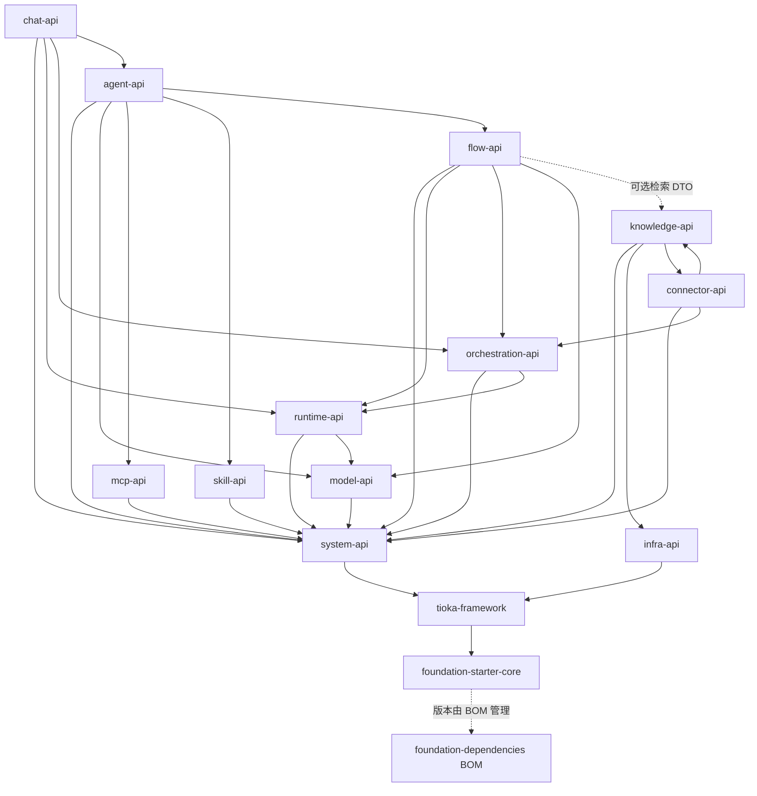

# Tioka 模块依赖关系

> 配套：S0/S8/S10–S14；全局实施方案 30/31；F-02 BAS-26、F-11 BAS-20、36 号专项  
> 更新：2026-11-09（X8 回写：补 ontology / governance / eval；模块树 15 个业务模块，事实基线）  
> 更新：2026-11-15（BAS-26 第一批：补 Foundation 外部构件依赖节点与接入进度，见 §7）  
> 更新：2026-11-15（BAS-26 第四批：F-02 第 1 步收敛 + 第 2 步 data 合流，见 §7.4）
> 更新：2026-11-16（PF-00a 回归缺陷修复：Foundation 发布 pom 全部合法，见 §7.6）

## 1. 仓库模块树

```
tioka-modules/
├── tioka-module-system          # Foundation/RBAC/SPI（可拆 foundation）
├── tioka-module-infra
├── tioka-module-runtime
├── tioka-module-orchestration
├── tioka-module-chat
├── tioka-module-knowledge
├── tioka-module-flow            # 含 S14 管理 package 可同模块
├── tioka-module-connector
├── tioka-module-model           # S10
├── tioka-module-agent           # S11
├── tioka-module-mcp             # S12 管理面
├── tioka-module-skill           # S13
├── tioka-module-ontology        # 业务本体（ADR-036）
├── tioka-module-governance      # 授权 / 评测（ADR-025）
└── tioka-module-eval            # 评测（ADR-031）
```

根目录另有：`tioka-dependencies`、`tioka-framework`、`tioka-server*`、`tioka-ui`。

> X8 整改（2026-11-09）：实际仓库为 **15 个业务模块**——在 ADR-025 / ADR-031 / ADR-036 后新增 `ontology` / `governance` / `eval`，上述模块树据此回写；**15 为事实基线**，设计口径「13 对 15」中的 13 为旧快照（详见一致性矩阵 X8 裁决）。

## 2. 编译期依赖（只允许 → api）



> X6 整改（2026-11-09）：移除 `MCP --> AG` 反向边缘，打破 AG↔MCP 依赖环——`mcp-api` 实际仅依赖 `tioka-framework`，不反向依赖 `agent-api`（已由 pom 实证，X6 判为文档漂移）。本图 api 层边缘与 pom 的逐条一致性，由 L8 ArchUnit 依赖基线统一复核。

> **2026-11-15**：`FDN` / `FCORE` 是**独立仓库 `tioka-foundation` 的构件**，不是本仓库模块，也不出现在根 `pom.xml` 的 `<modules>` 中。`tioka-dependencies` 导入 `com.foundation:foundation-dependencies` BOM，`tioka-framework` 依赖 `foundation-starter-core`（F-02 BAS-26 第 1 步）。在此之前 Tioka 对 Foundation 是零依赖（36 号专项 §1.3 D1）。接入进度见 §7。

## 3. biz 实现依赖（同样只引 api）

| biz | 允许依赖的 api |
|---|---|
| system-biz | framework |
| infra-biz | system-api, framework |
| model-biz | system-api, framework |
| runtime-biz | system-api, model-api, framework |
| agent-biz | system-api, model-api, mcp-api, skill-api, flow-api, framework |
| mcp-biz | system-api, agent-api（Grant 快照解析）, framework |
| skill-biz | system-api, framework |
| orchestration-biz | runtime-api, agent-api, governance-api（TRU-03 派工复验 AgentCharterPort）, system-api, framework |
| chat-biz | runtime-api, orchestration-api, agent-api, system-api, framework |
| knowledge-biz | connector-api, infra-api, system-api, framework |
| flow-biz | runtime-api, orchestration-api, model-api, knowledge-api(可选), system-api, framework |
| connector-biz | orchestration-api, knowledge-api, system-api, framework |

## 4. 禁止项

- 任何 `*-biz` 依赖其他 `*-biz`
- `runtime-biz` 直接依赖 `connector`（飞书/MCP SDK 放 connector；Runtime 只看 Tool SPI / mcp-api 描述符）
- `chat-biz` ↔ `flow-biz` 互相依赖（经 runtime / orch / MQ）
- 在 biz 内硬编码 MQ Topic 字符串（必须用 api 模块常量）
- Agent 散落主模型字段绕过 `model-api` RoutingPlan

## 5. 同步 vs 异步

| 方式 | 场景 |
|---|---|
| `-api` 本地/RPC | 要返回值：建 Session、选模、检索、答卡片、触发同步 |
| MQ | 生命周期广播：Turn 结束、Attention、agent.published、mcp.tools.refreshed、入库完成 |

## 6. 建议拆分部署组合

| 进程 | 包含 biz |
|---|---|
| tioka-server | 全量（开发） |
| server-runtime | runtime + model |
| server-orch-chat | orchestration + chat + agent |
| server-knowledge | knowledge |
| server-flow | flow |
| server-connector | connector + mcp（出站宿主可选） |
| system 可与 RuoYi 底座合部或独立 | system + infra + skill 管理 |

---

## 7. Foundation 接入进度（F1 / BAS-26 / BAS-20，2026-11-15）

> 权威设计：[S15](systems/S15-Foundation基础平台系统.md)、[ADR-051](adr/ADR-051-foundation-platform.md)、[F-02](construction/F-02-工程底座与骨架.md) BAS-26、[F-11](construction/F-11-部署与Tioka接入与GF闸门.md) BAS-20；现状判定见 [36 号专项](implementation/36-Foundation后续开发规划与适配性专项.md) §0 与 §1.3 D1。本文只记仓库事实，不改上述文档的排期与人天。

### 7.1 第一批已落地

| 项 | 位置 | 说明 |
| --- | --- | --- |
| 版本契约 | `tioka-dependencies/pom.xml` | 导入 `com.foundation:foundation-dependencies:${foundation.version}`（当前 `0.2.0-adapt-SNAPSHOT`，F3 适配性剖面，见 §7.6 版本分轨）；Tioka 原有版本定义优先 |
| 编译期依赖 | `tioka-framework/pom.xml` | 引入 `com.foundation:foundation-starter-core`，版本由 BOM 管理；`CoreAutoConfiguration` 只绑定 `foundation.*` 配置属性，不接管 Jackson 与异常处理 |
| 双模式开关 | `com.tioka.framework.foundation.*` | `tioka.foundation.mode`（默认 `local`）、`@ConditionalOnFoundationMode` 条件注解、`FoundationModeConfiguration` |
| 启动期守卫 | `FoundationModeGuard` | `foundation` 模式下校验 starter 契约已装配且 `foundation.base-url` 显式配置（拒绝默认 localhost），`local` 模式不校验 |
| 配置 | `tioka-server/src/main/resources/application.yml` | `tioka.foundation.mode`、`foundation.enabled / app-code / base-url`（`FOUNDATION_URL`） |
| 单测 | `FoundationModeSwitchTest` | 8 例全绿：默认 local、local 不接中台、foundation 缺契约 fail-fast、契约齐备注册守卫、starter 自动配置与本地模式共存、模式宽松解析、默认 base-url 拒绝、local 跳过校验 |

### 7.2 第二批已落地（PF-00a 发布形态修复 + 根 `pom.xml` 切 parent）

| 项 | 位置 | 说明 |
| --- | --- | --- |
| PF-00a 发布形态 | `tioka-foundation/foundation-parent/pom.xml`（分支 `fix/pf00a-parent-publishable`） | 源码 pom 显式写出 `groupId` / `version` / `properties`，并单独覆盖 `flatten-maven-plugin`：发布 pom 剥离 `parent`、`distributionManagement`、`profiles` 与 `build` 中实际执行的插件，只保留 `pluginManagement` 插件版本契约。Foundation 内部仍继承 `foundation-build` 的完整构建链（源码 pom + `relativePath`），两者互不影响 |
| 根 `pom.xml` 的 `parent` | `com.foundation:foundation-parent:0.2.0-adapt-SNAPSHOT`，`<relativePath/>`（第二批切换时为 `0.1.0-SNAPSHOT`，2026-11-16 版本分轨后改锁 F3 轨） | 跨仓库强制从 Maven 仓库解析；版本显式固定、不与 Tioka 的 `${revision}` 绑定（S15 §5.3 升级说明）；两处版本源须同轨，见 §7.6 |
| 副作用隔离 | 发布 pom | 下游不再依赖未发布的 `foundation-build` 聚合器、不再继承 Foundation 私有仓库发布目标、不再继承 `enforcer` / `failsafe` 实际执行与同名 `gate` profile |
| PF-00a 验收 | 独立示例工程（仓库外） | 只引 `foundation-parent`、依赖 `foundation-starter-core` **不写版本**即可 `mvn -o clean compile` 成功（F-01 §3「示例工程只引父工程可编译」） |

### 7.3 第三批已落地（BAS-26 第 1 步 core · 子步骤 1a：主键生成合流）

F-02 迁移表第 1 步写的是整包 `com.tioka.framework.{error,id,jackson,context}` → `com.foundation.starter.core.*`。实测 Foundation 侧**并未提供等价实现**，因此按「每步 G0〜G3 可验证」拆子步骤，本批先完成唯一语义等价的 `Ids`：

| 项 | 位置 | 说明 |
| --- | --- | --- |
| 代码级依赖合流 | 全仓 **137 个 Java 文件**（main 78 / test 59） | `import com.tioka.framework.id.Ids` → `import com.foundation.common.id.Ids`；至此 Tioka 业务代码**真实调用 Foundation 类**，不再只是 pom 级依赖 |
| 本地副本删除 | `tioka-framework/.../id/Ids.java` | 已删除，**不保留兼容层**（F-00 §5 约定 2）；两侧实现逐字等价（同为 `{前缀}_{单调 ULID}`） |
| 显式依赖 | `tioka-framework/pom.xml` | 新增 `com.foundation:foundation-common-api`（版本由 Foundation BOM 管理），不依赖 starter-core 的传递 |
| 契约守护 | `FoundationIdsContractTest` | 4 例：类名指向 Foundation、前缀 + 26 位 ULID 格式、单调唯一、空前缀拒绝 |
| 文档回写 | `00-施工总纲.md` §2.2、`M0-01-工程基线.md` ENG-05、`docs/code-wiki/04-关键类与函数.md` | 主键实现指向 `com.foundation.common.id.Ids`，ULID 规则不变；W0 施工记录加回写注记（保留历史代码块），关键类索引改指 Foundation 仓库真实路径（原链接已失效） |
| 保留项 | `ulid-creator` 依赖 | `TraceContext` 与 `NotificationService` 仍直接调用 `UlidCreator`，不能移除 |

**第 1 步剩余部分为何不能机械替换（设计偏差，待负责人拍板）**：

| 包 | 阻塞原因 |
| --- | --- |
| `error.ErrorCode` | Tioka 是 **31 个业务错误码**枚举（含 `WORKSPACE_FORBIDDEN` / `EGRESS_DENIED` / `STALE_REVISION` 等，另有 `isGovernanceFailure()` / `mustNotDegrade()`）；Foundation `com.foundation.common.api.error.ErrorCode` 是**只有 6 个通用码的枚举**、不可扩展。直接替换会丢 25 个码与治理语义，需 Foundation 侧先把错误码模型改为接口/SPI（BAS-24 欠账） |
| `error.BizException` / `error.ApiResponse` / `error.NotImplemented` | 构造与方法签名绑定 `ErrorCode` 类型，随上一项一起阻塞；Tioka 的 `BizException` 还多一个 `Object data` 构造 |
| `context.RequestContext` / `RequestContextHolder` | Tioka 侧是带 `subject` / `workspaceId` / 父子请求信息的 record + 线程上下文（属空间与归属过滤），S15 §5.4 明确应留在 `tioka-framework`；Foundation 同名 `RequestContext` 是 `traceId` / `appCode` 静态工具，语义不同 |
| `jackson.JacksonConfiguration` | 属迁移表第 3 步 web starter 范围，且 Foundation 侧对应实现需另核；本批不动 |

### 7.4 第四批已落地（F-02 第 1 步收敛 + BAS-26 第 2 步 data 合流）

**设计回写（A 方案）**：F-02 §BAS-26 迁移表第 1 步原写「整包 `{error,id,jackson,context}` → `com.foundation.starter.core.*`」，实测 Foundation 侧无等价实现，已收敛为「只合流 core 中可共用的 `id.Ids`」，并逐条登记 `error` / `context` / `jackson` 按 S15 §5.4 留在 `tioka-framework` 的依据。同时修正 F-02 的配置示例与配置项表：`foundation.base-url` / `foundation.app-code` 是根级键（原写 `foundation.client.*` 实际无此绑定），补登记 `foundation.<capability>.enabled` 逐能力开关与 `foundation.client.mode` 三值键。**第 1 步判定为「已完成（收敛后范围）」**，未合流的包不再作为 BAS-26 待办，也不在 Tioka 侧建兼容层；若日后统一错误码模型，属 BAS-24 的 Foundation 侧改造。

| 项 | 位置 | 说明 |
| --- | --- | --- |
| 编译期依赖 | `tioka-framework/pom.xml` | 引入 `com.foundation:foundation-starter-data`；其传递依赖（mybatis-plus starter / jsqlparser / spring-boot-starter / starter-core）Tioka 原本已显式声明，**未引入新的第三方库** |
| 代码合流 | 全仓 **50 个 Java 文件**（main 49 / test 1，共 53 处 import） | `com.tioka.framework.persistence.{BaseDO,AppendOnlyDO,ImmutableSnapshotDO,MutableRecordDO}` → `com.foundation.starter.data.*`；同包的 `WorkspaceAwareDO` 补显式 import |
| 删除副本 | `tioka-framework/.../persistence/` 下 4 个 DO 基类 | 已删除，不保留兼容层；规范化比对仅差 `implements Serializable` + `serialVersionUID`，以及 `BaseDO` 的 `@TableLogic(value="false", delval="true")` 显式化（与 Tioka 全局 `logic-delete-value: true` / `logic-not-delete-value: false` 一致） |
| 保留项 | `tioka-framework/persistence/` 剩余 11 个类 | `WorkspaceAwareDO` / `WorkspaceScoped` / `Owned` / `ScopeLineHandler` / `ScopedTables` / `TiokaMetaObjectHandler` / `MybatisPlusConfiguration` / `PersistenceProperties` / `TechnicalRecordDO` / `OperatorAuditor` / `UtcLocalDateTimeTypeHandler`，即 F-02 第 2 步要求的「空间过滤留在 `tioka-framework`」 |
| 能力开关 | `tioka-server/application.yml` | 新增 `foundation.data.enabled: false`。所有 starter 自动配置的总开关与能力开关缺省均为 `true`，**仅加依赖即会装配**；data 本批只取用其 POJO 基类，显式关闭可避免与 Tioka 本地 `MetaObjectHandler` / `MybatisPlusInterceptor` 并存 |
| 契约守护 | `FoundationDataContractTest` | 6 例全绿：4 个基类来自 Foundation、`WorkspaceAwareDO` 继承 Foundation 基类、Tioka 特有类仍在本地、逻辑删值与全局配置一致、capability 开关确实门控自动配置、yml 显式关闭 data |

**第 3〜9 步可行性比对（本批完成，供后续按步推进）**：Tioka `tioka-framework` 与 8 个 Foundation starter 共 12 个同名类，规范化比对（去包名 / 导包 / 注释 / 空白）后**只有 data 的 4 个 DO 基类可安全合流**：

| 步 | starter | 结论 |
| --- | --- | --- |
| 3 | web | `PageQuery` / `PageResult` / `GlobalExceptionHandler` / `IdempotencyFilter` 在 Tioka `tioka-framework` 无同名实现，属新增能力而非替换；`JacksonConfiguration` 需单独评估与 Tioka Jackson 配置的覆盖关系 |
| 4 | cache | Tioka framework 无 `DistributedLock` / `RateLimiter` 同名类；需先定位 Tioka 的 Redis / 限流实现所在模块 |
| 5 | mq | `DomainEvent`（43 行差异）、`IdempotentConsumer`（40 行差异）语义不同，Tioka 另有 `sys_outbox` 既有约定；须逐类设计迁移，不可按名替换 |
| 6 | observability | Tioka `TraceContext` 与 starter 的 `TraceIdFilter` / `OtelConfig` 无同名冲突；GOV-08 对齐需单独评估 |
| 7 | security | `Principal`（31 行）、`PrincipalHolder`（63 行）、`PublicApi`（5 行）、`RequirePermission`（4 行）语义不同；F-02 第 7 步明文「授权快照接线留 BAS-20，本步保留 Tioka 本地实现」，应与 BAS-20 / FND-09/10 删除一并收口 |
| 8 | audit | Tioka framework 无 `@Audited` 同名类；哈希链与归档（GOV-09 / OBS-10）按 F-00 §5 约定 5 原样保留 |
| 9 | client | 9 个 starter 构件均已在本地 m2 可用；但 `foundation.client.mode` 缺省 `foundation`（会连中台），引入前必须先设 `local` 并处理 §7.7 的双键不同步 |

### 7.5 尚未完成

| 项 | 状态 | 依据 |
| --- | --- | --- |
| `tioka-dependencies` 退化为对 `foundation-dependencies` 的导入（清理重复版本定义与重复 BOM 导入） | 未开始；当前 parent 与 `tioka-dependencies` **双重导入** Foundation BOM（版本同为 `0.2.0-adapt-SNAPSHOT`，实测无告警、无冲突），保留是为了 Tioka BOM 自包含，收尾时统一退化 | F-02 §BAS-26「父工程与清单」 |
| 第 1 步 core 未合流部分（error / context / jackson） | **已收敛关闭**：按 S15 §5.4「Tioka 特有部分」保留在 `tioka-framework`，F-02 迁移表与配置项表已回写（§7.4），不再是 BAS-26 待办 | F-02 §BAS-26 第 1 步收敛说明 |
| 第 2 步 data | **已完成**（§7.4）：4 个 DO 基类合流，本地副本删除，data 能力显式关闭 | F-02 §BAS-26 迁移表第 2 步 |
| 第 3〜9 步 starter 替换（web / cache / mq / observability / security / audit / client）与包名一次性重构 | 可行性已逐项比对（§7.4 矩阵）；同名类语义不等价部分须逐类设计迁移，security 随 BAS-20 收口 | F-02 §BAS-26 迁移表 |
| Foundation 发布构件（子模块发布 pom 无效，PF-00a 回归缺陷） | **已修**，见 §7.6；Foundation 两条分支均已落地，m2 中 53 个发布 pom 全部合法 | 本批实测 |
| `tioka-framework` 只留特有部分、ArchUnit 规则集移到 `foundation-test`、冻结库保持为空 | 未开始 | F-00 §5 约定 2、S15 §5.4 |
| BAS-20 中台接线（`PrincipalLoader` 读授权快照、starter 权限注解、离职事件、FND-09/10 删除）、BAS-28、BAS-22 的 GF 12 条闸门 | 未开始 | F-11 §1；36 号 §4 的 F1 债务清零 |
| `foundation-ui` 前端包与门户基座 | 空壳 | 36 号 §1.3 D2 |

### 7.6 父工程切换的前置问题与修复（PF-00a）

第一批时 `com.foundation:foundation-parent:0.1.0-SNAPSHOT` 的安装产物带 `<parent>foundation-build</parent>`（聚合器按 BAS-23 设计「不对外发布」）、`${env.FOUNDATION_REPO_URL}` 的 `distributionManagement`、同名 `gate` profile，以及 `enforcer` / `failsafe` 的实际执行。直接继承会造成三类问题：下游必须能解析一个未发布的聚合器；Tioka 的 deploy 目标被改写；Foundation 的闸门插件会与 Tioka 自身的 `gate` profile 叠加。

第二批没有在 Tioka 侧逐项覆盖来绕开，而是修正发布形态本身：`foundation-parent` 的**源码 pom** 保持 Foundation 内部继承链不变（模块通过 `relativePath` 读源码 pom），**安装到仓库的 flattened pom** 裁剪为「坐标 + 属性 + `dependencyManagement` + `pluginManagement`（仅插件版本契约）」。PF-00a 验收与下游零副作用由此同时成立。两种模式下的 G0〜G3 全绿仍属 BAS-20/28 收尾范围，见 7.8。

**编号说明**：本文此前把下述缺陷暂称「PF-00b」，但 F-01 §3 已有官方编号 `PF-00b`（BAS-01 工程骨架 / Flyway / Keycloak 管理连接 / CI / 闸门基座，验收 `GfSmokeIT` 绿）。为避免与官方任务包冲突，本批去编号化，统一称「**PF-00a 回归缺陷（子模块发布 pom 无效）**」。

**缺陷（第四批实测发现）**：PF-00a 的 `<pomElements><parent>remove</parent></pomElements>` 写在 `foundation-parent/pom.xml` 的 `<build><plugins>` 中，会被所有 Foundation 子模块继承，导致子模块安装产物也剥掉 `<parent>`。这些源码 pom 未显式写 `groupId`、依赖版本来自父工程 `dependencyManagement`，发布 pom 因此变成「无 groupId + 依赖无 version」的无效模型，Maven 报 `The POM ... is invalid, transitive dependencies (if any) will not be available` 及 `'groupId' is missing` / `'dependencies.dependency.version' ... is missing`。当时 Tioka 靠显式声明依赖规避，但只要后续引入带新传递依赖的 starter 即会编译失败。

**两种否决的修法（保留记录）**：① 给裁剪插件加 `<inherited>false</inherited>` → 子模块彻底失去 flatten 插件，发布 pom 保留 `${revision}` 与 `relativePath`，Tioka 报 `foundation-parent:pom:${revision}` 无法解析、**构建直接断链**；② 把 `<parent>remove</parent>` 换成 `<parent>expand</parent>` → 子模块发布 pom 有效，但 `foundation-parent` 自身发布 pom 重新带上未发布的 `foundation-build` 父与 `build` 段，**破坏 PF-00a 零副作用目标**。两者当时均已回退。

**本批正解（2026-11-16，已修）**：让**源码形态即发布形态** —— 解除 `foundation-parent` 与 `foundation-dependencies` 对未发布聚合器 `foundation-build` 的继承，两者显式写出坐标、`revision` 属性与 flatten 插件版本 / 执行绑定；`foundation-parent` 的裁剪配置**去掉 `<parent>remove</parent>`**，只保留 `distributionManagement` / `profiles` / `build` 三项裁剪。于是：

| 对象 | 发布 pom 形态 |
| --- | --- |
| `foundation-parent` / `foundation-dependencies` | 无 parent、自包含坐标与属性；父工程仅留「坐标 + 属性 + `dependencyManagement` + `pluginManagement` 插件版本契约」，PF-00a 的零副作用目标不变 |
| Foundation 子模块 | **保留 `<parent>`** 指向已发布的 `foundation-parent`（或中间聚合父），由标准 flatten 把 `${revision}` 解析为具体版本；`groupId` 与依赖版本经 parent 链正常继承，模型合法、传递依赖可用 |
| Foundation 内部构建链 | 子模块经 `relativePath` 读**源码 pom**，仍完整拿到 enforcer / failsafe / gate profile / 私有仓库发布配置；这些元素只从对外发布 pom 裁掉 |

`foundation-build` 退化为纯 reactor 聚合器，不再作为任何模块的父。

**实证**：Foundation 全量 `mvn -o install -DskipTests` 后，m2 中 **53 个发布 pom** 全部满足「parent 链可解析、无未发布聚合器、`groupId` 完整、无 `${revision}` 残留、无 `distributionManagement` / `gate` 污染」；裸工程（**不继承父工程**、只导入 BOM，仅依赖 `foundation-starter-data`）`clean compile` 与 `dependency:tree` 均通过、零告警；PF-00a 冒烟工程（只引父工程、starter 不写版本）仍绿；Tioka `mvn -o validate` 中 `'groupId' is missing` 等 Foundation 构件告警**全部消失**，只剩既有的 `json-schema-validator` 重复声明与 javassist 告警。

**分支与 m2 口径**：修复在 `main` 基点分支 `fix/fdn-publish-pom-regression`（`6cca930`）与 F3 分支 `feat/f3-adaptability`（cherry-pick `bba1b0f`）**各一份**；m2 最终由 F3 分支全量 install，与 Tioka 第四批契约测试依赖的 `foundation.data.enabled` 门控保持一致。曾在 main 基点上直接 install 过一次，导致 `FoundationDataContractTest.capabilitySwitchGatesStarterAutoConfiguration` 失败（main 版 `FoundationMigrationAutoConfiguration` 只认 `foundation.enabled`），恢复 F3 口径后该用例重新通过 —— 说明 **Tioka 当前提交依赖 F3 行为，切 Foundation 主干版本前须先统一口径**；这属 F3 归属决策，不在本批改动范围。

**版本分轨（2026-11-16，已解决上述口径问题，未合并任何代码）**：分轨前 `main` 与
`feat/f3-adaptability` 共用 `0.1.0-SNAPSHOT` 一个坐标却有两套行为（最典型的是
`FoundationMigrationAutoConfiguration` 分别认 `foundation.enabled` / `foundation.data.enabled`），
由「最近一次 install 哪个分支」隐式决定。现改为两条显式版本轨：

| 轨道 | 坐标 | 内容 |
| --- | --- | --- |
| 稳定基座 | `0.1.0-SNAPSHOT`（Foundation `main` = `6cca930`） | PF-00a 与发布 pom 回归修复，无 F3 适配性代码 |
| 适配性剖面 | `0.2.0-adapt-SNAPSHOT`（Foundation `feat/f3-adaptability` = `5124542`） | 含 F3 五批成果，**Tioka 当前提交锁定此轨** |

Tioka 侧两处版本源（根 `pom.xml` 的 parent 与 `tioka-dependencies` 的 `foundation.version`）已同步锁定；
Foundation 侧同步三处 `<revision>` 与模板 parent，并新增 `docs/version-tracks.md` 说明改版本清单与用法。
两轨在本地 m2 是不同目录、互不覆盖，行为由 pom 显式决定，不再依赖构建顺序；
**但 Foundation 仓库目前无远程，双轨仅本地有效，配远程后须分别 deploy**，否则 CI / 其他机器
无法解析 `0.2.0-adapt-SNAPSHOT`。本批验证见 §7.8，规划记录见 36 号文档 §16。

### 7.7 配置约定

- Tioka 自身配置一律 `tioka.*`；`foundation.*` 属于底座/中台前缀（F-02 §BAS-26、00-施工总纲 §2.5）。
- 默认 `local` 不要求 Foundation 服务可达（F-00 §5 约定 3）；切到 `foundation` 前需完成 BAS-20，否则 `FoundationModeGuard` 会拒绝启动。
- **BAS-20 接线待办（F3 第四批发现）**：starter 侧 `foundation.client.mode`（`FoundationRuntimeMode`，三值）与应用侧 `tioka.foundation.mode`（两值）**不自动同步**。接线时须由同一环境变量派生两键，并补启动期一致性校验；否则会出现「应用以为单飞、starter 仍连中台」的半接线状态。当前 `FoundationModeGuard` 只校验 starter 契约是否装配与 `foundation.base-url` 是否显式配置，不校验这两键的一致性。
- **配置前缀偏差已回写（第四批）**：F-02 原示例写 `foundation.client.base-url` / `foundation.client.app-code`，实际 `FoundationProperties` 绑定根级 `foundation.base-url` / `foundation.app-code`（`foundation.client.*` 下是 `mode` / 超时 / 重试 / 降级 / local）。已修正 F-02 的 yaml 示例、配置项表并加实现实证注记；`tioka-server/application.yml` 与本文记录一致。
- **逐能力开关（ADP-05）**：`foundation.enabled` 与 `foundation.<capability>.enabled` 在 starter 侧缺省均为 `true`，故 Tioka 对尚未迁移的能力必须显式置 `false`（当前仅 `data` 已置）。每步迁移时单独打开，并先核对与 Tioka 本地 bean 的冲突。

### 7.8 验证结果（2026-11-15，JDK 17 / `mvn -o`）

| 项 | 结果 |
| --- | --- |
| `mvn -o -q test-compile -pl tioka-server -am` | 通过（exit 0） |
| `FoundationModeSwitchTest` | 8 例，0 失败 / 0 错误 |
| `mvn -o -fae test` 全量 reactor | 除 `tioka-module-governance-biz` 外全部 SUCCESS；`tioka-server` 因上游失败被 SKIPPED，另以 `-Dtest='*Arch*Test'` 单独跑过 |
| **第二批**：`mvn -o validate` | 通过（exit 0），父工程解析与 POM 合并正常；仅 `json-schema-validator` 重复声明这一既有 warning，无新增告警、无重复 BOM 导入告警 |
| **第二批**：`mvn -o -q test-compile -pl tioka-server -am` | 通过（exit 0） |
| **第二批**：Foundation `mvn -o -q -pl foundation-starter-core -am test-compile` | 通过（exit 0），源码 pom 的继承链未被 flatten 改动破坏 |
| **第二批**：PF-00a 示例工程 `mvn -o clean compile` | 通过（exit 0）：仓库外独立工程只引 `foundation-parent`，依赖 `foundation-starter-core` 不写版本，证明发布 pom 自包含、BOM 生效、无需 `foundation-build` |
| **第二批**：`mvn -o -fae test` 全量 reactor | 失败模块与第一批**完全相同**：`orchestration-biz`（CEL 50ms 超时 1 error）、`governance-biz`（Cedar JNI 7 errors）、`tioka-server` SKIPPED；`FoundationModeSwitchTest` 8 例仍全绿，无新增失败模块 |
| **第二批**：`-Dtest='*Arch*Test'`（server 单独跑，补齐被 SKIPPED 的模块） | 46 例中 45 绿；唯一失败是 `PersistenceArchTest` 的 3 处 `StructuredOutputStatsService` 直连 `RuntimeItemStatsMapper` 既有违例，明细与第一批一致、不含本次新增包 |
| **第三批**：`mvn -o -q test-compile -pl tioka-server -am` | 通过（exit 0）；137 个改 import 的文件（含 59 个测试类）全部编译通过，删除本地 `Ids` 后无遗漏引用 |
| **第三批**：定向测试 `-Dtest='FoundationIdsContractTest,FoundationModeSwitchTest,ModuleDependencyRulesTest'` | 13 例全绿（新增契约 4 + 双模式 8 + framework ArchUnit 1），`BUILD SUCCESS` |
| **第三批**：`mvn -o -fae test` 全量 reactor | 失败集合**未扩大**：仅 `governance-biz`（Cedar JNI 7 errors）FAILURE、`tioka-server` SKIPPED；`orchestration-biz` 本次 SUCCESS（CEL 超时为偶发）；`FoundationIdsContractTest` 4 例在全量中同样全绿 |
| **第四批**：`mvn -o -q test-compile -pl tioka-server -am` | 通过（exit 0）；50 个改 import 的文件与删除 4 个本地 DO 后无遗漏引用，`WorkspaceAwareDO` 补 import 生效 |
| **第四批**：定向测试 `-Dtest='FoundationDataContractTest,FoundationIdsContractTest,FoundationModeSwitchTest,ModuleDependencyRulesTest'` | **19 例全绿**（新增 data 契约 6 + Ids 契约 4 + 双模式 8 + framework ArchUnit 1），`BUILD SUCCESS` |
| **第四批**：`mvn -o -fae test` 全量 reactor | 失败集合**未扩大**：仍仅 `governance-biz`（Cedar JNI 7 errors）FAILURE、`tioka-server` SKIPPED；`orchestration-biz` SUCCESS；`FoundationDataContractTest` 6 例在全量中同样全绿 |
| **第四批**：Foundation 发布形态实验与回退 | `inherited=false` / `parent=expand` 两种修法均实测否决（详见 §7.6），已 `git checkout` 回退 `foundation-parent/pom.xml` 并重新 install 三个构件；回退后 Tioka `test-compile` 再次通过 |
| **第五批（发布 pom 回归修复）**：Foundation 全量 `mvn -o install -DskipTests` | exit 0；m2 中 **53 个发布 pom** 全部合法（parent 链可解析、无未发布聚合器、坐标完整、无 `${revision}`、无 `distributionManagement` / `gate` 污染）；裸工程 `clean compile` + `dependency:tree`、PF-00a 冒烟工程 `clean compile` 均 `BUILD SUCCESS` |
| **第五批**：Tioka `mvn -o validate` / `test-compile -pl tioka-server -am` | validate exit 0，Foundation 构件的 invalid POM / `'groupId' is missing` 告警**全部消失**，仅剩既有 `json-schema-validator` 重复声明与 javassist 告警；test-compile exit 0 |
| **第五批**：定向测试 `-Dtest='FoundationDataContractTest,FoundationIdsContractTest,FoundationModeSwitchTest,ModuleDependencyRulesTest'` | **19 例全绿**，`BUILD SUCCESS`（恢复 F3 口径后 `capabilitySwitchGatesStarterAutoConfiguration` 重新通过） |
| **第五批**：`mvn -o -fae test` 全量 reactor | 失败集合**未扩大**：仍仅 `governance-biz`（Cedar JNI 7 errors）FAILURE、`tioka-server` SKIPPED；`orchestration-biz` SUCCESS；19 例定向测试在全量中同样全绿 |
| **版本分轨（2026-11-16）**：Foundation `mvn -o install -DskipTests`（F3 worktree，JDK 17） | exit 0；m2 新增 `0.2.0-adapt-SNAPSHOT` 共 **53 个发布 pom**，坐标正确、无 `${revision}` 残留；旧 `0.1.0-SNAPSHOT` 未被覆盖；新 jar 含 F3 运行模式与命名空间类 |
| **版本分轨**：Tioka 定向测试 `-Dtest='Foundation*Test'` / `test-compile -pl tioka-server -am` / `validate` | 均 exit 0；**18 例全绿**（data 6 + Ids 4 + 双模式 8）；根 flattened pom 的 parent 为 `0.2.0-adapt-SNAPSHOT`，surefire classpath 实测加载 `foundation-starter-core-0.2.0-adapt-SNAPSHOT.jar` |
| 已知既有失败（与本批无关） | ① `CedarEvaluatorTest` / `CharterCompilerTest`：`UnsatisfiedLinkError: BasicAuthorizationEngine.getCedarJNIVersion()`，本机缺 Cedar JNI 原生库；**改动前 stash 对照同样 5 errors**。② `CelRuleConditionTest.simpleAttrMatch`：CEL 求值硬超时 50ms，偶发；**改动前 stash 对照同样失败**，全量 `-fae` 复跑时该模块 SUCCESS。③ `PersistenceArchTest.applicationAndKernelMustNotDependOnMappers`：`StructuredOutputStatsService` 直连 `RuntimeItemStatsMapper` 的 3 处既有违例，违例明细中不含本次新增包 |
| 未覆盖 | `*IT`（Testcontainers）需 Docker，本机不可用，按既有约定归 CI；G0〜G3、GF 12 条闸门、`-Pgate` 与 `local` / `foundation` 双模式的闸门验证，仍待 BAS-20/28 收尾时在具备环境的 CI 上重跑 |
