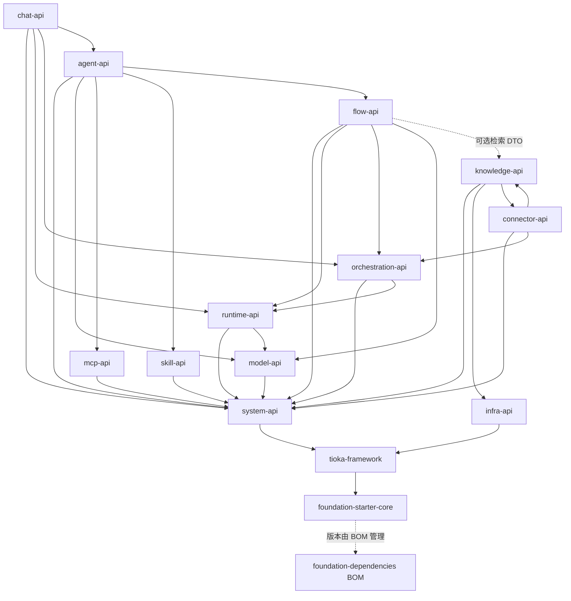

# Tioka 模块依赖关系

> 配套：S0/S8/S10–S14；全局实施方案 30/31；F-02 BAS-26、F-11 BAS-20、36 号专项  
> 更新：2026-11-09（X8 回写：补 ontology / governance / eval；模块树 15 个业务模块，事实基线）  
> 更新：2026-11-15（BAS-26 第一批：补 Foundation 外部构件依赖节点与接入进度，见 §7）

## 1. 仓库模块树

```
tioka-modules/
├── tioka-module-system          # Foundation/RBAC/SPI（可拆 foundation）
├── tioka-module-infra
├── tioka-module-runtime
├── tioka-module-orchestration
├── tioka-module-chat
├── tioka-module-knowledge
├── tioka-module-flow            # 含 S14 管理 package 可同模块
├── tioka-module-connector
├── tioka-module-model           # S10
├── tioka-module-agent           # S11
├── tioka-module-mcp             # S12 管理面
├── tioka-module-skill           # S13
├── tioka-module-ontology        # 业务本体（ADR-036）
├── tioka-module-governance      # 授权 / 评测（ADR-025）
└── tioka-module-eval            # 评测（ADR-031）
```

根目录另有：`tioka-dependencies`、`tioka-framework`、`tioka-server*`、`tioka-ui`。

> X8 整改（2026-11-09）：实际仓库为 **15 个业务模块**——在 ADR-025 / ADR-031 / ADR-036 后新增 `ontology` / `governance` / `eval`，上述模块树据此回写；**15 为事实基线**，设计口径「13 对 15」中的 13 为旧快照（详见一致性矩阵 X8 裁决）。

## 2. 编译期依赖（只允许 → api）



> X6 整改（2026-11-09）：移除 `MCP --> AG` 反向边缘，打破 AG↔MCP 依赖环——`mcp-api` 实际仅依赖 `tioka-framework`，不反向依赖 `agent-api`（已由 pom 实证，X6 判为文档漂移）。本图 api 层边缘与 pom 的逐条一致性，由 L8 ArchUnit 依赖基线统一复核。

> **2026-11-15**：`FDN` / `FCORE` 是**独立仓库 `tioka-foundation` 的构件**，不是本仓库模块，也不出现在根 `pom.xml` 的 `<modules>` 中。`tioka-dependencies` 导入 `com.foundation:foundation-dependencies` BOM，`tioka-framework` 依赖 `foundation-starter-core`（F-02 BAS-26 第 1 步）。在此之前 Tioka 对 Foundation 是零依赖（36 号专项 §1.3 D1）。接入进度见 §7。

## 3. biz 实现依赖（同样只引 api）

| biz | 允许依赖的 api |
|---|---|
| system-biz | framework |
| infra-biz | system-api, framework |
| model-biz | system-api, framework |
| runtime-biz | system-api, model-api, framework |
| agent-biz | system-api, model-api, mcp-api, skill-api, flow-api, framework |
| mcp-biz | system-api, agent-api（Grant 快照解析）, framework |
| skill-biz | system-api, framework |
| orchestration-biz | runtime-api, agent-api, governance-api（TRU-03 派工复验 AgentCharterPort）, system-api, framework |
| chat-biz | runtime-api, orchestration-api, agent-api, system-api, framework |
| knowledge-biz | connector-api, infra-api, system-api, framework |
| flow-biz | runtime-api, orchestration-api, model-api, knowledge-api(可选), system-api, framework |
| connector-biz | orchestration-api, knowledge-api, system-api, framework |

## 4. 禁止项

- 任何 `*-biz` 依赖其他 `*-biz`
- `runtime-biz` 直接依赖 `connector`（飞书/MCP SDK 放 connector；Runtime 只看 Tool SPI / mcp-api 描述符）
- `chat-biz` ↔ `flow-biz` 互相依赖（经 runtime / orch / MQ）
- 在 biz 内硬编码 MQ Topic 字符串（必须用 api 模块常量）
- Agent 散落主模型字段绕过 `model-api` RoutingPlan

## 5. 同步 vs 异步

| 方式 | 场景 |
|---|---|
| `-api` 本地/RPC | 要返回值：建 Session、选模、检索、答卡片、触发同步 |
| MQ | 生命周期广播：Turn 结束、Attention、agent.published、mcp.tools.refreshed、入库完成 |

## 6. 建议拆分部署组合

| 进程 | 包含 biz |
|---|---|
| tioka-server | 全量（开发） |
| server-runtime | runtime + model |
| server-orch-chat | orchestration + chat + agent |
| server-knowledge | knowledge |
| server-flow | flow |
| server-connector | connector + mcp（出站宿主可选） |
| system 可与 RuoYi 底座合部或独立 | system + infra + skill 管理 |

---

## 7. Foundation 接入进度（F1 / BAS-26 / BAS-20，2026-11-15）

> 权威设计：[S15](systems/S15-Foundation基础平台系统.md)、[ADR-051](adr/ADR-051-foundation-platform.md)、[F-02](construction/F-02-工程底座与骨架.md) BAS-26、[F-11](construction/F-11-部署与Tioka接入与GF闸门.md) BAS-20；现状判定见 [36 号专项](implementation/36-Foundation后续开发规划与适配性专项.md) §0 与 §1.3 D1。本文只记仓库事实，不改上述文档的排期与人天。

### 7.1 第一批已落地

| 项 | 位置 | 说明 |
| --- | --- | --- |
| 版本契约 | `tioka-dependencies/pom.xml` | 导入 `com.foundation:foundation-dependencies:${foundation.version}`（当前 `0.1.0-SNAPSHOT`）；Tioka 原有版本定义优先 |
| 编译期依赖 | `tioka-framework/pom.xml` | 引入 `com.foundation:foundation-starter-core`，版本由 BOM 管理；`CoreAutoConfiguration` 只绑定 `foundation.*` 配置属性，不接管 Jackson 与异常处理 |
| 双模式开关 | `com.tioka.framework.foundation.*` | `tioka.foundation.mode`（默认 `local`）、`@ConditionalOnFoundationMode` 条件注解、`FoundationModeConfiguration` |
| 启动期守卫 | `FoundationModeGuard` | `foundation` 模式下校验 starter 契约已装配且 `foundation.base-url` 显式配置（拒绝默认 localhost），`local` 模式不校验 |
| 配置 | `tioka-server/src/main/resources/application.yml` | `tioka.foundation.mode`、`foundation.enabled / app-code / base-url`（`FOUNDATION_URL`） |
| 单测 | `FoundationModeSwitchTest` | 8 例全绿：默认 local、local 不接中台、foundation 缺契约 fail-fast、契约齐备注册守卫、starter 自动配置与本地模式共存、模式宽松解析、默认 base-url 拒绝、local 跳过校验 |

### 7.2 尚未完成

| 项 | 状态 | 依据 |
| --- | --- | --- |
| 根 `pom.xml` 的 `parent` 切到 `foundation-parent` | **未切**，见 7.3 | F-02 §BAS-26「父工程与清单」 |
| 第 2〜9 步 starter 替换（data / web / cache / mq / observability / security / audit / client）与包名一次性重构 | 未开始 | F-02 §BAS-26 迁移表 |
| `tioka-framework` 只留特有部分、ArchUnit 规则集移到 `foundation-test`、冻结库保持为空 | 未开始 | F-00 §5 约定 2、S15 §5.4 |
| BAS-20 中台接线（`PrincipalLoader` 读授权快照、starter 权限注解、离职事件、FND-09/10 删除）、BAS-28、BAS-22 的 GF 12 条闸门 | 未开始 | F-11 §1；36 号 §4 的 F1 债务清零 |
| `foundation-ui` 前端包与门户基座 | 空壳 | 36 号 §1.3 D2 |

### 7.3 为什么第一批没有切父工程

`com.foundation:foundation-parent:0.1.0-SNAPSHOT` 已在本地仓库，但当前安装产物**未完成 flatten**：pom 仍带 `<parent>foundation-build</parent>`、BOM 版本仍是 `${revision}`，且父工程定义了 `distributionManagement`（`${env.FOUNDATION_REPO_URL}`）与同名 `gate` profile。直接继承会把 Tioka 的发布目标与闸门 profile 混入 Foundation 的配置。因此第一批先建立「BOM + starter + 双模式」这条可验证、可回退的依赖链；父工程切换应在修正 Foundation 仓库的发布形态后单独一批进行，并在两种模式下重跑 G0〜G3。

### 7.4 配置约定

- Tioka 自身配置一律 `tioka.*`；`foundation.*` 属于底座/中台前缀（F-02 §BAS-26、00-施工总纲 §2.5）。
- 默认 `local` 不要求 Foundation 服务可达（F-00 §5 约定 3）；切到 `foundation` 前需完成 BAS-20，否则 `FoundationModeGuard` 会拒绝启动。
- **待回写的偏差**：F-02 示例写 `foundation.client.base-url` / `foundation.client.app-code`，而 `foundation-starter-core` 的 `FoundationProperties` 实际绑定 `foundation.base-url` / `foundation.app-code`（无 `client` 层级）。本文按实现记录，需在 F-02 或 starter 侧统一。

### 7.5 验证结果（2026-11-15，JDK 17 / `mvn -o`）

| 项 | 结果 |
| --- | --- |
| `mvn -o -q test-compile -pl tioka-server -am` | 通过（exit 0） |
| `FoundationModeSwitchTest` | 8 例，0 失败 / 0 错误 |
| `mvn -o -fae test` 全量 reactor | 除 `tioka-module-governance-biz` 外全部 SUCCESS；`tioka-server` 因上游失败被 SKIPPED，另以 `-Dtest='*Arch*Test'` 单独跑过 |
| 已知既有失败（与本批无关） | ① `CedarEvaluatorTest` / `CharterCompilerTest`：`UnsatisfiedLinkError: BasicAuthorizationEngine.getCedarJNIVersion()`，本机缺 Cedar JNI 原生库；**改动前 stash 对照同样 5 errors**。② `CelRuleConditionTest.simpleAttrMatch`：CEL 求值硬超时 50ms，偶发；**改动前 stash 对照同样失败**，全量 `-fae` 复跑时该模块 SUCCESS。③ `PersistenceArchTest.applicationAndKernelMustNotDependOnMappers`：`StructuredOutputStatsService` 直连 `RuntimeItemStatsMapper` 的 3 处既有违例，违例明细中不含本次新增包 |
| 未覆盖 | `*IT`（Testcontainers）需 Docker，本机不可用，按既有约定归 CI；G0〜G3 与 GF 闸门未在本次改动范围内重跑 |
