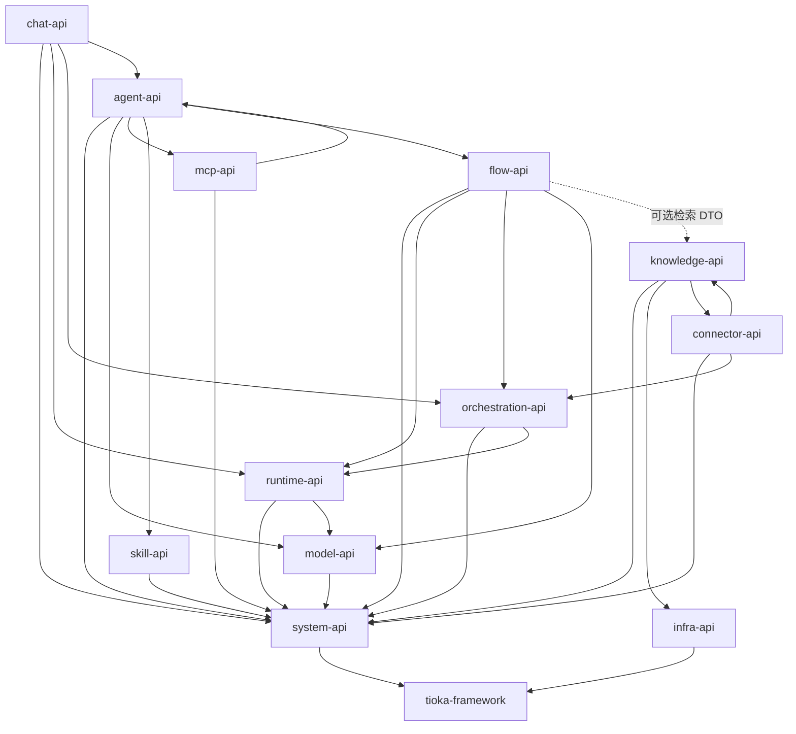

# Tioka 模块依赖关系

> 配套：S0/S8/S10–S14；全局实施方案 30/31  
> 更新：2026-11-05（补 model / agent / mcp / skill）

## 1. 仓库模块树

```
tioka-modules/
├── tioka-module-system          # Foundation/RBAC/SPI（可拆 foundation）
├── tioka-module-infra
├── tioka-module-runtime
├── tioka-module-orchestration
├── tioka-module-chat
├── tioka-module-knowledge
├── tioka-module-flow            # 含 S14 管理 package 可同模块
├── tioka-module-connector
├── tioka-module-model           # S10
├── tioka-module-agent           # S11
├── tioka-module-mcp             # S12 管理面
└── tioka-module-skill           # S13
```

根目录另有：`tioka-dependencies`、`tioka-framework`、`tioka-server*`、`tioka-ui`。

## 2. 编译期依赖（只允许 → api）



## 3. biz 实现依赖（同样只引 api）

| biz | 允许依赖的 api |
|---|---|
| system-biz | framework |
| infra-biz | system-api, framework |
| model-biz | system-api, framework |
| runtime-biz | system-api, model-api, framework |
| agent-biz | system-api, model-api, mcp-api, skill-api, flow-api, framework |
| mcp-biz | system-api, agent-api（Grant 快照解析）, framework |
| skill-biz | system-api, framework |
| orchestration-biz | runtime-api, system-api, framework |
| chat-biz | runtime-api, orchestration-api, agent-api, system-api, framework |
| knowledge-biz | connector-api, infra-api, system-api, framework |
| flow-biz | runtime-api, orchestration-api, model-api, knowledge-api(可选), system-api, framework |
| connector-biz | orchestration-api, knowledge-api, system-api, framework |

## 4. 禁止项

- 任何 `*-biz` 依赖其他 `*-biz`
- `runtime-biz` 直接依赖 `connector`（飞书/MCP SDK 放 connector；Runtime 只看 Tool SPI / mcp-api 描述符）
- `chat-biz` ↔ `flow-biz` 互相依赖（经 runtime / orch / MQ）
- 在 biz 内硬编码 MQ Topic 字符串（必须用 api 模块常量）
- Agent 散落主模型字段绕过 `model-api` RoutingPlan

## 5. 同步 vs 异步

| 方式 | 场景 |
|---|---|
| `-api` 本地/RPC | 要返回值：建 Session、选模、检索、答卡片、触发同步 |
| MQ | 生命周期广播：Turn 结束、Attention、agent.published、mcp.tools.refreshed、入库完成 |

## 6. 建议拆分部署组合

| 进程 | 包含 biz |
|---|---|
| tioka-server | 全量（开发） |
| server-runtime | runtime + model |
| server-orch-chat | orchestration + chat + agent |
| server-knowledge | knowledge |
| server-flow | flow |
| server-connector | connector + mcp（出站宿主可选） |
| system 可与 RuoYi 底座合部或独立 | system + infra + skill 管理 |
