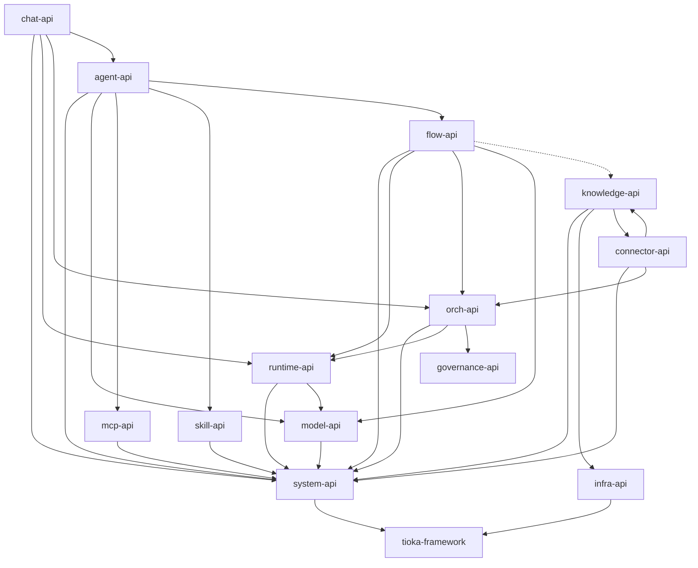

# 02 · 整体架构

## 1. 分层与模块边界

Tioka 采用「**框架内核 + 业务模块（api/biz 二分）+ 启动聚合**」的分层单体设计：

```
┌──────────────────────────────────────────────────────────────┐
│  tioka-ui (Vue3)  ── REST /api/**  +  SSE /api/runtime/threads/{id}/events
├──────────────────────────────────────────────────────────────┤
│  tioka-server  (Spring Boot 启动层：聚合全部 *-biz + Flyway + ops/catalog/MCP 出站)
├──────────────────────────────────────────────────────────────┤
│  业务模块 -biz (实现)   ← 只允许依赖其它模块的 -api / framework
│    runtime  orchestration  chat  knowledge  flow  connector     │
│    model    agent  mcp  skill  ontology  governance  eval  ...  │
│  业务模块 -api (契约/SPI/MQ 常量)  ← 跨模块唯一合法依赖面        │
├──────────────────────────────────────────────────────────────┤
│  tioka-framework (安全上下文/错误码/持久基类/消息内核/追踪/加密)  │
│  tioka-dependencies (BOM 版本锁定)                              │
├──────────────────────────────────────────────────────────────┤
│  PostgreSQL+pgvector · Redis · RocketMQ · Keycloak(OIDC) · Jaeger
└──────────────────────────────────────────────────────────────┘
```

### 关键规则

1. **跨模块只能依赖 `-api`**：编译期依赖图只允许「`xxx-api → framework`」及少量 api 之间的有向边（见 [03](./03-模块职责与依赖.md)）。
2. **`-biz` 互不依赖**：由 Maven Enforcer `banCircularDependencies` + ArchUnit 依赖基线兜底。
3. **同步 vs 异步**：
   - `-api` 本地/RPC 调用 → 需要返回值（建会话、选模、检索、答卡片、触发同步）
   - MQ 事件 → 生命周期广播（Turn 结束、审批、agent.published、mcp.tools.refreshed、入库完成）
4. **出网唯一通道**：所有外部 HTTP 经 `EgressClient`（system-api SPI）+ `EgressGuard`（白名单/空气间隙）。
5. **执行侧只读快照**：Runtime 只读已发布快照（AgentSpec/ToolDescriptor/路由计划），不改管理态配置。

## 2. Runtime 执行主链路（核心）

Runtime 是六边形架构（端口-适配器），纯领域 `AgentLoop` 只依赖 `LoopPorts`，基础设施适配在 `infrastructure`。

```
用户/事件 → RuntimeApi.startTurn(threadId, input)
   → Turn 落库 QUEUED  → 入 Redis Stream (rt:queued)
   → TurnDispatcher 消费组 rt-workers 取出
   → TurnRunner.run(turnId)
        ├─ ThreadLock + turns.acquire(lease_version++)   # 租约/fencing
        ├─ runAs(Principal)                              # 身份切换
        ├─ AgentLoop.run(LoopContext)
        │     ├─ ContextBuilder.build()   # A/B/C/D 四区上下文
        │     ├─ ModelPort.chat()         # 经 ModelRouter 选模
        │     ├─ 若返回 toolCalls:
        │     │     ├─ ToolGateway.authorize()  # ToolCallPipeline(1–7 步)
        │     │     ├─ ToolPipelineStepRegistry # 策略/自治/爆炸半径/去向许可(9–12.5)
        │     │     ├─ prepare → commit          # 两阶段（TRU-05/ADR-033）
        │     │     └─ 需审批 → ApprovalSuspendService → WAITING_APPROVAL
        │     └─ 落 ItemSink（Part 事件）
        └─ 终态写库 + 发 turn_finished 事件（MQ）
   → EventStream 追加 → StreamPump 推 SSE 给前端
```

关键性质：
- **Turn 状态机**：`QUEUED → RUNNING → COMPLETED/FAILED/CANCELLED`，挂起态 `WAITING_APPROVAL`、`WAITING_CHILD` 可恢复回 `RUNNING`。
- **崩溃恢复**：`LeaseReaper` 扫描过期租约续跑；`QueuedSweeper` 从 DB 重建丢失的入队；`ApprovalResumeSweeper` 续跑已决审批。
- **子 Agent**：`DelegateToolProvider` 建子 Thread + QUEUED Turn，父 Turn 挂起 `WAITING_CHILD`；`SubAgentReaper` 回收 grant + 预算回拨 + 唤醒父 Turn。
- **撤销补偿**：`UndoService` → `TrustCompensator`（MQ 消费、指数退避、失败转人审）。

## 3. 横切机制

| 机制 | 位置 | 说明 |
|---|---|---|
| 租约/围栏 | [TurnRunner](file:///f:/AI时代/Tioka/tioka-modules/tioka-module-runtime/tioka-module-runtime-biz/src/main/java/com/tioka/runtime/kernel/application/TurnRunner.java) / [LeaseReaper](file:///f:/AI时代/Tioka/tioka-modules/tioka-module-runtime/tioka-module-runtime-biz/src/main/java/com/tioka/runtime/kernel/application/LeaseReaper.java) | Redis 线程锁 + DB `lease_version` 乐观锁，防多实例并发执行 |
| 事务 Outbox | infra [OutboxEventPublisher](file:///f:/AI时代/Tioka/tioka-modules/tioka-module-infra/tioka-module-infra-biz/src/main/java/com/tioka/infra/messaging/OutboxEventPublisher.java) / [OutboxRelay](file:///f:/AI时代/Tioka/tioka-modules/tioka-module-infra/tioka-module-infra-biz/src/main/java/com/tioka/infra/messaging/OutboxRelay.java) | 事务内写 `sys_outbox`，Relay 单 leader 批量投递，保证至少一次 |
| 幂等消费 | framework `IdempotentConsumer` + infra [IdempotentDeliveryService](file:///f:/AI时代/Tioka/tioka-modules/tioka-module-infra/tioka-module-infra-biz/src/main/java/com/tioka/infra/messaging/IdempotentDeliveryService.java) | `sys_consumed` 表 `INSERT ... ON CONFLICT DO NOTHING` 去重，超阈值进死信 |
| 死信运维 | infra [DeadLetterOpsService](file:///f:/AI时代/Tioka/tioka-modules/tioka-module-infra/tioka-module-infra-biz/src/main/java/com/tioka/infra/messaging/DeadLetterOpsService.java) | 列表 / 重放 / 丢弃 |
| 空间行级隔离 | framework [ScopeLineHandler](file:///f:/AI时代/Tioka/tioka-framework/src/main/java/com/tioka/framework/persistence/ScopeLineHandler.java) | MyBatis 拦截器自动注入 `workspace_id`；系统表与 SYSTEM 主体豁免（deny-by-default） |
| 审计哈希链 | system [AuditChainService](file:///f:/AI时代/Tioka/tioka-modules/tioka-module-system/tioka-module-system-biz/src/main/java/com/tioka/system/application/audit/AuditChainService.java) | `hash = sha256(prev_hash + '\n' + canonical_record)`，每租户一条链 + 封印锚 |
| 策略求值 | governance [PolicyEvaluator](file:///f:/AI时代/Tioka/tioka-modules/tioka-module-governance/tioka-module-governance-biz/src/main/java/com/tioka/governance/application/policy/PolicyEvaluator.java) | Cedar forbid-only，两遍求值（DENY 组 → ESCALATE 组 → ALLOW），DRYRUN/ENFORCE 双模 |
| 自治等级 | governance `DefaultAutonomyGate` | 管线第 10 步；L0–L4，观察期钳制，Cedar 结果融合 |
| 数据标签/去向 | governance `DefaultSinkGuard` + runtime [SinkGuardPipelineStep](file:///f:/AI时代/Tioka/tioka-modules/tioka-module-runtime/tioka-module-runtime-biz/src/main/java/com/tioka/runtime/application/pipeline/SinkGuardPipelineStep.java) | 防止敏感数据下沉到 MCP/IM |
| 流式 SSE | runtime `EventStream`/`StreamPump` | Redis Stream `rt:events:{threadId}` → `SseEmitter`，支持 `Last-Event-ID` / `after` 续传 |
| 规则灰度 | orchestration `RuleVersionPicker` | murmur3_32(subjectKey) % 100 < canaryPercent 走灰度，失败回落 stable |
| 模型容错 | model `DefaultModelGateway` | 同 binding 重试（退避）→ 冷却（滑动窗口）→ 令牌桶限流（RPM/TPM）→ 故障接力 failoverChain |
| 配置版本 | governance `DefaultConfigVersionService` | 草稿/发布/回滚/导出统一框架，投影缓存 + 跨实例刷新总线 |

## 4. 数据与安全原则

- 分 schema，禁止跨库 join；无 `tenant_id`，行级隔离统一用 `workspace_id`（ADR-029）。
- 多租户 RBAC：功能权限（`@RequirePermission`）+ 资源级 ACL（`VIEW < USE < EDIT < OWNER`，拒绝时 VIEW/USE 返回 404 不暴露资源存在）。
- 密钥：AES-256-GCM（`AesGcmCredentialCipher`），带 keyVersion 支持轮换；生产强制外部主密钥。
- 出网：OPEN / ALLOW_LIST / STRICT 三模式，DNS 校验 + CIDR 拒绝 + 私网拦截。
- 指令/资料分离；策略只能收紧不能放宽（forbid-only）。

## 5. 部署形态

单进程全量（开发）或按域拆分（生产可选）：

| 进程 | 包含 biz |
|---|---|
| tioka-server | 全量（开发/单机） |
| server-runtime | runtime + model |
| server-orch-chat | orchestration + chat + agent |
| server-knowledge | knowledge |
| server-flow | flow |
| server-connector | connector + mcp（出站宿主） |
| system | system + infra + skill 管理（可合 RuoYi 底座） |

> 详见 [deploy/compose.yml](file:///f:/AI时代/Tioka/deploy/compose.yml) 与 [06-运行与部署.md](./06-运行与部署.md)。

## 6. 依赖关系图（api 层）



> 完整矩阵与「禁止项」见 [03-模块职责与依赖.md](./03-模块职责与依赖.md)。
