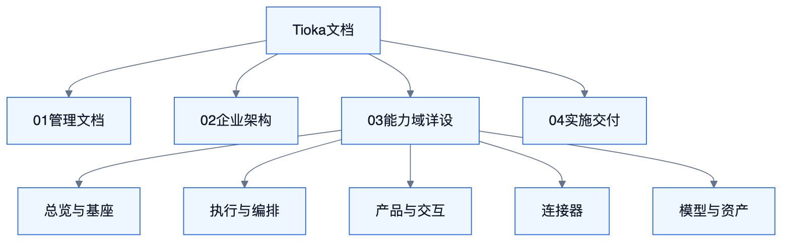

# Tioka

<!-- DIAGRAMS:BEGIN -->

## 图形（飞书可见：PNG + 文本绘图）

> **飞书正文**：下方 **PNG 图**（push 时自动上传）+ **文本绘图**（等宽字符，一定可见）。
> **本地可编辑**：`.drawio` 源文件；不要依赖 Mermaid 代码块在飞书里渲染（目前不可见）。

### 文档层级树



文本绘图：

```
Tioka
├── 01-管理文档
├── 02-企业架构          BA / TA / DA / AA / EA / FE
├── 03-能力域详设
│   ├── 总览与基座       S0 / S8 / S9
│   ├── 执行与编排       S1 / S2
│   ├── 产品与交互       S3 / S4 / S5 / S7
│   ├── 连接器           S6
│   └── 模型与资产       S10–S14
└── 04-实施交付          30 / 31 / 32
```

- 可编辑源：[doc-hierarchy.drawio](diagrams/doc-hierarchy.drawio)

<!-- DIAGRAMS:END -->

企业级 **Agent 应用套件 + 运行中台 + 治理 + 私有化企业基座**（自研）。  
能力并集见 ADR-009；企业接入见 S9（ADR-010）；企业架构成册见 ADR-013。

---

## 文档层级

```
Tioka（本页）
├── 01-管理文档          需求 / 总览导航 / 接口 / ADR / 运维
├── 02-企业架构          BA → TA → DA → AA → EA → FE + 架构评审
├── 03-能力域详设
│   ├── 总览与基座       S0 / S8 / S9
│   ├── 执行与编排       S1 / S2
│   ├── 产品与交互       S3 / S4 / S5 / S7
│   ├── 连接器           S6
│   └── 模型与资产控制面 S10–S14
└── 04-实施交付          全局方案 / W0–W5 计划 / 实施评审
```

本地目录与飞书知识库树**同构**（见 `feishu-docs/Tioka/`）。

---

## 文档地图

{{DOC_MAP}}

---

## 推荐阅读顺序

| 步骤 | 读什么 | 目的 |
| --- | --- | --- |
| 1 | [需求文档](01-管理文档/01-需求文档.md) | 范围与验收 |
| 2 | [BA](02-企业架构/40-BA-业务架构.md) → [TA](02-企业架构/41-TA-技术架构.md) → [DA](02-企业架构/42-DA-数据架构.md) | 业务/技术/数据基线 |
| 3 | [AA](02-企业架构/43-AA-应用与集成架构.md) → [EA](02-企业架构/44-EA-Java工程架构.md) → [FE](02-企业架构/45-FE-前端架构.md) | 应用切分与工程/前端 |
| 4 | [S0](03-能力域详设/总览与基座/10-S0-体系总览与边界.md) | 能力地图、门禁、波次 |
| 5 | 按需深入 S1–S14 | 域内详设 |
| 6 | [全局实施方案](04-实施交付/30-全局实施方案.md) → [W0–W5 计划](04-实施交付/31-W0至W5实施计划.md) | 落地执行 |
| 7 | 评审记录 32 / 46 | 决策追溯 |

入口导航也可从 [技术方案总览](01-管理文档/02-技术方案总览.md) 跳转（仅导航，非权威正文）。

---

## 当前状态

| 项 | 内容 |
| --- | --- |
| 文档结构 | 四层：管理 / 企业架构 / 能力域 / 实施 |
| 权威 | S0–S14 + 40–45 + 30–31；ADR-009…013 |
| 波次 | W0–W5；W1 = 商业 PoC Gate |

## 变更记录

| 日期 | 说明 |
| --- | --- |
| 2026-11-05 | **图形库**：30× draw.io + 文档内嵌 Mermaid；图形三轮评审（47） |
| 2026-11-05 | **文档层级重组**：本地目录 + 飞书树同构为 01–04 四层 |
| 2026-11-05 | 新增企业架构六册与实施三册 |
| 2026-11-05 | 能力域 S0–S14 详设 |
