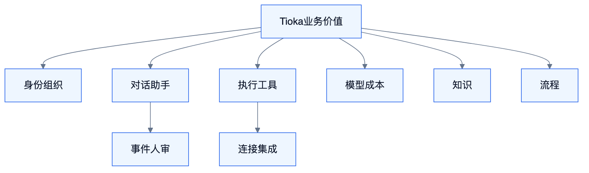

# Tioka 需求文档（完整范围）

<!-- DIAGRAMS:BEGIN -->

## 图形（飞书可见：PNG + 文本绘图）

> **飞书正文**：下方 **PNG 图**（push 时自动上传）+ **文本绘图**（等宽字符，一定可见）。
> **本地可编辑**：`.drawio` 源文件；不要依赖 Mermaid 代码块在飞书里渲染（目前不可见）。

### 角色与价值（能力鸟瞰）



文本绘图：

```
[ Tioka 业务价值 ]
     ┌────┬────┬────┬────┬────┐
   身份  对话  执行  模型  知识  流程
          │              │
        人审            连接/治理
```

- 可编辑源：[ba-capability-map.drawio](../diagrams/ba-capability-map.drawio)

<!-- DIAGRAMS:END -->

## 1. 背景与产品定义

建设**完整**企业级 Agent 套件：执行内核、编排中台、对话、知识、工作流、连接器、HCI、治理。  
能力对标 LibreChat + Langflow + WeKnora + autoloop/superagent + harness + AgentCore 的**并集**；实现全部自研，外部只接 MCP / IM / 业务系统（及飞书开放平台作通道）。

**分期 = 交付顺序，≠ 砍需求。** 未排进当前波次的能力必须保留在需求与 S 篇能力地图中。

## 2. 用户与场景（完整）

| 角色 | 完整场景集 |
| --- | --- |
| 终端业务用户 | 对话、引用问答、卡片决策、IM 继续任务、查看产物 |
| 值班/运营 | 审批台、超时升级、批量处理、业务事件闭环 |
| Agent 工程师 | 轨迹、Steer、分叉回滚、Skill/MCP/沙箱、子 Agent |
| 知识管理员 | 多源同步、解析策略、chunk 治理、Wiki、评测 |
| 流程搭建者 | Studio、节点库、Playground、发布 API/MCP/Tool |
| 平台管理员 | 租户/空间、RBAC、模型治理、配额、审计、多环境、**适配器配置** |
| 客户 IT/IAM | **SSO 联邦、组织同步、权限模型对齐、自备中间件** |
| 客户集成商 | **自有 IM/业务系统 Adapter 开发与上架** |
| 安全合规 | 密钥/KMS、沙箱、内容安全、审计外送 SIEM、留存与导出 |

## 3. 范围声明

### 3.1 In（完整，按波次交付）

见 **S0 §2 能力域总表** 与各 S 篇第 2 章。包括但不限于：

- Runtime：多模型、MCP、Skills、沙箱、解释器、SubAgent/Team、压缩、自动化入口  
- Orch：事件/规则/工单/人审/定时/溯源/Mandate/交付流水线  
- Chat：LibreChat 级会话与 Agent 产品能力  
- Knowledge：WeKnora 级知识平台能力  
- Flow：Langflow 级编排与发布能力  
- Connector：IM 矩阵、飞书办公套件、数据源矩阵、MCP Server  
- HCI：全交互面与 Part 完整集  
- 治理与工程：租户到 HA 观测  
- **Foundation（私有化基座）**：OIDC/SAML/LDAP/SCIM、RBAC+数据权限、客户 IM/业务/审计/通知适配 SPI、服务账号、空气间隙、客户自备 PG/Redis/MQ  
- **模型中台（对标 HiRoute）**：多源接入、通用/决策模型、智能路由（固定/难度/分支/免费优先）、发布启用、同轮冻结与故障接力、Agent 绑定、路由与成本观测  

### 3.2 Out（仅这些）

- 自研基础大模型训练平台  
- 以外部云 Agent 托管替换自研 Runtime  
- 复制第三方商标/市场品牌资产  

## 4. 验收门禁（累计）

| 门禁 | 含义 |
| --- | --- |
| G1–G6 | 见 S0 §13；每完成一波必须回归已过门禁 |
| 文档门禁 | 各 S 篇能力地图无「永久不做」项；波次标签齐全 |

## 5. 优先级

波次 W0→W5 见 S0 §14 / S8 附录。并行轨（Chat/KB/Flow）在契约冻结后按 W 波次拉齐密度，而不是永久降配。
