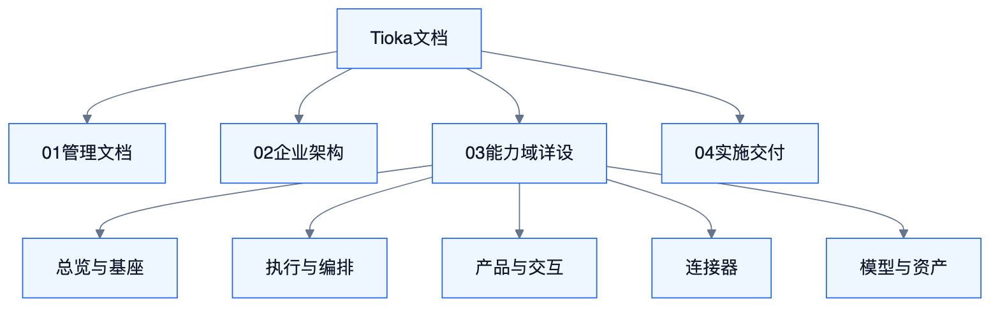
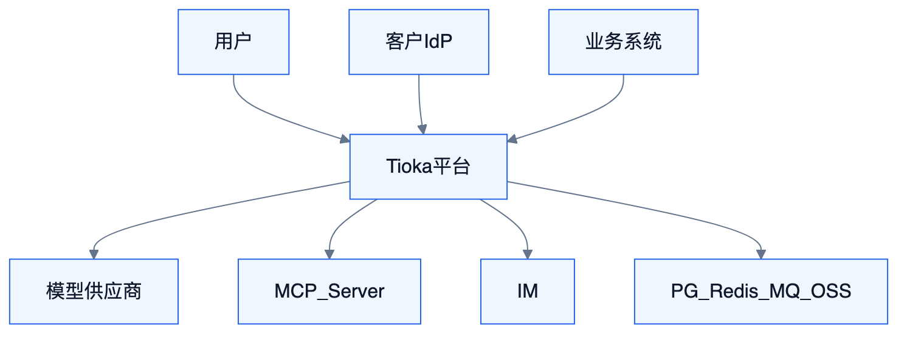

# 技术方案总览

<!-- DIAGRAMS:BEGIN -->

## 图形（飞书可见：PNG + 文本绘图）

> **飞书正文**：下方 **PNG 图**（push 时自动上传）+ **文本绘图**（等宽字符，一定可见）。
> **本地可编辑**：`.drawio` 源文件；不要依赖 Mermaid 代码块在飞书里渲染（目前不可见）。

### 文档层级



文本绘图：

```
Tioka
├── 01-管理文档
├── 02-企业架构          BA / TA / DA / AA / EA / FE
├── 03-能力域详设
│   ├── 总览与基座       S0 / S8 / S9
│   ├── 执行与编排       S1 / S2
│   ├── 产品与交互       S3 / S4 / S5 / S7
│   ├── 连接器           S6
│   └── 模型与资产       S10–S14
└── 04-实施交付          30 / 31 / 32
```

- 可编辑源：[doc-hierarchy.drawio](../diagrams/doc-hierarchy.drawio)

### C4 Context



文本绘图：

```
[ 用户/审批/管理员 ]
                          |
          +---------------+---------------+
          |               |               |
     [ 客户 IdP ]    [ Tioka 平台 ]   [ MCP Server ]
          |               |               |
                     +----+----+
                     |         |
              [ 模型供应商 ]  [ IM/业务/中间件 ]
```

- 可编辑源：[ta-c4-context.drawio](../diagrams/ta-c4-context.drawio)

<!-- DIAGRAMS:END -->

> **本文只做导航**，不是权威正文。  
> 权威：企业架构 40–45 · 能力域 S0–S14 · 实施 30–31。

## 1. 架构一句话

自研 Runtime 执行 + Orch 调度人审 + Chat/Knowledge/Flow 产品域 + Connector 出网 + HCI + Foundation/Model/资产控制面 + 治理底座。

## 2. 文档层级与入口

```
01 管理文档 ← 你在这里（导航）
02 企业架构   BA/TA/DA/AA/EA/FE
03 能力域详设 S0–S14（分子组）
04 实施交付   方案与 W0–W5 计划
```

### 2.1 企业架构

| 打开 | 路径 |
| --- | --- |
| BA 业务架构 | [../02-企业架构/40-BA-业务架构.md](../02-企业架构/40-BA-业务架构.md) |
| TA 技术架构 | [../02-企业架构/41-TA-技术架构.md](../02-企业架构/41-TA-技术架构.md) |
| DA 数据架构 | [../02-企业架构/42-DA-数据架构.md](../02-企业架构/42-DA-数据架构.md) |
| AA 应用与集成 | [../02-企业架构/43-AA-应用与集成架构.md](../02-企业架构/43-AA-应用与集成架构.md) |
| EA Java 工程 | [../02-企业架构/44-EA-Java工程架构.md](../02-企业架构/44-EA-Java工程架构.md) |
| FE 前端架构 | [../02-企业架构/45-FE-前端架构.md](../02-企业架构/45-FE-前端架构.md) |
| 架构评审 | [../02-企业架构/46-架构多轮评审记录.md](../02-企业架构/46-架构多轮评审记录.md) |

### 2.2 能力域详设

| 子组 | 文档 |
| --- | --- |
| 总览与基座 | [S0](../03-能力域详设/总览与基座/10-S0-体系总览与边界.md) · [S8](../03-能力域详设/总览与基座/18-S8-工程部署与依赖.md) · [S9](../03-能力域详设/总览与基座/19-S9-平台基座与企业接入.md) |
| 执行与编排 | [S1](../03-能力域详设/执行与编排/11-S1-Runtime执行内核.md) · [S2](../03-能力域详设/执行与编排/12-S2-Orchestration编排.md) |
| 产品与交互 | [S3](../03-能力域详设/产品与交互/13-S3-Chat对话域.md) · [S4](../03-能力域详设/产品与交互/14-S4-Knowledge知识域.md) · [S5](../03-能力域详设/产品与交互/15-S5-Flow工作流.md) · [S7](../03-能力域详设/产品与交互/17-S7-HCI人机交互.md) |
| 连接器 | [S6](../03-能力域详设/连接器/16-S6-Connector连接器.md) |
| 模型与资产 | [S10](../03-能力域详设/模型与资产控制面/20-S10-模型管理与智能路由.md) · [S11](../03-能力域详设/模型与资产控制面/21-S11-Agent资产管理.md) · [S12](../03-能力域详设/模型与资产控制面/22-S12-MCP管理.md) · [S13](../03-能力域详设/模型与资产控制面/23-S13-Skill资产管理.md) · [S14](../03-能力域详设/模型与资产控制面/24-S14-工作流编排管理.md) |

### 2.3 实施交付

| 打开 | 路径 |
| --- | --- |
| 全局实施方案 | [../04-实施交付/30-全局实施方案.md](../04-实施交付/30-全局实施方案.md) |
| W0–W5 切片计划 | [../04-实施交付/31-W0至W5实施计划.md](../04-实施交付/31-W0至W5实施计划.md) |
| 后续推进（路径 A） | [../04-实施交付/33-差距收口与后续推进计划.md](../04-实施交付/33-差距收口与后续推进计划.md) |
| 实施评审 | [../04-实施交付/32-多轮评审记录.md](../04-实施交付/32-多轮评审记录.md) |

## 3. 原则

1. 能力地图写全，禁止用 MVP 删除对标能力。  
2. 硬约束：自研 Runtime、api 边界、出网位置。  
3. 冲突：ADR > TA/EA 硬规则 > 波次调整。

## 4. 待决

MQ（RocketMQ vs Kafka）、向量超规模：W0-13 / ADR-008。RPC：ADR-006。
