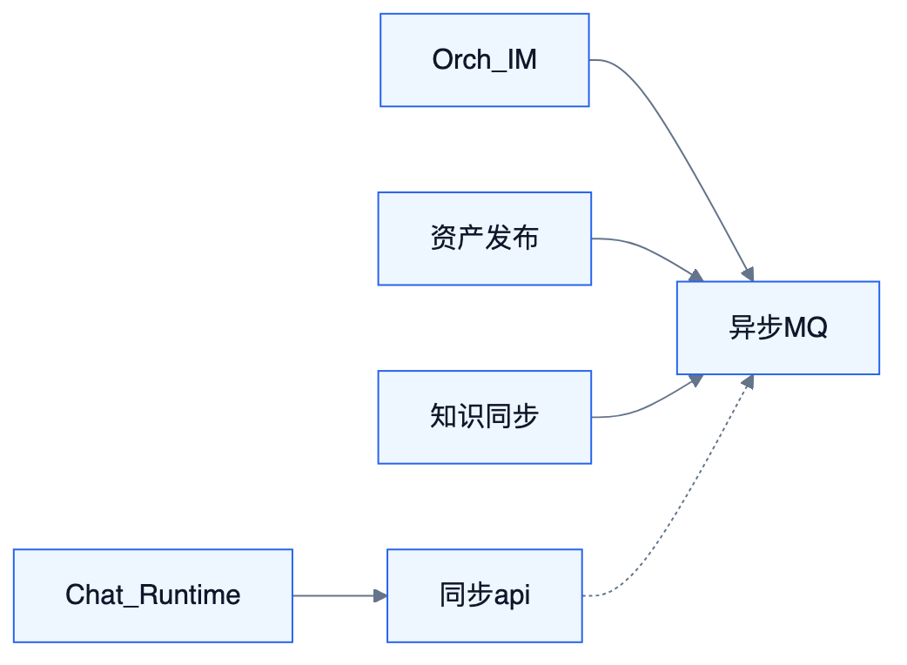

# 接口与数据总表

<!-- DIAGRAMS:BEGIN -->

## 图形（飞书可见：PNG + 文本绘图）

> **飞书正文**：下方 **PNG 图**（push 时自动上传）+ **文本绘图**（等宽字符，一定可见）。
> **本地可编辑**：`.drawio` 源文件；不要依赖 Mermaid 代码块在飞书里渲染（目前不可见）。

### 同步 API 与异步 MQ



文本绘图：

```
Chat/Runtime ──同步 api──┐
Orch/IM / 资产发布 / 知识 ──异步 MQ─┘
```

- 可编辑源：[mgmt-api-mq.drawio](../diagrams/mgmt-api-mq.drawio)

<!-- DIAGRAMS:END -->

> 分系统字段级细节以各 S 篇第 6–8 章为准。本文提供**跨系统索引**。

## 1. API 目录

### 1.1 runtime-api（S1）

| 接口 | 方法 | 说明 |
| --- | --- | --- |
| RuntimeSessionApi | create, append, steer, cancel, get, listEvents | 会话 |
| RuntimeStream | SSE | Part 流 |
| RuntimeToolQueryApi | listTools | 工具清单 |

### 1.2 orchestration-api（S2）

| 接口 | 方法 | 说明 |
| --- | --- | --- |
| OrchEventApi | emit | 幂等事件 |
| OrchRunApi | claim, heartbeat, submitResult, cancel | 领活 |
| OrchAttentionApi | list, get, answer, resolve | 人审 |
| OrchRuleApi | publish, getReleased | 规则 |
| OrchWhyApi | timeline | 审计 |

### 1.3 chat-api（S3）

| 接口 | 方法 | 说明 |
| --- | --- | --- |
| ConversationApi | CRUD, fork, archive | 会话 |
| MessageApi | appendUser, list | 消息 |
| ChatCardApi | answerInteractive | continue 卡 |
| ChatStream | SSE | 会话流 |

### 1.4 knowledge-api（S4）

| 接口 | 方法 | 说明 |
| --- | --- | --- |
| KnowledgeBaseApi | CRUD | 库 |
| DocumentApi | upload, list, get, delete | 文档 |
| IngestApi | reparse, status | 入库 |
| RetrievalApi | search | 检索 |
| CitationApi | resolve | 引用 |
| KnowledgeSyncApi | bind, syncNow | 同步门面 |

### 1.5 flow-api（S5）

| 接口 | 方法 | 说明 |
| --- | --- | --- |
| FlowDefinitionApi | save, publish, rollback | 定义 |
| FlowRunApi | start, get, cancel | 运行 |
| FlowPublishApi | asTool, asHttpEndpoint | 发布 |

### 1.6 connector-api（S6）

| 接口 | 方法 | 说明 |
| --- | --- | --- |
| FeishuImApi | sendCard, sendText | IM |
| FeishuDocSyncApi | mapping, syncNow, jobs | 文档同步 |
| McpAdminApi | register, refresh | MCP（详设迁至 S12） |
| BizIngress | HTTP | 业务入站 |

### 1.7 model-api（S10）

| 接口 | 方法要点 |
| --- | --- |
| ProviderApi | 供应商 CRUD、凭证引用 |
| LogicalModelApi | 逻辑模型目录 |
| BindingApi | Provider×Model 部署绑定 |
| RoutingPlanApi | 发布路由计划、启停 |
| ModelRouterQuery | 运行时选模（内部） |

### 1.8 agent-mgmt-api（S11）

| 接口 | 方法要点 |
| --- | --- |
| AgentApi / AgentVersionApi | CRUD、发布、回滚、diff |
| AgentBindingApi | route/mcp/skill/flow/tool |
| AgentPolicyApi | sandbox、approval |
| AgentValidateApi | 启用前依赖检查 |

### 1.9 mcp-mgmt-api（S12）

| 接口 | 方法要点 |
| --- | --- |
| McpServerApi | 登记 HTTP/stdio、认证、启停 |
| McpDiscoveryApi | tools/list 刷新、缓存 |
| McpGrantApi | 授权 Agent/角色 + 工具过滤 |
| McpOutboundApi | Tioka 作为 MCP Server 出口 |

### 1.10 skill-mgmt-api（S13）

| 接口 | 方法要点 |
| --- | --- |
| SkillImportApi / SkillVersionApi | 导入、发布、回滚 |
| SkillBindApi | Agent 绑定与 mode |
| SkillMarketApi | 上架 |

### 1.11 flow-mgmt-api（S14）

| 接口 | 方法要点 |
| --- | --- |
| FlowDraftApi / FlowReleaseApi | 草稿、校验、发布版本 |
| FlowPublicationApi | API/Tool/MCP/Webhook 通道 |
| FlowOpsApi | 运行实例运维 |

## 2. Tool 命名（Runtime 可见）

| 工具 | 提供方 |
| --- | --- |
| `kb.search` / `kb.read_*` | Knowledge ToolProvider |
| `flow.run:{flowId}` | Flow Publisher |
| MCP 原名（加前缀策略） | Connector McpToolProvider |
| 内置 shell/fs（若启用） | Runtime builtin + 策略 |

## 3. MQ Topic / Tag 总表

| Topic | Tag 示例 | 生产者 |
| --- | --- | --- |
| tioka-runtime | turn.*, part.appended, attention.requested | runtime |
| tioka-orch | event.*, run.*, attention.* | orch |
| tioka-chat | message.*, conversation.* | chat |
| tioka-knowledge | ingest.*, document.*, sync.* | knowledge |
| tioka-flow | run.*, definition.published | flow |
| tioka-connector | im.*, doc.sync.*, mcp.* | connector |
| tioka-model | plan.published, binding.* | model |
| tioka-agent | agent.published, binding.changed | agent-mgmt |
| tioka-mcp | server.*, tools.refreshed, grant.* | mcp-mgmt |
| tioka-skill | skill.published, skill.bound | skill-mgmt |
| tioka-flow | definition.published, publication.changed | flow-mgmt |

## 4. 核心实体索引

| 实体 | 系统 | 主键语义 |
| --- | --- | --- |
| Session | S1 | sessionId |
| Run / WorkItem / Attention | S2 | runId / workItemId / attentionId |
| Conversation / Message / Part | S3 | conversationId / messageId |
| KnowledgeBase / Document / Chunk / Citation | S4 | 各域 ID |
| FlowDefinition / FlowRun | S5 | flowId+version / runId |
| DocSyncMapping / SyncJob | S6 | mappingId / jobId |
| Provider / LogicalModel / RoutingPlan / Binding | S10 | planId / bindingId |
| Agent / AgentVersion | S11 | agentId / version |
| McpServer / McpGrant | S12 | serverId / grantId |
| SkillPackage / SkillBinding | S13 | skillId / bindingId |
| FlowPublication / FlowDraft | S14 | publicationId / draftId |

## 5. Message Part Schema（摘要）

```json
{
  "type": "interactive_card|approval_card|citation|tool_call|...",
  "mode": "continue|suspend",
  "payload": {}
}
```

完整 JSON Schema 将落在 `platform` 契约包（待 ADR）。

### 1.7 model-api（S10）

| 接口 | 说明 |
| --- | --- |
| ModelProviderApi / ModelCatalogApi | 接入与目录 |
| DecisionModelApi | 决策模型连接 |
| RoutingPlanApi | 路由草稿/发布/启停 |
| RouteBindingApi | 绑定 Agent/Preset/节点 |
| ModelRouterApi | Runtime select / sticky / failover |
| RoutingObserveApi | 时间线与成本 |

### 1.8 foundation-api / system-api（S9）

| 接口 | 说明 |
| --- | --- |
| AuthApi | SSO 登录地址、回调、登出、刷新 |
| RbacApi | 鉴权 check、角色授予 |
| UserApi / OrgApi | 用户组织查询 |
| WorkspaceApi | 空间与成员 |
| AdapterAdminApi | 适配器注册启停探测 |
| IntegrationBindingApi | 客户 IM/业务实例绑定 |
| ScimApi | SCIM Users/Groups |
| ServiceAccountApi / ApiKeyApi | 机器身份 |

## 6. 错误码段

| 段 | 系统 |
| --- | --- |
| 1xxx | runtime |
| 2xxx | orch |
| 3xxx | chat |
| 4xxx | knowledge |
| 5xxx | flow |
| 6xxx | connector |
| 7xxx | foundation/IAM |
| 9xxx | gateway |
