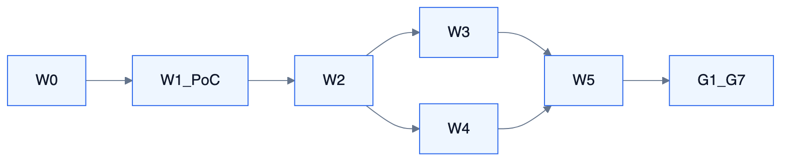

# 发布与运维

<!-- DIAGRAMS:BEGIN -->

## 图形（飞书可见：PNG + 文本绘图）

> **飞书正文**：下方 **PNG 图**（push 时自动上传）+ **文本绘图**（等宽字符，一定可见）。
> **本地可编辑**：`.drawio` 源文件；不要依赖 Mermaid 代码块在飞书里渲染（目前不可见）。

### 波次与门禁



文本绘图：

```
W0 契约骨架 → W1 PoC Gate → W2 Orch+IM
                 ├─→ W3 Knowledge ─┐
                 └─→ W4 Flow ──────┴→ W5 密度/HA → G1–G7
```

- 可编辑源：[impl-waves.drawio](../diagrams/impl-waves.drawio)

<!-- DIAGRAMS:END -->

## 1. 文档发布（飞书知识库）

权威本地目录：`<repo>/feishu-docs/Tioka/`

```bash
S=~/.cursor/skills/feishu-docs/scripts/feishu.mjs
cd <Tioka 仓库根>

node $S doctor
node $S ensure Tioka          # 补齐 S0–S8 等节点
node $S push Tioka            # 全量
node $S push Tioka --only sys-runtime,sys-orch
node $S status Tioka
```

| 规则 | 说明 |
| --- | --- |
| 改设计 | 改对应 S 篇或管理面 md → push |
| 飞书有人改 | 先 pull 再合并，或 `--force` |
| 凭证 | `~/.cursor/skills/feishu-docs/credentials.json` 软链 DSH |

知识库：项目空间 · 项目主页见 status 输出链接。

## 2. 应用部署（目标态）

详见 **S8**。摘要：

| 形态 | 用途 |
| --- | --- |
| tioka-server 单体 | 开发 |
| 按域 server-* | 生产扩缩 |

依赖：PostgreSQL、Redis、MQ、对象存储、向量存储。

## 3. 配置与密钥

- 模型/飞书 Secret → 凭证服务  
- 禁止提交 `credentials.json`  
- 租户级 FeishuBinding / McpServerBinding 走管理面  

## 4. 观测与告警（目标）

| 信号 | 动作 |
| --- | --- |
| Run 连续失败 | 页告警 + IM |
| Attention 超时 | 升级通知 |
| 入库/同步失败 | 知识管理员队列 |
| Worker 租约丢失 | 值班 |

Trace 字段：tenantId, sessionId, runId, toolCallId, syncJobId。

## 5. 回滚

- 应用镜像回滚  
- Flow/Rule 版本回滚  
- 飞书发布面：本地 md `--force` push  

## 6. 分期门禁

| 门禁 | 条件 |
| --- | --- |
| 详设评审 | S0–S8 评审通过（ADR-007） |
| P0 | modules 骨架 + ArchUnit |
| M1 | 黄金用例 1–3 |
| M2 | 黄金用例 4–5 |
