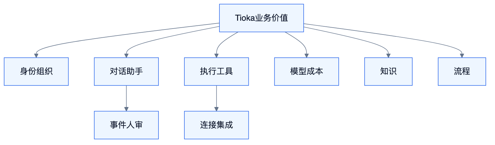
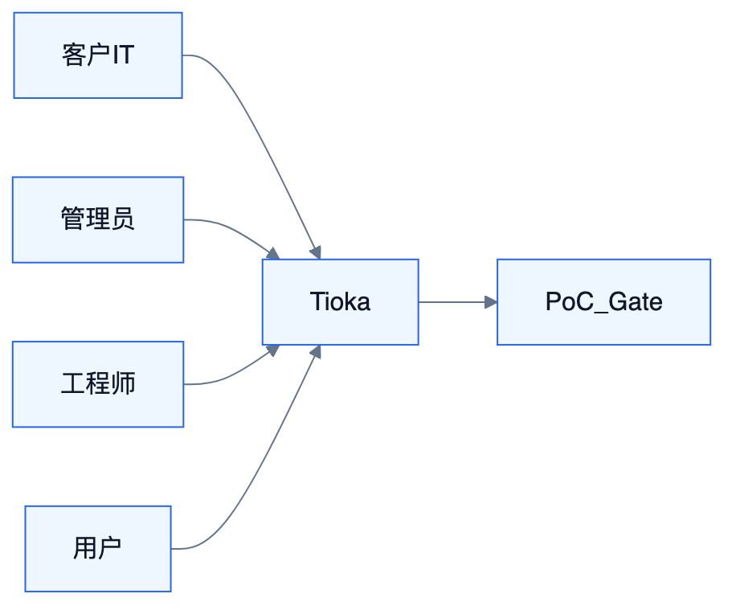
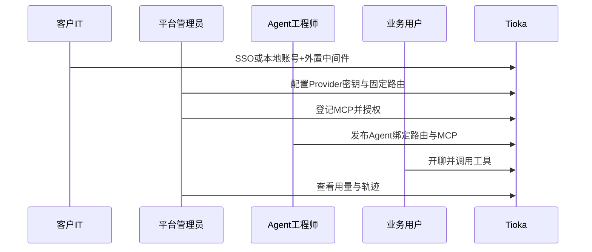

# BA — Tioka 业务架构

<!-- DIAGRAMS:BEGIN -->

## 图形（飞书可见：PNG + 文本绘图）

> **飞书正文**：下方 **PNG 图**（push 时自动上传）+ **文本绘图**（等宽字符，一定可见）。
> **本地可编辑**：`.drawio` 源文件；不要依赖 Mermaid 代码块在飞书里渲染（目前不可见）。

### 业务能力地图



文本绘图：

```
[ Tioka 业务价值 ]
     ┌────┬────┬────┬────┬────┐
   身份  对话  执行  模型  知识  流程
          │              │
        人审            连接/治理
```

- 可编辑源：[ba-capability-map.drawio](../diagrams/ba-capability-map.drawio)

### PoC Gate 路径



文本绘图：

```
客户IT ──SSO/中间件──┐
管理员 ──模型+MCP────┼──→ Tioka ──演示达标──→ PoC Gate
工程师 ──发布Agent───┤
用户   ──对话+工具───┘
```

- 可编辑源：[ba-poc-sequence.drawio](../diagrams/ba-poc-sequence.drawio)

<!-- DIAGRAMS:END -->

> 回答：谁在什么场景下创造什么业务价值；业务能力如何映射到系统。  
> 权威能力清单仍以 S0 / 需求文档为准；本文不砍范围。

---

## 1. 定位与边界

| 内 | 外 |
| --- | --- |
| 业务能力地图、价值链、角色矩阵、端到端场景、主数据业务归属 | 表结构 DDL（见 DA） |
| 组织与运营模型假设 | UI 像素（见 FE） |
| 非功能业务约束（合规、驻留、私有化） | 框架版本细节（见 TA/EA） |

---

## 2. 业务愿景与价值主张

**Tioka** = 企业可私有化部署的 Agent 应用套件 + 运行/治理中台：把「对话、知识、流程、编排、模型与工具资产」收成可审计、可接入客户 IdP/IM/业务系统的统一能力。

| 价值 | 对谁 | 可验证结果 |
| --- | --- | --- |
| 缩短 Agent 上线周期 | Agent 工程师 / 平台管理员 | 从配置到可用对话 < 约定时长（PoC Gate） |
| 人机协同闭环 | 值班/运营 | 审批卡 → 续跑可追踪（why） |
| 知识可引用 | 业务用户 / 知识管理员 | 回答带 Citation |
| 流程可发布 | 流程搭建者 | Flow → API/Tool/MCP |
| 私有化可接入 | 客户 IT | SSO + 外置中间件 + Adapter |

---

## 3. 业务能力地图（L1→L2）

```
BC1 身份与组织运营
  L2: 联邦登录 / 组织同步 / 空间与授权 / 服务账号
BC2 对话与助手运营
  L2: 会话 / Agent 发布 / 提示与人设 / 分享与市场
BC3 执行与工具运营
  L2: 运行会话 / 工具与 MCP / Skill / 沙箱与审批升级
BC4 模型与成本运营
  L2: 供应商接入 / 路由计划 / 用量与成本 / 故障接力
BC5 知识运营
  L2: 入库解析 / 检索问答 / 同步源 / 评测 / Wiki
BC6 流程运营
  L2: 画布编排 / 调试 / 发布通道 / 运行运维
BC7 事件与人审运营
  L2: 规则 / 工单 Run / 审批台 / IM 续办 / 溯源
BC8 连接与集成运营
  L2: IM / 业务 Adapter / 数据源 / MCP 出口
BC9 治理与合规运营
  L2: 配额 / 审计 / 多环境 / 内容安全 / 资产目录
BC10 平台工程运营
  L2: 发布部署 / 观测 / 备份 / 空气间隙
```

映射：BC1→S9；BC2→S3/S11/S7；BC3→S1/S12/S13；BC4→S10；BC5→S4；BC6→S5/S14；BC7→S2/S7；BC8→S6；BC9→S8/S9/资产面；BC10→S8。

---

## 4. 角色与职责（RACI 摘要）

| 角色 | 主责业务能力 | 关键动作 |
| --- | --- | --- |
| 终端业务用户 | BC2/BC5 | 提问、点卡片、看引用 |
| 值班/运营 | BC7 | 审批、升级、批量处理 |
| Agent 工程师 | BC2/BC3/BC4 | 配 Agent、MCP、路由、看轨迹 |
| 知识管理员 | BC5 | 库、同步、评测 |
| 流程搭建者 | BC6 | Studio、发布 |
| 平台管理员 | BC1/BC4/BC9 | 租户、配额、模型、审计 |
| 客户 IT/IAM | BC1/BC10 | IdP、中间件、网络策略 |
| 集成商 | BC8 | Adapter 开发上架 |
| 安全合规 | BC9 | 密钥、留存、SIEM |

---

## 5. 端到端业务场景（泳道级）

### 5.1 PoC 黄金路径（商业 Gate）

对应实施计划 **W1 Exit / PoC Gate**（见 31）。总览图见文首 **图形 → PoC Gate 路径**（`ba-poc-sequence.drawio`）。



1. IT 配置 SSO（或开本地账号）与模型 Key  
2. 管理员登记 MCP HTTP Server，授权给 Agent  
3. 工程师发布 Agent（指令 + RoutingPlan + MCP）  
4. 用户开聊 → 流式回答 → 工具调用可见  
5. 管理员在观测中看到模型与用量  

### 5.2 人审闭环

事件/对话触发 Run → `approval_card` 挂起 → 审批台或 IM 处理 → 续跑 → why 可查。

### 5.3 知识引用问答

管理员入库/同步 → 用户提问 → Agent 调 kb.search → Citation 展示 → 可点回原文。

### 5.4 Flow 发布为工具

搭建者画布发布 Flow-as-Tool → Agent 挂载 → 用户对话触发 FlowRun → 运维可重跑。

### 5.5 私有化接入

客户 IdP + 外置 PG/Redis/MQ → 官方或自研 IM Adapter → 断公网时仅本地模型。

---

## 6. 组织与运营模型假设

- **租户 / Workspace**：逻辑隔离；一份部署可多空间。  
- **资产所有权**：Agent/MCP/Skill/Flow/KB 归属 Workspace；跨空间分享显式授权。  
- **变更治理**：生产发布（Agent/路由/Flow）可配审批；审计不可关在 prod。  
- **值班模型**：Attention 队列 + SLA/超时升级（Orch）。

---

## 7. 主数据业务归属

| 主数据 | 业务 Owner | 系统 of Record |
| --- | --- | --- |
| 用户/组织 | 客户 IAM / 平台管理员 | S9（同步后） |
| Workspace/角色 | 平台管理员 | S9 |
| Provider/LogicalModel/Plan | 模型管理员 | S10 |
| Agent/Skill/MCP 登记 | Agent 工程师 | S11–S13 |
| KB/Document | 知识管理员 | S4 |
| Flow 定义 | 流程搭建者 | S5/S14 |
| 会话/消息 | 终端产生 | S3（非主数据，操作数据） |
| Run/Attention | 运营 | S2 |

---

## 8. 业务规则与约束（摘要）

1. 分期不砍能力（ADR-009）。  
2. 外部系统不得直连 biz；经 Connector/Adapter。  
3. Agent 生产只绑已发布 RoutingPlan（ADR-011/012）。  
4. 出网与密钥受治理；空气间隙可强制本地模型。  
5. 人机双模式：continue 卡 vs suspend 审批卡语义不可混。

### 8.1 业务非目标（与 ADR-009 Out 对齐）

- 不承诺成为基模训练/微调平台。  
- 不以外部云 Agent 托管替换自研执行内核作为交付形态。  
- 不运营第三方品牌应用市场（可有自有模板市场）。

---

## 9. 业务 KPI（建议）

| KPI | 定义 |
| --- | --- |
| TTF-Agent | 新建到首次成功对话 |
| 人审 TAT | Attention 创建到解决 |
| 引用率 | 含 Citation 的回答占比 |
| 工具成功率 | tool_result 成功/总调用 |
| 单位会话成本 | Token+供应商费用 |
| Adapter 健康 | 失败率/熔断次数 |

---

## 10. 与其他架构册关系

- 能力→系统映射驱动 **AA**  
- 场景 NFR 驱动 **TA**  
- 主数据归属驱动 **DA**  
- 角色导航驱动 **FE**  
- 波次交付见 **30/31**
