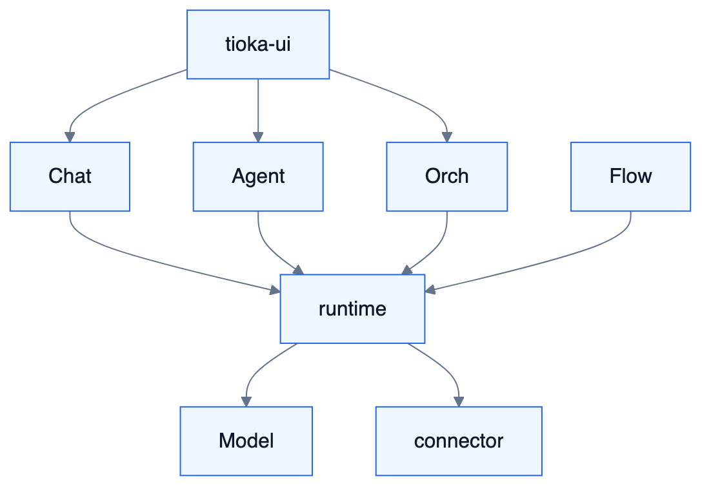

# AA — Tioka 应用与集成架构

<!-- DIAGRAMS:BEGIN -->

## 图形（飞书可见：PNG + 文本绘图）

> **飞书正文**：下方 **PNG 图**（push 时自动上传）+ **文本绘图**（等宽字符，一定可见）。
> **本地可编辑**：`.drawio` 源文件；不要依赖 Mermaid 代码块在飞书里渲染（目前不可见）。

### 应用交互总图



文本绘图：

```
tioka-ui ──REST/SSE──→ chat / agent / orch
                              │
                         runtime-api ←── flow
                              │
                    model-api + connector(出网)
```

- 可编辑源：[aa-app-interaction.drawio](../diagrams/aa-app-interaction.drawio)

<!-- DIAGRAMS:END -->

> 回答：应用如何切分、如何通过 API/MQ/Webhook/MCP 协作；外部系统如何接入。

---

## 1. 应用边界（逻辑应用）

| 应用 | 对应模块 | 对用户价值 |
| --- | --- | --- |
| 身份基座 | system/foundation | 登录、权限、空间、SPI |
| 模型中台 | model | 选模与成本 |
| 执行内核 | runtime | Agent 循环 |
| 编排中心 | orchestration | 事件、人审、工单 |
| 对话应用 | chat | 会话产品 |
| 知识应用 | knowledge | 入库检索 |
| 流程应用 | flow | 编排发布 |
| 连接中心 | connector | 出网与同步 |
| 资产控制台 | agent/mcp/skill + flow-mgmt | 配置发布 |
| HCI 壳 | tioka-ui | 统一入口 |

部署上 W0–W2 可同进程；逻辑边界不因合部而消失。

---

## 2. 应用交互总图

```
                    ┌──────── tioka-ui ────────┐
                    │ REST/SSE                 │
                    └──────────┬───────────────┘
         ┌─────────────────────┼─────────────────────┐
         ▼                     ▼                     ▼
   chat-api              agent/model/mcp         orch-api
         │                     │                     │
         └──────────► runtime-api ◄── flow-api ──────┘
                         │
              model-api / Tool SPI
                         │
         knowledge-api ◄─┴─► connector（出网唯一）
```

异步：各域发 MQ，消费者刷新缓存、驱动 Orch、通知 UI（经订阅或轮询 Attention）。

---

## 3. 同步集成模式

| 模式 | 用法 | 示例 |
| --- | --- | --- |
| 本地/RPC 调用 `-api` | 要返回值的用例 | Chat→Runtime.create |
| REST 对外 | 客户/前端/Webhook | Flow Publication API |
| SSE | 流式 Part | Chat/Runtime stream |
| MCP HTTP | 工具协议 | S12 Client / Outbound Server |
| OIDC 回调 | 登录 | S9 |

**禁止**：biz 直接 new 其他 biz；UI 直连数据库。

### 3.1 幂等与追踪头（同步）

| Header | 含义 |
| --- | --- |
| `X-Idempotency-Key` | 写接口幂等（创建会话、发消息、发布资产等） |
| `X-Request-Id` / `traceparent` | 追踪；与 OTel 对齐 |
| `X-Workspace-Id` | 显式空间（亦可从令牌解析，二者冲突以令牌为准） |

---

## 4. 异步集成（MQ）

Topic 前缀 `tioka-*`（见接口总表）。约定：

- 消息体含 `eventId`、`tenantId`、`workspaceId`、`occurredAt`、`payloadVersion`  
- Tag 细分生命周期；消费者幂等  
- 失败进 DLQ；提供重放 API/工具  

典型链路：

1. `agent.published` → Runtime/Chat 缓存失效  
2. `attention.requested` → HCI/IM 通知  
3. `ingest.completed` → 可通知订阅方  
4. `definition.published` → ToolRegistry 注册 Flow Tool  

---

## 5. 外部系统接入架构

### 5.1 IdP / 组织

`AuthApi` ← OIDC/SAML；`ScimApi` / OrgSync Adapter → `sys_*`。

### 5.2 模型供应商

仅 **model-biz** 适配器出站；凭证 SecretStore；统一经 ModelRouter。

### 5.3 MCP

- **入站 Client**：管理面登记 → Runtime ToolProvider 调用  
- **出站 Server**：Tioka 暴露 KB/Flow/受控工具；API Key/OIDC  

### 5.4 IM

`ImChannelAdapter` SPI；官方飞书等在 connector；消息卡片规范对齐 FE/S7。

### 5.5 业务系统

`BizSystemAdapter`：Webhook 入 Orch；出站写回工单/业务 API。

### 5.6 数据源（知识）

Connector 同步作业 → Knowledge ingest；不在 knowledge-biz 写死飞书 SDK。

---

## 6. 反腐层与 DTO

- 外部 JSON → connector 防腐 → 内部 DTO/领域事件  
- 前端只看稳定 REST/SSE 契约（BFF 可先由 server 直接提供）  
- Part payload 版本化；未知 type 降级为 `status/error` 文本  

---

## 7. 集成安全

| 通道 | 控制 |
| --- | --- |
| 用户 API | Session/JWT + RBAC |
| 服务账号 | API Key / mTLS（可选） |
| Webhook | 签名 + 时间窗 |
| MCP | Header/OAuth；Grant 范围 |
| IM | 平台验签；租户绑定 |

---

## 8. 错误与重试语义

- 同步：业务错误码段（按域）；不重试 4xx；5xx 由调用方短重试  
- 异步：有限重试 + DLQ  
- 工具调用：Runtime 策略（次数/人工）  

---

## 9. 与波次

W1：Chat-Runtime-Model-MCP 同步主链；W2：Orch/IM MQ；W3：SyncJob；W4：Publication/MCP Out；W5：多 IM/多 Adapter。

---

## 10. 相关

接口总表、S6、S9、S12、TA、EA。
