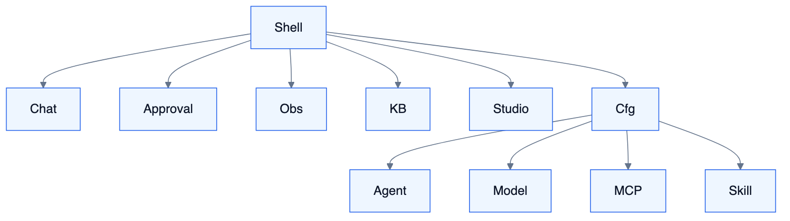
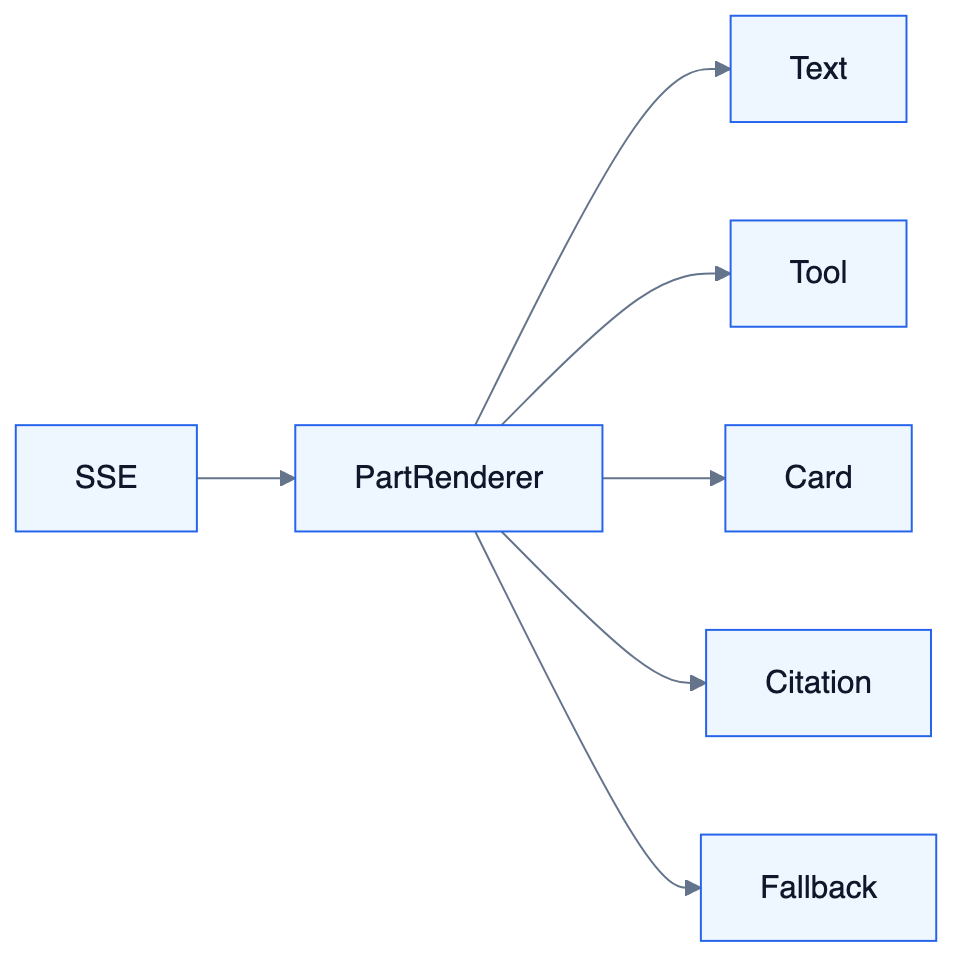
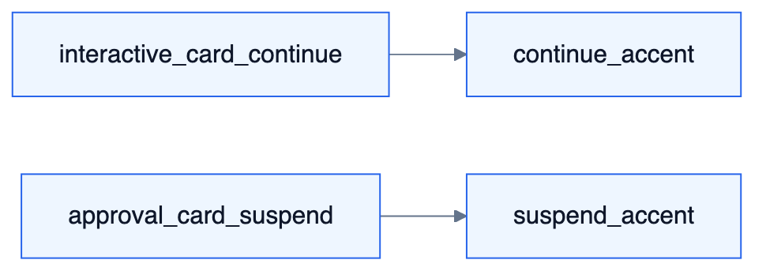

# FE — Tioka 前端架构

<!-- DIAGRAMS:BEGIN -->

## 图形（飞书可见：PNG + 文本绘图）

> **飞书正文**：下方 **PNG 图**（push 时自动上传）+ **文本绘图**（等宽字符，一定可见）。
> **本地可编辑**：`.drawio` 源文件；不要依赖 Mermaid 代码块在飞书里渲染（目前不可见）。

### 信息架构导航



文本绘图：

```
Shell
├── Chat / Approval / Obs / KB
├── Studio
└── Cfg → Agent / Model / MCP / Skill
```

- 可编辑源：[fe-ia-nav.drawio](../diagrams/fe-ia-nav.drawio)

### Part 渲染体系



文本绘图：

```
SSE → PartRenderer → Text | Tool | Card | Citation | Fallback
```

- 可编辑源：[fe-part-renderer.drawio](../diagrams/fe-part-renderer.drawio)

### 双卡片可感知差异



文本绘图：

```
[interactive_card · continue]     [approval_card · suspend]
     对话内继续、不挂起 Run              挂起 Attention / 审批台
   --card-continue-accent            --card-suspend-accent
```

- 可编辑源：[fe-dual-card.drawio](../diagrams/fe-dual-card.drawio)

<!-- DIAGRAMS:END -->

> 回答：前端技术栈、应用拆分、信息架构、Part/HCI 渲染体系、与后端契约。  
> 产品交互能力地图见 S7；本文定**工程与框架设计**。

---

## 1. 目标与原则

1. **一套壳多工作台**：Chat / 审批 / 知识 / Studio / 配置 / 观测。  
2. **Part 唯一渲染源**：`packages/parts`；禁止业务页私建平行气泡协议。  
3. **契约驱动**：Part Schema + OpenAPI；未知 Part 降级展示。  
4. **权限与路由同源**：菜单/按钮码对齐 S9 RBAC。  
5. **可私有化换肤**：CSS 变量主题；不强绑公有云字体 CDN。

---

## 2. 技术选型（冻结）

| 项 | 选择 | 说明 |
| --- | --- | --- |
| 框架 | Vue 3.4+ + TypeScript | Composition API |
| 构建 | Vite 5+ | |
| 状态 | Pinia | 会话流、审批队列、用户会话 |
| 路由 | Vue Router 4 | 按工作台拆分 |
| UI 基线 | Element Plus（可裁） | 配置台/表格；Chat 自研气泡 |
| 样式 | CSS Variables + SCSS | 禁止默认堆紫光皮肤；租户可覆盖 |
| HTTP | Axios / fetch 封装 | 统一错误码 |
| SSE | `@microsoft/fetch-event-source` 或原生 | Chat/Runtime 流 |
| 画布 | **Vue Flow**（W4）；`studio-kit` 抽象隔离 | 禁止页面直依赖；可替换实现 |
| 单测 | Vitest + Vue Test Utils | Part 组件必测 |
| E2E | Playwright | PoC/黄金路径 |

对齐 RuoYi-Vue-Pro：**布局、权限指令、登录页可借鉴**；对话与 Part **不**复用其业务 CRUD 模板当 Agent UI。

---

## 3. 仓库与包结构

```
tioka-ui/
├── apps/web/                 # 主 SPA
│   ├── src/views/            # 工作台页面
│   ├── src/layouts/          # 壳：侧栏+顶栏
│   ├── src/stores/
│   ├── src/api/              # 后端客户端
│   └── src/router/
├── packages/
│   ├── parts/                # Part 渲染器（唯一）
│   ├── chat-kit/             # 会话列表、输入箱、工具轨迹
│   ├── studio-kit/           # 画布封装（W4）
│   ├── config-kit/           # 配置台表单片段
│   └── shared/               # 主题、权限指令、hooks
└── package.json (pnpm workspace)
```

---

## 4. 信息架构（IA）

### 4.1 主导航（随波次生长）

| 导航 | 波次 | 权限域 |
| --- | --- | --- |
| 对话 | W1 | chat:use |
| 审批 | W2 | attention:handle |
| 观测 | W2 | observability:read |
| 知识 | W3 | kb:* |
| 流程 Studio | W4 | flow:edit |
| 配置 | W1+ | 见下 |

### 4.2 配置台子导航

**推荐顺序（心智模型：先 Agent 后工具）**：Agent（S11）→ 模型路由（S10）→ MCP（S12）→ Skill（S13）→ 空间用户角色（S9）→ 通道/Adapter → 配额审计。  
W2 预留知识/流程入口灰显或隐藏（功能开关）。

### 4.3 PoC 必达（对齐 31）

会话列表、Agent 选择器、流式气泡、MCP/Agent/模型配置入口。

---

## 5. Part 渲染体系

```
SSE/API Part JSON
    → PartRenderer（按 type 分发）
        → TextPart / MarkdownPart / ThinkingPart
        → ToolCallPart / ToolResultPart
        → CitationPart / ArtifactPart / ...
        → InteractiveCardPart（continue）
        → ApprovalCardPart（suspend）
        → FallbackPart（未知 type）
```

规范：

- `mode: continue | suspend` 视觉与文案必须可区分（W2-23）  
- 设计令牌：`--card-continue-accent` vs `--card-suspend-accent`（色相分离，不只靠文案）  
- 卡片提交走统一 `ChatCardApi` / Attention API  
- 工具轨迹默认可折叠；错误态明确  
- **移动**：审批台 W3 起响应式列表+底部操作；Chat 输入区固定底栏  

组件 props 以 schema 生成类型（`packages/parts` 导出 TS 类型）。

---

## 6. 状态与数据流

| Store | 职责 |
| --- | --- |
| `session` | 登录用户、权限码、空间 |
| `conversation` | 当前会话消息、流式缓冲 |
| `agentCatalog` | 可用 Agent 列表 |
| `attention` | 待办计数与列表 |
| `workspaceConfig` | 功能开关 |

流式：专属 `streamBuffer`；完成后再规范化进消息列表，避免频繁深拷贝。

不引入过重全局 event bus；跨页用 Pinia + 路由 query。

---

## 7. 与后端契约

| 通道 | 用途 |
| --- | --- |
| REST | CRUD、发布、配置 |
| SSE | Chat/Runtime Part 流 |
| 未来 WS | 可选；不作为 W1 依赖 |

错误码：映射友好提示；401 统一登出；403 无权限空态。  
BFF：初期 server 直出；若出现聚合页过重再加 Node BFF（非必须）。

---

## 8. 关键页面模块

| 模块 | 路由示例 | 依赖包 |
| --- | --- | --- |
| ChatWorkbench | `/chat/:id?` | chat-kit + parts |
| ApprovalDesk | `/approvals` | parts |
| ModelAdmin | `/admin/models` | config-kit |
| AgentAdmin | `/admin/agents` | config-kit |
| McpAdmin | `/admin/mcp` | config-kit |
| KnowledgeDesk | `/kb/*` | W3 |
| FlowStudio | `/studio/:flowId` | studio-kit W4 |
| Observability | `/obs/*` | W2 |

---

## 9. 主题、品牌、无障碍

- CSS 变量：`--color-bg` `--color-accent` `--font-sans` …  
- 租户可覆盖；默认**避免** AI 八股紫渐变皮肤  
- 暗色可选 W4  
- a11y：焦点序、卡片键盘可操作；i18n 骨架 W3+  

---

## 10. 安全（前端）

- Token 存 HttpOnly Cookie 优先；若 localStorage 须防 XSS  
- Markdown 渲染消毒（DOMPurify）  
- 不在前端落密钥；Secret 只走引用  
- Embed Widget（W4）独立入口与 CSP  

---

## 11. 性能

- 路由级 code split  
- 长会话虚拟列表（W2+）  
- Part 列表按消息窗口渲染  
- Studio 大图懒加载节点  

---

## 12. 测试与门禁

- Part 各 type 快照/交互测  
- PoC E2E：登录→选 Agent→对话→工具轨迹  
- HCI 走查：双卡片、引用点击、Studio 三态（对齐 31）  

---

## 13. 波次

| 波次 | 前端交付 |
| --- | --- |
| W0 | 壳、登录、空布局 |
| W1 | Chat + 配置三入口 + Part 基础集 |
| W2 | 审批、观测、双卡片、Skill 导航 |
| W3 | 知识台、引用联动、移动适配起步 |
| W4 | Studio、发布向导、市场壳 |
| W5 | 产物中心、协作、主题完善 |

---

## 14. 相关

S7、S3、BA 角色、31 HCI 任务、TA 选型。
