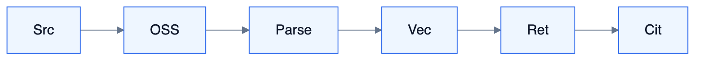

# S4 — Knowledge 知识域（完整能力）

<!-- DIAGRAMS:BEGIN -->

## 图形（飞书可见：PNG + 文本绘图）

> **飞书正文**：下方 **PNG 图**（push 时自动上传）+ **文本绘图**（等宽字符，一定可见）。
> **本地可编辑**：`.drawio` 源文件；不要依赖 Mermaid 代码块在飞书里渲染（目前不可见）。

### 入库与引用



文本绘图：

```
Src → OSS → Parse → Vec → Retrieve → Citation
```

- 可编辑源：[s4-knowledge-pipeline.drawio](../../diagrams/s4-knowledge-pipeline.drawio)

<!-- DIAGRAMS:END -->

> 对标：WeKnora 知识平台能力并集（RAG + Agent 推理 + Wiki + 数据源 + 评测）

---

## 1. 定位与边界

企业知识中台：接入、理解、索引、检索、引用、Wiki/图谱、评测；对 Runtime 暴露工具；对 Chat/Flow/IM 提供问答。解析与外部同步经管道与 S6。

---

## 2. 完整能力地图

| 能力簇 | 具体能力 | 对标 WeKnora | 波次 |
| --- | --- | --- | --- |
| **库类型** | 文档库、FAQ 库、Wiki 库、混合空间 | KB types | W3–W5 |
| **目录** | 文件夹树、标签、元数据、置顶 | folder/tags | W3 |
| **接入** | 上传、URL、目录、手写 MD、批量 | upload | W3 |
| **数据源同步** | 飞书知识库/云盘、Notion、Confluence、语雀、钉钉文档、GitLab、RSS、IMA、Seafile… | datasources | W3–W5 |
| **解析** | PDF 版式、OCR、Office、HTML、EPUB、表格、图片 VLM、音频 ASR；多引擎可配 | docreader | W3–W5 |
| **分块** | 固定/父子/自适应；按批次 process_config；reparse | chunking | W3 |
| **分块治理** | 在线编辑 chunk、版本、diff、回滚 | chunk edit | W4 |
| **索引** | 向量、BM25、多向量、多模态 embedding | hybrid index | W3 |
| **检索** | 混合、RRF、Rerank、改写、扩展、意图分流 | retrieval | W3–W4 |
| **GraphRAG** | 实体关系、图谱检索增强 | Neo4j graph | W5 |
| **引用** | 可点击溯源、多片段、权限过滤 | citations | W3 |
| **问答模式** | 快速 RAG；智能 ReAct（多步+工具） | QA + agent | W3–W4 |
| **Wiki** | 自动生成主题页、链接、编辑、版本 | Wiki mode | W5 |
| **技能/沙箱** | 知识 Agent 用 Skills 与沙箱分析数据 | skills | W4–W5 |
| **数据分析** | CSV/Excel SQL 分析工具 | data_analysis | W4 |
| **评测** | 召回/BLEU/ROUGE、评测集、回归 | evaluation | W4–W5 |
| **对外** | API Key、MCP Server、站点 Embed、IM 问答 | channels | W4–W5 |
| **权限** | 库/文档 ACL、组织共享、审计 | RBAC | W3 |
| **任务治理** | 入库队列、Worker 池、进度面板 | task queue | W3 |

---

## 3–14. 结构摘要

实体：KnowledgeBase、Document、Chunk、IngestJob、DataSource、WikiPage、Entity/Relation、EvalSuite、Citation。  
工具：`kb.search/read/list/ask/wiki_search/data_analysis`。  
波次：W3 主链；W4 评测/对外/分析；W5 Wiki/图谱/全数据源矩阵。
