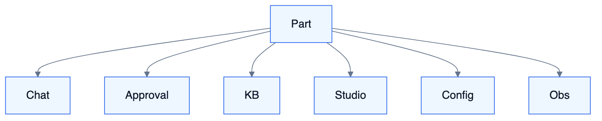

# S7 — HCI 人机交互（完整能力）

<!-- DIAGRAMS:BEGIN -->

## 图形（飞书可见：PNG + 文本绘图）

> **飞书正文**：下方 **PNG 图**（push 时自动上传）+ **文本绘图**（等宽字符，一定可见）。
> **本地可编辑**：`.drawio` 源文件；不要依赖 Mermaid 代码块在飞书里渲染（目前不可见）。

### 交互面与 Part



文本绘图：

```
Part → Chat | Approval | KB | Studio | Config | Obs
```

- 可编辑源：[s7-hci-surfaces.drawio](../../diagrams/s7-hci-surfaces.drawio)

<!-- DIAGRAMS:END -->

> 对标：LibreChat 全 UI + 飞书级交互卡片 + IDE Agent 轨迹 + Langflow Studio + WeKnora 工作台

---

## 1. 定位与边界

一等产品系统：所有人对 Agent/知识/流程/治理的交互面与 Part 渲染规范。无独立业务真相，状态在各域。

---

## 2. 完整能力地图

| 能力簇 | 具体能力 | 对标 | 波次 |
| --- | --- | --- | --- |
| **Chat 工作台** | 会话列表、流式气泡、模型/Agent 选择、停止/重试/编辑、附件、多模态预览 | LibreChat | W1–W3 |
| **工具轨迹** | 逐步展开、参数/结果、耗时、批准操作 | IDE/LibreChat | W1–W2 |
| **Thinking** | 可折叠推理过程 | — | W1 |
| **交互卡片** | 单选/多选/表单/步进向导/表格选择/日期/上传 | Generative UI | W2–W4 |
| **审批台** | 待办/已办/超时/批量/筛选/升级展示 | 企业审批 | W2 |
| **IM 延伸** | 卡片样式规范、深链回 Web、流式卡片更新 | 飞书卡片 | W2–W3 |
| **Steer/分叉/回滚** | 运行中插话；历史分叉；检查点回滚 UI | WeKnora/LibreChat | W2–W4 |
| **产物中心** | Artifacts、解释器文件、跨会话产物 | artifacts | W3–W5 |
| **观测台** | why 时间线、Token/费用、队列、同步任务、Trace 跳转 | autoloop why + APM | W2–W5 |
| **Flow Studio** | 完整画布 UX、Playground、发布向导 | Langflow | W4–W5 |
| **知识工作台** | 库/树/上传/解析进度/chunk 编辑/评测/同步源 | WeKnora UI | W3–W5 |
| **配置台** | 租户、用户、Agent、Skill、模型、MCP、规则、通道、配额 | AgentCore/RuoYi | W1–W4 |
| **提示词与市场** | 提示词库、Agent 市场浏览安装 | LibreChat | W4–W5 |
| **协作** | 分享会话、评论、@同事 | — | W4 |
| **无障碍与国际化** | a11y、多语言 | WeKnora i18n | W3–W5 |
| **嵌入** | 站点 Embed Widget、SDK | WeKnora embed | W4–W5 |
| **移动适配** | 响应式 Chat/审批；PWA（可选） | — | W3–W5 |
| **主题与品牌** | 租户主题、暗色（可选） | — | W4 |

### Part 渲染完整集

`text/markdown/thinking/tool_*/citation/artifact/code_interpreter/interactive_card/approval_card/form_wizard/image/audio/file_ref/agent_handoff/status/error` — 全部有组件规范，禁止业务面私建平行渲染。

---

## 3–14. 结构摘要

`packages/parts` 唯一；apps/web 多路由。  
波次：W1 Chat 基础；W2 卡片/审批/观测起步；W3 知识台/移动；W4 Studio/市场/嵌入；W5 产物与协作完善。
