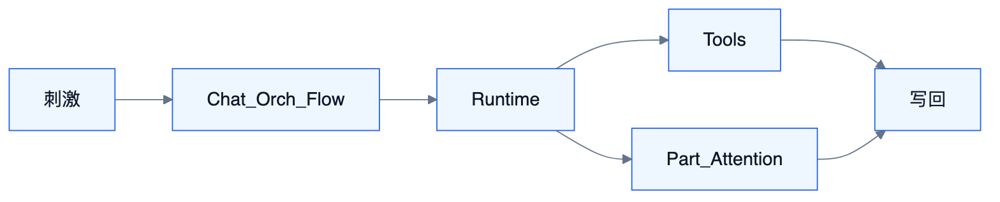
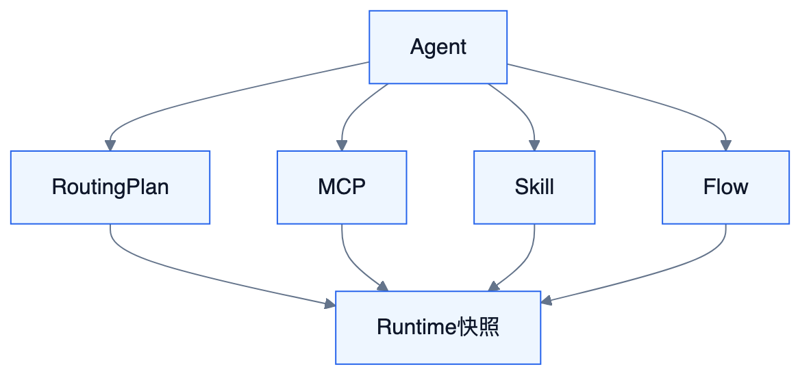

# S0 — 体系总览与边界

<!-- DIAGRAMS:BEGIN -->

## 图形（飞书可见：PNG + 文本绘图）

> **飞书正文**：下方 **PNG 图**（push 时自动上传）+ **文本绘图**（等宽字符，一定可见）。
> **本地可编辑**：`.drawio` 源文件；不要依赖 Mermaid 代码块在飞书里渲染（目前不可见）。

### 系统级生命周期



文本绘图：

```
刺激(用户/事件/IM) → Chat|Orch|Flow → Runtime Session
                         → Tools(KB/Flow/MCP)
                         → Part/Attention
                         → 写回 Chat/IM/业务/知识
```

- 可编辑源：[s0-lifecycle.drawio](../../diagrams/s0-lifecycle.drawio)

### 资产挂载关系



文本绘图：

```
Agent(S11)
  ├── RoutingPlan(S10)
  ├── McpGrant(S12)
  ├── SkillBinding(S13)
  └── FlowPublication(S14)
         └── Runtime 只读已发布快照
```

- 可编辑源：[s0-asset-mount.drawio](../../diagrams/s0-asset-mount.drawio)

<!-- DIAGRAMS:END -->

> **能力原则**：Tioka 产品范围按**完整企业级 Agent 套件**定义，对标 LibreChat + Langflow + WeKnora + autoloop/superagent + harness 级执行内核 + AgentCore 级治理的能力并集。  
> **分期只排序，不阉割**：下文 W0–W5 是交付波次，未排到的能力仍在范围内，必须进 backlog 与详设，禁止用「MVP 不做」删除。

---

## 1. 定位与边界

### 1.1 产品是什么

Tioka = **企业级 Agent 应用套件 + 运行中台 + 治理平台**：

| 层 | 职责 | 完整能力对标 |
| --- | --- | --- |
| HCI | 全交互面与 Generative UI | LibreChat 壳 + 飞书级卡片 + IDE 轨迹 |
| Chat | 对话、Agent、附件、分支、记忆 | LibreChat |
| Flow | 可视化编排、组件生态、发布 | Langflow |
| Knowledge | 知识工程、Wiki、图谱、评测 | WeKnora |
| Orchestration | 事件驱动、人审、自治工单 | autoloop / dsh-superagent |
| Runtime | 模型↔工具循环、沙箱、子 Agent（**经 S10 取模**） | Codex / DeepSeek harness |
| **Model Hub** | **模型目录、智能路由、决策模型、发布绑定、成本观测** | **HiRoute** |
| Connector | MCP/官方 IM/业务/数据源的**官方实现** | dsh-feishu + WeKnora 数据源 |
| **Foundation** | **身份联邦、组织同步、RBAC、企业适配 SPI、私有化** | IAM/SCIM + RuoYi + AgentCore |
| Governance | 租户/空间、资产、配额、审计、模型治理 | AgentCore（落在 S8/S9） |

### 1.2 硬边界（架构约束，不是功能阉割）

| 允许 | 禁止 |
| --- | --- |
| 自研全部运行时与产品面 | 把外部 harness/云 AgentRun 当执行依赖 |
| 借鉴任意开源的能力清单与协议 | biz 直连外部 SDK（必须经 connector） |
| 外部系统：MCP、IM、业务系统、飞书开放平台 | 事件正文决定路由/权限 |
| 模块可合可拆 | `*-biz` 互依 |

### 1.3 本文不写

表字段 DDL 全量、像素稿、云账号合同。

---

## 2. 完整能力地图（平台级）

### 2.1 能力域总表

| 域 | 完整能力（均在产品范围内） |
| --- | --- |
| **执行 Runtime** | Turn/Step Loop；流式；Tool/MCP/Skill；沙箱与审批；压缩；SubAgent/Team；fork/resume；Job/终端；ACP；**执行用量上报（选模归 S10）** |
| **模型中台 Model** | 供应商接入；通用/决策模型；固定/难度/分支/免费优先路由；发布启停；同轮冻结与故障接力；Agent 绑定；路由时间线与成本 |
| **编排 Orch** | 多源事件；规则版本与灰度；WorkItem/Ticket；并行与合并；Run 租约；人审/通知；定时与 later；回执 emits；hops 熔断；事件溯源/why/stream；交付流水线式长任务；Mandate/订阅扇出 |
| **Chat** | 多端点/多模型/预设；Agent 市场与分享；Skills；MCP；代码解释器；联网搜索；多模态；文件对话；Artifacts；分支/编辑/重试；长期记忆；提示词库；分享链接；SSO |
| **Knowledge** | 多类型库（文档/FAQ/Wiki）；多格式解析（OCR/VLM/ASR/表格）；混合检索+Rerank+GraphRAG；引用溯源；分块编辑与版本；多数据源同步；Agent 推理问答；评测；对外 MCP Server / Embed / IM 问答 |
| **Flow** | 可视化编辑；丰富节点库；自定义节点；Agent/Tool Mode；Playground；发布 API/MCP/Embed；多 Agent 流；版本/协作；观测对接 |
| **HCI** | 工作台/审批/观测/配置/Studio/知识台；Part 全类型；对话内卡片与向导；Steer/分叉/回滚；产物中心；移动与 IM 延伸 |
| **Connector** | MCP Client+Server；官方 IM（飞书/钉钉/企微等）；飞书办公套件；业务 Webhook；数据源矩阵；**实现 Foundation 的 Adapter SPI** |
| **Foundation（平台基座）** | SSO（OIDC/SAML/CAS/LDAP）；组织/SCIM 同步；RBAC+数据权限；Workspace；**客户自有 IM/业务/审计/通知/密钥库适配器**；服务账号与 API Key；私有化/空气间隙；客户自备中间件 |
| **治理 / 资产控制面** | Agent/MCP/Skill/Flow/模型资产目录与发布；配额限流；内容安全；多环境；审计（与 Foundation 打通）— 详设 **S10–S14** |

### 2.2 对标映射（能力要齐，实现自研）

| 对标产品 | 映射到 Tioka |
| --- | --- |
| LibreChat | S3 + S7 + Runtime Skills/MCP/解释器 |
| Langflow | S5 + Runtime Agent 节点 |
| WeKnora | S4 + S6 数据源 + S7 知识台 |
| agent-autoloop / superagent | S2 + S6 IM |
| Codex / dsh harness | S1 |
| **HiRoute** | **S10 模型管理与智能路由** |
| AgentCore | S9 Foundation + 资产治理 |
| 企业 IAM/SCIM | S9 |
| dsh-feishu | S6（官方 Adapter 实现） |
| 客户自有 IM/业务中台 | S9 SPI + S6/自定义 Adapter 包 |

### 2.3 明确「不在范围内」的只有

- 成为模型训练平台 / 基础模型厂商  
- 绑定单一云厂商专有 Agent 托管为唯一运行时  
- 复制某开源的品牌与商标资产  

（功能密度对齐是目标；代码依赖不是。）

---

## 3. 领域模型（跨系统统一语言）

| 术语 | 归属 | 定义 |
| --- | --- | --- |
| Session / Turn / Step / SubAgent | Runtime | 执行上下文 |
| Event / Rule / WorkItem / Run / Mandate | Orch | 调度与授权 |
| Attention | Orch + HCI | 人机闸门 |
| Conversation / Message / Part / Memory | Chat | 对话与记忆 |
| KnowledgeBase / Document / Chunk / WikiPage / Citation | Knowledge | 知识资产 |
| FlowDefinition / Node / FlowRun / Publication | Flow | 工作流 |
| Binding / SyncJob / McpServer | Connector | 外部连接 |
| Workspace / Role / ExternalIdentity / AdapterRegistration | Foundation | 平台基座 |
| Agent / McpServer / SkillPackage / FlowPublication | 资产控制面 S11–S14 | 可发布智能体与工具资产 |
| LogicalModel / Provider / RoutingPlan / Binding | Model Hub S10 | 模型与路由 |
| Quota | Governance | 配额 |

**Part 完整类型（全局唯一，可扩展但需登记）**  
`text | markdown | thinking | reasoning_summary | tool_call | tool_result | citation | artifact | code_interpreter | interactive_card | approval_card | form_wizard | status | error | image | audio | file_ref | agent_handoff`

---

## 4. 组件与包结构

见 **S8 / S9**。逻辑模块：`system` + `foundation` + `infra/runtime/orchestration/chat/knowledge/flow/connector` + `tioka-ui`。

---

## 5. 系统级生命周期

```
刺激（用户/事件/定时/IM/数据源）
 → Chat 或 Orch 或 Flow 触发
 → Runtime Session（可 SubAgent）
 → Tools：KB / Flow / MCP / 沙箱 / 业务
 → 人机：Part 卡片 或 Attention 挂起
 → 写回 Chat / IM / 业务 / 知识 / Wiki
```

---

## 6–7. API / MQ 原则

- 跨模块只依赖 `-api`；生命周期走 MQ。  
- 契约变更走版本字段；总表见「接口与数据总表」，分册见各 S。

---

## 8–9. 数据与安全原则

- 分 schema；禁止跨库 join。  
- 多租户 RBAC；出网仅 connector；指令/资料分离。

---

## 10. 依赖

```
HCI → 各域 API
Chat/Flow/Orch → Runtime
Runtime → ModelRouter(S10) → 供应商/本地模型
Runtime ← ToolProviders（KB/Flow/MCP/沙箱）
S10 ← 决策模型 / 启发式（选组，不执行业务）
Knowledge ↔ Connector（同步）
Connector → Orch.emit / Knowledge.ingest
Foundation(S9) → 全域鉴权/组织/适配器
客户 IdP/组织/IM/业务/SIEM ←→ Foundation Adapters
```

---

## 11–12. 失败与可观测

至少一次语义；全链路 Trace；成本与配额计量；各域错误码段保留。

---

## 13. 验收（完整能力门禁，分波次累计）

| 门禁 | 必须同时满足的能力簇 |
| --- | --- |
| G1 执行面 | 工具、MCP、流式、Steer、Cancel（模型经路由） |
| G1b 模型面 | 接入目录、固定/智能路由、发布绑定、同轮不换模、故障接力、成本时间线 |
| G2 人机面 | 双卡片、审批台、IM、轨迹、分叉 |
| G3 知识面 | 多格式入库、混合检索、引用、至少 3 类数据源、评测骨架 |
| G4 编排面 | 事件规则、挂起续跑、why、定时、并行 |
| G5 编排面+Flow | 节点库≥约定清单、发布 API+Tool+MCP、Playground |
| G6 治理面 | 资产目录、配额、审计策略、多环境 |
| G7 企业接入面 | SSO 联邦、组织同步、RBAC/数据权限、客户 IM Adapter、业务 Adapter、外置中间件、断公网可用 |

---

## 14. 交付波次（全量排序）

| 波次 | 主题 | 仍属完整范围的内容（本波交付） |
| --- | --- | --- |
| W0 | 契约与骨架 | Part Schema、modules、**Foundation SPI+本地 RBAC** |
| W1 | 执行+对话+企业登录+管模 | Runtime + Chat + S9 SSO + **S10 固定路由** |
| W2 | 编排+人审+IM+智能路由 | Orch + 双卡片 + IM + **难度分流/决策模型/观测** |
| W3 | 知识完整主链 | 解析矩阵起步、检索、引用、飞书同步、评测骨架 |
| W4 | Flow 完整主链 | Studio、核心节点库、发布三形态 |
| W5 | 密度对齐 | 子 Agent/Team、Wiki/图谱、解释器/Artifacts、组件扩展、多 IM、HA |

各 S 篇第 2 章列出该域**全量能力清单**；第 14 章只标波次，不删条目。

## 文档索引（层级）

完整树见项目主页。本册所属：**03-能力域详设 / 总览与基座**。

| 子组 | 编号 |
| --- | --- |
| 总览与基座 | S0 · S8 · S9 |
| 执行与编排 | S1 · S2 |
| 产品与交互 | S3 · S4 · S5 · S7 |
| 连接器 | S6 |
| 模型与资产控制面 | S10 · S11 · S12 · S13 · S14 |
| 企业架构（02） | BA · TA · DA · AA · EA · FE |
| 实施交付（04） | 30 · 31 · 32 |

```
资产挂载关系（管理态）
  Agent(S11)
    ├── RoutingPlan(S10)     # 默认/场景路由
    ├── McpGrant(S12)        # HTTP/stdio Server + 工具过滤
    ├── SkillBinding(S13)    # manual/auto/always
    └── FlowPublication(S14) # Flow-as-Tool
  Runtime(S1) 只读已发布快照装载，不直接改管理配置
```
