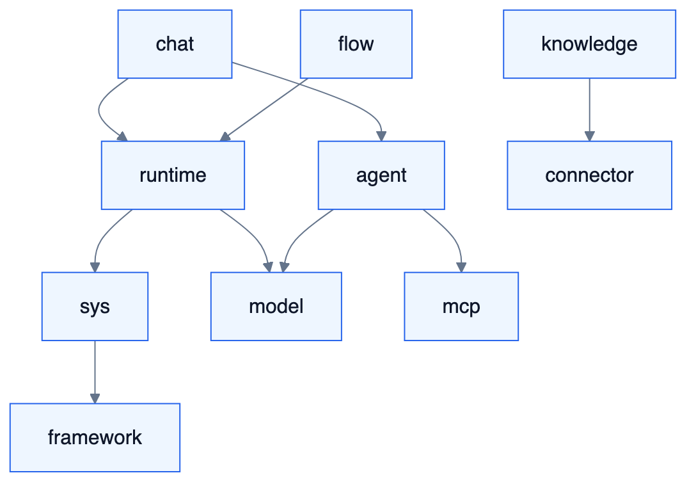

# S8 — 工程、部署与治理落地（完整能力）

<!-- DIAGRAMS:BEGIN -->

## 图形（飞书可见：PNG + 文本绘图）

> **飞书正文**：下方 **PNG 图**（push 时自动上传）+ **文本绘图**（等宽字符，一定可见）。
> **本地可编辑**：`.drawio` 源文件；不要依赖 Mermaid 代码块在飞书里渲染（目前不可见）。

### 模块依赖（工程视角）



文本绘图：

```
framework ← system-api ← model / runtime / agent / mcp
                ↑
     chat / orch / flow / knowledge / connector  (只依赖 *-api)
```

- 可编辑源：[ea-module-deps.drawio](../../diagrams/ea-module-deps.drawio)

<!-- DIAGRAMS:END -->

> 对标：RuoYi 工程化 + AgentRun 运维可观测思路（自建）  
> **身份/RBAC/企业适配器详见 S9**；本文侧重构建、部署、中间件与资产治理工程落地。

---

## 1. 定位与边界

工程骨架、多模块部署、环境与 SRE、Agent/模型等**资产治理**的工程承载。  
**企业 IAM、组织同步、RBAC 详设、客户 IM/业务 SPI → S9。**

---

## 2. 完整能力地图

### 2.1 工程与部署

| 能力簇 | 具体能力 | 波次 |
| --- | --- | --- |
| Maven 多模块 | modules/api/biz、BOM、framework | W0 |
| 单体/拆分 | 合部与按域 server | W0–W5 |
| RPC | 本地→Feign/Dubbo 统一演进 | W0–W3 |
| MQ | 主题规范、DLQ、重放工具 | W0–W2 |
| 配置中心 | 多环境、热更新（规则/开关） | W2–W4 |
| CI/CD | 编译、ArchUnit、契约、镜像、发布 | W0–W2 |
| K8s/Compose | 本地 compose；生产 Helm/编排 | W3–W5 |
| 多环境 | dev/test/stage/prod 隔离 | W2 |
| HA | 无状态扩缩、会话粘性可选、DB/MQ HA | W5 |
| 备份恢复 | DB/对象存储/密钥演练 | W4–W5 |

### 2.2 资产与模型治理（与 S9 配合）

| 能力簇 | 具体能力 | 波次 |
| --- | --- | --- |
| Agent 资产 | 模板、版本、上下线（授权点走 S9 RBAC） | W2 |
| Skill 资产 | 导入/市场/签名 | W2–W4 |
| 模型治理 | 连接、目录、Fallback、限流、成本 | W1–W4 |
| 凭证引用 | 对接 S9 SecretStoreAdapter | W1 |
| 配额 | Token/并发/存储/工具调用 | W2–W4 |
| 内容安全 | 输入输出审核钩子 | W3–W5 |
| 合规导出 | 对接 S9 AuditSink；留存策略 | W4–W5 |

### 2.3 私有化中间件（客户自备）

| 能力 | 说明 | 波次 |
| --- | --- | --- |
| 外置 PostgreSQL / Redis / MQ / OSS | 连接客户已有基础件 | W1 |
| 前缀/库隔离 | 多空间共享集群时的命名空间 | W2 |
| 不强制捆绑云厂商 | 纯私有化包 | W0 |

### 2.3 可观测与运维

全链路 Trace、业务大盘、成本大盘、告警、值班、容量规划 — 全部在范围内（W2 起建，W5 完备）。

---

## 3–10. 模块树与依赖

同前：`tioka-modules/*`；biz 禁互依；依赖矩阵见历史 S8 表（保持有效）。  
编译期/运行时规则不变。

---

## 11–14. 失败·观测·测试·波次

ArchUnit + 契约 + 黄金 E2E + 混沌（可选 W5）。  

| 波次 | 内容 |
| --- | --- |
| W0 | 骨架、CI、契约包 |
| W1–W2 | 租户 RBAC、单体可运行、基础观测 |
| W3–W4 | 拆分部署、配置中心、配额成本 |
| W5 | HA、多活准备、完备 SRE |

---

## 附录 — 全局交付波次（平台）

| 波次 | 平台主题 |
| --- | --- |
| W0 | 契约 + 工程骨架 + 文档权威（本套 S 篇） |
| W1 | Runtime + Chat 主链 + 治理起步 |
| W2 | Orch + 人审 + IM + MCP Client + 观测起步 |
| W3 | Knowledge 主链 + 飞书文档同步 + 多模态 |
| W4 | Flow Studio 主链 + 发布三形态 + 评测/对外 |
| W5 | 密度对齐：Wiki/图谱/Team/解释器/多 IM/HA/市场 |
