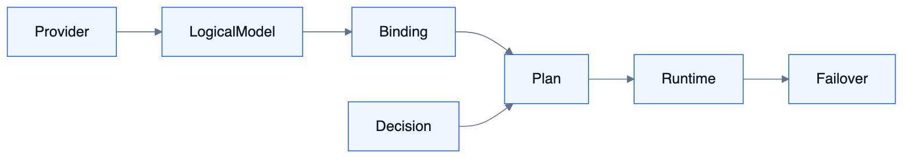

# S10 — 模型管理与智能路由（Model Hub & Routing）

<!-- DIAGRAMS:BEGIN -->

## 图形（飞书可见：PNG + 文本绘图）

> **飞书正文**：下方 **PNG 图**（push 时自动上传）+ **文本绘图**（等宽字符，一定可见）。
> **本地可编辑**：`.drawio` 源文件；不要依赖 Mermaid 代码块在飞书里渲染（目前不可见）。

### 模型路由链路



文本绘图：

```
Provider → LogicalModel → Binding → Plan → Runtime(Failover)
```

- 可编辑源：[s10-routing.drawio](../../diagrams/s10-routing.drawio)

<!-- DIAGRAMS:END -->

> 模块建议：`tioka-module-model`（api + biz）；Runtime 经 **ModelRouter** 取模，禁止各域私连供应商  
> 对标：**HiRoute**（模型接入、通用模型/决策模型、智能路由计划、发布启用、故障接力、会话可观测、Agent 绑定）  
> 约束：能力对齐 HiRoute，**自研实现**，不嵌入 HiRoute 进程（与 ADR-001 一致）  
> 私有化：客户自有 Key、本地模型、企业网关全部可配（与 S9 SecretStore 打通）

---

## 1. 定位与边界

### 1.1 定位

Tioka 的 **模型控制面 + 路由数据面入口**：

| 层 | 职责 |
| --- | --- |
| **模型目录** | 供应商/接入点/模型清单/能力标签/凭证 |
| **智能路由** | 按计划为每次「可切换边界」选择执行模型组与候选顺序 |
| **决策服务** | 难度/任务类别判断（可内置启发式、决策模型、客户扩展） |
| **绑定** | 路由绑定到 Agent / Chat 预设 / Flow LLM 节点 / Orch 默认 |
| **观测** | 实际模型、切换原因、用量、成本、胜任度 |

### 1.2 与 Runtime（S1）分工

| S10 | S1 |
| --- | --- |
| 选哪个 modelRef / 候选链 | 用选定模型跑 Turn/Tool |
| 发布路由计划、草稿不生效 | 执行时只读「已发布路由快照」 |
| 决策模型调用（判断用） | 不负责业务回答（除非被选为执行模型） |

### 1.3 与 Agent / 多供应商（管理口径）

- **一个 LogicalModel** 可挂多个 Provider Binding（同能力多供应商）。  
- **Agent（S11）** 绑定的是 **RoutingPlan**，不是散落的多主模型字段；调试固定 Binding 仅管理员且强审计。  
- 供应商凭证进 SecretStore（S9）；路由发布后 Runtime 只读快照。

### 1.4 边界外

- 不替代 Chat/Agent 产品配置 UI 的全部（S7 消费本域 API；Agent 挂载见 S11）  
- 不做基模训练  
- 不把路由逻辑散落在 Prompt 里（阈值与选组在路由计划）

---

## 2. 完整能力地图（对标 HiRoute）

### 2.1 模型接入与目录

| 能力 | 说明 | 波次 |
| --- | --- | --- |
| 多供应商接入 | OpenAI/Anthropic/Gemini/百炼/DeepSeek/OpenRouter/兼容网关/其他 | W1 |
| 订阅与 API Key | 企业 Key、按空间隔离；走 S9 SecretStore | W1 |
| 本地/私有模型 | vLLM/Ollama/客户内网网关 | W1–W2 |
| 连接测试 | 探测连通与最小补全；「接入就绪」≠ 全量评测 | W1 |
| 模型能力标签 | 工具调用、视觉、音频、长上下文、结构化输出、thinking | W1 |
| 思考/推理开关 | 按模型配置 thinking effort | W2 |
| 扫本机/导入 | 复用已有配置（可选） | W3 |
| 价格与额度 | 单价、日限额、告警 | W2–W3 |

### 2.2 通用模型 vs 决策模型（HiRoute 核心分离）

| 类型 | 职责 | 波次 |
| --- | --- | --- |
| **通用/执行模型（General）** | 回答用户、调工具、完成任务 | W1 |
| **决策模型（Decision）** | 任务难度/类别判断、阶段胜任度评分；**不**代替执行、不选工具 | W2 |
| 决策扩展 | 客户自研决策服务（HTTP SPI） | W3–W4 |
| 启发式规则 | 无决策模型时的本地规则分流 | W2 |

### 2.3 智能路由类型（与 HiRoute 对齐）

| 类型 | 行为 | 波次 |
| --- | --- | --- |
| **固定模型** | 有序候选；能力不满足或不可用则跳过（故障接力） | W1 |
| **按难度分流** | 常规组 vs 主力组；决策/启发式判定；可结合上一阶段评分 | W2 |
| **自定义分支** | 先任务类别（写稿/审稿/编码…），再组内常规/主力 | W2–W3 |
| **免费优先** | 先免费候选，失败再主力兜底或停止 | W2 |

### 2.4 切换边界与稳定性（对齐 HiRoute）

| 规则 | 说明 |
| --- | --- |
| **新用户消息** | 可重新判断路由 |
| **同轮工具续跑** | **冻结**本轮模型选择，避免频繁切换丢 KV cache |
| **上下文压缩/重建** | 允许重新选模 |
| **同组偏好沿用** | 新判断仍同组时，优先沿用上一模型（含故障切到的备用） |
| **开始向客户端吐回答后** | 本回答内不静默换模 |
| **组内故障接力** | 按候选序；常规耗尽可升主力（按计划）；主力耗尽则失败 |

### 2.5 计划生命周期

| 能力 | 说明 | 波次 |
| --- | --- | --- |
| 草稿 / 发布 | 改草稿不影响线上；**发布后生效** | W1 |
| 启用 / 停用 | 仅启用计划接新请求 | W1 |
| 版本与回滚 | 发布版本号、可回滚 | W2 |
| 校验 | 无模型/缺决策连接/非法阈值阻止发布 | W1 |

### 2.6 绑定到 Agent / 产品面

| 绑定对象 | 说明 | 波次 |
| --- | --- | --- |
| Agent 资产 | Agent 启用「模型路由」并选择计划 | W1–W2 |
| Chat 预设 | 会话默认路由 | W1 |
| Flow LLM/Agent 节点 | 节点级覆盖或继承 | W4 |
| Orch 默认 | 无人指定时的执行路由 | W2 |
| 手动覆盖 | 用户本轮强制某模型（权限控制） | W2 |

### 2.6.1 关键关系（回答：多模型 / 多供应商）

**1）Agent 管理时，是不是可以挂多个模型？——可以，而且推荐挂「路由计划」而不是单点模型。**

```
Agent ──(1)──▶ RoutingPlan（智能路由）
                    │
                    ├─ 模型组 A（如「常规」）：候选1 → 候选2 → 候选3
                    ├─ 模型组 B（如「主力」）：候选1 → 候选2
                    └─（分支模式下还有多个任务类别 × 组）
```

| 配置方式 | 含义 |
| --- | --- |
| Agent → **一条**已发布 RoutingPlan | **标准做法**：一条计划内已含多模型候选/多组；运行时按规则选用 |
| Agent → 多条 RoutingPlan（按场景） | 允许：如「编码路由」「写稿路由」，由用户/规则切换默认计划 |
| Agent → 单个 ModelBinding | 等价于「退化的固定路由」（仅 1 个候选）；可用，但不推荐生产 |

因此：**不是**「Agent 只能绑死一个供应商上的一个模型 ID」；而是 **Agent 绑定路由，路由里挂 N 个执行候选（可跨供应商）**。

**2）一个模型是不是可以有多个供应商？——可以。要区分「逻辑模型」与「供应端点」。**

```
LogicalModel（逻辑模型，如「Qwen-Max」「GPT-4o 级」）
    │ 1
    │
    ├─ Deployment / ModelBinding ①  供应商=百炼，endpoint=…，key=…
    ├─ Deployment / ModelBinding ②  供应商=OpenRouter，同能力模型 ID
    └─ Deployment / ModelBinding ③  供应商=客户内网 vLLM 兼容网关
```

| 概念 | 是什么 | 例子 |
| --- | --- | --- |
| **ProviderConnection** | 供应商接入（凭证+Base URL+协议） | 百炼账号 A、Azure OpenAI 订阅 B |
| **LogicalModel** | 产品侧逻辑名/能力画像（可选目录实体） | `enterprise-chat-strong` |
| **ModelBinding（部署）** | 「在某 Provider 上的具体可调用模型」 | 百炼上的 `qwen-max`、OpenRouter 上的 `qwen/qwen-max` |
| **RoutingPlan 候选** | 指向 **ModelBinding**（不是裸供应商） | 候选序：Binding① → Binding② |

因此：

- **同一逻辑能力**可挂 **多个供应商部署**（主备、成本、区域、限流逃生）。  
- **同一供应商**下也可有多个模型 Binding（不同型号）。  
- 路由候选列表里排的是 **Binding**；故障接力时从 Binding① 切到 Binding②，对 Agent 配置无感。

**3）和「用户手动选模型」的关系**

- 默认：跟 Agent 绑定的 RoutingPlan 自动选。  
- 可选：会话里展示「当前计划下的可选 Binding / 组」，用户强制本轮用某一 Binding（需权限）。  
- 强制选择仍走 ModelRouter，便于审计与成本统计。

### 2.7 观测与成本

| 能力 | 说明 | 波次 |
| --- | --- | --- |
| 会话路由时间线 | 类别、组别、实际模型、切换原因 | W2 |
| 用量与成本 | 按模型/路由/Agent/空间聚合 | W2 |
| 胜任度观察 | 阶段评分记录（可仅观测） | W3 |
| 导出 | 成本报表 | W3 |

### 2.8 私有化与企业

| 能力 | 说明 | 波次 |
| --- | --- | --- |
| 客户 Key 不上云 | 密钥仅客户侧 | W0 |
| 企业模型网关 | 兼容 OpenAI 协议的客户网关 | W1 |
| RBAC | 谁可改路由/看成本（S9） | W1 |
| 审计 | 发布路由、绑定变更审计 | W2 |

---

## 3. 领域模型

| 实体 | 定义 |
| --- | --- |
| **ProviderConnection** | 供应商接入点、协议、密钥引用（1 供应商账号可服务多 Binding） |
| **LogicalModel** | 逻辑模型（能力标签、展示名）；**可选**，用于把多供应商部署收拢成一个产品概念 |
| **ModelBinding** | **可调用部署**：ProviderConnection + 上游 modelId + 类型(general/decision) + 价格/限额；路由候选只引用它 |
| **RoutingPlan** | 路由计划：类型、组、阈值、决策方式 |
| **RoutingPlanVersion** | 已发布不可变快照 |
| **ModelGroup** | 常规/主力等组 + **有序 ModelBinding 候选列表** |
| **RouteBinding** | Agent/Preset/节点 → RoutingPlan（可 1 默认 + 多场景计划） |
| **RoutingDecision** | 一次判断：类别、组、选中 Binding、原因 |
| **DecisionService** | 内置连接或自定义扩展端点 |

**基数（必须遵守）**

| 关系 | 基数 |
| --- | --- |
| ProviderConnection : ModelBinding | 1 : N |
| LogicalModel : ModelBinding | 1 : N（跨供应商部署） |
| ModelBinding : 路由候选引用 | 1 : N（可被多个计划引用） |
| Agent : RoutingPlan（默认） | N : 1（每个 Agent 一个默认计划） |
| Agent : RoutingPlan（场景） | N : M（可选多计划，切换默认或按场景选用） |
| 单次 Turn 执行 | 冻结 **1** 个 ModelBinding（同轮工具续跑不换） |

---

## 4. 组件与包结构

```
tioka-module-model-biz
├── catalog/      Provider、ModelArtifact
├── binding/      通用/决策模型绑定与测试
├── routing/      Plan 编辑、发布、启停
├── decision/     Heuristic、DecisionModelClient、ExtensionSpi
├── router/       ModelRouter（供 Runtime 调用）
├── sticky/       同轮冻结、同组沿用策略
├── failover/     候选接力
└── observe/      时间线、成本聚合
```

`ModelRouter.select(ctx) → ExecutionModelRef`  
`ModelRouter.recordUsage(...)`

---

## 5. 状态机与生命周期

### RoutingPlan

`DRAFT → PUBLISHED(enabled|disabled) → 新 DRAFT → PUBLISHED'`

### 单次请求选模

```
请求进入 Runtime
 → 是否处于「同轮工具续跑」？是 → 用冻结模型
 → 否 → 加载 Agent 绑定的已发布计划
 → 固定/免费优先：按候选序选可用
 → 难度/分支：决策服务或启发式 → 选组 → 候选序
 → 能力标签过滤（要工具/视觉等）
 → 返回 modelRef；写入 RoutingDecision
 → 执行失败且可接力 → 下一候选（同轮内按计划）
```

---

## 6. 同步 API 契约

| API | 说明 |
| --- | --- |
| ModelProviderApi | 接入 CRUD、test |
| ModelCatalogApi | 列表、能力、启用 |
| DecisionModelApi | 决策连接 CRUD、test |
| RoutingPlanApi | 草稿保存、validate、publish、enable |
| RouteBindingApi | 绑定 Agent/Preset/Flow 节点 |
| ModelRouterApi | Runtime 内部：select / reportFailure / sticky |
| RoutingObserveApi | 时间线、成本查询 |

OpenAI 兼容网关（可选）：对外暴露「虚拟模型名 = 路由计划」，便于外部工具接入（类 HiRoute Gateway 思路，自研）。

---

## 7. MQ / 事件契约

**Topic：`tioka-model`**

| Tag | 含义 |
| --- | --- |
| `plan.published` | Runtime/绑定方刷新缓存 |
| `binding.changed` | Agent 路由变更 |
| `decision.made` | 可选采样观测 |
| `failover.triggered` | 故障接力 |
| `budget.exceeded` | 额度告警 |

---

## 8. 数据模型

`mdl_provider` `mdl_model` `mdl_binding`  
`mdl_routing_plan` `mdl_routing_version` `mdl_model_group` `mdl_candidate`  
`mdl_route_binding`  
`mdl_routing_decision` `mdl_usage_agg`

发布版本 JSON 快照完整可复现；执行只读 versionId。

---

## 9. 安全与多租户

- Key 仅 SecretStore；UI 不回显。  
- 路由发布需权限 `model:routing:publish`。  
- 强制模型覆盖需更高权限。  
- 决策模型调用计入成本与审计，防滥用。

---

## 10. 与其他系统依赖

| 方向 | 关系 |
| --- | --- |
| S1 Runtime | **唯一**执行入口经 ModelRouter |
| S3 Chat / S5 Flow / S2 Orch | 绑定路由计划 |
| S7 HCI | 模型中心、路由编辑器、会话路由时间线 |
| S9 | 密钥、RBAC、空间隔离 |
| S8 | 成本大盘工程落地 |

**禁止**：chat-biz / flow-biz 直连供应商 SDK。

---

## 11. 失败、重试与幂等

- 候选不可用跳过；全失败返回明确错误码 `7xxx/model`。  
- 决策服务超时 → 可配降级（默认主力组 / 启发式 / 失败）。  
- 发布 validate 失败不覆盖线上 version。  
- select 带 idempotency：同 turnId 重复 select 返回同一冻结结果。

---

## 12. 可观测性

- 路由命中率、组分布、failover 次数、决策延迟、缓存命中影响（标注切换点）  
- 会话页展示「本回合实际模型」与原因码（difficulty/branch/sticky/failover）

---

## 13. 测试与验收

| 用例 | 期望 |
| --- | --- |
| 固定候选接力 | 第一不可用自动第二 |
| 难度分流 | 简单→常规，复杂→主力 |
| 同轮工具续跑 | 不换模 |
| 新用户消息 | 可重新判断 |
| 草稿不生效 | 未发布变更不影响流量 |
| Agent 绑定 | 切换计划后新会话生效 |
| 私有化 Key | 仅客户侧存储 |
| 成本时间线 | 可查实际 model 与 token |

---

## 14. 交付波次

| 波次 | 内容 |
| --- | --- |
| W1 | 目录+接入+固定路由+发布+绑定+Runtime 接入 |
| W2 | 难度分流+启发式+决策模型+粘性/冻结+观测时间线 |
| W3 | 自定义分支+免费优先+胜任度+额度 |
| W4–W5 | 自定义决策扩展、虚拟模型网关、高级成本优化 |

---

## 附录 A — 与 HiRoute 概念对照

| HiRoute | Tioka S10 |
| --- | --- |
| 通用模型 | ModelBinding(type=general) |
| 决策模型 | ModelBinding(type=decision) |
| 智能路由计划 | RoutingPlan + Version |
| 常规/主力组 | ModelGroup |
| 发布更改 / 启用 | publish + enable |
| Agent 模型路由 | RouteBinding |
| 会话路由时间线 | RoutingObserve |
| 自定义扩展 | DecisionExtension SPI |

## 附录 B — 为什么必须独立成域

模型路由涉及**凭证、成本、发布治理、跨 Chat/Flow/Orch 统一**，放在 S1 易变成「执行细节」；独立 S10 才能做到企业级模型中台，并满足私有化客户「统一管模、智能省钱、可审计」。
