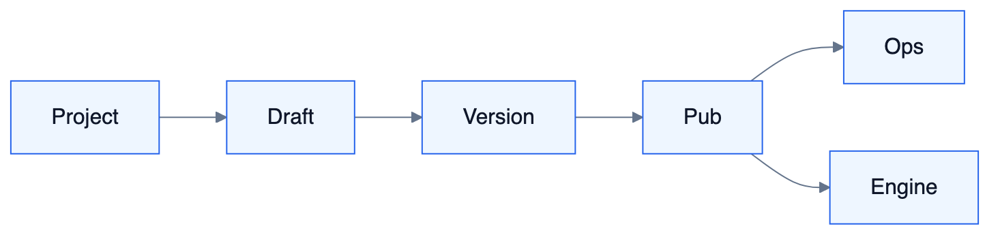

# S14 — 工作流编排管理详细设计

<!-- DIAGRAMS:BEGIN -->

## 图形（飞书可见：PNG + 文本绘图）

> **飞书正文**：下方 **PNG 图**（push 时自动上传）+ **文本绘图**（等宽字符，一定可见）。
> **本地可编辑**：`.drawio` 源文件；不要依赖 Mermaid 代码块在飞书里渲染（目前不可见）。

### Flow 管理控制面



文本绘图：

```
Project → Draft → Version → Pub → Ops / Engine
```

- 可编辑源：[s14-flow-mgmt.drawio](../../diagrams/s14-flow-mgmt.drawio)

<!-- DIAGRAMS:END -->

> 与 **S5（执行与节点能力）** 分工：S5=引擎与节点库能力；**本文=管理控制面**（定义、版本、发布、权限、运维、与 Agent/MCP 挂载）  
> 对标：Langflow 的项目/发布/分享/Playground 管理体验

---

## 1. 定位与边界

| S14 管理面 | S5 执行面 |
| --- | --- |
| Flow 项目、画布元数据、版本、发布通道 | DAG 引擎、节点运行 |
| 权限、目录、模板、导入导出 | 节点 IO、等待人、调 Runtime |
| 运行实例运维（重跑/取消/检索） | 单次执行语义 |

---

## 2. 完整能力地图（管理）

| 能力簇 | 能力项 | 波次 |
| --- | --- | --- |
| **项目空间** | Flow 列表、文件夹、标签、搜索 | W4 |
| **画布编辑** | 保存草稿、自动保存、协作锁（可选） | W4 |
| **校验** | 图合法性、节点配置、凭据引用、模型路由存在性 | W4 |
| **版本** | draft/published；diff；回滚；发布说明 | W4 |
| **Playground** | 调试运行、逐步、看 IO（调 S5） | W4 |
| **发布形态** | ①内部 API ②Flow-as-Tool（挂 Agent）③MCP Tool ④HTTP Webhook ⑤Orch 规则触发 ⑥Embed | W4–W5 |
| **发布治理** | 审批上线（可接 Orch Attention）；环境（dev/prod） | W4–W5 |
| **权限** | flow:edit/publish/run；资源 ACL；运行数据可见性 | W4 |
| **密钥** | 节点内凭据只引用 SecretStore/S10 Binding | W4 |
| **模板** | 租户模板库、从模板创建 | W5 |
| **导入导出** | JSON 图；兼容迁移 | W4 |
| **运行运维** | 实例列表、筛选失败、重跑、取消、导出轨迹 | W4 |
| **告警** | 失败率、等待人超时 | W4 |
| **节点包管理** | 启用官方节点、安装自定义节点包（签名） | W5 |
| **配额** | 并发 FlowRun、节点调用限额 | W4 |

### 2.1 与 Agent / 模型 / MCP 的管理关系

```
Flow 发布为 Tool
  → 登记到 ToolRegistry（名：flow.run:{id}）
  → Agent 管理（S11）勾选挂载
Flow 内 Agent/LLM 节点
  → 配置 RoutingPlan（S10）或继承空间默认
Flow 内 MCP 节点
  → 只能选已启用 McpServer（S12），不可填野 URL
```

---

## 3. 领域模型（管理）

| 实体 | 说明 |
| --- | --- |
| **FlowProject** | 目录归属、所有者 |
| **FlowDefinition** | 逻辑流 ID |
| **FlowDraft** | 可编辑 graph JSON |
| **FlowVersion** | 已发布不可变图+节点配置快照 |
| **FlowPublication** | 通道类型、对外名、环境、状态 |
| **FlowRunRecord** | 运维视图（引用 S5 runId） |
| **FlowTemplate** | 模板 |
| **NodePackage** | 自定义节点包登记 |

---

## 4. 组件结构

```
flow-mgmt（可与 flow-biz 同模块不同包）
├── project/      目录与元数据
├── draft/        保存与锁
├── validate/     静态检查
├── release/      发布版本
├── publish/      API/Tool/MCP/Webhook 通道
├── ops/          Run 检索、重跑
├── template/
└── nodepkg/      节点包启停
```

---

## 5. 生命周期

```
DRAFT → VALIDATE → PUBLISH Version
Version → 创建 Publication(s)（多通道）
Publication ENABLED/DISABLED
Run：由 Publication 或 Playground 触发 → S5 引擎
```

生产 Publication 默认钉死 FlowVersion；开发可「跟随最新」仅限非 prod。

---

## 6. 管理 API

| API | 说明 |
| --- | --- |
| FlowProjectApi | 目录 CRUD |
| FlowDraftApi | save、getGraph |
| FlowValidateApi | validate |
| FlowReleaseApi | publish、rollback、diff |
| FlowPublicationApi | createChannel、enable、rotateSecret |
| FlowOpsApi | listRuns、cancel、rerun |
| FlowTemplateApi | instantiate |
| FlowAgentMountApi | 列出可挂到 Agent 的 Tool 描述 |

---

## 7. MQ

`tioka-flow`（管理相关 Tag）：`definition.published` `publication.changed`  
S11/S12 出口订阅以刷新 Tool/MCP 列表。

---

## 8. 数据模型

`flow_project` `flow_def` `flow_draft` `flow_version`  
`flow_publication` `flow_run_index` `flow_template` `flow_node_package`

graph 存 JSONB + 对象存储备份大图。

---

## 9. 安全

- 发布 prod 需双人/审批（可配）。  
- Webhook 入口验签；Tool 调用走 Agent 身份。  
- 自定义节点包默认签名+沙箱。

---

## 10. 依赖

S5 引擎；S10/S11/S12；S9 RBAC；S2 可选发布审批。

---

## 11–14. 失败 / 观测 / 测试 / 波次

发布校验失败不覆盖线上 Version。  
测试：草稿保存、发布、挂 Agent 可调、Webhook 验签、回滚。  
波次：W4 管理主链；W5 模板/节点包/多通道完备。

---

## 附录 — 管理台信息架构

| 页 | 功能 |
| --- | --- |
| 流程列表 | 搜索、标签、状态 |
| 画布 | 编辑、校验、Playground |
| 版本 | 历史、diff、回滚 |
| 发布 | 通道配置、密钥、启用 |
| 运行 | 实例、失败、等待人 |
| 节点包 | 启用官方/自定义 |
