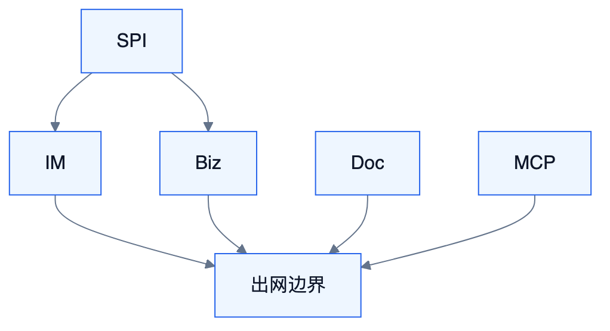

# S6 — Connector 连接器（完整能力）

<!-- DIAGRAMS:BEGIN -->

## 图形（飞书可见：PNG + 文本绘图）

> **飞书正文**：下方 **PNG 图**（push 时自动上传）+ **文本绘图**（等宽字符，一定可见）。
> **本地可编辑**：`.drawio` 源文件；不要依赖 Mermaid 代码块在飞书里渲染（目前不可见）。

### 连接器出网边界



文本绘图：

```
SPI → IM / Biz / Doc / MCP → 出网边界
```

- 可编辑源：[s6-connector.drawio](../../diagrams/s6-connector.drawio)

<!-- DIAGRAMS:END -->

> 对标：dsh-feishu / WeKnora 数据源 / 企业 IM 矩阵 / MCP 网关

---

## 1. 定位与边界

唯一出网与外部协议**实现层**。官方协议实现（飞书/钉钉/MCP…）在本模块；**客户自有 IM/业务系统**通过 **S9 Foundation Adapter SPI** 挂载（可为独立 jar），本模块提供运行时宿主与官方样例。

与 S9 分工：S9 定义 SPI、绑定、身份映射、RBAC；S6 提供协议实现与出站执行。

---

## 2. 完整能力地图

| 能力簇 | 具体能力 | 对标 | 波次 |
| --- | --- | --- | --- |
| **MCP Client** | 多 Server、工具/资源、OAuth、刷新、按 Agent 授权 | MCP | W2–W3 |
| **MCP Server** | 把 Tioka（KB/Flow/会话工具）暴露为 MCP | WeKnora/Langflow MCP | W4–W5 |
| **ImChannelAdapter 宿主** | 加载官方+客户 IM 适配器；统一投递 Attention/卡片 | S9 SPI | W1–W2 |
| **IM 飞书（官方实现）** | 长连接/Webhook、文本/富文本/卡片流式、线程、表情、斜杠命令、审批卡回调 | harness-lark / dsh-feishu-bot | W2–W3 |
| **IM 钉钉/企微（官方）** | 机器人、卡片、回调 | webhook templates | W3–W4 |
| **IM 客户自研（自定义 Adapter）** | 实现 ImChannelAdapter：发消息/验签/用户映射 | 私有化必达 | W2–W3 |
| **IM Slack/Discord/Teams** | 入站出站与卡片 | 多渠道 | W4–W5 |
| **BizSystemAdapter 宿主** | 事件入站、出站回写、作为 Tool 查询 | S9 SPI | W1–W2 |
| **业务通用 HTTP（官方）** | 签名模板、映射 Orch Event | autoloop HTTP | W2 |
| **客户业务中台（自定义）** | 客户 SDK/API 封装为 Adapter 包 | 私有化必达 | W2–W3 |
| **飞书文档** | docx 创建/读写/Markdown↔blocks/导入 | feishu_doc | W3 |
| **飞书 Wiki** | 空间/节点/移动/映射 | feishu_wiki | W3 |
| **飞书云盘** | 目录、上传下载 | feishu_drive | W3 |
| **飞书表格** | Sheet / Bitable / 聚合查询 / 仪表盘 | feishu_sheet/bitable | W4–W5 |
| **飞书消息工具** | Agent 可发消息（受策略） | feishu_message | W3 |
| **身份** | App/User OAuth、auto 回退告警、token 刷新 | dsh-feishu auth | W2–W3 |
| **文档同步** | PUSH/PULL/BIDI、冲突、hash、CI 触发 | feishu-docs skill + WeKnora sync | W3 |
| **知识数据源** | Notion/Confluence/语雀/钉钉文档/GitLab/RSS/Seafile/IMA… | WeKnora sources | W3–W5 |
| **业务 Ingress** | 签名校验、重放保护、映射 Orch Event、幂等 | autoloop HTTP source | W2 |
| **业务 Egress** | 回写 API、重试、出站审计 | — | W3–W4 |
| **浏览器/桌面**（可选连接器） | 受控浏览器自动化入口 | AgentRun browser | W5 |
| **逃生舱** | 受控 raw API 调用（高权限 Agent） | feishu_api | W5 |

---

## 3–14. 结构摘要

分包：mcp/、im/*、feishu-doc/、datasource/、biz/。  
安全：密钥托管、白名单、验签、同步范围。  
波次：W2 IM+业务入站+MCP Client；W3 飞书文档同步+数据源起步；W4–W5 多 IM/Bitable/MCP Server/全数据源。
